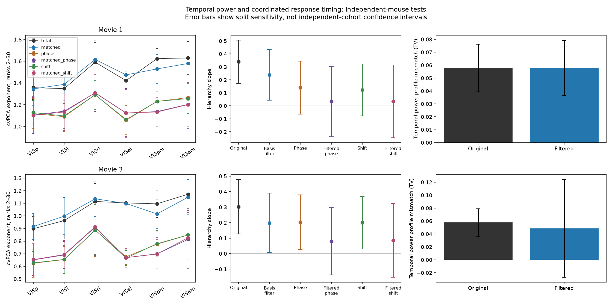
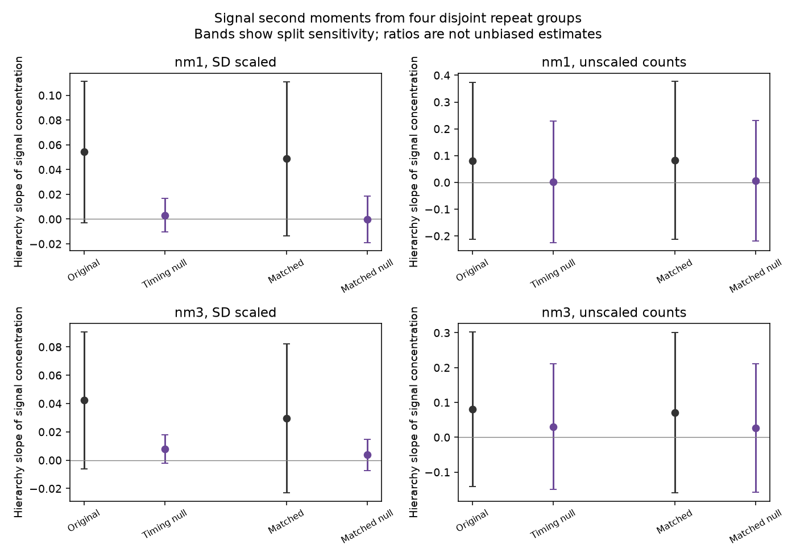
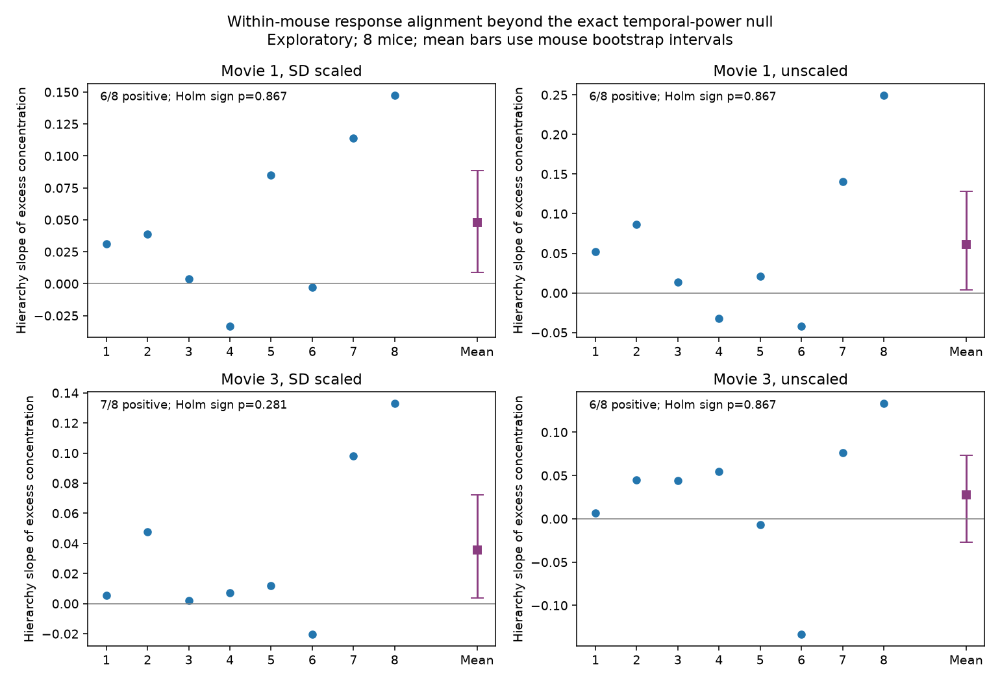

# An exact timing null did not resolve a concentration hierarchy beyond temporal power in eight mouse recordings

## Summary

We tested whether slower response changes explain faster response-spectrum decay in higher mouse visual areas. We used 1,051 selected cells from the first eight Allen Visual Coding BO1.1 sessions by session ID. These sessions came from eight distinct male mice. This is a subset of the earlier cohort, not an independent data set.

We developed an exact timing null for signal concentration. The null keeps each cell's temporal power and repeat-mean reliability fixed. It changes the alignment of responses between cells. Four disjoint repeat groups give a second-moment estimate without fitting PCA axes. We derive its exact mean under independent Fourier phases or circular shifts. The two timing controls have the same mean for this statistic. An efficient implementation avoids neuron-pair matrices for the null mean.

The biological result remains uncertain. In an exploratory within-mouse test, excess concentration rose with hierarchy in 6–7 of 8 mice. Three of four mouse-bootstrap intervals for the mean slope excluded zero. None of four sign tests passed Holm adjustment (adjusted p >=0.281), and unscaled movie three remained unresolved. This suggests a response-alignment component, but does not establish a stable hierarchy beyond temporal power.

A separate attempt to match temporal power with filters learned in other mice reduced fitted alpha slopes. It did not reliably match power in held-out mice. Thus this reduction cannot identify the fraction of compression caused by temporal power. The source of new higher-area dimensions, and its circuit mechanism, remain open.

## Why this test matters

The selected SCI work found faster response-spectrum decay in higher mouse visual areas. Linear VISp read-outs did not explain the movie compression (SCI 831e5770). A single shared mean direction left most of the effect; a broader shared HVA subspace removed more (SCI c6dfdd40). VISp history models did not remove it (SCI fc542281). MICrONS work found a partial smoothing account inside scans (SCI 1f7d0723). Rudelt et al. (2024) found a hierarchy of single-neuron timescales. These results motivate a direct test of temporal response power. They do not show that a single low-pass operation causes population compression.

Fourier surrogate methods are established (Theiler et al., 1992). We do not claim to invent phase randomization or circular shifts. The contribution here is a repeat-aware, exact conditional null for concentration, its fast implementation, and a test of the mouse hierarchy with explicit control-quality checks. This is not another aggregate-spectrum identifiability argument.

## Results

### The timing null has exact invariants

Let Q0,...,Q3 be centered time-by-cell response means from four disjoint repeat groups. Define C01=(Q0^T Q1+Q1^T Q0)/(2T), and C23 from the other two groups. We measure concentration as

    kappa = tr(C01 C23) / (tr(C01) tr(C23)).

Its signal counterpart is tr(C^2)/tr(C)^2, the inverse participation ratio. Larger values mean more concentrated variance. It includes rank one. It is a different statistic from alpha fitted over ranks 2–30.

Apply the same independent phase rotation, or circular shift, to all four means of each cell. This keeps each cell's Fourier cross products, trace norms and reliable variance fixed. Both traces and the diagonal part of the second moment are exact invariants. A shift also keeps every response-mean value and each cell's full waveform, up to rotation. The remaining change in the second moment comes from terms between cells.

Parseval's identity and Fourier orthogonality give an exact conditional mean for this timing control. Independent phases and independent uniform circular shifts have the same expected second moment. This is an identity for fixed centered real arrays of even length. It needs no Gaussian or stationarity assumption. It does not imply equal surrogate distributions or equal mean alpha. The full derivation and code are in files/code/METHOD.md and analyze_moments.py. The fast null uses O(T*N*log(T)) operations including FFTs and O(T*N) storage.

With fixed cell weights and independent zero-mean repeat errors, the numerator and trace-product denominator separately estimate signal moments without bias. Their ratio is not unbiased. SD estimated from all repeats can couple group errors. We therefore use both SD-scaled and fixed unscaled exposure-corrected counts. Drift and correlated repeat errors remain limits even for unscaled counts.

Simulation checks recovered an unsmoothed alpha of 0.289 after a known filter had raised it to 1.240. The fast and matrix timing-null formulas agreed exactly in the saved validation example. Their exact second moment was 26.3472; 1,000 phase draws gave 26.3447 (Monte Carlo SE 0.0307), and 1,000 shifts gave 26.3087 (SE 0.0316). Separate noise simulations recovered the known second moment and squared trace within two Monte Carlo SEs. In the real pooled four-group data, the largest trace and diagonal invariant errors were 2.1e-13 and 5.5e-12. All trace pairs and concentration estimates were positive. These checks validate the calculation, not a neural mechanism.

### Learned power filters reduced alpha but did not give a reliable held-out match

Forty four-mouse basis/four-mouse target draws used all 17 metadata-eligible partitions. Each target area had 50 cells. Primary filters used 12 frequency bands. Bands below are mean +/-1.96 SD over overlapping draws, not independent-cohort confidence intervals.

| Movie | Original alpha hierarchy slope | Slope after basis filter | Paired reduction |
|---|---:|---:|---:|
| One | 0.339 (0.171, 0.507) | 0.239 (0.043, 0.435) | 0.100 (0.002, 0.198) |
| Three | 0.303 (0.128, 0.478) | 0.198 (0.007, 0.390) | 0.105 (0.020, 0.189) |

The reductions are about 29% and 35% of the original mean slopes. They are **not estimates of a biological fraction explained**. The mean held-out temporal-power mismatch, measured by total variation from the across-area mean profile, was 0.05777 before and 0.05778 after filtering for movie one. It was 0.05781 before and 0.04862 after filtering for movie three. Paired mismatch-reduction bands included zero in both movies. The attempt therefore did not achieve a reliable temporal-power match.

Movie three, draw 26, had one nonpositive VISam basis-band estimate. The declared floor produced gain 370.0. This is a failed filter estimate. We retain it in the original results. A post-result check excluded that whole draw: the paired alpha reduction remained 0.109 (0.048, 0.171), n=39. This shows that the reduction was not driven by that draw; it does not repair the weak power transfer. Four-band filters had no nonpositive basis bands and gains below 1.64. Their movie-three reduction was 0.082 (0.040, 0.123), but their movie-one band included zero. Thirty-band filters had more floor failures and poor transfer. These are reasons to avoid a simple temporal-power explanation from the fitted slopes alone.

The primary phase and shift contrasts after filtering were also unresolved. For movie one, filtered slope minus filtered-shift slope was 0.204 (-0.025, 0.434). For movie three it was 0.113 (-0.059, 0.284). The corresponding phase bands also included zero. Rank 2–20 fits did not resolve the original-versus-filtered change in either movie. Rank 2–40 fits resolved it only in movie three. Across all band counts and models, no alpha was missing, but 21 of 8,640 rank-2–30 fits stopped early at a nonpositive estimate. Full fit and gain audits are included.

The figure shows area exponents, hierarchy slopes and held-out power mismatch. “Filtered” means the basis filter was applied; it does not mean that target power was matched. Error bars show overlapping-draw sensitivity.

### The pooled four-group test depended on scaling and movie

For SD-scaled movie one, the original-minus-exact-null concentration slope was 0.0511 (0.0021, 0.1001), or 0.0489 (0.0007, 0.0971) after the attempted power filter. For SD-scaled movie three these differences were 0.0346 (-0.0070, 0.0761) and 0.0259 (-0.0188, 0.0705). All unscaled-count paired bands included zero. Thus the clearest pooled effect depended on scaling and movie. This statistic avoids PCA axis fitting, but its use of all ranks means that it cannot validate the fitted alpha slope by itself.

### The exploratory within-mouse test did not establish a stable hierarchy

Poor filter transfer and unequal area coverage motivated this declared post-result test. It uses no learned filter. Keep areas with at least 10 selected cells. In each mouse, match all included areas to the smallest available cell count, 10–30 cells. Each mouse had four to six included areas. Average moment numerators and trace products across 100 fixed cell/repeat partitions, then divide. These inner draws are not extra mice. Fit the area hierarchy inside each mouse, then use the eight slopes for outer summaries.

| Movie and weights | Mean excess-concentration slope | Mouse-bootstrap interval | Positive mice | Holm-adjusted sign p |
|---|---:|---:|---:|---:|
| One, SD scaled | 0.0481 | 0.0091 to 0.0887 | 6/8 | 0.867 |
| One, unscaled | 0.0612 | 0.0038 to 0.1284 | 6/8 | 0.867 |
| Three, SD scaled | 0.0356 | 0.0039 to 0.0722 | 7/8 | 0.281 |
| Three, unscaled | 0.0275 | -0.0273 to 0.0732 | 6/8 | 0.867 |

Intervals are percentile intervals from 20,000 bootstrap means of the eight mouse slopes. The sign tests are two-sided, with Holm adjustment over these four excess tests. Bootstrap means and sign tests assess different quantities. Positive bootstrap intervals in three conditions do not establish a uniform direction across animals. With only eight convenience-selected mice, all adjusted sign tests are unresolved, and unscaled movie three is sensitive to animal variation. The result is compatible with an alignment-related hierarchy, but does not establish it across weights and movies.

Mouse numbers follow session-ID order. Blue points are individual mice. Purple squares and bars show the mean and mouse-bootstrap interval. Full session IDs, area values, numerator estimates and trace products are included in the CSV files.

## Conclusion and limits

The new method gives an exact temporal-power baseline for a four-group concentration statistic. It separates the part retained by each cell's circular temporal power from the part that depends on response alignment between cells. This can help test candidate computations without fitting noisy PCA axes or drawing many timing surrogates.

The data do not give a stable mechanistic answer. Learned power filters did not transfer well enough to quantify the role of temporal power. Most within-mouse excess slopes were positive, but evidence depended on movie, weights and uncertainty measure. No result establishes recurrence, inhibition, divisive normalization, feature pooling or a causal temporal filter. Common image features or stimulus-locked behavior can produce response alignment. “Timing” here means trial-mean response alignment on a nominal 250 ms grid, not millisecond spike synchrony or neural oscillations.

The cohort is small, male only, and selected by session order. Some areas are absent in some recordings. The pooled analysis has only 17 eligible mouse partitions, with different mouse mixtures across areas. The within-mouse test uses few cells, different available areas and post-result choices. Repeated errors, drift, quality-based unit selection and all-repeat SD scaling can violate the ideal independent-error model. Concentration ratios have finite-sample bias. Alpha and kappa measure different aspects of geometry. We test two movies from the same Allen cohort; no new species or independent data set is tested. The original mouse hierarchy is not refuted by these unresolved conditional tests.

## Detailed methods

### Question
Do slower response changes explain faster response-spectrum decay in higher mouse visual areas? Single-neuron timescales increase along the mouse hierarchy (Rudelt et al., 2024). This can make population responses concentrate variance without a change in image features. Earlier SCI work tested VISp history read-outs and low-frequency removal. Those tests do not match temporal signal power across all areas. We test that match and a separate phase control.

## Data
We use the first eight Allen Brain Observatory Visual Coding Neuropixels BO1.1 sessions by numerical session ID. This metadata-only subset was fixed before new spectra were inspected because spike retrieval was slow. We reuse the metadata-only unit selection from SCI c6dfdd40: ISI violations <0.5, amplitude cutoff <0.1, presence ratio >0.9, up to 30 cells per mouse and area. We use six cortical areas and the Harris et al. hierarchy scores: VISp -0.357, VISl -0.093, VISrl -0.059, VISal 0.152, VISpm 0.327, VISam 0.441. Movie one has 120 time bins and 20 repeats. Movie three has 480 time bins and 10 repeats. A time bin is nominally 250 ms and contains seven or eight frames. Counts are multiplied by 7.5/frame count. Each cell is scaled by its single-trial SD across the corrected counts. This scalar does not change its temporal power shape. It changes its population weight. Zero-SD cells have zero weight.

The exact four metadata file paths and hashes are in files/provenance/shared_metadata.tsv. For each NWB source, source_sessions.tsv records its URL, ETag, selected spike/table hash and extracted file hash. This is range retrieval; it is not a claim to have hashed the full NWB object. analysis_array_hashes.tsv hashes the external response arrays. The source data, metadata records and response arrays remain outside the publication. See NOTICE_EXTERNAL_DATA.md.

## Independent-mouse temporal filters
Each of 40 fixed draws assigns half of the mice to a filter basis and half to the target. Partitions are redrawn until each area has at least 30 basis cells and 50 target cells. This rule uses metadata only. Some sessions lack areas, so different areas still have different mouse mixtures. All selected cells in each basis area estimate its temporal power. Each target has 50 randomly selected cells per area. Each mouse has a separate random whole-repeat split. The means of its two repeat groups give A and B. Center columns across movie time. This is a new split schedule, with seed 551107+draw, not a selection of favorable previous draws.

Let F and G be orthonormal real Fourier transforms of A and B. For each frequency, reliable power is the real cross product Re(F G*) averaged over cells. Double each positive frequency except the Nyquist frequency. Sum over frequency bands and normalize to total nonzero-frequency power. The main test uses 12 bands with near-equal numbers of Fourier frequencies. The four- and 30-band tests are sensitivity checks. At the nominal 4 Hz sampling rate, band widths are about 0.167 Hz in the primary test, 0.5 Hz for four bands, and 0.067 Hz for 30 bands. The exact bin edges follow the discrete Fourier grid. No filter is fitted to target responses.

Let p[a,b] be basis power in area a and band b, after normalization. The common power profile q is the normalized geometric mean of p over areas. Apply gain sqrt(q[b]/p[a,b]) at each frequency in that band to both target halves. The DC term stays zero. This matches the expected basis band profile exactly up to scalar gain. It does not force the target profile to match: we audit that transfer separately. A floor of 1e-8 times total absolute band power protects normalization; all nonpositive basis bands and extreme gains are reported. The procedure changes Fourier amplitude, retains phase, and does not remove any nonzero frequency.

The target match score is mean total variation distance of each area's normalized reliable band profile from the mean profile across areas. Smaller values mean better matching. For this audit only, negative target band powers are set to zero and counted. They are not clipped in cvPCA. Imperfect transfer, broad bands and finite basis samples limit the scope of a remaining hierarchy slope.

## Phase control
For every cell and positive frequency, multiply both target-half Fourier coefficients by the same random unit complex number. Each cell has independent phases. At Nyquist use a random real sign. This preserves each cell's temporal power and cross-half power exactly, including trial-noise cross products, but changes the timing between cells. We apply this control to original and power-matched responses. One phase realization per draw, area, band count and model enters the spread across draws. Randomization is a descriptive conditional control, not a causal or fully exchangeable biological null. The operation also removes the common relation to the original movie, so it does not selectively identify one circuit or feature.

A phase rotation shared by all cells is an orthogonal time transform and must leave all cvPCA values unchanged. Independent cell phases need not. Synthetic checks test these invariants and recover an unsmoothed spectrum from a known filter. They show that temporal smoothing alone can steepen a spectrum and that the transform can undo it.

A secondary control independently circular-shifts each target cell by a uniform random integer offset and uses the same offset for both halves. This preserves each half's entire trace up to rotation, including response values, sparseness and circular temporal statistics. It also preserves that cell's cross-half temporal power. Apply it to original and matched responses. It changes the relative timing between cells without changing each cell's waveform shape. Zero shifts are allowed. It remains a descriptive surrogate, not a causal intervention.

## Spectrum and uncertainty
We compute PCA axes in one half, evaluate their variance by cross products with the other half, reverse halves, and average. Alpha is minus the log variance versus log rank slope for ranks 2-30. Fits stop at the first nonpositive value and need five values. No spectrum value is clipped. Ranks 2-20 and 2-40 check fit dependence. We fit alpha against six fixed anatomical scores using OLS. Compare slopes within the same split.

Bands are mean +/-1.96 SD over 40 overlapping mouse splits. These are sensitivity bands, not confidence intervals from 40 independent cohorts, p-values or animal-level significance tests. They include cell, repeat and partition variability and, for phase controls, random phase variability. Scaling uses all repeats, as in the selected work; this can cause weak dependence between target noise halves. Frequency filters are circular, zero-phase transforms over one movie period. This tests response covariance, not a realizable causal neural filter, intrinsic timescales or information transfer. It cannot exclude cell-specific integration or nonlinear temporal computation.

## Secondary check without PCA axes
Divide each target mouse's repeats into four disjoint groups. This gives 5 repeats per group in movie one, and 2 or 3 repeats in movie three. Let Q0,...,Q3 be the centered group means. Define C01=(Q0^T Q1+Q1^T Q0)/(2T), and C23 in the same way from Q2 and Q3. Signal concentration is kappa=tr(C01 C23)/(tr(C01) tr(C23)). If signal covariance is C, its population counterpart is tr(C^2)/tr(C)^2, the inverse participation ratio. It has no power-law rank fit and does not estimate PCA axes.

With fixed neuron weights and independent zero-mean repeat errors, the second-moment numerator and trace-product denominator separately are unbiased for tr(C^2) and tr(C)^2. Their ratio is not unbiased. We preserve numerator, denominator, diagonal contribution and ratio in the outputs, including negative values. In real data, repeat errors can be dependent. SD scaling from all repeats also couples group errors. We therefore test both the original SD scaling and fixed unscaled exposure-corrected counts. Only the unscaled case avoids the scaling-induced dependence. This does not remove drift or all trial dependence.

For each cell, apply the same random phase or circular shift to all four group means. Both traces and the diagonal part of tr(C01 C23) are then exact invariants. The paired ratio change has the same denominator and comes from off-diagonal covariance terms. This addresses a possible effect of noisy PCA axis fitting. It does not identify a neural circuit. Each model is also tested after 12-band independent-mouse temporal power matching, with its own basis estimated using the same metadata seed schedule. The second movie has a new random repeat split. Each draw uses the same selected target cells as the spectral test, but group splits differ. This endpoint was added to the local plan before new response spectra were calculated; it is secondary and not a registered test.

## Reproduction and provenance

All analysis code, aggregate spectra, cross moments, figures and source checks are bundled. External Allen data, cell-level records and response tensors are not bundled. Their terms and attribution are in files/NOTICE_EXTERNAL_DATA.md. The exact four shared metadata paths, source URLs and SHA-256 hashes are in files/provenance/shared_metadata.tsv. Source-session ETags and selected-spike/table hashes are in source_sessions.tsv. No full NWB hash is claimed. Semantic response-array hashes and exact software versions are included.

Use Python 3.12.16 in a private environment and install files/code/requirements.txt. Run from the extracted publication root. Keep external scratch and new outputs outside this root.

    python -m venv /absolute/private-env
    /absolute/private-env/bin/pip install -r files/code/requirements.txt
    PY=/absolute/private-env/bin/python bash files/code/reproduce.sh /absolute/external-scratch /absolute/new-output /absolute/shared-datasets

On this machine the shared metadata root is the dataset link named in shared_metadata.tsv. On another machine first run files/code/fetch_metadata.py /absolute/external-scratch/datasets, then pass that directory as the third argument. Fixed metadata hashes and NWB ETags guard source versions. A changed source stops retrieval. HTTP buffer sizes can differ from the initial retrieval; they do not change selected spikes or response values. Retrieval can take about an hour. At most two numerical processes run together, each with one numerical thread.

For data-free inspection, regenerate the plots and aggregate tables from the bundled draw outputs:

    OPENBLAS_NUM_THREADS=1 PYTHONDONTWRITEBYTECODE=1 python files/code/summarize_power.py files/results/draws /absolute/new-power-summary
    OPENBLAS_NUM_THREADS=1 PYTHONDONTWRITEBYTECODE=1 python files/code/summarize_moments.py files/results/moment_draws /absolute/new-moment-summary

The within-mouse plot can be regenerated by copying its three CSV files to a new directory and running files/code/plot_within.py NEW_DIRECTORY. PLAN.md records the initial plan, metadata-only scope changes before response results, and the declared post-result checks. It is a local analysis plan, not a registered preregistration. The exact null proof is in METHOD.md. Validation outputs are in files/results/. The quality directory records failed filters, transfer checks and the positive-basis-only sensitivity. The code does not rely on this private workspace surviving.

Job: sci-1107-dell-neural-structure-and-computation-55f375217d97. Topic: neural-structure-and-computation. Campaign: 11_07_2026. Machine: dell. Account: codex-olen. Model: gpt-6.1-sol, high reasoning effort, in the Codex harness through T3 Code. No agents were launched. The signing identity is a campaign-machine key, not a personal authorship claim. The bundle is signed and saved locally; no remote submission is made by this job.
