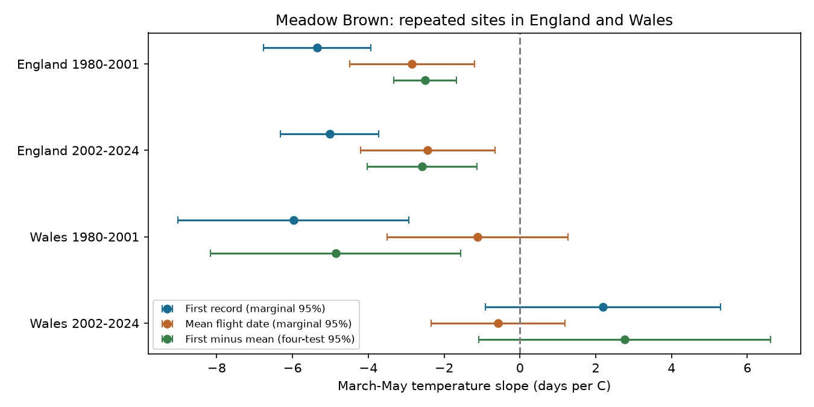

# First-date warmth slopes were more negative than mean-date slopes for Meadow Brown at 120 England sites in both 1980-2001 and 2002-2024

## Result

At 120 repeated England sites, the first recorded date of Meadow Brown had a more negative link to spring warmth than the count-weighted mean flight date. The difference was -2.50 days per C in 1980-2001 and -2.58 days per C in 2002-2024. Both four-test adjusted intervals were below zero. Three repeated Wales sites did not show the same pattern in the later period. Thus the result repeated across time in the England sample, but not across all four country and period samples.

The difference shows that a first-date slope need not measure the shift in the centre of observed flight. It does not show that the difference is an error. Changes in flight shape, abundance, adult activity and survey visits can all change it. This study cannot separate these explanations.

## Question and prior work

We asked whether March-May warmth had the same association with first recorded dates and mean flight dates for Meadow Brown (*Maniola jurtina*). This common species has a summer flight period. Fixed spring weather windows reduce the risk that a weather window set by the outcome creates a date association. We chose one species to keep the comparison clear. We did not choose it from fitted results.

Roy and Sparks (2000, doi:10.1046/j.1365-2486.2000.00322.x) studied British butterfly first dates, peaks and flight length. Roy et al. (2015, doi:10.1111/gcb.12920) studied mean flight dates across space and time. Van Strien et al. (2008; PMID 18236084) showed that first appearance measures can have observation bias. Moussus et al. (2010, doi:10.1111/j.2041-210X.2010.00020.x) compared date estimators with simulations. These works motivate our paired comparison; they do not make its difference a direct measure of bias.

We searched the local SCI campaign for phenology, climate, pollution, butterfly and mean-flight terms. The prior campaign heat study (sci:sha256:124367e558e424dfb10426e017740ce5a8fd519edac6a86ba105193e3a47af42) used national abundance indices and daily heat peaks. We read that publication. We use a different source table and outcome from the same monitoring scheme. This is not an independent survey validation. Our added evidence is a direct first-minus-mean date test with the same long-record sites in two periods, plus a failed repeat in Wales. We do not claim to be the first study to compare phenology measures.

## Data and selection

The UKBMS phenology 2024 release gives annual site and species dates. The support document states that these measures use standard transects, with weekly counts across the main survey season. They do not use the two or three visits of the wider countryside survey. First and last dates are recorded dates. Mean flight date is the count-weighted mean. Dates use days relative to 1 April. A date shift has the same units in this scale as in a day-of-year scale.

We joined site country from the UKBMS site location 2024 release. Site identifiers in that table are unique. We kept England and Wales records from 1980 through 2024. We required first date <= mean date <= last date, available weather and peak count >=5. Each site needed at least ten retained records in each period. This rule was fixed before the fits. It selects long-running, well-recorded populations; it is not representative of all sites or of range expansion. All retained records have the UKBMS survey-type label. There are no duplicate site-years.

| Country | Period | Source rows | Rows after count filter | Retained rows | Retained sites |
| --- | --- | ---: | ---: | ---: | ---: |
| England | 1980-2001 | 3,913 | 3,820 | 1,940 | 120 |
| England | 2002-2024 | 23,455 | 22,447 | 2,398 | 120 |
| Wales | 1980-2001 | 216 | 206 | 65 | 3 |
| Wales | 2002-2024 | 894 | 832 | 55 | 3 |

All source rows in these four groups passed the date-order and weather checks. There are 4,458 retained site-years. Each England period has 22 or 23 observed years. Each Wales period has 22 observed years. The Wales sample is especially small. The source file includes some dates outside the standard April-September season. We retain these in the main fit and check a narrower date filter separately.

Met Office country series supply monthly mean temperature and rain from HadUK-Grid. Spring temperature is the equal-weight mean of March, April and May monthly means. Spring rain is their total, in units of 100 mm. These are country exposures, not site temperatures. The exact input snapshots, source URLs, used archive members, byte sizes and SHA-256 hashes are in `files/provenance.json`. Shared data were read in place. No new shared download was needed.

## Model and uncertainty

We fit each country and period separately:

`date measure = site intercept + common linear year + spring temperature + spring rain + error`.

The primary measure is `first date - mean flight date`. We also fit each component on the identical sample. The difference slope equals the first-date slope minus the mean-date slope by the linear model identity. Each site-year has equal weight. Sites with more retained years therefore have more total weight. Site intercepts remove stable differences between sites. They do not remove changes in visits, habitat or population state within a site.

Uncertainty uses scores summed within each observed calendar year. This allows arbitrary covariance across retained sites in the same year. A Bartlett covariance estimate includes calendar lags one and two, each with its usual weight. Missing calendar years remain gaps. We multiply the covariance by Y/(Y-1), where Y is the number of observed years, and use a t reference with Y-4 degrees of freedom. This is a chosen small-sample approximation, not an exact coverage result. The four primary difference intervals use Bonferroni adjustment for nominal family 95% coverage. Component intervals and sensitivity intervals are marginal 95% intervals. Sites are not independent replicates of a country weather exposure.

The two countries use separate sites but share weather systems and methods. Periods do not overlap, but retain the same sites and linked population history. These tests are not four independent experiments. The analysis tests weather associations. It does not estimate the effect of human-caused climate change.

## Estimates

Slopes are days per C. Difference intervals correct for four tests.

| Country | Period | First-date slope | Mean-date slope | Difference slope | Adjusted difference interval |
| --- | --- | ---: | ---: | ---: | --- |
| England | 1980-2001 | -5.35 | -2.85 | -2.50 | -3.32 to -1.68 |
| England | 2002-2024 | -5.02 | -2.43 | -2.58 | -4.03 to -1.14 |
| Wales | 1980-2001 | -5.98 | -1.12 | -4.86 | -8.16 to -1.56 |
| Wales | 2002-2024 | +2.19 | -0.57 | +2.77 | -1.08 to +6.62 |



Negative differences mean that first records shift earlier more strongly than mean flight dates at fixed model controls. The later Wales estimate is positive and uncertain. The study therefore fails a rule that would require a negative, nonzero difference in all four samples. A sign change alone does not establish a statistically clear difference between countries or periods; we did not test that contrast.

Adding log peak count gives England difference slopes of -2.46 and -2.65 days per C. Separate site trends give -2.71 and -2.51. Raising the peak-count threshold to ten or admitting all positive counts at the same selected sites retains negative England estimates. Marginal intervals remain below zero in these checks. Count adjustment is a diagnostic. Peak count can be affected by weather and visits; it is not an effort measurement or a valid general correction for detection.

Omitting one outcome year at a time gives England slopes from -2.88 to -2.30 in the early period and -2.95 to -2.30 in the later period. Later Wales estimates remain positive in this check, from +0.69 to +3.42. The later pre-2009 fit instead gives a negative Wales slope, with an interval that includes zero. It has only 20 rows and seven observed years. This short subset is weak evidence. The later Wales interpretation also changes with covariance lag and count threshold at the marginal 0.05 level. We make no repeated Wales claim.

All fits, covariance choices, date-bound checks and omitted-year results are saved in `files/estimates.csv` and `files/leave_year_out.csv`. The saved plan is in `files/PLAN.txt`. We added lag-zero, lag-three and date-bound checks after the main fits. These checks are exploratory.

## Limits and use

First dates can respond to the number of butterflies seen and to when visits occur. Mean flight dates can also respond to missed visits, count error and seasonal coverage. Actual visits and absences are not supplied here. The count threshold can select on a weather response. Stable site effects and a common sample reduce some site-turnover bias, but cannot correct these within-site problems. The same sites in both periods strengthen the temporal comparison and restrict the population to long-record sites.

There is no measured mechanism in this study. A broader early tail of the flight distribution is one possible biological explanation for a negative difference. Weather-linked observation or activity is another. Local habitat, management, population change, rain outside spring, and seasonal weather may confound both measures. The linear spring model may be incomplete. Country weather masks local variation. A single species and three Wales sites give a narrow test. The small number of years limits covariance accuracy. The intervals are conditional on reported dates and weather; they do not include source measurement uncertainty.

This study does not measure species loss, distribution shifts, pollution effects, or damaging weather thresholds. It adds a practical warning for ecological timing studies: a first-date temperature slope can exceed the shift in the centre of observed activity in repeated sites. A site-level follow-up needs visit dates, zeros, local weather and seasonal count curves to test why.

## Reproduction and provenance

The publication includes the Meadow Brown source subset, country weather, retained panel, selection counts, all estimates, code and environment versions. The larger shared raw archives are not copied. `files/provenance.json` lists exact shared aliases and resolved paths and hashes for all six raw files used, and hashes for the two CSV archive members. `files/retrieve.py` gives a private retrieval recipe and refuses changed hashes. Live weather series can change; the recorded shared snapshots are the reference.

From an extracted publication root, use Python 3.12 with numpy, pandas, scipy and matplotlib. Write outputs to a new directory:

```bash
python files/analyze.py --input files --output replay
OPENBLAS_NUM_THREADS=1 python files/validate.py --input files --results replay
cmp files/estimates.csv replay/estimates.csv
```

The separate validator uses full site-indicator design matrices rather than the analysis code's site demeaning. It checks all four primary coefficients, year-score covariance estimates, the component-difference identity and adjusted interval arithmetic. `files/validation.json` saves the result. `files/replay_check.json` records byte comparisons from a second full analysis. These checks test computation, not assumptions.

To rebuild from shared raw data:

```bash
python files/build.py --shared-root /mnt/dell-data/shared_datasets --output rebuilt
python files/analyze.py --input rebuilt --output rebuilt_results
```

For retrieval elsewhere, run `python files/retrieve.py --output private_raw`, then pass `private_raw` as the shared root. Compare raw hashes with the recorded provenance before use. `build.py` records input hashes; it does not itself reject a different source snapshot.

## Source credits and campaign record

Botham, M.S.; Middlebrook, I.; Heywood, J.; Harrower, C.A.; Milborrow, J.; Roy, D.B. (2025). United Kingdom Butterfly Monitoring Scheme: phenology 2024. NERC EDS Environmental Information Data Centre. https://doi.org/10.5285/b9d237fc-5a79-4449-bcee-34c52d87608f

Botham, M.S.; Middlebrook, I.; Heywood, J.; Harrower, C.A.; Milborrow, J.; Roy, D.B. (2025). United Kingdom Butterfly Monitoring Scheme: site location data 2024. NERC EDS Environmental Information Data Centre. https://doi.org/10.5285/d7256b49-f2e3-4ae7-907d-af729610c768

Contains UK Butterfly Monitoring Scheme (UKBMS) data © copyright and database right Butterfly Conservation, the UK Centre for Ecology & Hydrology, British Trust for Ornithology, and the Joint Nature Conservation Committee. Source data retain their Open Government Licence and attribution terms. Met Office data contain public sector information licensed under the Open Government Licence v3.0. See the exact source URLs in the provenance record. The baseline licence applies to our text, figures and code subject to these source rights.

Campaign: 11_07_2026. Job: sci-1107-dell-climate-pollution-biodiversity-ad8f906b86f3. Topic: climate-pollution-biodiversity. Machine: dell. Account: codex-andrii. Model: gpt-6.1-sol, high reasoning effort. The configured campaign-machine key signs this local result. It is not a personal authorship claim. No remote archive or index submission is made.
