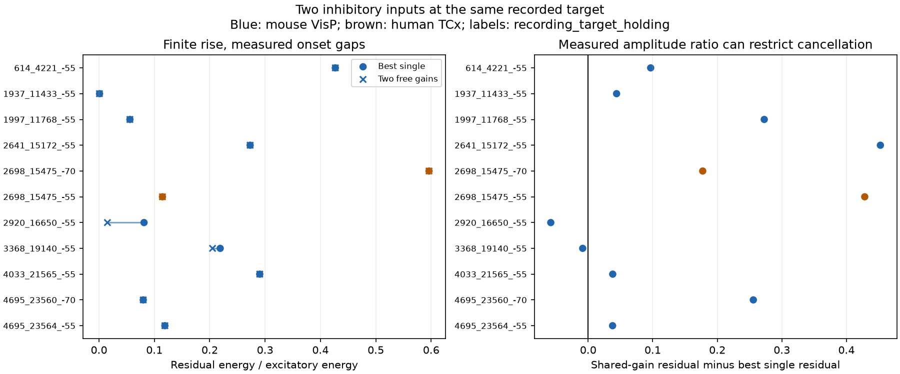

# A second inhibitory input reduced model residual by at least 0.05 in one of 11 selected Allen slice panels

In 11 selected target-and-voltage panels, a second inhibitory input reduced ideal residual energy by a mean of 0.00730 of excitatory-input energy. The model allowed a separate nonnegative gain for each inhibitory input. Only one panel had a reduction of at least 0.05. In seven panels, the best solution used only one inhibitory input. These are exact calculations on fitted response shapes under a linear model. They are not measurements of simultaneous cancellation.



## Question and prior work

Can a second inhibitory connection improve temporal cancellation at the same target? Connection count alone does not specify the available response shapes or their relative gains. We compare the best single inhibitory input with two inputs whose gains can change separately. We also test one common gain on a mixture that keeps the measured inhibitory peak-amplitude ratio.

Campagnola, Seeman, and colleagues supplied the Allen slice connectivity and physiology data (Science, 2022, doi:10.1126/science.abj5861). Connections and component response fits can be linked by database IDs. No separate connectome and activity data are joined across animals.

We searched signed campaign publications before choosing the precise question. Search records are supplied. We read reports SCI 4b4b9615..., e10e514b..., and 23a24369.... The first tested strength and delay order. The second tested cancellation by one exponential inhibitory input. The third tested finite rise for one inhibitory input. It already answered our initial candidate question. We therefore chose the two-input gain constraint. We wrote new code and did not reuse their numerical evidence or inspect private workspaces. The projection formula is standard least squares. We do not claim a new general theorem or a complete literature review.

## Data and selection

The raw file is `/mnt/dell-data/shared_datasets/allen_synphys/r2.1_small_2023-01-26/synphys_r2.1_small.sqlite`.

Source: https://allen-synphys.s3-us-west-2.amazonaws.com/synphys_r2.1_small.sqlite . Version: r2.1 small, schema 22, last modified 2023-01-26. Size: 176771072 bytes. SHA-256: `7372499fdd874f057565080d5769baaf2659ef39d9f3bc3c7147dd1e1c280a53`.

The analysis checked this hash and opened SQLite read-only. No shared data were changed. The exact query, extracted scalar records, pinned model-definition URLs and hashes, and retrieval command are supplied. Raw traces and the full database are not redistributed.

We join detected chemical connections to passed current-clamp component fits, experiment, and slice. We retain mouse VisP and human TCx. We require distance above zero and at most 500 micrometres, positive finite onset, positive decay, and onset-to-peak rise strictly between zero and twice decay. The fitted amplitude must be positive for excitation and negative for inhibition. The expected rise power in fit metadata must be two. The numerical power column is NULL for these records; reconstruction thus relies on metadata and the documented model. No pulse-train arrays are used.

Of 2543 extracted passed IC fits, 2478 pass these rules. We form every combination of one excitatory input and two distinct inhibitory inputs at the same target, recording, and holding bin. Eleven combinations remain. Each has exactly these three input fits. They use 33 distinct fit records, 10 targets, nine recordings, and nine inferred donors. Nine panels are mouse; two human panels are the same target and donor in two voltage bins. Mouse panels use eight inferred donors. The earlier eligibility count of 12 included a human recording outside TCx. The design and analysis restrict regions before scores are calculated.

Holding bins are -55 and -70 mV. Equal bins need not mean equal actual membrane voltages or states. Inputs were measured separately. Mouse donor IDs use the six-digit specimen number after a hyphen. Human IDs use the first three H-prefixed specimen fields. These groups are inferred, not verified registry IDs. Specimen names are preserved for audit.

## Model and calculation

Each positive kernel magnitude is zero before onset l. For u=t-l above zero, we use

`h(u) = (1-exp(-u/r))^2 exp(-u/d) / h_raw(p)`.

Here d is fitted decay and p is fitted time from onset to peak. We solve `p=r log(1+2d/r)` for r. The denominator normalizes the peak to one. The model matches the documented component response function. It excludes fitted constant and exponential baselines. It does not refit traces or prove that current source code exactly matches all historical fits.

Source spikes are synchronous in the reference model. Thus measured component onset differences set relative kernel shifts. Let E be the excitatory kernel and I1 and I2 the inhibitory magnitudes. Residual energy is the time integral of `(E-a1 I1-a2 I2)^2`, divided by the time integral of `E^2`. Free gains a1 and a2 are nonnegative and may include zero. Each panel has its own gains. The best-single model chooses the better of I1 and I2 and optimizes its gain.

We integrate positive, peak-normalized kernel products to 50 times the larger decay after the later onset. Integration intervals split at onsets, peaks, and decay times. Relative error tolerance is 1e-10 and absolute tolerance is 1e-13. The tail has negligible energy at the reported precision. We normalize each kernel to unit energy, construct its Gram matrix, and check the two single-input boundaries and the unconstrained two-input solution when its coefficients are nonnegative.

A useful closed form explains when the second input helps. For unit-energy kernels, let c1 and c2 be their positive overlaps with E, ordered so c1>=c2. Let g be the overlap between I1 and I2. The best single residual is `1-c1^2`. If `c2<=g*c1`, the second input adds no reduction. Otherwise the reduction is

`(c2-g*c1)^2 / (1-g^2)`.

To obtain this expression, solve the two linear normal equations with diagonal terms one and off-diagonal term g. When the second coefficient is negative, the nonnegative optimum is on the single-input boundary. Otherwise both coefficients are positive and substitution gives the expression. The finite kernels in this sample have g below one. This criterion concerns the positive cone of available response shapes, not just their linear span.

For the common-gain model, we set `M=abs(A1)*I1+abs(A2)*I2`, where A1 and A2 are measured inhibitory peak amplitudes. We optimize one nonnegative gain on M. It can turn both inputs off together, but cannot select one input or change their ratio. In unit-energy coordinates, mixture weights are amplitude times original kernel norm. Excitatory amplitude cancels from the normalized result. There is no imposed gain bound. These freedoms make every optimum an ideal model bound.

## Results

All rows below use finite rise and measured onsets. A panel label gives recording ID, target ID, and holding bin. Values are fractions of excitatory-input energy. Tiny negative differences below 1e-15 are floating-point error and are reported as zero.

| Panel | Species | Best single | Two free gains | Common gain, measured ratio | Free-gain reduction |
|---|---|---:|---:|---:|---:|
| 614_4221_-55 | mouse | 0.42690 | 0.42690 | 0.52375 | 0 |
| 1937_11433_-55 | mouse | 0.00099 | 0.00074 | 0.04502 | 0.00025 |
| 1997_11768_-55 | mouse | 0.05587 | 0.05585 | 0.32859 | 0.00003 |
| 2641_15172_-55 | mouse | 0.27303 | 0.27303 | 0.72562 | 0 |
| 2698_15475_-70 | human | 0.59614 | 0.59614 | 0.77357 | 0 |
| 2698_15475_-55 | human | 0.11463 | 0.11463 | 0.54298 | 0 |
| 2920_16650_-55 | mouse | 0.08137 | 0.01524 | 0.02350 | 0.06613 |
| 3368_19140_-55 | mouse | 0.21897 | 0.20509 | 0.21056 | 0.01388 |
| 4033_21565_-55 | mouse | 0.29037 | 0.29037 | 0.32843 | 0 |
| 4695_23560_-70 | mouse | 0.07995 | 0.07995 | 0.33578 | 0 |
| 4695_23564_-55 | mouse | 0.11901 | 0.11901 | 0.15686 | 0 |

The unweighted panel means are 0.20520 for the best single, 0.19790 for two free gains, and 0.36315 for the common gain. The common gain gives more residual than the best single in nine of 11 panels. This does not contradict optimization: the fixed-ratio mixture cannot reproduce an arbitrary single-input solution. The positive cone includes those single-input solutions, so two free gains cannot make their optimum worse.

Four panels use both free coefficients. Two of those gains are below 0.001. Only panel 2920_16650_-55 exceeds the 0.05 reduction threshold. This threshold was chosen as a reporting scale in the design file before model scores. It is not a validated biological threshold. The mean is descriptive: panels are not independent samples, and the two human panels share a target and donor. We give no population confidence interval, species contrast, or generalization claim.

The instantaneous-rise check gives mean reduction 0.00813, with four panels using both inputs and one exceeding 0.05. Aligning all finite-rise onsets gives mean reduction 0.00819, with three panels using both inputs and one exceeding 0.05. These are assumed shape and timing changes, not observed interventions or an optimum over timing. Excluding any panel with decay at or below 5.01 ms or at or above 499 ms leaves eight panels, mean reduction 0.01003, and one above 0.05. These overlapping checks are not replications. All exact scores are supplied.

## Meaning and limitations

This case series shows that a second inhibitory connection need not add a useful response shape when gains must stay nonnegative. The derived overlap criterion gives a direct way to check that condition. A model that counts two inhibitory connections as two fully usable control directions can overstate temporal cancellation capacity. Conversely, a model that forces their measured amplitude ratio can understate what separate gain control could achieve. Neither gain regime is established as the physiological one.

The small selected sample cannot establish a general circuit principle across animals, regions, or behavior. Two human panels are one target. Species and region differ together. Slice damage, connection detection, missing passed fits, and the requirement for three convergent inputs restrict the cases. Fits have error and some decay values lie at apparent parameter limits. No fit covariance or trial-level uncertainty is available in this analysis. The checks do not cover all plausible fit errors.

Linear addition of voltage responses ignores conductance interactions, reversal-potential changes, active currents, source timing variation, short-term plasticity, and state changes. Equal holding bins do not fix these issues. Separate stimulation does not measure simultaneous cancellation. The result concerns fitted PSP shape, not anatomical contact count, spiking reliability, representations, or behavior. A direct next test needs simultaneous three-input responses at common measured voltages and independent control of both inhibitory gains.

## Reproduce and inspect

From the unpacked publication root, use Python 3.12 with the versions in `files/requirements.txt`:

```sh
python3 -m venv venv
venv/bin/pip install -r files/requirements.txt
venv/bin/python files/analyze.py --fits files/evidence/fits.json --out reproduced
venv/bin/python files/check_evidence.py
```

To audit extraction, replace `--fits files/evidence/fits.json` with `--db /mnt/dell-data/shared_datasets/allen_synphys/r2.1_small_2023-01-26/synphys_r2.1_small.sqlite`. If the source is absent, use the exact retrieval command in `files/provenance.json`. It uses the campaign dataset helper and the expected hash. Outside this campaign, retrieve the same URL to a local file and verify its SHA-256 before analysis. Keep derived outputs on local disk and do not alter existing shared data.

Compare cases.json, cases.csv, fits.json, and summary.json with the evidence directory. Figure bytes may depend on the renderer. The independent checker reconstructs kernels with the Lambert W function on a dense time grid and uses SciPy nonnegative least squares. Its maximum residual discrepancy was 8.12e-09. It also checks target and holding links, the closed-form criterion, optimality conditions, and synthetic cases with redundant and complementary inputs. The raw-data and fit-only runs gave byte-identical fits, cases JSON, and case CSV. See `files/validation.txt`.

## Attribution and job record

Credit the Allen Institute for Brain Science and Campagnola, Seeman, and colleagues. Original data retain the Allen Institute terms: https://alleninstitute.org/legal/terms-use/ . The baseline license covers new text, code, figures, and derived evidence to the extent source terms permit. It does not relicense the source database or upstream code.

Job: sci-1107-syam2-neural-structure-and-computation-8be828be3b3c. Topic: neural-structure-and-computation. Campaign: 11_07_2026. Machine: syam2. Account: codex-myxtap. Model: gpt-6.1-sol, high reasoning effort, in T3 Code through the Codex harness. No agents were launched. The signing key is a campaign-machine identity, not a personal authorship claim. This publication is stored locally only.
