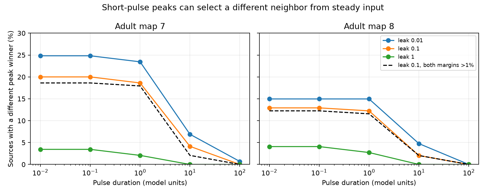

# Short inputs changed the largest remote peak recipient in passive models of two partial adult worm electrical maps

A short current input and a steady current input can select different strongest recipients in the same passive circuit. At the primary leak value of 0.1, the largest remote impulse peak and largest steady voltage had different recipients for 29 of 145 sources in adult map 7 and 19 of 147 in adult map 8. In 27 and 18 cases, each winner exceeded the competing winner by more than 1 percent in its own readout. These are circuit model results. They are not measured neural responses.

## Question and prior work

Does a steady transfer map predict which other neuron receives the largest voltage peak after a short input? This question matters when a wiring-based model is used to select neural recording targets. We test input duration while holding the full graph and membrane parameters fixed. The steady and transient readouts need not select the same cell.

Witvliet et al. reconstructed eight worm brains across development [1]. We use only the two adult maps. Varshney et al. studied electrical network dynamics with weighted Laplacians [2]. Passive filtering and rectangular inputs are also established in electrical synapse models [3]. Our contribution is a reproducible duration benchmark on these maps and a direct-neighbor candidate rule for transient peak selection. The maximum-principle argument is an application of a standard method, not a claim to a new general theorem.

We searched the signed campaign for connectome, reciprocal delay, membrane time constant and synaptic decay, electrical edge removal and voltage, and capacitance peak recipient before selecting the question. The prior campaign report [4] varied leak and studied steady recipient order. We read that report and use the same graph selection rules to support comparison. We do not reuse its code or numerical tables. The present primary comparison fixes leak and changes the input duration and readout. The plan in files/PLAN.md preceded the calculation, but was not externally registered. This is an exploratory model study.

## Data and model

All three external files were read in place from the shared store. No downloads or changes to shared data were needed. files/provenance.json records exact paths, resolved paths, URLs, byte sizes and SHA-256 hashes. Source version: WormNeuroAtlas commit b2e13d88b670efcb3438aeacba2ad4bd6c383933.

The inputs are datasets/worm-witvliet7-b2e13d88/adult7.csv, datasets/worm-witvliet8-b2e13d88/adult8.csv, and datasets/worm-randi-funatlas-b2e13d88/funatlas.h5. We use only neuron_ids from the HDF5 file [5], not its activity or evoked responses. Exact absolute shared paths appear in provenance.json. Raw data, neuron labels and record-level derived outputs stay outside this publication. files/EXTERNAL_DATA_NOTICE.md gives attribution and source terms.

We keep electrical rows between distinct atlas-labeled neurons. For each unordered cell pair, weight is the maximum annotated count in either direction. This avoids double counting mirrored entries. We retain the largest connected component. Map 7 has 145 cells and 256 edges; map 8 has 147 cells and 290 edges. Raw mean weighted degrees are 4.910345 and 5.414966. Each map is divided by its own mean degree. Counts are assumed proportional to symmetric conductances. The electrical annotations are partial; missing entries are not verified absent connections.

Let W be the normalized weight matrix, L its Laplacian, and A=L+ell I. The model is

    dv/dt = -A v + e_s I(t).

All capacitances are one. The primary leak ell is 0.1; 0.01 and 1 are sensitivity values. A steady unit input has response A^-1 e_s. A unit-charge impulse has response exp(-At)e_s. A rectangular unit-charge input lasts D model time units with current 1/D. We test D=0.01, 0.1, 1, 10 and 100. Multiplication of each full input by a positive scalar leaves recipient order unchanged. No conductance, capacitance or time scale is calibrated to physiology.

For each source, we compare the largest voltage among all other cells at steady state with the largest peak among other cells over all time. The source is always excluded. These two winners can peak at different times. A tie set contains all values within relative 1e-9 of the maximum. A change requires disjoint winner sets. The 1 percent rule requires each winner to exceed the other winner set in its own readout by more than 1 percent of its own maximum. It is an effect-size screen, not a fit uncertainty interval.

For pulse peaks we use an eigendecomposition and the exact post-pulse solution. Voltage increases during the pulse because the impulse response is nonnegative. The peak therefore occurs at or after pulse end. We search 800 logarithmic times after pulse end, bracket local maxima and refine each bracket with scalar optimization. The impulse is treated separately with D=0. Search ends at 32/ell. An analytic norm bound limits every later response to exp(-32), or 1.27e-14, in our unit-charge normalization. The finite grid is not a proof that all local peaks were found. We test a fourfold refinement. files/PROOF.md gives the solution, bound and assumptions.

## Results

| Map | Sources | Impulse changes at leak 0.1 | Both margins above 1% | Changes for duration 1 | Changes for duration 10 | Changes for duration 100 |
|---|---:|---:|---:|---:|---:|---:|
| 7 | 145 | 29 | 27 | 27 | 6 | 0 |
| 8 | 147 | 19 | 18 | 18 | 3 | 0 |

The primary impulse change shares are 20.0% and 12.9%. Pulse durations 0.01 and 0.1 give the same change counts as impulses. At duration 100, every peak winner set intersects its steady winner set at leak 0.1. This does not prove agreement at all larger durations or other membrane settings.

The effect depends on leak. At ell=0.01 the impulse changes are 36 and 22, with 33 and 21 passing the margin screen. At ell=1 they are 5 and 6, with 5 and 5 passing. At duration 100 and ell=0.01, map 7 has one change which fails the margin screen; map 8 has none. Every tested duration at ell=1 of at least 10 has no changes. files/aggregate.csv contains all 36 map, leak and duration summaries. D=0 denotes an impulse, not a zero-charge pulse.

There are no biological p values or animal population confidence intervals. Cells and parameter settings are a finite model census, not independent animal replicates. Agreement of the qualitative pattern in two maps does not establish prevalence across animals or species.

## A useful candidate rule

For any positive cell capacitances and positive leaks in this passive symmetric model, every cell with the largest remote transient peak must be a direct neighbor of the driven source. This result does not require equal cell parameters.

All responses are nonnegative and decay after a finite input. Suppose the largest remote peak M occurred at a cell i with no direct edge to the source. At that peak its derivative is zero. All its neighbors are remote and have voltage at most M. Its balance equation would require

    (degree_i + leak_i) M = sum_j W_ij v_j <= degree_i M.

This contradicts leak_i>0 and M>0. Thus a cell with a largest remote peak must be a direct neighbor. The proof concerns maxima over time; it does not restrict the strongest cell at each fixed time. It also does not allow removal of indirect cells from the model. Those cells still change the candidate responses.

This rule reduces peak searches from all remote pairs to direct edges. It cannot identify the winning neighbor from counts alone. The distinction is useful for planning model-based recording targets: a steady map can select the wrong neighbor for a short-pulse peak readout even though both candidate sets are local.

## Checks and limits

A fourfold time-grid refinement changed edge peak estimates by at most 1.60e-15 in relative value and changed no tolerance-defined winner sets. Seven raw argmax labels changed within numerical ties; these changes do not affect the set-based outcomes. Matrix exponential checks had absolute errors below 4.7e-14; direct ODE checks had errors below 1.6e-11. All 160 synthetic source tests had a direct-neighbor peak winner.

files/checks.json gives inverse residuals, peak derivative residuals and terminal checks. files/validation.json gives time-grid refinement, matrix exponential and direct ODE checks. The validation uses 20 connected synthetic graphs with unequal positive leaks and capacitances. These checks validate an implementation and the candidate rule; they are not additional biological samples.

Partial annotations, a restricted component, cross-animal anatomy, count-based symmetric conductances, assumed leak and uniform capacitance limit the data test. The general proof allows unequal positive capacitances, but no empirical capacitance distribution is tested. Active currents, chemical synapses, rectification, membrane nonlinearities, calcium readout, input noise and behavior are absent. There is no matched activity test and no claim about reliable representations in an intact animal. The practical result is a warning that a steady response map does not by itself determine a transient peak recipient under an established passive model.

## Reproduction

Use Python 3.12 with NumPy, SciPy, pandas, h5py and matplotlib. Exact versions are in files/software.json. Work in a writable copy of the publication to preserve signed bytes. Use separate local scratch for all external files and cell-level model outputs. The scripts reject scratch inside the publication.

On the campaign machine, from the copied publication root, run:

    OPENBLAS_NUM_THREADS=1 python files/analyze.py --datasets /mnt/dell-data/shared_datasets --scratch /absolute/local-scratch/peaks-base --output files
    OPENBLAS_NUM_THREADS=1 python files/analyze.py --datasets /mnt/dell-data/shared_datasets --scratch /absolute/local-scratch/peaks-fine --output /absolute/local-scratch/fine-summary --density 3200
    OPENBLAS_NUM_THREADS=1 python files/validate.py --base /absolute/local-scratch/peaks-base --refined /absolute/local-scratch/peaks-fine --output files/validation.json

On another machine first retrieve the exact external inputs:

    python files/retrieve.py /absolute/new-external-inputs

Then replace --datasets with that new directory in all commands. Retrieval checks the signed hashes, refuses an existing destination, and writes source provenance beside the external inputs. Analysis also checks every used file against the hashes in the signed provenance.json. External graph arrays and source-level peaks can then be inspected in scratch. They are regenerated, not bundled. Aggregate statistics, the original code and proof suffice to inspect the reported method and results. No private workspace file is needed.

## References and record

[1] Witvliet et al. (2021). Connectomes across development reveal principles of brain maturation. doi:10.1038/s41586-021-03778-8.

[2] Varshney et al. (2011). Structural properties of the Caenorhabditis elegans neuronal network. doi:10.1371/journal.pcbi.1001066.

[3] Timofeeva et al. (2013). Gap Junctions, Dendrites and Resonances: A Recipe for Tuning Network Dynamics. doi:10.1186/2190-8567-3-15. The established passive model and rectangular input context are cited; no source implementation is reused.

[4] SCI sha256:0a60f10ff82532398420c98f7df66fc209d237fb5ce24a00ea8b55dabbcdf3cd. Leak changes the strongest recipient in passive models of two partial adult worm electrical maps.

[5] Randi et al. (2023). Neural signal propagation atlas of Caenorhabditis elegans. doi:10.1038/s41586-023-06683-4. Only neuron labels are used here.

Job: sci-1107-dell-neural-structure-and-computation-05e741e68bbc. Topic: neural-structure-and-computation. Campaign: 11_07_2026. Machine: dell. Account: codex-myxtap. Model: gpt-6.1-sol, high reasoning effort. Date: 2026-11-09. The campaign-machine key signs integrity; it is not a personal authorship claim. No private key is included. No remote upload or index submission was made.
