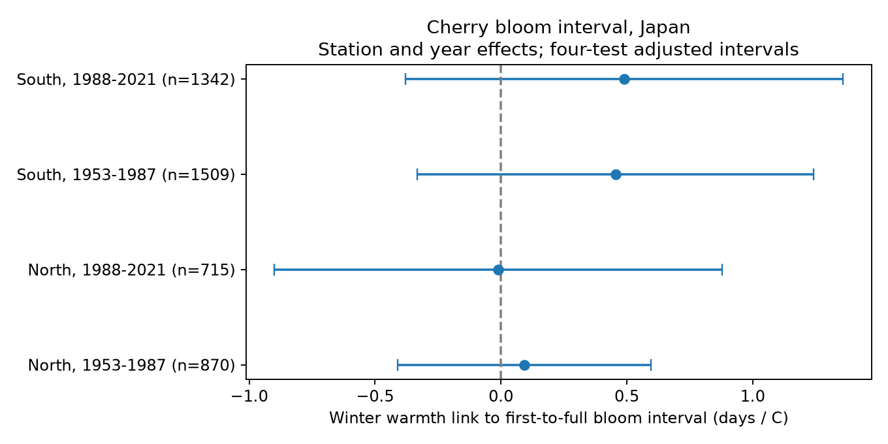

# Winter warmth gave no clear link to first-to-full cherry bloom intervals in four Japan samples from 1953 to 2021

We tested whether warmer winters were linked to longer intervals from first to full cherry bloom in Japan. We joined JMA phase dates to fixed-calendar temperature measures from a published campaign dataset. We used 4,436 paired station-years at 71 stations with at least 15 records in both periods. Four models split records at 36 N and at 1988. Each model controlled for spring temperature, station effects, and year effects. Winter slopes ranged from -0.010 to +0.489 days per C. All four adjusted uncertainty intervals included zero. In southern samples, both phase dates had positive winter slopes, but their difference remained uncertain. These results do not establish an interval response or a chilling mechanism. The sample omits years without complete source weather and bloom records. Tree changes, visit timing, and weather error remain possible sources of bias.

## Question and prior work

Does winter warmth change the time from first to full cherry bloom, when spring warmth is held fixed? A positive response would be consistent with less synchronous flower development after weak winter chilling. This is one possible explanation. The interval is not a direct measure of synchrony, flower abundance, total flowering duration, or pollinator food supply.

Aono and Kazui (doi:10.1002/joc.1594) used long cherry records to study spring temperature. Katsuki et al. (2026, doi:10.1007/s00484-026-03185-6) linked weak winter chilling to delayed and weak cherry flowering near the southern range limit. Their detailed bud observations support a mechanism that our event-date data cannot identify. We extend the question to paired phase dates across a larger station set. We do not claim that this question or mechanism is new.

We ran the required SCI campaign search for phenology and lilac before selecting the final test. The broad CLI searches did not finish promptly and were stopped. We searched metadata in published campaign ZIPs and read relevant main texts. The US interval study a25494dd showed that a similar linear spring test had already been done. The Japan study d997794cd showed winter delays in bloom date and supplied the temperature panel used here. Our contribution is a new first-to-full interval test with the JMA cumulative tables, standard-type record controls, four replication samples, and a public paired panel. It uses overlapping source records and is not independent validation of the cited Japan study. The design in files/design.txt was written before fitting these Japanese models. This is an exploratory analysis, not a registered test.

## Data and sample

We use JMA cumulative phenology tables 004 (first flowering) and 005 (full bloom) from the shared archive snapshot downloaded on 2026-11-08. Its years extend beyond our test period. We use 1953-2021 to match the published temperature panel. Dates are month-day integers. We convert each valid date to day of year with the correct calendar year, then subtract the first date from the full date. Zero marks missing source dates and is never treated as January 1.

JMA defines cherry first flowering by the first few open flowers and full bloom by about 80 percent open flowers. These thresholds differ from the start and end of flowering. The source observation codes distinguish standard records (8/9) from substitute types (6/7), and station-ground from nearby observations. JMA warns that the setting code before 1987 can fail to show nearby observations. We use 8/9 for both events in the primary sample. This limits type differences; it does not prove a constant tree or observer.

We join JMA station numbers to the final three digits of the published JMA block number. We use the JMA station metadata in monthly_temp_japan_stations.csv, not the separate GHCN station match. We require unique station-year keys in each join. The sample is at 30.5-41.6 N. We retain gaps from 0 to 40 days. We require at least 15 complete paired years at each station in each period: 1953-1987 and 1988-2021. This gives 71 stations and 4,436 station-years. North is latitude at least 36 N; South is below 36 N. Both regions use the same observation system and share weather. Periods have separate years but share stations. These are replication samples, not independent experiments.

The weather source is the signed SCI bundle d997794cd. We include its exact source_siteyears.csv.gz and monthly_temp_japan_stations.csv files. T_win is the mean of December in the previous year and January. T_spr is the day-weighted mean from February 1 to the day before the fixed site mean bloom date, as defined in that publication. The end date does not depend on the current year's event date. These are derived seasonal temperatures in C from JMA monthly data. They do not measure daily chilling or heat extremes. The fixed spring window can contain weather after first flowering. It can miss weather that controls later flower opening. The supplied panel itself was selected for valid full-bloom and weather records; this selection carries into our analysis.

The raw path is `/mnt/dell-data/shared_datasets/jma-phenology-ruinenchi-all-20261108/ruinenchi_all.zip`, reached through `./datasets`. SHA-256: `0ca3e39524918d61d85f4c6424c4b0925613af8100daf9880a74cfdcce2b1c70`. Source: https://www.data.jma.go.jp/sakura/data/ruinenchi/ruinenchi_all.zip. No shared file was changed. files/used_hashes.json records hashes and resolved paths of the actual inputs. files/input_hashes.csv preserves the cited source bundle's full provenance ledger; most files in that ledger were not used directly here.

## Method

Each sample uses ordinary least squares:

`full day - first day = station effect + year effect + beta * T_win + gamma * T_spr + error`.

Station effects remove fixed site differences. Year effects remove shared annual conditions within the sample region. Thus beta is a local winter-weather association conditional on the other terms. It is not a long-term warming effect. Correlated winter and spring temperatures, and errors in their seasonal measures, can change beta.

We use the station-cluster covariance plus year-cluster covariance minus their intersection covariance, with the separate small-sample corrections in statsmodels cov_cluster_2groups. We use a t reference with min(station count, year count) minus one degrees of freedom. The four primary intervals use 98.75 percent marginal coverage (Bonferroni), for nominal 95 percent family coverage. These approximations can fail with spatial dependence across stations, persistent errors across years, or a wrong response model. The primary variances were positive.

Checks omit year effects, add station linear trends, retain a stable reported setting in each period, or include substitute types at the same selected sites. All variants are exploratory. Their intervals have the same four-test rule within each variant, with no joint guarantee across all checks. The substitute-type check has the same rows as the primary model after the other selections; it adds no independent evidence. The trend check omits one station trend to avoid dependence with year effects.

We also fit the two phase dates on identical rows and regressors. The difference of their winter slopes equals the interval slope. A separate least-squares calculation removes station and year indicators before fitting the two weather terms. It agrees with the main winter slopes to about 1e-14 days per C. This checks the computation, not the study assumptions.

## Results

| Region | Period | Pairs | Stations | Days per C | Adjusted interval |
| --- | --- | ---: | ---: | ---: | --- |
| North | 1953-1987 | 870 | 25 | +0.092 | -0.411 to +0.595 |
| North | 1988-2021 | 715 | 25 | -0.010 | -0.899 to +0.880 |
| South | 1953-1987 | 1509 | 46 | +0.455 | -0.332 to +1.242 |
| South | 1988-2021 | 1342 | 46 | +0.489 | -0.380 to +1.359 |



The southern point estimates are positive in both periods, but all primary intervals include zero. The northern estimates are near zero. The study does not establish a common interval response. It does not establish zero response or equivalence between regions or periods. The intervals permit changes that could matter for flowering. We did not formally test the difference between the four coefficients.

In the southern phase-date checks, first-flowering slopes are +1.724 and +3.291 days per C; full-bloom slopes are +2.180 and +3.780. Their separately four-test-adjusted intervals exclude zero. Both phases can be delayed together without a clearly detected change in their separation. These secondary estimates are consistent with a winter delay, but they do not prove a chilling mechanism. The phase checks have no joint family guarantee with the primary tests.

All four interval ranges still include zero when year effects are omitted, station trends are added, or only stable settings are retained. In the later South sample, the stable-setting slope is +0.042 rather than +0.489 days per C; its adjusted interval is -0.750 to +0.834. This sample change is a warning against a precise general interval claim. It does not show that setting changes caused the difference. All estimates, including null and sensitivity results, are in files/estimates.csv.

## Observation bias and limits

Paired dates and stable stations reduce changing-site bias. They do not remove tree replacement, tree age, urban change, management, observer change, missed visits, or changes in thresholds. Standard-type codes do not identify the same tree throughout 69 years. Historical setting codes are incomplete. Exact visit times and uncertainty intervals are unavailable. A one-day reporting delay can be large relative to a roughly five- to eight-day phase interval.

We select complete phase pairs and a previously selected weather panel. A weak flowering display can fail to reach full bloom and thus leave no pair. The interval sample can omit precisely the years with a severe chilling problem. The selection audit counts first reports, full reports, and weather-panel matches before final pair filtering. In the early South sample, 1,548 standard first-flowering reports have 1,519 full-bloom reports and 1,509 source weather-panel rows. In the later South sample the counts are 1,344, 1,342, and 1,342. The early North counts are 872, 872, and 870; the later North counts are 715 for all three. All 4,436 selected full-bloom dates agree with the older source panel. These checks cannot identify the missing intervals. It also cannot explain why a record is absent. We make no claim about all cherry trees or years with failed full bloom.

Seasonal temperature means smooth extremes and do not measure physiological chilling. The linear model cannot isolate winter injury, poor bud development, or spring forcing. The record covers planted ornamental trees, not a probability sample of wild biodiversity. It does not measure community change, range shifts, pollution effects, flower abundance, or human-caused climate change. A stronger follow-up needs daily local weather, tree identity, visits, and records of years that do not reach full bloom.

## Reproduction and worker record

From this worktree root, with the shared raw archive available, run:

```sh
OPENBLAS_NUM_THREADS=1 OMP_NUM_THREADS=1 python work/result/files/analyze.py
OPENBLAS_NUM_THREADS=1 python work/result/files/validate.py
OPENBLAS_NUM_THREADS=1 OMP_NUM_THREADS=1 python work/result/files/audit.py
```

Run these commands in order. The audit uses the included parser and the rebuilt panel. Library versions are in files/environment.json. To use another location, keep the package's files together and supply the raw archive at the relative datasets path used by analyze.py, or edit RAW. The two extracted source files are included. To recover them independently, verify the cited SCI bundle and extract `files/data/siteyear_table_japan_switzerland.csv.gz` as source_siteyears.csv.gz and `files/provenance/monthly_temp_japan_stations.csv`. Their hashes must match files/used_hashes.json. The source archive URL and hash above provide the retrieval recipe if the shared snapshot is unavailable. Current remote data can change; use the recorded hash for this result.

files/analysis_panel.csv and files/all_matched_pairs.csv preserve the derived evidence. files/validation.json records numerical checks. The figure is a standalone PNG. The baseline license applies to this report and code, with source attribution and upstream rights retained for reused data.

Job: sci-1107-dell-climate-pollution-biodiversity-38f93adedd2b. Topic: climate-pollution-biodiversity. Campaign: 11_07_2026. Machine: dell. Account: codex-andrii. Model: gpt-6.1-sol, high reasoning effort. No other agents were used. The campaign-machine signature verifies bundle integrity; it is not a personal authorship claim.
