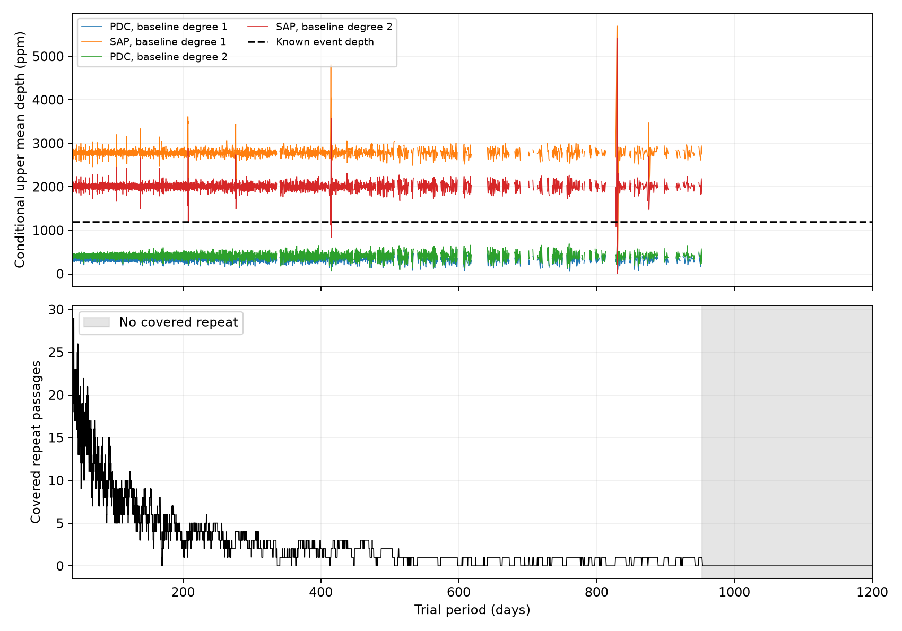

# Corrected Kepler flux gives lower fixed-shape repeat bounds than aperture flux for KIC 11084727 at 40 to 1200 days

We test whether the known comet-like dip of KIC 11084727 repeats with a fixed shape, depth, and period. We use public Kepler release 25 data and 24,168 trial periods from 40 to 1200 days. Corrected flux gives no repeat above the stated control thresholds. Its largest conditional upper mean fitted depth is 693.5 parts per million (ppm), below the reference depth of 1187.6 ppm. Aperture flux does not give the same bound. Thus, this result depends on the flux correction and the noise model. We report no new planet, comet, or confirmed physical cause.

A period with no covered passage cannot be tested by this method. Such periods cover 36.01% of the period range, with length measured in days. No trial above 952.99 days has a covered repeat. These are limits of the specified measurement mask, not proof that the telescope took no samples at any predicted event.



The upper panel shows conditional upper mean fitted depths in four fits to the same observations. Each curve uses a separate envelope from 499 shifted controls over the whole grid. The horizontal line shows the fitted known dip. The lower panel shows the number of eligible repeat passages. The grey area has no eligible repeat. Blank upper values are not zero depths.

## Prior work and added test

Rappaport et al. (2018, doi:10.1093/mnras/stx2735) reported the known dip. Kennedy et al. (2019, doi:10.1093/mnras/sty3049) recovered it and discussed the lack of repeats. We do not claim that this lack is new.

Before this test, we ran `sci search "astronomy" --in ./campaign` and `sci search "11084727" --in ./campaign`. We read two published results. Publication eef3f5b tests 5 to 40 days with shifted controls. We reuse its local depth fits, epoch, shape, and raw-data provenance. Publication b3cc9d09 maps missing detectable repeats from 5 to 1000 days with four filters. Its diagnostic is deterministic. Our addition is a separate, whole-grid conditional error envelope at longer periods, a comparison of corrected and aperture flux, and tests with periods between grid nodes. The scope overlaps that prior map. This is a statistical and processing sensitivity test, not a new isolated-event search or an independent data confirmation. Full publication IDs are in sci.json.

## Data and reuse

Raw input: `/mnt/dell-data/shared_datasets/kepler-kic11084727-q0-q17-dr25/lightcurves.tar`.

This is the public NASA Kepler DR25 long-cadence archive for quarters 0 to 17 from the MAST S3 mirror. Source URL and each used FITS hash, size, quarter, and pipeline version are in files/prior_provenance.json. The TAR SHA-256 is `a302c57e7ae4a1c50133d100967d5676d55083d6b5de67845d3d93b5d0f102d9` (7,536,640 bytes). No shared dataset was changed or added. Raw data are not duplicated in the bundle. files/retrieve.py downloads this exact archive to a new local path and checks its hash.

The reused derived files came from the verified eef3f5b ZIP. Their hashes and source ID are in files/reuse_provenance.json. The full verification record and target campaign search are included. No private workspace was read. files/rebuild_local.py adapts the published source to rebuild the local measurements from the raw archive. files/validate.py reads and hashes every used raw FITS file and checks the reused fits with a direct solver.

TIME is BKJD (BJD minus 2454833). SAP is aperture flux; PDC is corrected flux from the same observations. Retained rows have quality zero and finite time and both flux values. Each quarter is normalized by its median, then expressed in ppm. All of quarter 11 is reserved for the known event. No repeat in that quarter enters this test.

## Method and assumptions

The fixed reference epoch is BKJD 1075.993785. The model is an exposure-averaged split Gaussian with entry width 0.077793 day and exit width 0.292738 day. A quadratic fit within three days of the reference sets these parameters and the depth. The model describes a shape; it does not measure a physical dust-tail size. Reference uncertainty is not propagated.

For each other quarter, the published local measurements fit this template plus a linear or quadratic baseline within two days. Centers have 0.04-day spacing. A fit needs 160 retained rows, 36 rows within 0.5 day, 40 before -0.7 day, and 35 after +0.9 day. Centers must lie at least two days from quarter edges. No high-pass filter is applied first.

Trial frequencies are evenly spaced from 1/1200 to 1/40 cycles per day, inclusive, with 24,168 nodes. Each period predicts centers t0 + nP, for integer n from -27 to 13. This covers the raw time span and includes zero, but the reserved reference quarter supplies no repeat measurements. A predicted passage is used only between two finite adjacent local-depth nodes. We interpolate their depths and average all covered passages with equal weight. Trials with zero passages have no statistic. The result concerns this grid and epoch; it proves nothing between grid nodes.

For each of four flux and baseline choices, 499 controls independently shift each quarter's finite local-depth sequence by a random integer with wrap. The original interpolation mask is retained. The seed is 2355734. This procedure transfers noise within a quarter, compresses gaps in the finite sequence, and joins its ends. It assumes that such transfers describe relevant error. It does not model arbitrary time-dependent noise or the original Kepler correction process.

The threshold is the 95th percentile of the largest control mean across the whole covered period grid. The reported rank fraction is (1 + number of control maxima at least as large as the observed maximum) / 500. It is conditional on the controls, not a physical false-alarm probability. The upper curve adds the 95th percentile of the largest negative control mean to every observed mean. This is a simultaneous error envelope over one grid under that noise model. It is not a joint 95% bound over four choices. It bounds fitted amplitudes; Interpolation and frequency-grid mismatch can affect conversion to an intrinsic constant depth. The upper values apply to fitted means at the tested grid nodes. They do not bound signals at all periods between nodes.

Range fractions use period-length weights from the midpoint cells of the trial periods, clipped to each range. They are approximations for this sampled mask, not probabilities for an orbit or exact continuous coverage measures.

## Results

| Flux | Baseline degree | Largest mean (ppm) | Control threshold (ppm) | Rank fraction | Largest upper value (ppm) |
| --- | ---: | ---: | ---: | ---: | ---: |
| PDC | 1 | 230.97 | 337.23 | 0.968 | 566.48 |
| PDC | 2 | 281.73 | 401.37 | 0.864 | 693.50 |
| SAP | 1 | 2917.29 | 2915.36 | 0.048 | 5698.70 |
| SAP | 2 | 3409.65 | 3482.73 | 0.144 | 5419.86 |

The SAP linear fit marginally passes its own threshold. It fails a simple four-choice Bonferroni threshold of 0.0125 and is not stable across baseline choices. Its 829.64955-day trial has only one covered passage, at BKJD 246.34424 in quarter 2. At that time the PDC depths are 176.84 and 235.34 ppm. The large product difference is consistent with a correction-sensitive feature. It does not by itself establish an instrument cause or rule out correction of a real signal. We do not promote it to a new candidate. files/sap_peak_check.json gives the paired measurements.

| Period range (days) | Fraction with a covered repeat | Fraction with PDC upper value below the reference, in both baseline choices |
| --- | ---: | ---: |
| 40 to 100 | 100.00% | 100.00% |
| 100 to 300 | 99.63% | 99.63% |
| 300 to 700 | 80.86% | 80.86% |
| 700 to 1200 | 31.92% | 31.92% |

SAP envelopes usually exceed the reference depth. The PDC result is therefore conditional on trusting the corrected product. A long-lived body with a stable, equally deep dust profile is disfavored by PDC at covered trial periods under this error model. Variable dust, a long orbit, timing changes, or a different shape remain possible. We cannot infer eccentricity, mass, or the number of bodies.

## Validation

files/validation.json records direct least-squares checks and raw-flux injection tests. The injection periods are 32 logarithmically spaced values from 40.1 to 1199 days. For each, we add a full reference-depth train to retained normalized raw samples, refit the local baseline at the two nodes used by the nearest frequency trial, and repeat interpolation and averaging. This tests local fitting and grid mismatch. It does not rerun the Kepler pipeline or measure detection probability from independent noise samples. Trials without eligible repeats cannot recover a signal. The summary below gives the measured counts.

The 136 direct solver checks differ from the reused local depths by at most 9.07e-11 ppm. All raw hashes match.

| Flux | Baseline degree | Covered injection periods | Passes above control threshold | Transfer gain range |
| --- | ---: | ---: | ---: | --- |
| PDC | 1 | 27 of 32 | 27 | 0.3898 to 0.9972 |
| PDC | 2 | 27 of 32 | 26 | 0.2451 to 0.9964 |
| SAP | 1 | 27 of 32 | 0 | 0.3898 to 0.9972 |
| SAP | 2 | 27 of 32 | 0 | 0.2451 to 0.9964 |

PDC recovers 53 of 54 covered configuration and period tests. Transfer can fall to 0.245 for periods between grid nodes. Thus the grid is too coarse to extend the bound to all continuous periods, especially at long periods. These finite tests do not establish completeness over all periods. SAP tests show the loss of sensitivity caused by its large global noise envelope.

## Limits

There is no independent telescope observation, new pixel localization, neighbor-star check, or new centroid fit. The two flux products share the same telescope samples. The noise controls, fixed epoch, selected shape, constant depth, excluded quarter, and coverage requirements restrict the claim. In particular, absence of a persistent dust profile does not imply absence of an orbiting body. Further source tests and independent observations are required for a new physical claim.

## Reproduce

Use Python 3.12 and the versions in files/requirements.txt in a private environment. From the publication root, run:

```sh
python files/analyze.py
python files/check_peak.py
python files/validate.py /mnt/dell-data/shared_datasets/kepler-kic11084727-q0-q17-dr25/lightcurves.tar
```

The first command uses the included, hash-recorded local-depth table and makes the period scans, controls, summary, and PNG. The second verifies raw inputs and repeats the independent fit and injection checks. Both write beside their source files; use a writable copy. For a full rebuild of the reused local table, first run:

```sh
python files/retrieve.py /your/local/scratch/lightcurves.tar
python files/rebuild_local.py /your/local/scratch/lightcurves.tar
python files/analyze.py
python files/validate.py /your/local/scratch/lightcurves.tar
```

The retrieval step is unnecessary if the shared archive is available. The rebuilt reference CSV is an optional inspection output. No network access is needed after retrieval. No server or secret is needed. Package hashes fix all supplied derived evidence.

## Campaign record

Campaign 11_07_2026. Job sci-1107-dell-astronomy-2355d7340adc. Topic astronomy. Machine dell. Account codex-andrii. Model gpt-6.1-sol with high reasoning effort in T3 Code through the Codex harness. Analysis date 2026-11-08. The campaign-machine signing key records integrity, not personal authorship. No private key is included. NASA Kepler and MAST supply the public observations. The baseline license applies to this work; prior work remains credited by citation. The signed bundle is stored locally only.
