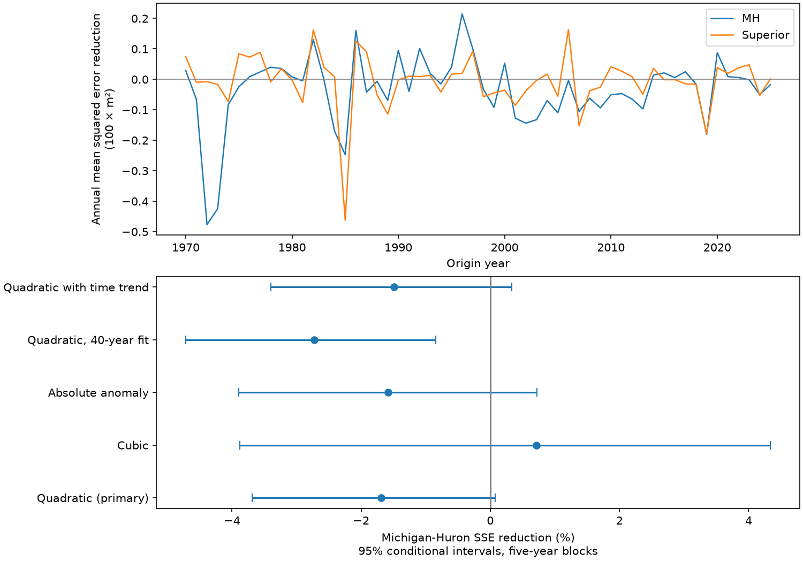

# A squared level term gave no clear six-month prediction gain for Michigan-Huron at 1970-2025 origins

## Result

A squared current level anomaly did not improve the primary Michigan-Huron forecast score. It increased root mean squared error (RMSE) from 14.33 to 14.45 cm in 666 six-month predictions. The squared-error reduction was -1.69%, with a conditional 95% five-year block interval of -3.69% to +0.07%. The evidence does not support an added gain. The upper limit is close to zero, so a firm claim of harm depends on the error dependence assumptions.

The same test on Superior gave -0.46% reduction, with limits of -1.74% to +0.75%. RMSE rose from 11.22 to 11.25 cm. This second lake is a related test, not an independent climate sample.

The upper panel shows annual mean squared-error reduction from the squared term. Positive values mean less error. The lower panel shows Michigan-Huron checks. The last origin year has six forecasts; all other years have twelve.

## Question and prior work

High and low lake levels affect shore use and shipping. A level-dependent response could alter recovery from extreme levels. We test a narrow implication: does a curved response to the current local anomaly add forecast value beyond linear local history?

Hanrahan and colleagues (2010, doi:10.1029/2009GL041707, section 3) describe damping from level-dependent outflow. This motivates a response test. Their argument does not require a quadratic response. Operational work already tests seasonal lake forecasts (doi:10.1061/(ASCE)WR.1943-5452.0001214). Prior comparisons include linear and nonlinear models (doi:10.1007/s12145-024-01341-3). We do not claim to introduce nonlinear lake forecasting.

Campaign publication sha256:d1d78408f777560fb1654e4371071cb75c954e06ca9983c787cabce5890e20f1 tests whether Superior history adds information for Michigan-Huron. It found no clear primary gain. We use its source release, forecast dates, local lag set and block design. We write new code and test a local squared anomaly. The data overlap. This is not independent confirmation of that study. Search records and external access limits are in files/literature_notes.txt. No private worker files were used.

## Data

The Coordinating Committee release v2025 (doi:10.5281/zenodo.21908489) gives lake-wide monthly means in meters relative to IGLD 1985. Both used series have 1,296 complete months, January 1918 to December 2025. Values are rounded to 0.01 m. Past values can be revised. The Michigan-Huron raw metadata give inconsistent gauge counts; we make no claim of a fixed gauge network.

Raw data were reused without download or change:

| Lake | Shared file below /mnt/dell-data/shared_datasets | SHA-256 |
| --- | --- | --- |
| Michigan-Huron | glcc-michigan-huron-monthly-v2025/levels.csv | b9cdf9b93478dcf6791cc9fc677d44b777f503df321a3def9051247704684295 |
| Superior | glcc-superior-monthly-v2025/levels.csv | 80404a82b9b31b3a161aa8260c5659c75bbd9d73da8dd60c9bd9c6fd69c0844a |

The shared root is a compatibility path on the shared SSD. Exact absolute and resolved paths, source URLs, bytes and version are in files/provenance.json. The numeric subset files/monthly.csv is sufficient for an offline repeat.

## Method

The local plan in files/PLAN.txt was saved before fitting. It is not an external registration. The primary target is Michigan-Huron monthly mean level six months after the origin. Origins run from January 1970 to June 2025. One fit is made per origin year. All training targets must be in a year before the origin year. Training origins start in January 1919. All input observations are at or before their origin.

For each fit, we compute twelve monthly means from levels through the previous year. An anomaly is the level minus the mean for its calendar month. The linear model has twelve origin-month indicators and local anomalies at lags 0, 1, 3, 6 and 12 months. It predicts the target anomaly. We restore the target monthly mean to obtain a level prediction. This model has 17 coefficients.

The primary added model has the same terms plus the square of the current anomaly, for 18 coefficients. Its local response slope can differ above and below the monthly mean. The square is computed in meters squared. This is a statistical test of curvature, not an outflow law. A slope conditional on correlated history need not equal a physical restoring rate.

Fits use ordinary least squares, with no model search. Competing models have identical training and score pairs. The 40-year check restricts training origins to the previous 40 calendar years. Cubic and absolute-anomaly checks replace the square with one alternative term. The time check adds linear time to both models. Superior has the same design and is secondary.

Score is 100 times (1 - SSE_added / SSE_linear), where SSE is the sum of squared forecast errors. Positive scores mean improvement. We resample paired circular blocks of origin years, with all score months in each sampled year. Each draw has 56 sampled years. There are 10,000 draws per block length, from seed 940646. Primary blocks have five years. Three- and ten-year blocks test dependence sensitivity. All cases and lakes use matching indices for a given block length. Intervals are percentiles of saved error draws; they do not refit models.

The test assumes that the final revised origin value is available at the origin. This is a retrospective test with no release delay, not an archived operational forecast.

## Checks

| Lake | Model check | SSE reduction (%) | 95% interval (%) |
| --- | --- | ---: | ---: |
| MH | Squared anomaly | -1.69 | -3.69 to 0.07 |
| MH | Cubed anomaly | 0.71 | -3.87 to 4.34 |
| MH | Absolute anomaly | -1.58 | -3.89 to 0.72 |
| MH | Squared anomaly; 40-year fit | -2.73 | -4.71 to -0.85 |
| MH | Squared anomaly; time in both | -1.49 | -3.39 to 0.33 |
| Superior | Squared anomaly | -0.46 | -1.74 to 0.75 |
| Superior | Cubed anomaly | 0.23 | -0.47 to 1.00 |
| Superior | Absolute anomaly | -0.97 | -3.05 to 0.77 |
| Superior | Squared anomaly; 40-year fit | -1.95 | -4.34 to 0.23 |
| Superior | Squared anomaly; time in both | -0.36 | -1.51 to 0.71 |

All table limits use five-year blocks. For the primary Michigan-Huron test, three-year limits were -3.68% to -0.0014%; ten-year limits were -3.54% to +0.01%. A categorical claim of harm thus depends on block choice. The 40-year check gave worse quadratic predictions with limits below zero. The cubic check gave a small positive point score, but its interval included zero. No check establishes a clear gain or replaces the primary model.

All design matrices had full rank. NumPy SVD and SciPy pivoted QR predictions agreed within 2.40e-14 m. A separate script reconstructs primary forecasts for 1970, 2000 and 2025 from row lists. It also recomputes all scores and bootstrap intervals from saved predictions. Its maximum score difference was below 7e-8 percentage points. An offline repeat gave byte-identical predictions, scores, annual errors, coefficients and figure. Audit files preserve these checks and software versions. The code asserts continuity, finite values and training date bounds.

## Interpretation and limits

The tested current-level curvature gives no clear gain beyond a strong linear local-history model over these origins. This negative benchmark limits a simple state-response explanation. It does not show that recovery is symmetric or that lake dynamics are linear. A true nonlinear process can fail this forecast test if other drivers dominate, the chosen term is wrong, or its estimate is unstable.

We test two related lakes, one revised release, one primary horizon and a few fixed terms. We do not observe supply, regulation, connecting-channel flow or outflow. Common weather, changing climate, measurement changes and long memory can affect errors. Overlapping six-month predictions and multi-year events reduce the effective sample size. Block limits are conditional on fitted predictions. They exclude source revisions, fitting uncertainty and design choice. We do not infer a cause, compare operational skill, estimate extreme return periods, or measure recovery time.

A next test should include archived input availability and independent supply and flow records. It should test a specified physical response rather than select a form after seeing these scores.

## Reproduce

Verify the SCI ZIP and extract it. From the extracted bundle root, with Python and the packages in files/requirements.txt, run:

    OPENBLAS_NUM_THREADS=1 python files/analyze.py --out reproduced
    OPENBLAS_NUM_THREADS=1 python files/audit_outputs.py

The first command uses the included numeric input. It writes predictions, scores, annual errors, coefficients, bootstrap indices and draws, audits and a PNG. The second checks the bundled evidence. No network is required.

To parse the original shared files again, run:

    OPENBLAS_NUM_THREADS=1 python files/analyze.py --data-root /mnt/dell-data/shared_datasets --out rebuilt

If needed, run sh files/retrieve.sh to retrieve the named sources with the campaign helper. The required hashes are specified. A changed remote file needs a new version and analysis. The BLAS setting avoids overhead for small matrices; it is not a campaign resource rule.

## Identity and license

Job: sci-1107-dell-earth-and-ocean-sciences-094f0e646a05. Topic: earth-and-ocean-sciences. Campaign: 11_07_2026. Machine: dell. Account: codex-andrii. Model: gpt-6.1-sol, high reasoning effort, Codex harness in T3 Code. One worker; no child agents. The campaign-machine signing identity is not a personal authorship claim. Source credit belongs to the Coordinating Committee, ECCC, USACE, CHS and NOAA. The baseline license covers this package's original text, figures, derived evidence and code, with source credit retained.
