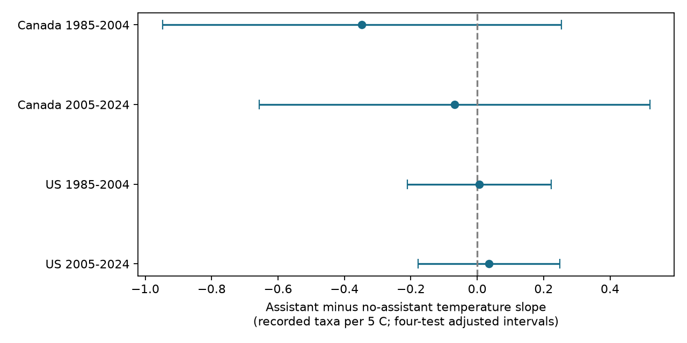

# Assistant status gave no clear temperature-slope difference in Canada and US bird surveys in 1985-2024

We tested whether the start-temperature slope of recorded bird taxa differed when an assistant recorded the observations. We used 59,238 consecutive-year pairs with the same route and observer in Canada and the US, in 1985-2004 and 2005-2024. Assistant minus no-assistant slopes were -0.347, -0.069, +0.007 and +0.035 taxa per 5 C. All four intervals adjusted for multiple tests included zero. US intervals were within -0.25 to +0.25 taxa per 5 C under the model. Canada intervals were wider. Checks with unchanged assistant status, close survey dates and observer clusters gave no clear difference. This result does not show that assistants remove weather bias. An assistant records data and is not a second independent bird observer. Selected surveys, missing assistant reports, detection, unmeasured change and few year clusters limit inference. The package includes data, code, source hashes, model inputs and checks.



## Question and prior work

Does an assistant change the link between survey temperature and recorded taxa? A recorder can reduce the observer's data-entry load. If this load contributes to a weather association, the slope can differ by recorder status. This is a possible explanation to test, not an established mechanism. Weather can also affect bird activity, sound travel and human detection. Robbins (1981) used BBS records to study weather and bird activity. Our narrow test concerns a survey condition that can affect the interpretation of biodiversity and climate records.

The campaign assistant-report study tested the loss of records with missing status. It did not test whether slopes differ between status values. The earlier four-state study controlled status as a main effect. We read these signed results and used their sample rules as context. We wrote new code and did not reuse their analysis files. The source records overlap. This is a new model contrast on a used archive, not independent data validation. Search details are in files/prior_work.txt. The plan was written before model fitting but was not registered. Data and question selection were informed by earlier results.

## Source and selection

We read Weather.csv in place from the shared store. It is the USGS 2026 release for 1966-2025, doi:10.5066/P144YU3S. We restrict analysis to 1985-2024. The source XML title identifies that release and its publication date field gives 20260528. Exact bytes are fixed by the hashes below. No download was needed. The XML is included. Source URLs, full paths, bytes and hashes are in files/provenance.json.

* Raw weather: /mnt/dell-data/shared_datasets/bbs-2026-release-weather-6a0b0b0a/Weather.csv. SHA-256: 4bcdb3346dcc44839690702f76c10306a19329260e99e16576b1a92f4465f67d.
* Source metadata: /mnt/dell-data/shared_datasets/bbs-2026-release-metadata-6a0b0b0a/metadata.xml. SHA-256: c16e9785a9e7fdf29b084fa2bd151710a662837a64c340fb7ab443c159402172.

TotalSpp counts recorded taxa. These include some subspecies, hybrids and species groups. It does not measure true species richness. Assistant=1 means that an assistant recorded data for the observer. Assistant=0 means no such recorder. Missing status has no data. It does not mean that a second independent observer counted birds. RPID=101 specifies the standard single-observer protocol.

There are 144,146 raw rows. CountryNum must be 124 or 840, Year 1985-2024, RPID 101, RunType 1 and QualityCurrentID 1. This leaves 100,195 runs before complete-field filters. Dates must be valid and on days 121-212. Start time must be 02:00-08:00 local clock time. Duration must be 180-480 minutes. Both times must be valid clock values. Start temperature must be -10 to 40 C after scale conversion. End temperature is not used. Wind codes at each end must be 0-5. Sky codes must be 0, 1, 2, 4, 5, 7 or 8. Code 9 is excluded as missing. Recorded taxa must be 1-200, observer ID positive and assistant status 0 or 1. These rules leave 86,378 runs. No route-year is duplicated.

We pair consecutive years on the same country-state-route with the same observer ID. Both years must be in one test period. There are 59,238 pairs. We do not bridge absent years or the 2020 survey cancellation. A survey can occur in two adjacent pairs. Countries have separate records; nearby routes can share conditions. Periods share routes and observers. These are regional and time checks, not four independent experiments.

## Model

For each country and period, the response is the annual difference in TotalSpp. Start temperature T is centered at 15 C and divided by 5 C. We include the differences in T, assistant status A and their product T*A. The coefficient of the product is the assistant minus no-assistant temperature slope, in taxa per 5 C. We also include differences in day of year divided by 10, squared day of year centered at day 166 and divided by 100, start clock hour, duration in hours, and indicators for each allowed nonzero start and end wind and sky code. The wind and sky categories do not impose linear weather slopes.

Separate intercepts for each state and ending year are removed by demeaning all differenced variables in those groups. First differences remove fixed route and observer levels in each pair. They do not remove observer-specific temperature responses or annual local change. The model imposes common slopes across routes within each country and period. The temperature interaction uses variation in both temperatures and status. It is not limited to status-switch years.

We use least squares with a pseudo-inverse. Some weather indicator columns have no variation. The primary focal contrast is identified in all four designs, with projection error below 1e-14. Effective model rank includes the state-year intercepts. For focal coefficient scores, we calculate route, ending-year and route-year cluster sums. Each variance component uses G/(G-1). We take the maximum of the route variance, year variance and route-plus-year-minus-route-year variance, then multiply by (N-1)/(N-k). This is a cautious choice among approximate cluster methods. It does not guarantee interval coverage.

Intervals use a t reference with min(route clusters, year clusters)-1 degrees of freedom: 18 early and 16 late. Each primary interval has nominal 98.75 percent coverage. The Bonferroni rule gives approximate 95 percent family coverage for four tests under the assumptions. Few year clusters remain a material limit. We do not report causal effects.

## Results

| Country | Period | Pairs | Routes | Status switches | Slope difference | Adjusted interval |
|---|---|---:|---:|---:|---:|---|
| Canada | 1985-2004 | 4,335 | 633 | 358 | -0.347 | -0.948 to 0.253 |
| Canada | 2005-2024 | 4,781 | 897 | 495 | -0.069 | -0.657 to 0.520 |
| US | 1985-2004 | 29,454 | 3,228 | 2,199 | 0.007 | -0.210 to 0.223 |
| US | 2005-2024 | 20,668 | 3,111 | 1,929 | 0.035 | -0.177 to 0.248 |


All four primary intervals include zero. The US intervals lie within -0.25 to +0.25 taxa per 5 C under this model. Canada intervals permit larger differences, including a negative difference near one taxon per 5 C in the early period. We did not establish equivalence in Canada. Opposite point-estimate signs between countries do not establish a country difference. We did not run a formal country contrast.

No-assistant temperature slopes were 0.118, 0.034, 0.044 and 0.026 taxa per 5 C, in table order. Assistant slopes were -0.230, -0.035, 0.050 and 0.061. These marginal point estimates are included for interpretation; the planned tests concern their differences. The early Canadian negative estimate does not repeat clearly in the later period or in the US.

Three planned checks also gave intervals that include zero. Keeping pairs with unchanged status gave interaction estimates -0.368, -0.148, -0.027 and 0.007. Requiring dates within seven days gave -0.473, 0.050, 0.003 and 0.037. Adding observer-cluster variance to the maximum left point estimates unchanged and gave similar intervals. Full results are in files/results.csv. Corrections apply within each set of four, not across all checks. Unchanged-status pairs still compare weather slopes across status groups; they do not identify a causal recorder effect.

## Interpretation and limits

The data gave no clear evidence that recorder status changes the mean start-temperature slope in these selected samples. This does not show that assistants remove or cause weather bias. Recorder use is not random. It can depend on observer age, skill, health, route difficulty or personal support. First differences do not remove all such differences. An observer can have a stable recorder status and a distinct temperature response. No recorder identity or skill measure is available here.

Missing assistant reports cause substantial selection, especially later. The earlier campaign audit found small changes in average temperature slopes under this selection rule, but that result does not establish unbiased interactions. Our complete-field filters and accepted-run rules remove many poor-weather events. We do not observe conditions when surveys were not made. We cannot extend these results to extreme heat. Reported temperatures have scale and rounding error. Clock time is not relative to sunrise. Survey-date and duration controls can also remove part of a weather pathway.

Recorded taxa depend on presence, bird activity, observation and reporting. The outcome cannot separate these processes. Opposing taxon responses can cancel. Roadside routes do not represent all habitats. Year and route clusters cannot cover every source of spatial or shared-observer dependence, and the observer check is also approximate. Quality rules changed in 1997. We did not test pollution, long-term warming, range shifts or population loss. These limits prevent a causal climate claim.

## Reproduction

Python 3, NumPy, pandas, SciPy and Matplotlib are required. Exact versions are in files/environment.json. From an extracted bundle root, run:

```sh
OPENBLAS_NUM_THREADS=1 python files/analyze.py files/panel.csv /tmp/assistant_offline
OPENBLAS_NUM_THREADS=1 python files/validate.py /tmp/assistant_offline
```

Use a new output directory. The panel route reproduces pairs, all model estimates, uncertainty and the figure. It does not audit raw filtering. To audit selection, replace files/panel.csv with the raw shared Weather.csv path above. files/retrieve.sh records a hash-checked dataset-helper recipe if the raw dataset is absent. Existing shared data must be reused in place. Raw data are not copied into this bundle. files/pairs.csv contains source row IDs, differenced inputs and grouping fields. Four design NPZ files preserve the demeaned primary matrices, coefficients and grouping fields without pickled objects. The panel retains source public observer IDs.

files/validate.py uses a separate residual-regression calculation and cluster score sums to check primary coefficients and standard errors. Errors were below 2e-15 for coefficients and 3e-16 for standard errors. files/validation.json records the checks. files/reproduction_check.json records a full offline comparison with the raw-file analysis. Code does not need network access. The source is public USGS data; source rights remain with the source. The baseline license covers this new text, code, figures and derived evidence subject to source rights.

## Job record

Campaign: 11_07_2026. Job: sci-1107-dell-climate-pollution-biodiversity-a40748387454. Topic: climate-pollution-biodiversity. Machine: dell. Account: codex-andrii. Model: gpt-6.1-sol, high reasoning effort, through the Codex harness in T3 Code. One finite worker ran the investigation with no child agents. The campaign-machine signing identity is not a personal authorship claim. No private keys are included. No remote submission is made.
