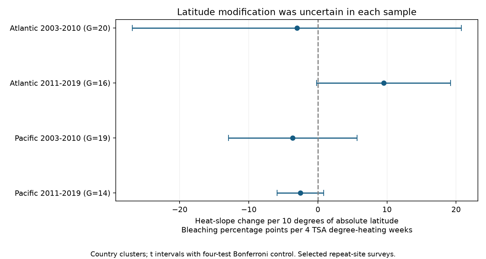

# Latitude gave no clear common heat-slope change in four Atlantic and Pacific coral samples in 2003-2019

We tested whether the link between heat stress and coral bleaching changes with distance from the equator. The four primary tests did not show a clear common latitude pattern. All four country-cluster intervals included zero after correction for four tests. This does not show that latitude has no effect.

## Question and prior work

Reefs at different latitudes can have different coral communities and heat histories. This can change their response to extreme heat. Sully et al. (2019), DOI [10.1038/s41467-019-09238-2](https://doi.org/10.1038/s41467-019-09238-2), reported high bleaching risk at tropical middle latitudes. They proposed community composition, genetic diversity and past heat exposure as possible explanations. Their study used Reef Check observations and CoRTAD heat data.

Our question is narrower: Does a linear latitude term change the slope between heat and bleaching within repeatedly surveyed sites? We test separate ocean and period samples. We do not repeat the prior latitude main-effect test or its nonlinear latitude pattern. Site effects absorb fixed latitude main effects. Our interaction test can detect a linear change in the heat slope, but cannot detect all possible geographic response shapes.

Before estimates, we searched SCI for “phenology climate pollution”, “bleaching” and “coral latitude”. We read SCI 87846242d9a62eebf235d7ded07a333967b6535fcfb3bcf394dbd6c48866d6f9. That study tested spatial grouping. We use its source choice, selection rules and four-sample design, with new code and a new latitude interaction. Records overlap with that study and with other campaign work. This is a follow-up, not an independent data validation. The analysis choices are in files/decisions.txt. This was not a registered study.

## Data and observation controls

The source is BCO-DMO 773466 version 2, dated 2022-10-14, DOI [10.26008/1912/bco-dmo.773466.2](https://doi.org/10.26008/1912/bco-dmo.773466.2). The source record lists CC BY 4.0. Van Woesik and Kratochwill (2022), DOI [10.1038/s41597-022-01121-y](https://doi.org/10.1038/s41597-022-01121-y), describe the archive. The data combine biological observations with CoRTAD version 6 environmental fields. No new download was needed. Exact shared paths, source URL, version, size and file hash are in files/provenance.json. Raw data and record-level tables stay outside the publication.

We select Reef_Check records. We check that all used fields agree within each Sample_ID, then remove repeated substrate rows. We require complete site, country, ocean, coordinate, year, month, depth, bleaching and heat fields. We keep Atlantic and Pacific records in 2003-2019, valid global coordinates, calendar months 1-12, depths 0-40 m, bleaching 0-100%, and nonnegative TSA_DHW. Each site must have fixed coordinates, country and ocean in these eligible records. We average bleaching, heat and depth within site, year and month. Each sample keeps sites surveyed in at least two distinct years.

The source has 41,361 rows. Reef_Check supplies 28,821 rows and 14,475 distinct surveys. Eligibility leaves 9,623 surveys and 7,820 site-months. The repeat-site rule leaves the following four samples:

| Ocean and years | Site-months | Sites | Countries | Absolute latitude range |
| --- | ---: | ---: | ---: | ---: |
| Atlantic 2003-2010 | 514 | 159 | 20 | 3.85-26.13 |
| Atlantic 2011-2019 | 464 | 103 | 16 | 1.57-26.21 |
| Pacific 2003-2010 | 1,583 | 446 | 19 | 0.73-34.10 |
| Pacific 2011-2019 | 2,775 | 596 | 14 | 0.55-34.10 |

These are disjoint ocean-year samples. Some sites occur in both periods. All samples use one reporting system. Thus they are not fully independent study programmes.

Monthly averaging prevents repeated substrate rows or extra same-month surveys from receiving extra weight. Site effects control fixed differences between sites. Calendar-month and year effects control common survey season and annual conditions. Depth controls one measured survey difference. These controls reduce some observation bias. They do not remove selective visits, missing bleaching reports, observer changes, unknown field effort or changes in coral composition.

## Model and uncertainty

For each sample, ordinary least squares fits:

    bleaching = site effect + year effect + calendar-month effect
                + depth coefficient * mean depth
                + beta * h + delta * h * l + error
    h = mean TSA_DHW / 4
    l = (absolute latitude - 15) / 10

Delta is the heat-slope change per ten degrees farther from the equator. Its unit is bleaching percentage points per four TSA degree-heating weeks. Centering latitude at 15 degrees changes beta, but not delta. Four defines the heat reporting unit; it is not an assumed threshold. The model describes a linear projection over observed records. It can predict outside 0-100 and is not a mechanistic response model. Bleaching is not mortality, species richness or extinction.

Primary standard errors allow arbitrary error dependence within countries. We use the cluster sandwich correction G/(G-1) times (n-1)/(n-k), where k is the full fitted rank. Intervals use a t reference with G-1 degrees of freedom and two-sided alpha 0.05/4. Each interval has nominal 98.75% coverage. Together the four primary intervals have nominal 95% family coverage under valid cluster approximations. There are only 14-20 country clusters, so this approximation can be poor. Cross-country event dependence is not modeled.

## Results

| Ocean and years | Delta | Adjusted interval | Unadjusted p |
| --- | ---: | ---: | ---: |
| Atlantic 2003-2010 | -3.05 | -26.87 to 20.77 | 0.7282 |
| Atlantic 2011-2019 | 9.52 | -0.18 to 19.21 | 0.0139 |
| Pacific 2003-2010 | -3.64 | -12.96 to 5.69 | 0.2932 |
| Pacific 2011-2019 | -2.54 | -5.92 to 0.84 | 0.0486 |

The later Atlantic estimate is positive. Both Pacific estimates are negative. No primary interval excludes zero after the four-test correction. The wide early Atlantic interval permits large effects of either sign. The later Atlantic and Pacific marginal p values must not be treated as repeated evidence of one common direction. We do not formally establish a difference between their slopes.

## Explanation and sensitivity tests

One explanation for an apparent latitude interaction is that latitude groups experience different parts of a curved heat response. We added a common squared-heat term while keeping all records fixed. Delta became -2.78, 9.53, -3.70 and -0.84 in table order. All adjusted country intervals included zero. The late Pacific estimate moved closer to zero. This is consistent with some sensitivity to common curvature. It does not prove that curvature caused the primary estimate. We did not fit latitude-specific curves.

We also gave each site equal total weight, rather than each site-month equal weight. Delta became -3.11, 7.59, -1.41 and -2.82. The last country interval was -5.59 to -0.05, which narrowly excludes zero under the same four-test correction within this sensitivity specification. The other three included zero. Thus this alternative supports a negative estimate only in the late Pacific sample. It does not establish a pattern repeated across all samples. The primary result must not be described as a null result under every choice.

Using site clusters instead of country clusters gave adjusted primary intervals above zero in the late Atlantic sample and below zero in the late Pacific sample. This allows less geographic error dependence and gives narrower intervals. It does not resolve the opposite signs. files/results.csv contains all 24 combinations of four samples, three model specifications and two cluster choices. Correction covers four samples within a specification, not all sensitivity analyses together. Sensitivity results are exploratory.

## Checks and limits

Dense QR projection and a separate sparse LSQR projection agree to less than 1e-6 for every coefficient in all 12 fits. A full statsmodels regression independently checks the four primary interaction estimates and country-cluster standard errors. Errors are below 1e-7. files/validation.json records those checks. These checks test numerical work, not source accuracy.

The linear interaction cannot reject the prior middle-latitude main-effect result. Fixed effects change the contrasts under study. This selected panel has no random site or visit sample. The heat field is a surface satellite estimate and can differ from heat at coral depth. Location errors, limited latitude support, sparse large heat events, unmeasured composition and shared ocean events can affect estimates. The study does not identify genetic adaptation, acclimation, causal climate-change effects, species-distribution change or air pollution effects. It addresses the climate-extreme part of the research objective through a tested geographic response hypothesis and an observation-aware method.

## Reproduce

Use Python 3.12 with NumPy, pandas, SciPy, Matplotlib, threadpoolctl and statsmodels. Tested versions are in files/environment.json and files/validation.json. From a verified, extracted publication, use separate local scratch folders:

    python files/retrieve.py /absolute/path/to/data_scratch
    python files/analyze.py --raw /absolute/path/to/data_scratch/global_bleaching_environmental.csv --out /absolute/path/to/output_scratch
    python files/validate.py --raw /absolute/path/to/data_scratch/global_bleaching_environmental.csv --results /absolute/path/to/output_scratch/results.csv --out /absolute/path/to/output_scratch/validation.json

Retrieval requires network access and refuses an existing destination. Omit retrieval when reusing the shared source path in provenance.json. Source SHA-256 is 78cc014b1e7887f26f4c44a40d4d9213212f3c6217541c6a1b69e723b61bfacb; size is 16,772,400 bytes. The analysis enforces the hash. Do not write regenerated files into the signed publication. The code creates aggregate outputs only. No record-level extract is needed in the bundle.

## Campaign and rights

Job: sci-1107-dell-climate-pollution-biodiversity-87438bb3133f. Topic: climate-pollution-biodiversity. Campaign: 11_07_2026. Machine: dell. Account: codex-myxtap. Model: gpt-6.1-sol, high reasoning effort. Analysis date: 2026-11-09. The campaign-machine signing key is not a personal authorship claim.

The exact SCI baseline license applies to bundled new code, text, figures and aggregate model results. External raw data and record-level derivative databases are excluded. Source attribution and external terms are in files/EXTERNAL_DATA.txt. This publication is signed into the local campaign only. No remote archive upload or index submission is part of this worker task.
