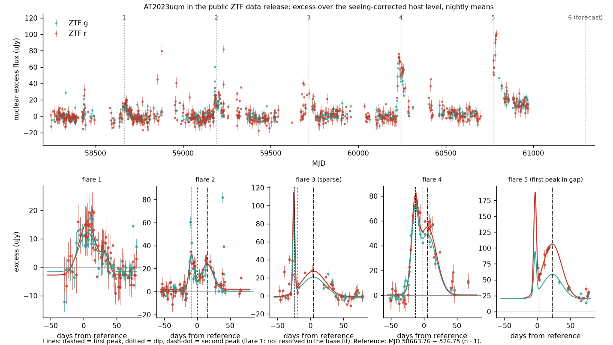
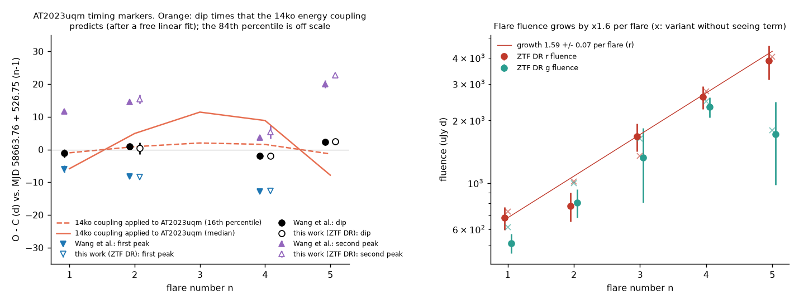
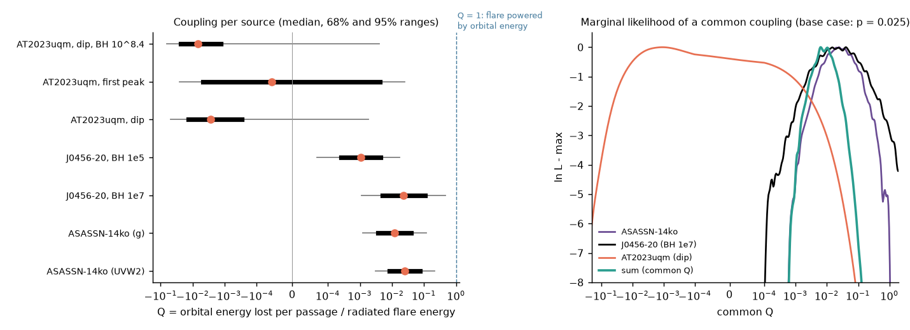

# Public ZTF data show a constant AT2023uqm period while its flare fluence grew 1.6-fold per flare; one energy-proportional clock for three periodic nuclear transients fails only for some markers

**Job:** sci-1107-dell-astronomy-ed8713bfa46b. **Campaign:** 11_07_2026. **Topic:** astronomy. **Machine:** dell. **Account:** claude-olen. **Model:** Claude Opus 5.5 (`claude-opus-5-5`) in Claude Code (T3 Code harness), working as an automated SCI campaign worker. **Analysis date:** 2026-11-10. The signing key is a campaign-machine key. It is not a personal authorship claim.

## Summary

**Question.** Prior SCI studies tested the flare clocks of two repeating partial tidal disruption candidates. The period decrease of ASASSN-14ko became slower after 2021, while its flares did not become weaker (sci:sha256:e5616202...). The recurrence time of eRASSt J0456-20 decreased fast and then stayed at 193 d, while its X-ray output fell by a factor of two per cycle (sci:sha256:e2dd9320...). Do the clocks of these sources, and of a third periodic source, follow one physical law in which the orbit loses energy in proportion to the energy that each flare radiates? If not, which classes of orbital-evolution mechanism remain possible?

**Third source.** AT2023uqm (ZTF23abikzfr, z = 0.238) has five periodic optical flares with a period of about 527 d (Wang et al. 2025, arXiv:2510.26561). Its flare energy increases from flare to flare. Thus it is a strong test of an energy-proportional clock. We measured its flares again with an independent public data set: the ZTF public data-release (DR) light curves from IRSA (PSF photometry on the science images, 2018 May to 2025 October). Wang et al. used the ZTF forced-photometry service, which needs an account.

**Approach.**
1. We removed the host-galaxy flux with a seeing-dependent model and fitted each flare with a two-Gaussian profile (robust loss, 400 bootstrap resamples). We measured the first peak, the dip between the peaks, the second peak, the half-rise time and the fluence.
2. For each source we fitted timing models with a free white jitter: constant period, constant period change per passage, a broken model, and an energy-coupled clock. In the energy-coupled clock, each passage changes the period by -k times the energy of its flare.
3. We converted each k into a dimensionless coupling Q (orbital energy lost per passage divided by the radiated flare energy). A Monte Carlo propagated the black-hole mass, the stellar mass and the bolometric energy. A likelihood-ratio test, calibrated with 1000 simulations, then tested one common Q for the three sources.
4. A Monte Carlo budget compared the measured period changes with gravitational-wave decay, tidal heating, star-disc drag and mass-loss kicks.

**Main results.**
1. **The ZTF DR data confirm the published AT2023uqm markers.** For flares 2, 4 and 5, our markers agree with Wang et al. within 0.0-2.7 d (|z| <= 1.9). The DR photometry does not resolve the double peak of flare 1 in the base fit.
2. **The AT2023uqm flare fluence increases by 1.59 +/- 0.07 per flare (r band; g: 1.62 +/- 0.08).** Over flares 1-5 it increases by a factor of 5.7 (r). Wang et al. found 1.67-1.79.
3. **The AT2023uqm period stays constant.** With the first-peak marker the period change per passage is +0.03 +/- 0.80 d (|dP| < 1.6 d at 2 sigma, |dP/P| < 0.003). With the dip marker it is +0.8 +/- 1.1 d. The energy-coupled coefficient is consistent with zero for every marker (first peak: -0.02 +/- 0.50 d per flare-1 energy; dip: -0.51 +/- 0.37 d).
4. **The AT2023uqm timing markers drift.** The first peak moves earlier relative to the dip by 1.26 +/- 0.44 d per flare. Thus the period depends on the marker: 524.45 +/- 0.17 d (first peak), 527.06 +/- 0.56 d (dip), 523.36 +/- 0.36 d (half rise, DR). As in ASASSN-14ko, the flares become broader when they become more energetic.
5. **An energy-coupled clock fits eRASSt J0456-20.** For cycles 1-5 it fits as well as the best empirical broken model (negative log-likelihood 14.4-15.4 against 14.8; no extra jitter is necessary). Out of sample it forecasts cycles 6-7 with |z| <= 1.7 (X-ray fluence weights) or up to z = 2.8 (bolometric weights of Liu et al. 2024, t_x scale). Thus the J0456-20 data do not reject a period change proportional to flare energy.
6. **The coupling of ASASSN-14ko and of J0456-20 is similar; AT2023uqm has a smaller coupling.** Q = 0.025 (95% range 0.003-0.21) for ASASSN-14ko and Q = 0.023 (0.001-0.47) for J0456-20 (black-hole mass 10^7). Each source predicts the other (posterior predictive p = 0.96). For AT2023uqm, Q is consistent with zero (first peak: -0.026 to +0.025; dip: -0.049 to +0.002). With the common coupling of the other two sources, AT2023uqm should have a period change of about 14 d per passage at flare-4 energy (68% range 2-90 d).
7. **One common Q is disfavoured only for some markers.** The joint test gives p = 0.025 for the published dip marker, but p = 0.11 when we add 2 d of timing jitter, and p = 0.25 for the first-peak marker (Table 6). If J0456-20 has a black-hole mass of 10^5, the coupling of J0456-20 agrees with AT2023uqm, but not with ASASSN-14ko.
8. **Budget.** Gravitational waves give less than 0.5% of the measured period changes. Tidal heating cannot supply the orbital energy loss of ASASSN-14ko or of the early J0456-20 cycles: per passage the orbit loses 0.6 (ASASSN-14ko, main-sequence star) to 11 (J0456-20, black-hole mass 10^7) times the binding energy of the star. Star-disc drag needs a disc mass of order 1 Msun (ASASSN-14ko, main-sequence star) or 15 Msun (J0456-20, 10^7) inside the pericentre. Mass-loss kicks can explain J0456-20 only with a black-hole mass near 10^5, as Liu et al. (2024) found. For ASASSN-14ko (main-sequence star), each of at least 13 passages needs a kick 1.3 times the largest middle-age value in those simulations.

**Interpretation.** The three best-timed periodic nuclear transients do not show one simple energy-proportional clock. J0456-20 alone agrees with it. ASASSN-14ko prefers a break in its period derivative to an energy-weighted clock (sci:sha256:e5616202...; Table 4 here). AT2023uqm shows no period change while its flare energy increased by a factor of 5.7. The cross-source test is weak because the black-hole masses and the bolometric energies are uncertain by about one order of magnitude, and because the AT2023uqm result depends on the timing marker. The marker drift of 1.3 d per flare in AT2023uqm and of 7.5 d over 2017-2024 in ASASSN-14ko is of the same size as the period-change signals. Thus flare-shape evolution is a main systematic error for all optical flare clocks.

## 1. Data

| Data | Source and version | Use | In this bundle? |
| --- | --- | --- | --- |
| ZTF public data-release light curves of AT2023uqm (RA 347.66256, Dec +34.90301; 2.16 arcsec cone; g 795, r 1317, i 213 epochs; MJD 58244-60969) | NASA/IPAC IRSA ZTF light-curve service, latest public data release served on 2026-11-10. URL in `files/code/00_get_inputs.sh`. SHA-256 `4ff903f48050e239ec243dde5683aec1e1a41bdb012a08d4090a7198d06f1b87` (592,808 bytes) | Flare times and fluences | No. Only per-flare aggregate results. See `files/NOTICE_external_data.md`. |
| Published AT2023uqm markers (Table S1), periods (Table S2), black-hole mass estimates | Wang et al. 2025, arXiv:2510.26561v3 (CC BY 4.0) | Timing set W, priors | 13 numbers in `files/code/03_uqm_timing.py` |
| eRASSt J0456-20 onsets t1-t5 and bolometric energies E_tot (Tables 1 and 2) | Liu et al. 2024, A&A 683, L13 (arXiv:2401.14091) | Timing and energy weights | Numbers in `files/code/04_other_sources.py` |
| eRASSt J0456-20 cycle 2-7 markers and X-ray fluences | sci:sha256:e2dd9320... `files/results/joint_cycle_fits_base.csv`, `amplitudes_base.csv` | Timing and energy weights | Yes, `files/inputs/` (SCI baseline license of that publication) |
| ASASSN-14ko compiled peak times (n = 0-38) | sci:sha256:9398601f... `files/data/derived/all_peak_times_used.csv` (Payne et al. 2021, 2022 values for n <= 24) | Timing | Yes, `files/inputs/` |
| ASASSN-14ko per-flare g and UVW2 fluences | sci:sha256:e5616202... `files/data/energy_series.csv` | Energy weights | Yes, `files/inputs/` |

The SHA-256 values of the four input tables are in `files/code/00_get_inputs.sh`. The script checks them.

## 2. Method

All scripts are in `files/code/`. Random seeds are fixed.

**Host subtraction (`01_prepare.py`).** We use DR points with `catflags = 0`. For each light curve (one field, CCD quadrant and filter) we fit the quiescent flux as b0 + b1 * sharp, where `sharp` is the DR shape parameter. The PSF-fit flux of a resolved host depends on the image quality, and `sharp` follows it. Quiescent points are more than 60 d before and more than 110 d after each reference time t_ref(n) = 58663.76 + 526.75 (n - 1) (Wang et al. dip ephemeris; it only places the windows). We clip at 3 sigma and add an error term so that the quiescent chi2 per degree of freedom is 1 (1.3-6.6 uJy). The quiescent rms is 3.3-3.8 uJy in g and 6.3-6.9 uJy in r. The flares have peak excesses of 15-170 uJy. A variant without the `sharp` term (`x_const`) tests this step. We then form weighted nightly means per filter.

**Flare fits (`02_flares.py`).** For each flare we fit the g and r nightly excess in [t_ref - 55, t_ref + 80] d with one two-Gaussian shape, a g/r ratio and a local offset per band. We use a soft-L1 loss, which limits the effect of single-night outliers. The errors come from 400 bootstrap resamples of the nights. For flare 5 the first peak fell in the seasonal gap. We bound its peak separation to 14-26 d and its first width to 2-10 d, and we use only its dip and second peak.

**Timing models (`timing_lib.py`, `03_uqm_timing.py`, `04_other_sources.py`).** All models are linear in their parameters. We solve them by generalised least squares and profile a white timing jitter s_j (or fix it at 0, 2 or 4 d). Intervals follow passages: I_j = t_(j+1) - t_j.
- const: t_n = a + P n.
- quad: constant period change dP per passage.
- broken: constant dP up to a break passage, then dP = 0.
- energy: I_j = I_1 - k * sum over m = 2..j of w_m. Here w_m is the energy of flare m. Passage m changes the period by -k w_m.

**Energy weights.** AT2023uqm: our DR r fluences, normalised to flare 1 (and geometric laws with 1.54 and 1.79 per flare as checks). J0456-20: E_tot of Liu et al. (2024) for cycles 1-5 (this includes their bolometric correction; the cycle-5 value is a lower limit), with cycles 6-7 scaled by the X-ray fluence ratio; or the X-ray fluences of sci:sha256:e2dd9320... ASASSN-14ko: UVW2 or g fluences of sci:sha256:e5616202..., with era means for flares without a measurement.

**Coupling Q (`05_crosssource.py`).** If the orbit loses Q E_rad per passage, then Delta P / P = -(3/2) Q E_rad / |E_orb| and Q = (2/3) (k / P) |E_orb| / E_unit. Here |E_orb| = G M_BH M_* / (2 a), with a from the rest-frame period. The Monte Carlo priors are: log M_BH = 7.86 +/- 0.5 (ASASSN-14ko), 7.0 +/- 0.5 (J0456-20; variant 5.0 +/- 0.3), and an equal mixture of 7.18 +/- 0.55 and 8.39 +/- 0.3 (AT2023uqm, the two scaling relations of Wang et al.). M_* is log-uniform in 0.3-3 Msun. E_unit includes a blackbody bolometric correction (ASASSN-14ko: T = 20,000-40,000 K; AT2023uqm: 15,000-25,000 K), the luminosity distance (flat LCDM, H0 = 70, Omega_m = 0.3), extinction and a 0.15 dex calibration term. For J0456-20 we use E_tot with a 0.5 dex uncertainty.

**Common-Q test (`06_joint_Q.py`).** For each source the marginal likelihood L_s(Q) is the mean of N(k_s; Q f, sigma_s) over the nuisance draws of f = (3/2) P E_unit / |E_orb|. The statistic is Lambda = 2 [sum_s max ln L_s - max sum_s ln L_s]. We calibrate it with 1000 data sets simulated at the best common Q.

**Budget (`07_budget.py`).** With the same priors and main-sequence radii (and a giant-star case for ASASSN-14ko, R_* = 3-30 Rsun), we compute for the measured Delta P per passage: the gravitational-wave period change (Peters 1964, pericentre at the tidal radius), the orbital energy lost per passage over the stellar binding energy 1.5 G M_*^2 / R_*, the disc mass that star-disc drag needs (scaling of Linial & Quataert 2024, as written by Wang et al. 2025), and the remnant energy change in units of the tidal energy spread. We compare the last quantity with the largest values in the simulations of Liu et al. (2024): 0.0246 (terminal-age star, 80-90% mass loss) and 0.0027 (middle-age star). Draws in which the black hole would swallow the star (r_t < 4 G M_BH / c^2) are removed.

## 3. Results

### 3.1 AT2023uqm flares in the ZTF data release

Table 1. Flare fits (base run). Times in days relative to t_ref(n) = 58663.76 + 526.75 (n - 1); 68% bootstrap errors. Fluence in uJy d. Full table: `files/results/flare_fits.csv`.

| n | nights (g+r) | first peak | dip | second peak | half rise | r fluence | g fluence |
| --- | --- | --- | --- | --- | --- | --- | --- |
| 1 | 119 | not resolved | not resolved | not resolved | -9.5 +/- 2.9 | 681 +/- 84 | 514 +/- 56 |
| 2 | 105 | -8.35 +/- 0.52 | +0.4 +/- 1.8 | +15.4 +/- 1.3 | -12.7 +/- 0.6 | 778 +/- 123 | 807 +/- 124 |
| 3 | 55 | (sparse) | (sparse) | (sparse) | (sparse) | 1675 +/- 252 | 1325 +/- 519 |
| 4 | 64 | -12.70 +/- 0.30 | -2.0 +/- 0.8 | +5.4 +/- 2.1 | -19.5 +/- 0.4 | 2598 +/- 330 | 2323 +/- 252 |
| 5 | 27 | in gap | +2.45 +/- 0.22 | +22.7 +/- 0.8 | in gap | 3870 +/- 721 | 1724 +/- 741 |

In the variant without the `sharp` term, flare 1 shows two peaks (first peak -7.35 +/- 0.74, dip -1.6 +/- 2.0, second peak +10.1 +/- 1.4), close to the values of Wang et al. The other markers change by less than 1.2 d (flare 3 excepted), and the fluences change by less than 31% (`flare_fits_x_const.csv`). The flare-5 fluence includes a model of the unobserved first peak and is less certain than its error suggests.

Table 2. Our DR markers minus the markers of Wang et al. (same flares; `uqm_validation_vs_wang.csv`).

| marker | flare | difference (d) | z |
| --- | --- | --- | --- |
| first peak | 2 / 4 | -0.04 / +0.21 | -0.07 / +0.59 |
| dip | 2 / 4 / 5 | -0.49 / +0.01 / +0.11 | -0.26 / +0.01 / +0.11 |
| second peak | 2 / 4 / 5 | +0.91 / +1.71 / +2.71 | +0.60 / +0.78 / +1.87 |

### 3.2 AT2023uqm timing tests

Table 3. Timing models for AT2023uqm (`uqm_timing_tests.csv`). W: Wang et al. markers; D: this work. dP: period change per passage. k: energy-coupled coefficient in days per flare-1 r fluence (flare 1 radiated about 2.3e50 erg in the Monte Carlo median). The flare-6 forecast is for a constant period.

| set (flares) | jitter | P (d) | fitted jitter (d) | dP (d) | k (d per E_1) | flare 6 forecast (MJD) |
| --- | --- | --- | --- | --- | --- | --- |
| W first peak (1,2,4) | 0 | 524.45 +/- 0.17 | - | +0.03 +/- 0.80 | -0.02 +/- 0.50 | 61280.0 +/- 0.5 |
| W dip (1,2,4,5) | free | 527.06 +/- 0.56 | 1.4 | +0.82 +/- 1.08 | -0.51 +/- 0.37 | 61298.5 +/- 2.3 |
| W dip (1,2,4,5) | 2 d | 527.10 +/- 0.72 | 2 | +0.80 +/- 1.47 | -0.48 +/- 0.58 | 61298.6 +/- 3.1 |
| W second peak (1,2,4,5) | free | 527.3 +/- 1.8 | 5.8 | +4.4 +/- 3.2 | -2.3 +/- 1.0 | 61311.5 +/- 8.5 |
| D dip (2,4,5) | 2 d | 527.4 +/- 1.1 | 2 | +3.8 +/- 2.7 | -1.1 +/- 0.8 | 61299.2 +/- 3.3 |
| D half rise (1,2,4) | 0 | 523.36 +/- 0.36 | - | -0.13 +/- 2.05 | +0.08 +/- 1.29 | 61271.2 +/- 1.0 |

Thus no marker shows a period decrease. A positive k means a period decrease when the flare energy is high. All fitted k values are consistent with zero or are negative. The first-peak period (524.45 d) and the dip period (527.06 d) differ by 2.6 +/- 0.6 d. This follows from the marker drift: the interval from the first peak to the dip is -4.8, -9.2 and -10.9 d for flares 1, 2 and 4 (slope -1.26 +/- 0.44 d per flare). The second peak has a jitter of about 5 d. Public data do not cover the predicted flare 6 (2026 August-September): the public ZTF alert stream stopped covering Dec +35 after 2026 April (sci:sha256:9398601f...), and the source is north of the Rubin footprint.

### 3.3 eRASSt J0456-20 and ASASSN-14ko

Table 4. Negative log-likelihood (lower is better) of the timing models with a free jitter (`j0456_timing_tests.csv`, `14ko_timing_tests.csv`). All models except const have three linear parameters; the broken models also have a chosen break.

| source, data | const | quad | broken | energy (bolometric / Liu E_tot or UVW2) | energy (X-ray or g fluence) |
| --- | --- | --- | --- | --- | --- |
| J0456-20, Liu onsets, cycles 1-5 | 24.4 | 19.0 | 14.8 (break at 4) | 15.4 | 14.4 |
| J0456-20, onsets, cycles 1-7 | 35.7 | 31.1 | 24.4 | 25.4 | 23.6 |
| J0456-20, t_x, cycles 1-7 | 34.5 | 31.0 | 24.0 | 27.8 | 24.6 |
| ASASSN-14ko, all 29 peaks | 112.8 | 81.2 | 78.1 (break at 24) | 84.2 | 83.9-86.0 |
| ASASSN-14ko, 20 peaks n >= 11 | 66.2 | 55.4 | 50.0 | 56.9 | 56.5-57.3 |

For J0456-20 the energy-coupled clock fitted to cycles 1-5 gives k = 17.4 +/- 1.6 d per X-ray fluence unit, with residuals of -6.8 to +3.5 d and no extra jitter. Its forecasts for cycles 6 and 7 (`j0456_forecasts.csv`):

| clock (trained on cycles 1-5) | cycle 6, onset z | cycle 6, t_x z | cycle 7, onset z | cycle 7, t_x z |
| --- | --- | --- | --- | --- |
| constant P (cycles 3-5) | -2.0 | -0.4 | -0.1 | +0.3 |
| broken at cycle 4 | -1.8 | -0.1 | +0.1 | +0.6 |
| quad | +1.0 | +2.3 | +3.0 | +3.4 |
| energy, X-ray fluence | -1.1 | +0.9 | +1.0 | +1.7 |
| energy, Liu E_tot | -0.2 | +2.0 | +1.9 | +2.8 |

The cycle-6 onset is early because the cycle-6 rise was slow (sci:sha256:e2dd9320...). The energy clock with X-ray weights is not rejected. The constant-period and broken clocks are slightly better on the t_x scale. For ASASSN-14ko, the energy clocks are worse than a constant period change (by 2.7-4.8 in negative log-likelihood) and worse than a break at n = 24 (by 5.8-7.9), in agreement with sci:sha256:e5616202....

### 3.4 Coupling Q and the common-Q test

Table 5. Q = orbital energy lost per passage divided by the radiated energy (`crosssource_Q.json`). Median and 95% range of the Monte Carlo.

| source, variant | Q median | 95% range |
| --- | --- | --- |
| ASASSN-14ko, UVW2 energy | 0.025 | 0.003 to 0.21 |
| ASASSN-14ko, g energy | 0.012 | 0.001 to 0.12 |
| J0456-20, BH 10^7, cycles 1-5 | 0.023 | 0.001 to 0.47 |
| J0456-20, BH 10^7, t_x cycles 1-7 | 0.017 | 0.001 to 0.36 |
| J0456-20, BH 10^5 | 0.0011 | 0.0001 to 0.017 |
| AT2023uqm, first peak | -0.00005 | -0.026 to +0.025 |
| AT2023uqm, dip | -0.0028 | -0.049 to +0.002 |
| AT2023uqm, dip, BH 10^8.4 | -0.007 | -0.065 to +0.004 |

Q is much smaller than 1 in all sources (95% upper values 0.02-0.47 for stellar masses of 0.3-3 Msun). Thus the orbital energy loss cannot power the flares, which would need Q >= 1.

Table 6. Test of one common Q (`joint_Q_tests.csv`). Lambda is the likelihood-ratio statistic; p comes from 1000 simulations at the best common Q. The last columns give the best Q of each source alone.

| configuration | Lambda | p | common Q (95% range) | Q 14ko | Q J0456-20 | Q AT2023uqm |
| --- | --- | --- | --- | --- | --- | --- |
| base: uqm dip (Wang), 14ko UVW2, J0456 1e7 | 6.86 | 0.025 | 0.0062 (0.0020-0.0304) | 0.0247 | 0.0412 | -0.0011 |
| uqm first peak (Wang) | 3.57 | 0.246 | 0.0121 (0.0025-0.0457) | 0.0164 | 0.0202 | -0.0000 |
| uqm dip, jitter 2 d | 4.87 | 0.114 | 0.0089 (0.0022-0.0412) | 0.0304 | 0.0223 | -0.0005 |
| uqm dip (ZTF DR, this work), jitter 2 d | 5.13 | 0.111 | 0.0089 (0.0026-0.0412) | 0.0288 | 0.0212 | -0.0022 |
| uqm dip, uqm BH 10^8.4 | 6.11 | 0.046 | 0.0094 (0.0019-0.0319) | 0.0235 | 0.0223 | -0.0043 |
| uqm first peak, uqm BH 10^8.4 | 2.44 | 0.343 | 0.0121 (0.0028-0.0457) | 0.0372 | 0.0304 | -0.0001 |
| 14ko g-band fluence | 5.96 | 0.059 | 0.0051 (0.0013-0.0247) | 0.0109 | 0.0192 | -0.0011 |
| J0456 set B (t_x, cycles 1-7) | 6.71 | 0.045 | 0.0089 (0.0018-0.0319) | 0.0304 | 0.0164 | -0.0011 |
| J0456 BH 1e5 | 7.43 | 0.017 | 0.0044 (0.0009-0.0149) | 0.0319 | 0.0009 | -0.0011 |
| J0456 BH 1e5, uqm first peak | 4.72 | 0.100 | 0.0048 (0.0013-0.0192) | 0.0304 | 0.0017 | -0.0000 |
| pair 14ko + J0456 only | 0.13 | 0.788 | 0.0223 (0.0044-0.1556) | 0.0202 | 0.0319 | - |
| pair 14ko + uqm dip | 6.25 | 0.015 | 0.0062 (0.0013-0.0288) | 0.0212 | - | -0.0012 |
| pair J0456 + uqm dip | 5.26 | 0.007 | 0.0022 (0.0004-0.0235) | - | 0.0223 | -0.0011 |

The two pair tests show the structure. ASASSN-14ko and J0456-20 agree with one Q (p = 0.79). AT2023uqm with the dip marker disagrees with each of them (p = 0.015 and 0.007). With the first-peak marker, or with 2 d of extra jitter on the dip, the three-source test gives p = 0.10-0.34. A black-hole mass of 10^5 for J0456-20 moves its Q near the AT2023uqm range, but then ASASSN-14ko disagrees (p = 0.017 with the dip marker).

### 3.5 Budget of orbital-evolution mechanisms

Table 7. Budget per passage (`mechanism_budget.csv`). Median (5-95%) over the Monte Carlo; draws in which the star would be swallowed are removed. For the J0456-20 cycles 3-7 and the AT2023uqm rows, Delta P is consistent with zero, so the values show the size that the data still allow.

| source, phase, star | Delta P per passage (d) | GW / measured | Delta E_orb / E_bind | disc mass for drag (Msun) | kick de/De over largest simulated value |
| --- | --- | --- | --- | --- | --- |
| ASASSN-14ko, n=11-24, MS | -0.42 +/- 0.05 | 0.00072 (0.0003-0.0012) | 0.62 (0.25-0.98) | 1.1 (0.29-2.8) | 0.14 (0.087-0.2) |
| ASASSN-14ko, n=11-24, giant | -0.42 +/- 0.05 | 1.1e-06 (2e-08-5.4e-05) | 9.3 (1.5-55) | 21 (4-1.2e+02) | 1.6 (0.42-6.1) |
| ASASSN-14ko, n=24-38, MS | -0.18 +/- 0.12 | 0.0016 (0.00052-0.013) | 0.25 (0.028-0.67) | 0.42 (0.043-1.7) | 0.06 (0.0074-0.14) |
| ASASSN-14ko, n=24-38, giant | -0.18 +/- 0.12 | 3.1e-06 (4.5e-08-0.0002) | 3.6 (0.28-28) | 8.2 (0.71-60) | 0.63 (0.064-3.3) |
| eRASSt J0456-20, passages 2-3, MS | -55.50 +/- 7.00 | 1.2e-05 (3.6e-06-3e-05) | 11 (3.1-26) | 15 (3.7-58) | 3.2 (1.7-5.4) |
| eRASSt J0456-20, passages 2-3, BH 1e5, MS | -55.50 +/- 7.00 | 6.7e-07 (2.9e-07-1.6e-06) | 0.58 (0.25-1.4) | 0.84 (0.27-2.4) | 0.75 (0.48-1.2) |
| eRASSt J0456-20, cycles 3-7, MS | +3.10 +/- 6.00 | 9.2e-05 (1.8e-05-0.0011) | 1.3 (0.11-6.1) | 1.9 (0.14-12) | 0.43 (0.038-1.4) |
| AT2023uqm, flares 1-5 (dip), MS | +0.82 +/- 1.08 | 0.0024 (0.00047-0.027) | 0.064 (0.0051-0.28) | 0.096 (0.007-0.59) | 0.02 (0.0018-0.064) |
| AT2023uqm, flares 1-4 (first peak), MS | +0.03 +/- 0.80 | 0.0043 (0.0008-0.05) | 0.037 (0.0028-0.17) | 0.054 (0.0038-0.34) | 0.011 (0.00099-0.038) |

The budget gives these results (fiducial priors; the ranges are in Table 7):
- **Gravitational waves** are negligible in all sources (less than 0.5% of the measured changes, also for e = 1 - r_t/a).
- **Tidal heating of the star** cannot be the energy sink for ASASSN-14ko or for the early J0456-20 cycles. Per passage, the orbit of ASASSN-14ko loses 0.6 (main-sequence star) or 9 (giant) times the stellar binding energy, and the sum over the 13 passages of n = 11-24 is 8 (main sequence) to 120 (giant) binding energies. For J0456-20 the loss per passage is 11 binding energies (10^7) or 0.6 (10^5). Simulations allow at most about 0.01-0.1 per passage. For AT2023uqm the data allow 0.04-0.06 per passage.
- **Star-disc drag** needs a disc mass inside the pericentre of about 1 Msun (ASASSN-14ko, main-sequence star; 21 Msun for a giant) and about 15 Msun (J0456-20, 10^7; 0.8 Msun for 10^5). The stripped mass per flare is about 0.003-0.1 Msun in published estimates. Thus drag needs a pre-existing gas disc. The host of ASASSN-14ko has an AGN; the host of J0456-20 is quiescent (Liu et al. 2023).
- **Mass-loss kicks** (a change of the binding energy of the remnant). J0456-20 needs 3.2 (1.7-5.4) times the largest simulated value for a black-hole mass of 10^7, and 0.75 times for 10^5. This agrees with Liu et al. (2024), who needed 10^5. ASASSN-14ko (main-sequence star) needs 0.14 times the terminal-age value, which is 1.3 times the largest middle-age value, at each of at least 13 passages. A giant needs 1.6 times the terminal-age value.

## 4. Discussion

**What the three clocks show together.** Each source shows a different relation between its clock and its flare energy. In J0456-20 the period decrease and the X-ray output decreased together, and a clock with Delta P proportional to flare energy fits all data within about 2 sigma. In ASASSN-14ko the period decrease became slower while the flare energy stayed constant or increased (sci:sha256:e5616202...). In AT2023uqm the flare energy increased by a factor of 5.7 while the period stayed constant within 1.6 d per orbit. A period change that is proportional to the radiated energy, with one coupling constant, explains J0456-20 and ASASSN-14ko on average (Q of about 0.02), but it predicts a period decrease of about 14 d per orbit in AT2023uqm. The data exclude this for the dip marker and disfavour it weakly for the first-peak marker.

**Possible explanations.** (a) The orbital change is not set by the flare energy. For example, drag in a gas disc depends on the disc and not on the flare (Linial & Quataert 2024). ASASSN-14ko has an AGN host, and AT2023uqm may have had weak AGN activity (Wang et al. 2025). (b) The coupling depends on the star and the encounter. Hydrodynamic simulations show that the remnant can become more or less bound, depending on the fractional mass loss and on the stellar age (Liu et al. 2024). A star that loses mass in a runaway, as AT2023uqm may do, can have a coupling near zero or of the opposite sign. Our AT2023uqm coefficients are zero or slightly negative (a period increase), which agrees with this. (c) The radiative efficiency or the bolometric correction differs between the sources by more than one order of magnitude. Our Monte Carlo includes 0.15-0.5 dex for this, not more. (d) The flare markers do not trace the pericentre passages. The AT2023uqm first peak moves 1.3 d per flare relative to the dip, and in ASASSN-14ko the half rise moves by 7.5 d relative to the peak (sci:sha256:e5616202...). These drifts are of the same size as the period-change signals in the optical sources.

**Relation to prior campaign results.** The J0456-20 result revises the qualitative statement of sci:sha256:e2dd9320... that "the energy that the flares release does not set the period change". When the cycle-1 to cycle-3 decrease and the bolometric energies of Liu et al. (2024) are included, a proportional clock fits as well as the best broken clock. The statement is correct only for cycles 3-7 alone, where both the energies and the period changes are small. The ASASSN-14ko result agrees with sci:sha256:e5616202.... The AT2023uqm result is new: it adds a third source with an independent public data set. AT2018fyk, AT2022dbl and AT2020vdq did not show their predicted next flares (sci:sha256:9001f8c9...; Hinkle et al. 2026, arXiv:2606.06578). Thus the periodic sources with five or more cycles are the only sources in which a clock can be tested, and none of them shows a steady period derivative over the full record.

## 5. Limitations

- The ZTF DR photometry is PSF photometry on images that contain the host. It is noisier than difference imaging. The flare-1 double peak depends on the host model, and flare 3 is too sparse for markers. The flare-5 first peak is not observed, so its fluence includes a model.
- AT2023uqm has only three or four usable times per marker. The jitter cannot be well measured, and the result depends on the marker (p = 0.025-0.34 in the common-Q test).
- The energy weights are band-limited proxies with one bolometric correction per source. The J0456-20 energies depend on the bolometric factors of Liu et al. (2024) (3-15). The black-hole masses are uncertain by 0.3-0.55 dex, and for J0456-20 the simulation-based value (10^5) differs from the observational value (10^7) by two orders of magnitude.
- Q depends on the unknown stellar mass. We used independent log-uniform priors (0.3-3 Msun). A common Q for stars of very different masses is a strong assumption.
- The energy-coupled clock assigns the period change of passage m to the flare that follows passage m. Other assignments (for example, the previous flare) were not tested.
- The budget uses simple scalings (pericentre at the tidal radius, n = 3 polytrope binding energy, the drag formula of Wang et al. 2025, simulation maxima from one paper). It gives orders of magnitude, not exact limits.
- We used published timing products for ASASSN-14ko and J0456-20 and did no new photometry for them. No public data cover the 2026 flares of ASASSN-14ko or AT2023uqm (checked 2026-11-09/10 by sci:sha256:8ce2fda4... and sci:sha256:9398601f...).

## 6. Forecasts

Constant-period forecasts for the AT2023uqm flare 6, from the published markers (Table 3): first peak MJD 61280.0 +/- 0.5 (2026-08-28), dip MJD 61298.5 +/- 2.3, second peak MJD 61311.5 +/- 8.5. Under the common coupling of ASASSN-14ko and J0456-20, passage 5 alone would shorten the next interval by about 21 d (median; 68% range 4-140 d), so flare 6 would come at least this much earlier than these values. Archival data of 2026 August-October (WFST, ATLAS, ZTF forced photometry) can test this directly.

## 7. Reproduction

1. Make an empty working folder W. Copy `files/code/` to `W/code/`. Link or copy the campaign folder with the cited SCI ZIPs to `W/campaign/` (or give its path as the first argument).
2. Use Python 3.12 with numpy, scipy, pandas, matplotlib and astropy (versions in `files/code/environment.txt`). The `sci` command must be available to read the cited bundles.
3. Run `bash code/run_all.sh`. Step 00 downloads the ZTF DR light curve from IRSA into `W/scratch/ztf/` (never into a signed bundle) and reads the four input tables from the cited SCI bundles with hash checks. Steps 01-08 write tables to `W/out/` and figures to `W/figs/`. Set `OMP_NUM_THREADS=1` on a shared host. The run takes about 15 min of CPU time.
4. IRSA serves the latest ZTF data release. A later release can differ from the file of this study (SHA-256 above). To run steps 03-08 without a new download, copy `files/results/flare_fits*.csv` and `uqm_energy_growth.json` to `W/out/` and copy `files/inputs/` to `W/inputs/`.

Files:
- `files/results/flare_fits.csv`, `flare_fits_x_const.csv`, `flare_boot*.csv`: per-flare markers and fluences, and bootstrap samples (no record-level photometry).
- `files/results/prepare_info.json`: host-model coefficients and error terms per light curve.
- `files/results/uqm_*.csv|json`: AT2023uqm validation, timing tests, marker drift, fluence growth.
- `files/results/j0456_*.csv`, `14ko_timing_tests.csv`, `other_sources_meta.json`: the other two sources.
- `files/results/crosssource_Q.json`, `universal_Q_tests.csv`, `joint_Q_tests.csv`, `joint_Q_profiles.npz`: coupling and common-Q tests.
- `files/results/mechanism_budget.csv`: Table 7.
- `files/inputs/`: the four input tables from cited SCI publications.
- `files/NOTICE_external_data.md`: sources, terms and acknowledgements.

## 8. References

- Wang, Y. et al. 2025, "A Star's Death by a Thousand Cuts: The Runaway Periodic Eruptions of AT2023uqm", arXiv:2510.26561 (v3; Science Bulletin 71, 4645, doi:10.1016/j.scib.2026.08.025).
- Liu, Z. et al. 2023, A&A 669, A75 (arXiv:2208.12452); Liu, Z. et al. 2024, A&A 683, L13 (arXiv:2401.14091).
- Payne, A. V. et al. 2021, ApJ 910, 125 (arXiv:2009.03321); Payne, A. V. et al. 2022 (arXiv:2206.11278).
- Linial, I. & Quataert, E. 2024, MNRAS 527, 4317 (arXiv:2309.15849).
- Hinkle, J. T. et al. 2026, "A Disappearing Act: Constraints From Missing Flares of Repeating Partial TDE Candidates", arXiv:2606.06578.
- Peters, P. C. 1964, Phys. Rev. 136, B1224.
- Bellm, E. C. et al. 2019, PASP 131, 018002; Masci, F. J. et al. 2019, PASP 131, 018003 (ZTF).
- Campaign publications cited in `sci.json`.
