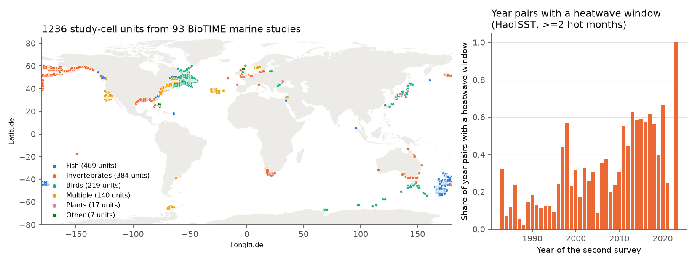
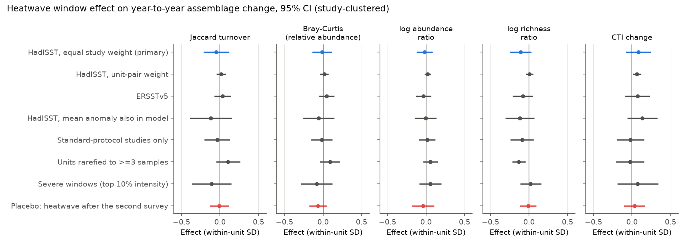
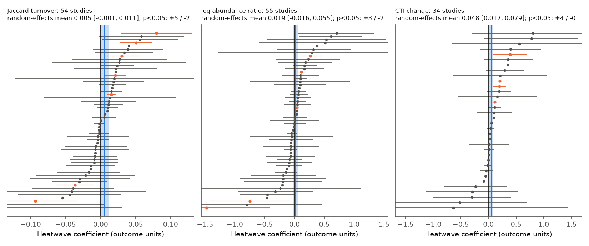

# Marine heatwaves did not increase year-to-year change in 93 BioTIME marine assemblage studies (1983-2023)

## Summary

Question: After a marine heatwave, do marine assemblages change more from one year to the next than after other years? Fredston et al. (2023, Nature) found that marine heatwaves were not a dominant driver of change in demersal fish surveys. We tested if this result is also true for other marine taxa and survey types.

Data: BioTIME 2.0 (release 15 April 2025), 93 marine studies without experimental treatment. The studies include fish, benthic and planktonic invertebrates, seabirds, algae and phytoplankton. We split each study into 1-degree grid cells ("units"). We rarefied each year in a unit to the same number of samples. This gave 1,236 units and 12,907 consecutive-year pairs from 1983 to 2023. Most pairs are before 2020.

Exposure: We calculated monthly sea surface temperature (SST) anomalies from HadISST 1.1 (1982-2011 baseline) for each unit. A "heatwave window" is a 12-month period between the two surveys with 2 or more consecutive months above the month-specific 90th percentile. This is a monthly version of the Hobday et al. (2016) definition. We repeated all tests with NOAA ERSST v5.

Result: Heatwave windows did not change year-to-year assemblage change. In the primary model (unit and year fixed effects, equal weight for each study, standard errors clustered by study), the heatwave coefficients were:

| Outcome | Coefficient | 95% CI | Within-unit SD | Permutation p |
| --- | --- | --- | --- | --- |
| Jaccard turnover | -0.005 | -0.021 to 0.011 | 0.097 | 0.56 |
| Bray-Curtis on relative abundance | -0.002 | -0.020 to 0.017 | 0.143 | 0.83 |
| log abundance ratio | -0.018 | -0.125 to 0.089 | 1.03 | 0.68 |
| log richness ratio | -0.043 | -0.099 to 0.012 | 0.40 | 0.07 |
| Community temperature index (CTI) change, degC | 0.072 | -0.074 to 0.217 | 0.89 | 0.33 |

The confidence intervals exclude effects larger than about 0.15-0.25 within-unit SD. For total abundance, the interval is -12% to +9% per heatwave window. The null result did not change with ERSST v5, with a continuous heatwave intensity, with severe windows only (top 10% intensity), with persistent windows (6 or more hot months), with a control for the mean SST anomaly, with standard-protocol studies only, or with units rarefied to 3 or more samples. The placebo test (a heatwave after the second survey) also gave no effect. Heatwave windows did not change the number of samples per year (sampling-effort check).

Secondary result: The CTI (abundance-weighted mean of species thermal indices) increased by a small amount after heatwaves in some data. The random-effects mean of 34 per-study estimates was +0.048 degC (95% CI 0.017 to 0.079). The pooled model with equal weight for each year pair gave +0.056 degC (p = 0.023). But the pooled primary model did not show this (p = 0.34). The increase was in 1982-2002 (+0.18 degC, p = 0.016) and did not occur again in 2003-2023 (-0.12 degC, p = 0.28). Most of the significant per-study increases came from north-west Atlantic trawl surveys. Thus, this "warm-species shift" is not a general or repeated result.

Main limitations: SST at 1-degree monthly resolution is not the same as the temperature at the sea floor, in the intertidal zone, or at a seabird foraging area. Monthly data cannot detect short heatwaves. There are only 8 tropical studies. Many units have few samples per year, so the turnover values contain much sampling noise. The tests have power to detect only moderate effects (see "Power").

## 1. Background

Marine heatwaves (MHWs) can cause mass mortality, bleaching and range shifts (Smith et al. 2023). But most evidence comes from selected events. Fredston et al. (2023) used 248 sampling regions of bottom-trawl surveys and found that MHWs did not cause a general change in fish biomass or community composition. Trawl surveys sample mobile demersal fish. Many studies suggest that sessile or planktonic taxa are more sensitive to heat. BioTIME 2.0 contains many standardized marine time series of other taxa. Thus, BioTIME gives an independent test of the Fredston et al. result, with a different data source and with taxa that the trawl surveys do not sample.

Hypotheses (set before the analysis):

- H1: Year pairs with a heatwave window have more turnover (Jaccard, Bray-Curtis) than other year pairs in the same unit.
- H2: Year pairs with a heatwave window have a decrease in total abundance and richness.
- H3: Year pairs with a heatwave window have an increase in CTI (more warm-affinity species).
- Control: A heatwave after the second survey (lead) has no effect.

## 2. Methods

### 2.1 Assemblage units and rarefaction (`code/01_build_units.py`)

- We used BioTIME 2.0 studies with REALM = Marine and no GENERAL_TREAT entry, and years 1982-2023.
- We used abundance, or biomass for studies that give only biomass. We removed zero and missing values.
- A unit is one study in one 1-degree grid cell (the HadISST grid). A sample is one BioTIME SAMPLE_DESC in one year.
- In each unit, we rarefied each year to k samples. k is the smallest number of samples per year in that unit. We made 20 random draws and used the mean of each metric over the draws. This controls for changes in sampling effort between years.
- We kept units with 5 or more consecutive-year pairs.
- For each consecutive-year pair (t-1, t), we calculated Jaccard dissimilarity, Bray-Curtis dissimilarity on relative abundances, log ratio of total abundance (lnN), and log ratio of species richness (lnS).

### 2.2 Species thermal index and CTI (`code/03_analysis.py`)

- For each species with a binomial name that occurs in 3 or more grid cells in the units, the species thermal index (STI) is the mean 1982-2011 HadISST SST over those cells (one value per cell). 4,322 species have an STI.
- CTI is the relative-abundance-weighted mean STI in a unit-year. We used CTI only where species with an STI make 50% or more of the abundance. dCTI is CTI(t) - CTI(t-1).

### 2.3 Heatwave exposure (`code/02_sst_exposure.py`)

- For each grid cell, monthly anomaly = SST minus the 1982-2011 mean for that calendar month. The threshold is the 90th percentile of the 1982-2011 anomalies for that calendar month. If more than 20% of the cell's months had no SST (coast or ice), we used the nearest of the 8 adjacent cells with more data.
- The exposure window is the 12 months that end in the median sampling month of year t. Thus the window is the time between the two surveys. If the month of a year was missing, we used the median month of the study.
- mhw2 (primary) = 1 if the window has 2 or more consecutive months above the threshold. ci90 = cumulative exceedance above the threshold (degC-months). z = mean window anomaly / SD of 12-month mean anomalies. We also calculated the same variables for the window 12 months later (lead, placebo) and 12 months earlier (lag).
- With a fixed baseline, heatwave windows became more frequent with time (Figure 1). The year fixed effects remove the common part of this trend.

### 2.4 Models (`code/fe.py`, `code/03_analysis.py`, `code/04_robustness.py`)

- y(u,t) = b * heatwave(u,t) + unit effect + year effect + error. We used weighted least squares with two-way fixed effects. Standard errors are clustered by study (93 clusters) and p-values use a t distribution with G-1 degrees of freedom.
- Primary weight: each study has the same total weight (weight = 1 / number of year pairs in the study). Some large surveys have more than 1,000 year pairs, and without weights they would control the result. We also show unweighted results.
- Permutation test: we shuffled mhw2 among the years in each unit (200 permutations) and recalculated b.
- Per-study models: for studies with 15 or more year pairs and 3 or more pairs in each exposure class, y = b * mhw2 + unit effect + linear year trend. We combined these with a DerSimonian-Laird random-effects model.
- Subgroups: period (1982-2002 and 2003-2023), climate zone (by latitude), ocean region, and taxa. We did not correct the subgroup results for multiple tests.

## 3. Results



Figure 1. Left: 1,236 study-cell units from 93 marine studies, by BioTIME taxa class. Right: share of year pairs with a heatwave window (HadISST) by year of the second survey. The 2021-2023 values have fewer than 10 pairs each.

### 3.1 Main estimates



Figure 2. Heatwave coefficients in within-unit SD units with 95% CI, for 8 model specifications. Blue: primary model. Red: placebo (heatwave after the second survey).

All the 95% CIs in Figure 2 include zero, except one. The richness ratio for units rarefied to 3 or more samples was -0.053 (p = 0.003, -0.13 SD). The primary richness estimate had the same sign (-0.043, p = 0.13; permutation p = 0.07). Thus, a small decrease in richness after heatwave windows is possible, but the evidence is weak. The full table is `files/results/fe_models.csv` and `files/results/robustness_models.csv`.

### 3.2 Power

The minimum detectable effects at 80% power (2.8 x standard error) for the primary model are: Jaccard 0.023 (0.24 SD), Bray-Curtis 0.027 (0.19 SD), lnN 0.15 (about 16% abundance change), lnS 0.079 (0.20 SD), dCTI 0.21 degC (0.23 SD) (`files/results/permutation.json`). Thus, the data exclude large general effects, but not small effects or effects that occur only in some taxa or places.

### 3.3 Subgroups and per-study estimates



Figure 4. Per-study heatwave coefficients (95% CI) for Jaccard turnover, log abundance ratio and CTI change. Orange: p < 0.05. Blue line and band: random-effects mean and 95% CI.

- Jaccard: 54 studies; random-effects mean +0.005 (95% CI -0.001 to 0.011); 5 studies significantly positive and 2 negative at p < 0.05. With 54 tests, we expect about 2.7 false positives.
- Abundance: 55 studies; mean +0.019 (-0.016 to 0.055); 3 positive and 2 negative.
- Richness: 54 studies; mean -0.014 (-0.033 to 0.005); 3 positive and 5 negative.
- Bray-Curtis: 55 studies; mean +0.005 (-0.002 to 0.012); 6 positive and 0 negative.
- CTI: 34 studies; mean +0.048 degC (0.017 to 0.079); 4 positive and 0 negative. The 4 positive studies are three north-west Atlantic trawl surveys (ECNASAP, DFO Maritimes invertebrates, southern Gulf of St. Lawrence snow crab survey) and the UK Marine Nature Conservation Review.

Subgroup estimates are in `files/figures/fig3_subgroups.png`. No subgroup showed a clear abundance effect. The CTI increase occurred in 1982-2002, in the North Atlantic and in polar/subpolar cells, but not in 2003-2023 (-0.12 degC, 95% CI -0.32 to 0.09). Plants (7 studies, 129 pairs) had more Jaccard turnover (+0.056, p = 0.04), but the sample is small and we did not correct for multiple tests.

## 4. Discussion

This test extends the Fredston et al. (2023) result from trawl-surveyed fish to a wider set of marine taxa and survey types. In 93 BioTIME studies, heatwave windows did not cause a general increase in year-to-year turnover or a general change in abundance or richness. The effect is less than about 0.2 within-unit SD. Normal year-to-year change in these assemblages is large, and heatwaves did not add a detectable amount to it.

The small CTI increase is the only signal that agrees with the expected direction ("tropicalization"). But it depends on the weighting, it comes mostly from a few north-west Atlantic surveys, and it did not occur again in the second period. Thus, we do not report it as a general effect.

The null result does not show that heatwaves have no ecological effects. Known heatwave impacts (for example coral bleaching, kelp loss and seabird mortality) are often local, short, or in habitats that 1-degree monthly SST does not represent. BioTIME has few tropical studies and few studies after 2019. Our heatwave definition with monthly data is coarser than the daily Hobday et al. definition. A daily product (for example OISST) and a finer spatial match can detect shorter events.

## 5. Limitations

- Exposure error: 1-degree monthly surface SST is a proxy. Benthic, intertidal and pelagic habitats can have different temperatures. Exposure error attenuates effects toward zero.
- Monthly heatwave definition: events shorter than about 1 month are not detected.
- Rarefaction to the minimum sample count per unit leaves units with k = 1 sample per year (high noise). The k >= 3 subset gave the same conclusions, except a small richness decrease.
- Opportunistic compilations (for example OBIS aggregations, seabird and cetacean sightings) are in the primary sample. The standard-protocol subset gave the same result.
- STI comes from the BioTIME units only, not from complete species ranges. CTI change is therefore a relative measure.
- The study is observational. Heatwave windows are not random. The year effects and the placebo test reduce, but do not remove, the risk of confounding.
- Few tropical studies (8) and few pairs after 2019; the results apply mainly to temperate and subpolar North Atlantic and North Pacific assemblages.

## 6. Reproduction

Run from an empty work folder that contains `code/` (copy `files/code/`), with Python 3.12 and the packages in `files/code/environment.txt`:

```
mkdir -p scratch results figures
bash code/00_fetch.sh ext                       # downloads to ./ext (not to this publication)
python code/00b_rds_to_parquet.py ext/biotime_v2_query_15April25.rds
python code/01_build_units.py ext/biotime_v2_metadata_15April25.csv
python code/02_sst_exposure.py ext/HadISST_sst.nc hadisst
python code/02_sst_exposure.py ext/sst.mnmean.nc ersst
python code/03_analysis.py ext/biotime_v2_metadata_15April25.csv
python code/04_robustness.py 200
python code/06_study_table.py ext/biotime_v2_metadata_15April25.csv
python code/05_figures.py zip://$PWD/ext/ne_10m_land.zip   # optional land layer
```

`00_fetch.sh` does not download the Natural Earth file; get it from the URL in `files/EXTERNAL_DATA_NOTICE.md`. The rarefaction and permutations use fixed random seeds. HadISST and ERSST change each month; use the files with the listed SHA-256 for an exact match. Run time is about 10 minutes on one core.

In this campaign, the inputs were the shared datasets `biotime-v2-zenodo15222193-query-rds-15april25`, `biotime-v2-zenodo15222193-metadata-15april25`, `hadisst1-sst-nc-20261108-olen`, `ersst-v5-psl-sst-mnmean-20261108-olen` and `naturalearth-10m-land-v5`. Their SHA-256 values are in `files/EXTERNAL_DATA_NOTICE.md`.

## 7. Files

- `files/code/`: all analysis code (MIT, see LICENSE).
- `files/results/fe_models.csv`: all pooled fixed-effects models (coefficient, SE, p, n, number of studies, within-unit SD).
- `files/results/robustness_models.csv`: severe, persistent and within-unit top-10% heatwave definitions.
- `files/results/permutation.json`: permutation tests and minimum detectable effects.
- `files/results/per_study.csv`: per-study coefficients.
- `files/results/summary.json`: sample sizes, sampling-effort check, random-effects summaries.
- `files/results/studies_used.csv`: the 93 BioTIME studies, with counts and their BioTIME permission text.
- `files/figures/`: Figures 1-4.
- `files/EXTERNAL_DATA_NOTICE.md`: sources, versions, hashes and terms of external data.

## 8. Provenance

- Campaign 11_07_2026, job sci-1107-dell-climate-pollution-biodiversity-978db97873c8, topic climate-pollution-biodiversity, machine dell, account claude-andrii.
- Analysis and text by an AI model (Claude Opus 5.5, model ID claude-opus-5-5) acting as a campaign worker. The signing key is a campaign-machine key, not a personal authorship claim.
- Date of analysis: 2026-11-09.

## References

- Fredston A.L. et al. (2023) Marine heatwaves are not a dominant driver of change in demersal fishes. Nature. doi:10.1038/s41586-023-06449-y
- Dornelas M. et al. (2025) BioTIME 2.0: expanding and improving a database of biodiversity time series. Global Ecology and Biogeography. doi:10.1111/geb.70003; data doi:10.5281/zenodo.15222193
- Hobday A.J. et al. (2016) A hierarchical approach to defining marine heatwaves. Progress in Oceanography. doi:10.1016/j.pocean.2015.12.014
- Smith K.E. et al. (2023) Biological impacts of marine heatwaves. Annual Review of Marine Science. doi:10.1146/annurev-marine-032122-121437
- Blowes S.A. et al. (2019) The geography of biodiversity change in marine and terrestrial assemblages. Science. doi:10.1126/science.aaw1620
- Rayner N.A. et al. (2003) HadISST. J. Geophys. Res. doi:10.1029/2002JD002670
- Huang B. et al. (2017) ERSSTv5. J. Climate. doi:10.1175/JCLI-D-16-0836.1
