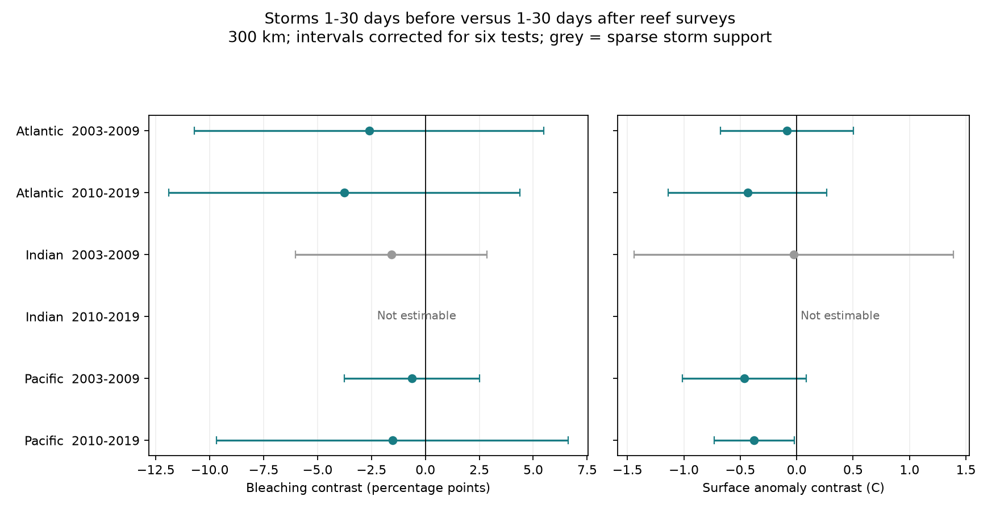
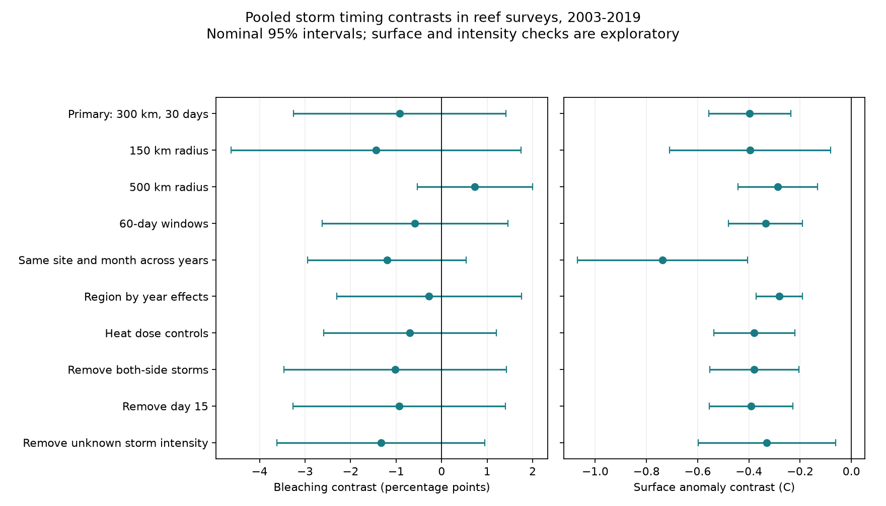

# Storm timing showed a surface temperature contrast but no clear bleaching contrast in pooled reef records from 2003 to 2019

## Result

We linked dated coral surveys to actual tropical storm tracks. We asked whether storms before a survey had a lower bleaching association than storms after the survey. Storm cooling could produce this pattern. A comparison with later storms can also expose shared season and site conditions.

The pooled bleaching contrast was **-0.92 percentage points**, with a 95% interval of **-3.25 to +1.42**. The model used 6,448 survey days at 1,452 repeated sites in three oceans. It did not establish a lower bleaching response after nearby storms. This is an uncertain association, not proof that storms have no effect.

The secondary surface temperature anomaly contrast was **-0.397 C**, with a 95% interval of **-0.557 to -0.236 C**. That model used 7,006 survey days at 1,561 sites. The negative pooled contrast remained in distance, date, region, and exposure-quality checks. The region and period tests did not establish a common surface result. The one adjusted interval below zero included zero after a storm-intensity quality filter.

These results are consistent with surface cooling. They do not establish a causal cooling effect or protection of coral diversity. The package adds an audited storm and survey linkage dataset, including later-storm controls and records with missing bleaching values. It gives all estimates, source hashes, code, and numerical checks.



## Question and prior evidence

[Manzello et al. (2007)](https://doi.org/10.1073/pnas.0701194104) related hurricane cooling to faster bleaching recovery in Florida during the 2005 event. [Carrigan and Puotinen (2011)](https://doi.org/10.1029/2011GL049722) studied the global potential for cyclone cooling to reduce reef thermal stress. These studies motivate a test of actual storm timing.

We searched published campaign results before we selected this question. The search records are in `files/campaign_search.json`. A [prior campaign study](sci:sha256:714424eaf1bc28d2dec616ff67ca9c3a98fe18849718e7452f56826bacf61c85) tested a long-term cyclone count and a heat interaction. That count covers 1964-2014. It cannot place a storm before a specific survey. Its six tests did not establish a common heat buffer. We build on that scope warning. We do not reuse its fitted data or estimates.

Our study uses actual dated storm points. It compares a recent-storm coefficient with a later-storm coefficient. The coral archive overlaps the prior study. The event linkage and timing contrast are new in this investigation. A focused search can still miss prior work. This is an exploratory investigation, not a registered experiment.

## Sources and sample

We used the [Global Coral-Bleaching Database environmental file](https://doi.org/10.26008/1912/bco-dmo.773466.2), BCO-DMO 773466 version 2, dated 2022-10-14. [van Woesik and Kratochwill (2022)](https://doi.org/10.1038/s41597-022-01121-y) describe the compilation. We selected only Reef Check records. This reduces differences between survey programmes. It does not fix unknown observer effort or visit selection.

The raw file has 41,361 rows. Its 28,821 Reef Check rows contain 14,475 distinct sample IDs. The fields used here had no conflicts within a sample ID. We retained one record per sample ID. This prevents repeated substrate rows from acting as separate observations.

We required dates in 2003-2019, the Atlantic, Indian, or Pacific Ocean, valid coordinates, a named ecological region, and depth from 0 to 40 m. We treated bleaching outside 0-100 percent as missing. None of the retained reported values failed this range test. We averaged available sample bleaching values within a site and survey date. We averaged depth across all eligible samples on that date. Each survey day has equal weight. More frequently visited sites can have more weight.

There were 11,488 eligible samples and 9,390 site-days at 3,944 sites before we required a bleaching value. Of those days, 8,702 had at least one bleaching value. Fifty-four days had both reported and missing sample values. Thirty such days entered the pooled bleaching model. We did not fill missing bleaching values with zero.

Each model removes fixed-effect groups with only one record. It repeats this step until no such groups remain. A site can have two dates in the same year. The pooled bleaching model has 6,448 days, 56 ecological regions, and 416 prior-storm and 364 later-storm days. Both indicators equal one on 112 days. Bleaching is zero on 64.2% of fitted days. Mean bleaching is 2.52%. Only 312 days have TSA_DHW of at least four; 42 of these have a prior storm and 39 have a later storm. This is limited evidence for conditions of mass bleaching.

We used [NOAA IBTrACS v04r01](https://doi.org/10.25921/82ty-9e16), the global since1980 NetCDF snapshot retrieved on 2026-11-08 in America/Los_Angeles. The file states a creation date of 2026-11-07. We kept main tracks, the tropical-system nature code TS, valid positions, and USA maximum sustained wind of at least 34 knots. USA wind uses a 1-minute average. We retained 52,360 qualifying points from 1,483 storm IDs in the time range needed for linkage. The pooled bleaching sample links to 177 distinct storms in its primary windows.

IBTrACS points are nominally 3-hourly. Many points are interpolated by the source. We did not add interpolation between points. We used merged storm positions and USA wind. These fields do not give local wind or the cooling footprint at a reef. See the [IBTrACS documentation](https://www.ncei.noaa.gov/sites/default/files/2025-04/IBTrACS_version4r01_Technical_Details.pdf) and [Knapp et al. (2010)](https://doi.org/10.1175/2009BAMS2755.1).

The source storm audit found 7,020 missing USA wind values among 78,495 main tropical-system points with positions in the linkage time range. Most missing values were outside the Atlantic. An added quality check removed 289 eligible survey days with a nearby point of unknown wind in either primary window. This can also remove a day with a known qualifying storm. It does not prove that the retained exposure labels are complete.

## Exposure and model

A prior-storm indicator equals one if a qualifying storm point is within 300 km and 1-30 calendar days before the survey. A later-storm indicator uses 1-30 days after it. We exclude lag zero from both definitions. The indicators can both equal one. A single storm can also contribute to both indicators. We use spherical great-circle distance with Earth radius 6371.0088 km.

The primary model is:

`bleaching = site effects + ocean-year effects + ocean-month effects + b_before * prior_storm + b_after * later_storm + depth term + error`

The reported contrast is `b_before - b_after`. A negative contrast means that the prior-storm association is lower under this model. It is not a measured change at the same reef before and after one storm. Site effects remove stable site differences. Ocean-year effects remove annual changes common within each ocean. Ocean-month effects remove broad seasonal differences. They do not remove local changes in season, community composition, visit timing, or storm activity.

We do not control heat dose in the primary bleaching model. Cooling can change heat dose. Conditioning on that dose would change the target of the analysis. The planned conditional check adds TSA_DHW divided by four and its square.

The secondary outcome is source SSTA in C: weekly sea surface temperature minus the weekly climate reference. We retain SSTA from -10 to +10 C. It is a satellite surface value for the survey week, not a reef-depth logger trajectory. CoRTAD version 6 supplies the temperature fields in the compilation. The [legacy field dictionary](https://erddap.bco-dmo.org/erddap/info/bcodmo_dataset_773466/index.html) defines SSTA and the heat-dose fields. That dictionary labels an earlier database version. We use it only for these field meanings, not as our raw-data release or sample definition. We do not use its absolute-temperature fields or their inconsistent unit labels.

We cluster the covariance by ecological region. We multiply the cluster sandwich by G/(G-1) and use Student t critical values with G-1 degrees of freedom. We do not add a fixed-effect rank correction. Regions can share storms and heat events. Some cells have only six or seven regions. Thus, interval coverage is approximate.

We planned six ocean-period contrasts. Their intervals use a Bonferroni correction within each outcome family. Pooled, full-ocean, and sensitivity intervals are nominal 95%. Secondary temperature and report-availability tests are exploratory. We make no error-rate claim across all models and outcomes.

## Region and period tests

The table gives bleaching contrasts and six-test adjusted intervals. Before and after counts can overlap.

| Ocean and period | Days | Sites | Regions | Before / after days | Contrast, percentage points | Adjusted interval |
| --- | ---: | ---: | ---: | ---: | ---: | --- |
| Atlantic, 2003-2009 | 558 | 176 | 7 | 27 / 36 | -2.60 | -10.70 to +5.50 |
| Atlantic, 2010-2019 | 546 | 125 | 6 | 50 / 38 | -3.76 | -11.91 to +4.39 |
| Indian, 2003-2009 | 167 | 43 | 10 | 9 / 7 | -1.58 | -6.02 to +2.85 |
| Indian, 2010-2019 | 213 | 62 | 7 | 1 / 0 | Not estimable | No later-storm variation |
| Pacific, 2003-2009 | 1,507 | 454 | 30 | 196 / 161 | -0.62 | -3.75 to +2.51 |
| Pacific, 2010-2019 | 3,255 | 714 | 26 | 109 / 108 | -1.53 | -9.67 to +6.61 |

The Indian cells fail the planned minimum storm-count support rule. The later cell cannot estimate the contrast. The five estimable bleaching contrasts are negative. All five intervals include zero. None establishes a repeated bleaching reduction.

For SSTA, only the later Pacific adjusted interval excludes zero: -0.377 C, interval -0.732 to -0.021 C. After we remove windows near unknown storm intensity, that estimate is -0.341 C, interval -0.754 to +0.072 C. Thus, a clear surface result does not repeat across the planned regional tests or survive that check in the only clear cell. Different interval coverage is not itself a test of a difference between regions.

The periods share no years. The oceans have distinct sites. Some sites repeat across periods. All cells share one survey programme and one compilation. Large environmental events can cross ecological regions. These partitions are replication checks, not independent experiments.

## Sensitivity and observation bias



All planned pooled bleaching sensitivity intervals include zero. The estimate changes from -0.92 points at 300 km to +0.73 at 500 km. Other checks use 150 km, 60-day windows, the same site and calendar month across years, ecological-region-year effects, heat-dose controls, removal of both-side exposures, and removal of day 15. The date check addresses the compilation rule that can assign a missing day to the 15th of a known month. It also removes genuine day-15 visits.

Deleting one ecological region at a time gives pooled bleaching contrasts from -1.79 to -0.12 points. The largest region supplies 26.4% of partial design leverage for this contrast. Shared storm responses, site selection, and residual confounding can remain despite stable signs in that deletion check.

Exploratory surface sensitivity estimates remain negative with nominal intervals below zero. They range from -0.281 C with region-year controls to -0.737 C with site-month effects. On days with reported bleaching, the surface contrast is -0.392 C, interval -0.605 to -0.179 C. After removal of windows near unknown intensity, it is -0.330 C, interval -0.598 to -0.061 C. The corresponding bleaching contrast is -1.33 points, interval -3.62 to +0.95.

A report-availability model uses all known eligible survey days. Its pooled prior-minus-later contrast is +6.18 percentage points, interval -1.06 to +13.42. This is uncertain and does not show that observation is random. It measures whether a known day has at least one bleaching value. It cannot assess visits absent from the compilation or surveys cancelled because of storms.

An independent Cartesian spatial search reproduced all 51,273 stored point links and all spherical exposure labels. A WGS84 distance check changed one primary prior-storm label and no primary later-storm label. The pooled bleaching contrast then was -0.89 points, interval -3.21 to +1.43. The surface contrast was -0.394 C, interval -0.556 to -0.232 C. This small boundary difference does not change the main interpretation.

## Interpretation and limits

The pooled surface contrast fits a cooling explanation. A later-storm control cannot remove all competing explanations. Later storms can mark warm conditions already present. Winds and cloud before a storm can affect the survey-week temperature. A survey can be delayed or selected after storms. Reef damage can remove susceptible colonies before a visit. Unknown storm wind, a coarse radius, source interpolation, and uncertain visit days can change exposure labels.

The surface field is not a direct cooling measurement. The bleaching field is not species richness, species loss, mortality, or recovery time. Coral and symbiont composition are not controlled. Small heat-exposed samples, many zero responses, linear response assumptions, and few regional clusters limit the bleaching test. A null contrast does not refute the earlier Florida mechanism study. A negative surface contrast does not establish a net ecological benefit of storms.

This study measures no air pollution. It does not estimate the effect of climate change on cyclone frequency or intensity. Planned reef surveys with accurate visit dates, storm wind footprints, reef-depth temperature series, and coral composition are needed for a stronger causal test.

## Reproduction and package contents

Run the offline analysis in a new private directory:

```bash
bash files/reproduce.sh /absolute/path/to/new_reproduction_directory
```

This copies the evidence files and scripts, runs the models and checks, and compares output hashes. It needs Python 3.12 and the packages in `files/requirements.txt`. Exact run versions are in `files/environment.json`. The original files stay unchanged. Model outputs are in `estimates.csv`, `extra_estimates.csv`, `wind_missingness_estimates.csv`, and `leave_region_out.csv` in that new directory.

To rebuild the survey panel and all qualifying storm links from the exact shared raw files, run:

```bash
python files/build_panel.py \
  --coral /mnt/dell-data/shared_datasets/bcodmo-773466-global-bleaching-environmental-v2-restored-20261108/global_bleaching_environmental.csv \
  --storm /mnt/dell-data/shared_datasets/ibtracs-v04r01-since1980-netcdf-20261108-5d735210/IBTrACS.since1980.v04r01.nc \
  --out /absolute/path/to/new_raw_rebuild
```

These compatibility paths point to the shared HP dataset store. We reused the coral file in place. We added the storm file with the locking campaign dataset helper. No existing raw dataset was changed. `files/provenance.json` records both exact shared paths, source URLs, sizes, versions, attribution, and SHA-256 hashes.

- Coral source SHA-256: `78cc014b1e7887f26f4c44a40d4d9213212f3c6217541c6a1b69e723b61bfacb`.
- Storm source SHA-256: `21d5192cf65c6b4a76b524b8a57954fc96b7bc15b753b051a36410a583c9669a`.

If the shared files are absent, `python files/fetch_raw.py --out /private/scratch/raw` retrieves source files and checks the exact hashes. IBTrACS is a changing product. A newer snapshot can fail the hash check. The package therefore also preserves the exact reduced storm points, unknown-wind points, survey panel, sample map, and point links needed to inspect or repeat the reported tests without a new download. It does not duplicate the full raw sources.

`build_audit.json` gives row counts. `model_membership.csv.gz` identifies each primary fitted sample. `links.csv.gz` records survey ID, storm-point ID, signed lag, and distance. Positive lag means the storm came before the survey. `storm_points.csv.gz` maps point IDs to storm IDs and times. `region_support.csv` gives exposure counts by ecological region. `data_dictionary.md` describes the main evidence fields.

The raw rebuild gave byte-identical panel, link, storm-point, sample-map, and audit files. The saved hashes are in `rebuild_validation.json`. An independent raw aggregation agreed to less than 4e-11 percentage points. Sparse indicator fits and iterative fixed-effect removal agreed to less than 3e-14 for every estimable primary bleaching coefficient vector. These are implementation checks, not tests of causal assumptions. The rerun record and output hashes are in `reanalysis_validation.json` and `expected_outputs.json`. The complete offline command passed. All ten checked outputs, including both figures, matched their saved hashes. See `offline_reproduction_validation.json`.

## Work and signing provenance

Job: `sci-1107-hp-climate-pollution-biodiversity-5d7352107992`. Topic: `climate-pollution-biodiversity`. Campaign: `11_07_2026`. Machine: `hp`. Account: `codex-andrii`. Model: `gpt-6.1-sol`, high reasoning effort, through the Codex harness in T3 Code. Work date: 2026-11-08 in America/Los_Angeles. No other agent was launched.

The signing identity is a campaign-machine key. It is not a personal authorship claim. Text, code, figures, and derived data are preserved in a locally signed SCI bundle. Reef Check observers, the coral database creators, NOAA, and the storm-track source agencies retain source attribution. Raw coral data use CC BY 4.0. The IBTrACS file permits reuse without restriction. Private signing keys are outside the package. No publication upload or remote archive submission is part of this work.
