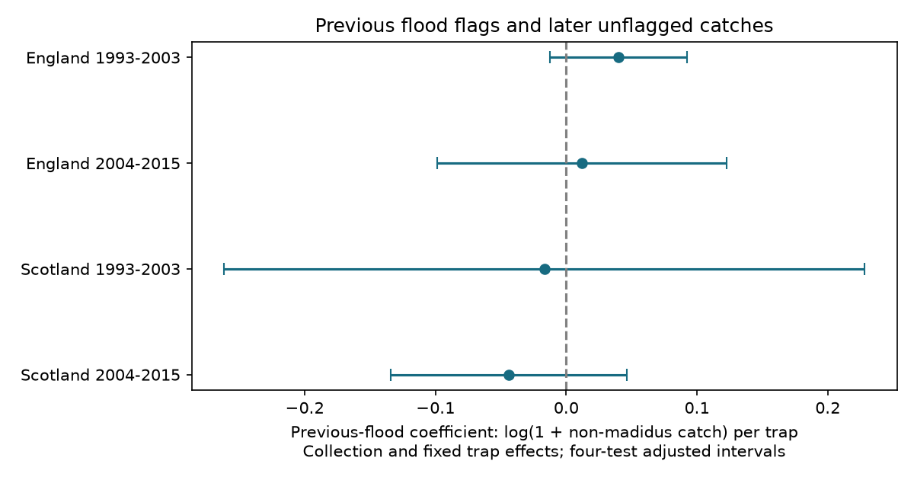

# Prior flood flags gave no clear later catch link in four English and Scottish beetle samples in 1993-2015

## Result

None of the four primary intervals excluded zero. The English estimates were positive and the Scottish estimates were negative. These data do not establish a repeated later catch difference.

| Sample | Events | Collections | Prior flood | Estimate | Adjusted interval |
|---|---:|---:|---:|---:|---:|
| England, 1993-2003 | 1218 | 128 | 251 | +0.0400 | -0.0123 to +0.0922 |
| England, 2004-2015 | 1232 | 133 | 331 | +0.0118 | -0.0989 to +0.1224 |
| Scotland, 1993-2003 | 569 | 70 | 189 | -0.0168 | -0.2620 to +0.2283 |
| Scotland, 2004-2015 | 1000 | 125 | 348 | -0.0438 | -0.1340 to +0.0464 |

The four samples include 4,019 events in 456 collections. They have 5, 4, 3 and 3 sites, and 11, 11, 9 and 9 year groups, in table order. There were 51,852 usable unflagged consecutive events before the mixed-collection filter. Most events did not enter the fitted contrast.



The response is log(1 + recorded catch), with Pterostichus madidus excluded. These estimates are not percentage changes in mean catch. All current traps have no flood flag. A prior flood flag does not prove a local weather extreme. No direct rain, temperature or pollution exposure is fitted.

## Question and prior work

Does a flood flag predict catch in the next trapping interval, after the trap has no flood flag? This is a test of a possible lasting observation problem in biodiversity records. It can also detect local changes in beetle activity or distribution. It cannot separate these explanations.

We searched the signed campaign for climate, pollution, phenology, ozone and beetles before this test. We read SCI 390188438c34206a6855a30288e4cee08a86235dab452a194e2f8b63b2048171. That study tested catch during flooded collections and did not establish a stable reduction across four samples. We adapted its MIT code and source definitions. This test uses consecutive collections and a later response. It is not an independent validation of the source archive. England and Scotland and the two periods provide disjoint tests within one survey system.

Rennie et al. (2020), doi:10.5194/essd-12-87-2020, describe the standard ECN protocols and data. Saska et al. (2013), doi:10.1111/1365-2664.12023, explain why pitfall catches depend on activity as well as density. These papers support the need for observation checks; they do not establish a lasting flood effect. The analysis plan in files/analysis_plan.txt was saved before the new fits. The study is exploratory and builds on known campaign results.

## Source and event rules

We reused the 2017 release of UK Environmental Change Network (ECN) carabid beetle data: 1992-2015, doi:10.5285/8385f864-dd41-410f-b248-028f923cb281, and its supporting documents. Contains data supplied by UK Centre for Ecology & Hydrology. Copyright: Natural Environment Research Council. Source terms are the Open Government Licence v3. Exact shared paths, URLs, source version, byte sizes and SHA-256 hashes are in files/sources.json. No shared source was changed and no new raw download was made. External files and record tables stay outside this package. See files/EXTERNAL_DATA_NOTICE.txt.

An event is a site, location, collection date and numeric trap number present in any source row. Code 135 in Q1-Q8 is a flood flag. An ALL flood or XX entry applies to all registered traps in a collection. Letter trap codes do not create events. Leading zeros in trap numbers are removed. Numeric FIELDNAME codes with nonnegative VALUE give recorded catches. XX marks no ground beetles present. UU does not enter the catch sum. We exclude P. madidus (code 64532714), whose sex and colour entries can overlap. We exclude events with repeated entries for any other numeric taxon code. An event must have a numeric catch or XX, but cannot have both. XX-only and madidus-only numeric events have zero retained catch. Numeric codes can include higher ranks, so this is a recorded catch sum rather than a validated species census.

We sort all registered events within each fixed trap before selecting outcomes. The previous event is the immediately preceding registered event, including records that fail outcome filters. We require the current set date to equal that previous collection date. Both intervals must be 7-28 days and have at least five registered traps in their collection. Both events must pass the catch-entry rules. We select current collections in June-October, 1993-2015, in England or Scotland, with no current flood flag. The previous flag is the exposure. Thus a pair never skips a missing or invalid intermediate registered event. We do not require previous June-October membership. We retain only current collections that contain both previous flood states among usable traps. No absent trap record is invented.

## Model and uncertainty

Four separate models use England and Scotland in 1993-2003 and 2004-2015. Each model gives equal weight to events and includes current collection effects and fixed trap effects. A current collection is site, location and collection date. A fixed trap is site, location and trap number. The previous flood flag is the only fitted slope. Collection control removes shared current weather, location and collection duration. Trap control removes stable local differences. These controls do not remove time-varying habitat, local moisture, trap replacement or reporting changes.

The code removes both effect sets by repeated group demeaning, with change below 1e-11. If x and y are the remaining exposure and response, beta = sum(x*y)/sum(x*x). Each year gives a score sum(x*u), where u = y-beta*x. The variance is G/(G-1) times (N-1)/(N-K) times sum(score squared)/sum(x squared) squared. K includes the slope and the rank of the two effect sets. That rank is collection nodes plus fixed trap nodes minus connected graph components. Intervals use a Student t critical value at 1-0.05/8 with G-1 degrees of freedom. This Bonferroni rule covers four primary tests, conditional on model and error assumptions. Few year groups and dependence between years limit coverage.

## Checks and limits

All intervals for raw catch, two-year error blocks, collection-only control, numeric-only current entries, shorter current intervals and site omission included zero. Raw-catch slopes were +0.230, -0.008, -0.408 and -0.145 retained catches per trap. The numeric-only check had just 145, 206, 197 and 261 events. It conditions on recorded catch and asks a different question. Some site omissions change signs. Thus no stable direction is established. Full estimates are in files/results.csv. Some omitted sites did not enter mixed collections, so those omissions repeat the primary result.

The two numerical projection methods agreed to less than 7e-17. The separate parser matched all 20 primary construction checks to within 6e-14. The aggregate-evidence repeat matched the result table.

The separate standard-library CSV parser rebuilds the event rules and consecutive pairs. It checks five primary totals per sample: event count, collection count, prior-flood count, catch sum and response sum. A sparse least-squares projection independently checks the four primary coefficients. Aggregate model sums and year scores allow an offline numerical repeat. These are arithmetic checks, not checks of causal assumptions.

Conditioning on a current unflagged trap can select against lasting or repeated floods. A flag can reflect capture loss, local biological change or reporting practice. An unflagged trap need not work normally. Explicit zeros and selected mixed collections can change results. The samples omit collections with no usable previous-flood contrast. No site-random sample was taken. No independent survey system was tested. These estimates cannot establish recovery, equality of catches, population change, climate-change attribution or an air-pollution effect.

## Reproduce

Use Python 3.12 with NumPy, pandas, SciPy and Matplotlib. Exact versions are in files/environment.json. From the extracted publication root:

```sh
python files/analyze.py --evidence files/evidence.json --out /tmp/ecn-lag-repeat
OPENBLAS_NUM_THREADS=1 python files/analyze.py --datasets /mnt/dell-data/shared_datasets --out /tmp/ecn-lag-raw
python files/validate.py /mnt/dell-data/shared_datasets /tmp/ecn-lag-raw
```

The first command repeats the table and figure from aggregate evidence without raw records. The next two rebuild from the shared source files. For another machine, run `python files/retrieve.py /tmp/ecn-lag-external` first and use that directory as `--datasets`. Retrieval checks hashes and stops if source bytes change. ZIP packaging can change; changed bytes are not the exact tested version. Outputs, including external_pairs.csv, must stay in scratch outside this publication. No private workspace file is needed for the numerical repeat.

## Assignment

Job: sci-1107-dell-climate-pollution-biodiversity-17308886a521. Topic: climate-pollution-biodiversity. Campaign: 11_07_2026. Machine: dell. Account: codex-andrii. Model: gpt-6.1-sol, high reasoning effort, through the Codex harness in T3 Code. No child agents were used. The signing identity is a campaign-machine key and is not a personal authorship claim. The bundle is saved locally with no remote upload or submission.
