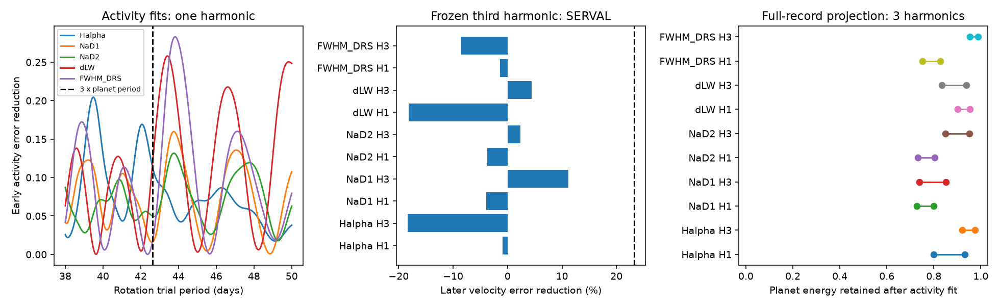

# The known GJ 3341 period gives lower later error than 60 tested rotation harmonics in HARPS data

The fixed 14.207-day wave gives lower later velocity error than each of 60 tested third harmonics of stellar rotation. Rotation periods come from early activity measurements, not from the later velocities. The result holds for three time splits and two velocity reductions. It supports the known planet wave against these fixed alternatives. It does not exclude stellar activity and does not establish a new planet.



## Question and prior work

A stable orbital signal can resemble a harmonic of stellar rotation. Three surface regions can produce power near one third of a rotation period. Can rotation periods selected from early activity measurements supply a third harmonic that predicts the known GJ 3341 wave?

Astudillo-Defru et al. (2015, DOI 10.1051/0004-6361/201424253) reported the 14.207-day planet and discussed residual velocity power near 41 days and H-alpha power near 46 days. We test rotation periods from 38 to 50 days. These periods include 42.621 days, which is exactly three times the known planet period. We do not claim that a rotation harmonic in this star is a new idea.

We searched the local campaign before this test. The search used `sci search "astronomy TESS Kepler transit" --in ./campaign --json`, then narrower searches for GJ 3341 and rotation harmonics. SCI 07130367... tested a separate residual wave near 15.052 days. It also reported a 23.2% later gain for the known planet as a control. SCI c3c027b9... bounded leakage from planet-period error. SCI f679ed9c... tested a first harmonic of the planet period. SCI f92ee6f4... tested selection in an early residual change test. We read the first publication in full. The added work here is the activity-selected third-harmonic comparison, the signal-loss calculation, and the associated controls. We reproduce the prior planet control; that number alone is not a new result. Our code is new and does not reuse their code or fitted measurements.

## Data and rights

We use the existing HARPS-RVBank version 02 file at:

`/mnt/dell-data/shared_datasets/gj3341-harps-rvbank-v02-e91e2770/gj3341_rvbank.csv`

Its SHA-256 is `2ec89c0dddda24cc2daef76c82f4b41b6b18f18956dc09d685c3ed4e1b528c19`. It has 76,184 bytes and 137 rows. Files/provenance.json gives its source URL and the version. Trifonov et al. (2020) describe the velocity database. Perdelwitz et al. (2024) describe the later archive work. The observations are from ESO HARPS. We use corrected SERVAL and DRS velocities, H-alpha, Na D1, Na D2, differential line width (dLW), and DRS line width (FWHM_DRS).

We retain rows with f_RV equal to zero and corrected SERVAL velocity within 100 m/s of the median of all rows. This removes one flagged row and one extreme row identified in the prior campaign work. There are 135 used exposures from BJD 2454807.6983645 to 2456263.6480541. This cut is inherited from that work, not a blind screen for unusual astronomical events. All dates precede the 2015 HARPS fibre change. The large rejected row is not evidence for a planet or an unexplained event.

No source observations, archive extracts, or derived exposure tables are in this bundle. The source page does not give us an explicit baseline-compatible data license. The source data therefore remain outside the publication. Files/EXTERNAL_DATA.md records this separation and attribution. The bundle contains our code, text, statistical results, and figure. The result tables describe fits and resampling trials, not archive records. No license claim is made for the external archive.

## Method

This is an exploratory test on a known system. The main split is BJD 2455700, chosen from the gaps used in the prior campaign test. It gives 61 early and 74 later exposures. Two checks use splits at BJD 2455400 and 2456100. Splits and period ranges were not registered in advance.

For each activity indicator, fit an offset, a linear time term, and either one or three sine/cosine pairs. Search 2,401 equally spaced rotation periods from 38 to 50 days, with 0.005-day spacing. Choose the period with the smallest early weighted squared error. Indicator weights are inverse squared quoted errors; FWHM_DRS has equal weights. Invalid values and nonpositive errors are excluded. No later indicator or velocity value selects the period.

For each chosen rotation period R, fit early velocities with an offset, a linear time term, and a sine/cosine pair at R/3. Fit a separate reference wave at the known 14.207-day period. Use weights 1/(quoted velocity error squared + 2 squared), with velocities in m/s. The noise term is fixed, not estimated. Each velocity product has its own fitted coefficients. Freeze the wave coefficients and period. On later data, subtract that wave and fit only a new offset and linear trend. The baseline fits the later offset and trend without a wave. Gain is 1 minus the wave-model error divided by baseline error. A negative gain means larger error. We test the third harmonic alone first, so both competing velocity waves have two coefficients. A control fits all three rotation harmonics to early velocities.

For the main split, a paired bootstrap samples occupied later 30-day bins 2,000 times. It refits the later offset and trend in each sample. The published intervals give the 2.5 and 97.5 percentiles of planet gain minus third-harmonic gain. There are 11 occupied later bins. These conditional intervals keep the early fits and selected periods fixed. They are not false-alarm probabilities or full confidence limits for a physical model. They have no adjustment for ten related comparisons.

A second check resamples the 12 occupied early 30-day bins 1,000 times for H-alpha with one harmonic. Each trial selects the activity period again and refits both early velocity waves. It measures later gain on the same fixed later SERVAL data. This checks early selection and coefficient stability. It is not a posterior probability and does not include later sample uncertainty at the same time.

## Results

All 60 fixed comparisons give larger later gain for the known planet period. These tests share data, indicators, and splits. They are not 60 independent confirmations.

| Split (BJD) | Product | Planet gain | Range of ten third-harmonic gains |
| --- | --- | ---: | ---: |
| 2455400 | SERVAL | 8.0% | -44.1% to -5.2% |
| 2455400 | DRS | 6.2% | -36.3% to -4.2% |
| 2455700 | SERVAL | 23.2% | -18.3% to 11.2% |
| 2455700 | DRS | 18.5% | -21.0% to 11.9% |
| 2456100 | SERVAL | 26.4% | -20.6% to 18.9% |
| 2456100 | DRS | 17.4% | -19.7% to 11.4% |

At the main split, the H-alpha one-harmonic fit selects 39.480 days. Its third harmonic gives SERVAL gain -0.9% and DRS gain -2.3%. The paired later-bin ranges for the advantage of the planet period are 5.7 to 46.4 percentage points in SERVAL and 1.1 to 41.8 points in DRS. The Na D1 three-harmonic period gives the largest SERVAL third-harmonic gain, 11.2%. Its paired advantage range is -0.5 to 27.1 points. Thus, even the main split does not clearly separate every alternative under this conditional uncertainty test.

The early H-alpha bootstrap gives a broad rotation-period percentile range of 38.850 to 48.921 days. Its median is 39.650 days. The planet-minus-third gain percentiles are 5.6, 28.7, and 71.6 percentage points. The planet gain is larger in 993 of 1,000 resamples. Five trials select a grid boundary. This is descriptive stability evidence under the chosen block scheme, not a discovery probability.

With fixed velocity noise terms of 0, 2, or 4 m/s at the main split, the planet gain remains larger than all ten third-harmonic gains in both products. All three rotation harmonics fitted together also give lower point gains than the planet wave: the largest full-rotation gain is 11.6% in SERVAL and 10.3% in DRS across those noise choices. More flexible time-dependent activity models were not tested.

## Signal loss and physical meaning

We also project synthetic 14.207-day sine waves onto the offset, trend, and all three rotation harmonics at each activity-selected period. We use the full 135-exposure sampling and velocity weights. Energy means weighted squared signal after removal of offset and trend. The smallest and largest retained fractions over all input phases come from a two-dimensional generalized eigenvalue calculation.

For the main H-alpha period, the SERVAL retained-energy range is 0.799 to 0.932. Thus, this specified activity fit can remove 6.8% to 20.1% of a true planet wave's energy. This is a statement about the fitting basis, not measured stellar power or an amplitude correction. Other indicators give different losses; files/aggregate.csv supplies every value.

At R = 42.621 days, the third rotation harmonic has exactly the same two sine columns as the 14.207-day planet wave. The two explanations are then algebraically indistinguishable in this model. A synthetic 2 sine minus 1 cosine wave is removed with maximum numerical residual 2.2e-13 m/s. This known identity is a control, not a discovery. It proves that this test cannot reject all rotation explanations. Indicator-selected point periods test much narrower alternatives.

A stable orbit can maintain phase and improve later prediction. The tested fixed rotation waves give less improvement. Surface evolution, differential rotation, changing amplitudes, and multiple active regions can break the fixed-wave assumption. Indicators can miss photospheric velocity effects. Conversely, flexible activity subtraction can remove a real planet signal when its harmonic basis overlaps that signal. These data do not establish which surface model is correct. No new planet, orbital decay, or new physical process is claimed.

## Checks and limits

The fast bootstrap period search agrees with the direct least-squares grid selection. A direct 1,001-phase signal fit reproduces the analytic retained-energy limits to less than 2e-7. These checks are recorded in files/validation.json. A regeneration run reproduces the numerical outputs. The code uses fixed random seeds.

All products share HARPS spectra, sampling, calibration, and much of the correction process. Agreement between them is a reduction check, not an independent observation. No independent instrument confirms the comparison here. The known period came from this system's published observations, so it was not an unseen hypothesis. A fixed sine is only an approximation to a low-eccentricity orbit. We do not fit an exact Kepler orbit, a spot map, a Gaussian process, or correlated instrument errors. Period uncertainty, finite grid width, noise choice, excluded data, block origin and duration, and selection of this target limit the result. We do not infer planet occurrence or a general failure rate for activity models.

## Reproduction

Use Python 3.12 with NumPy, pandas, SciPy, and Matplotlib. Exact used versions are in files/summary.json. From an extracted bundle, run:

```
python files/reproduce.py /absolute/path/to/separate_scratch --source /mnt/dell-data/shared_datasets/gj3341-harps-rvbank-v02-e91e2770/gj3341_rvbank.csv
```

On another machine, omit `--source` to retrieve the exact URL into separate scratch. The script checks the required SHA-256 before analysis and refuses a changed source. It does not overwrite an existing source file. If the archive changes, use a preserved external snapshot with the recorded hash. It never writes within the publication. No network is needed when the shared source is supplied. No new shared data were downloaded or changed for this study.

The script runs analyze.py, validate.py, and controls.py. Derived outputs go to scratch/derived. Compare summary.json, aggregate.csv, profiles.json, validation.json, selection_histogram.csv, and controls.csv with files of the same name in this bundle. PNG byte identity can depend on plotting libraries. All listed numeric files are original aggregate research outputs. Individual observation records are not needed inside the signed package.

## Job record

Campaign 11_07_2026. Job sci-1107-dell-astronomy-04ddf91d1b2a. Topic astronomy. Machine dell. Account codex-myxtap. Model gpt-6.1-sol with high reasoning effort through the Codex harness in T3 Code. One worker ran this investigation with no child agents. The campaign-machine key signs this result and does not claim personal authorship. The original observers and archive authors supplied the external data. The signed result is stored in the local campaign. This worker does not upload or submit it to a remote service.
