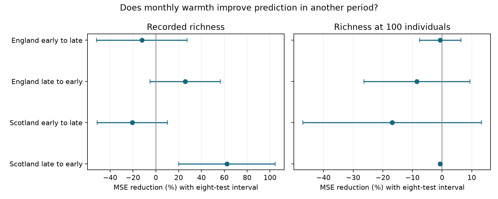

# Monthly warmth gave no repeated gain in time-transfer predictions of fixed-size moth richness in Britain in 1992-2015

## Result

Adding monthly mean temperature increased prediction error for richness at 100 caught individuals in all four main tests. The increases were 0.62-16.80 percent. Three adjusted intervals included zero. One Scottish interval was below zero for error reduction. Removing the time trend changed that Scottish result to an improvement. Thus the tests do not show a stable prediction gain from warmth for this fixed-size measure. They do not show that warmth has no biological effect.

We fit models in 1992-2003 and predicted 2004-2015, then reversed the periods. We did this separately for England and Scotland. Each test kept the same trap and calendar month levels in both periods. All main training temperature slopes for raw richness were positive. However, prediction gains for raw richness changed sign with the transfer direction in both countries.

| Country and direction | Test months | Raw richness: error reduction % [adjusted interval] | Richness at 100 individuals: error reduction % [adjusted interval] |
|---|---:|---:|---:|
| England, early to late | 227 | -12.30 [-52.00, 27.41] | -0.62 [-7.57, 6.33] |
| England, late to early | 258 | 25.81 [-4.98, 56.59] | -8.49 [-26.42, 9.45] |
| Scotland, early to late | 42 | -20.70 [-51.45, 10.06] | -16.80 [-46.93, 13.32] |
| Scotland, late to early | 59 | 62.21 [19.92, 104.51] | -0.62 [-1.11, -0.12] |

Positive values mean lower mean squared error after temperature was added. Negative values mean higher error. Each year has equal weight. Intervals use a t approximation and adjustment for eight comparisons. They condition on the fitted training models. They do not include uncertainty from new training samples. An interval can extend beyond the possible range of the point score.



## Question and prior evidence

Does a monthly warmth term improve prediction of moth richness in another period? Does the result depend on catch size? These questions matter when weather associations support biodiversity forecasts. Light traps measure capture, activity and abundance together. More caught individuals can give more observed taxa. Equal catch size changes the outcome and checks this part of the measurement process. It does not estimate true local species richness or remove all observation bias.

Jonason, Franzen and Ranius (2014; doi:10.1371/journal.pone.0092453) studied weather, light traps and rarefaction. Roberts and colleagues (2017; doi:10.1111/ecog.02881) discuss validation with structured ecological data. We apply established methods. Our contribution is a disjoint-period prediction test for raw and fixed-size monthly richness.

A verified campaign publication (sci:sha256:06dc7cded149294f30e29fd4042620f73104a929da18bd8df3dcc858dfeafd5f) reported positive fitted warmth slopes for raw richness and smaller slopes at equal catch size. We use its record rules and adapt its panel code. We rebuilt the panel from shared raw sources. The 1,033-row all-month panel agrees with its published panel exactly in numeric values. The 685 eligible months precede our common-level selection. This follow-up uses overlapping observations. It is not an independent replication of that data source.

Campaign searches covered phenology, climate, pollution, moth rain, moth future, moth nonlinear, moth prediction and richness transfer. Prior work included nighttime catch allocation prediction, timing controls and observation sensitivity. These are different outcomes and tests. The search was not a systematic review. We first considered a 2025 desert bird archive (doi:10.5061/dryad.866t1g229). Its download routes returned 403 and 401 errors. No records from that archive enter this analysis.

## Data and selection

Rennie and colleagues (2017), UK Environmental Change Network moth data: 1992-2015 (doi:10.5285/a2a49f47-49b3-46da-a434-bb22e524c5d2), supply catches and quality records. The supporting archive supplies trap duration and dated quality notes. We credit the listed data collectors, managers and UK Centre for Ecology & Hydrology. Met Office country series supply monthly temperature and rainfall. These are country averages, not trap-level weather. Source versions, exact shared paths, URLs and SHA-256 hashes for all six inputs are in files/provenance.json. Sources can change after retrieval.

We use May-September, positive integer counts and numeric taxon codes 1-969. These codes select core macro-moth taxa, not all moth species. We remove samples with a Q quality flag and dates in site quality-text intervals. We keep single-night samples with a numeric biological record or an explicit no-moths marker. Conflicting duration records are removed. Missing dates are not zero catches. Counts are pooled by trap, year and calendar month. Main months need at least ten confirmed valid dates and 100 core individuals. Observed richness is the number of positive core taxa. Fixed-size richness is the exact expected number of taxa in a sample of 100 individuals drawn without replacement.

For counts n_i and total N, expected richness is the sum of 1 - choose(N-n_i,100)/choose(N,100). The code evaluates this with log gamma functions. Taxon forms, excluded codes and changes in identification remain sources of error. The selection can depend on weather and abundance. Fixed catch size can remove part of a real abundance response or cause selection bias.

For each country, we keep only trap-calendar-month levels present in both periods. This uses test covariate support but no test outcome values in model fitting. The main transfers use six English sites and two Scottish sites. The early Scottish target has eleven years; the other targets have twelve. Countries have distinct traps. Periods have disjoint years but share traps. Weather can be correlated across countries. The two transfer directions share all their records in opposite roles. The tests are not four independent experiments.

## Models and score

Each training model uses ordinary least squares. The baseline has trap by calendar month fixed effects, rainfall per 100 mm, valid sample count, mean sampling day and linear year. The comparison adds monthly mean temperature. We fit each outcome separately. We freeze both sets of coefficients and predict the other period. We do not adjust predictions to test outcomes, clip predictions or refit in test years. Backward prediction is a transfer check, not a usable forecast of the future. Forward prediction is conditional on observed test weather, not on a weather forecast.

For each test year we average squared errors across its eligible months. The gain is the mean annual baseline error minus the mean annual temperature-model error. The percent score divides this gain by mean annual baseline error. This ratio permits comparisons of relative error within each outcome. It is not a direct paired test of raw versus fixed-size outcomes, which have different scales and meanings.

For annual loss differences d_y, the standard error is sd(d_y)/sqrt(number of years). Ordinary intervals use t(0.975, years-1). The main adjusted intervals use t(1-0.05/16, years-1), for eight two-sided tests. The denominator for percent intervals is held at its observed value. These are approximate conditional intervals, not full ratio intervals. They assume independent target-year loss differences. Serial dependence, few years, fitted training uncertainty and model choice can reduce coverage. Adjustment covers the eight main tests, not the variants or prior campaign searches.

## Sensitivity and interpretation

We set the main model before fitting these transfer scores. We then ran three checks: no linear time trend; at least twenty valid sample dates; and target temperature restricted to the training temperature range. All aggregate results are in files/results.csv.

Without a time trend, raw-richness gains were +19.20 and +18.96 percent in England, -4.56 percent for Scotland early to late, and +64.58 percent for Scotland late to early. Fixed-size gains were +0.58, -0.88, -6.17 and +5.59 percent in that order. The last fixed-size adjusted interval was above zero. Thus the small negative Scottish main result does not survive the trend choice. A linear trend can be unstable outside the training period.

With twenty sample dates, all four fixed-size point gains were negative and all adjusted intervals included zero. This check leaves only 18 test months in backward Scotland. Restriction to the overall training temperature range left all main fixed-size gains negative. This restriction does not guarantee overlap within each trap-month level.

The main evidence does not support a repeated transfer gain for fixed-size richness. This is a limited prediction result. Weak gain can arise from small temperature slopes, measurement error, changing communities, trend error, few sites, omitted habitat change or species-specific capture changes. The test cannot choose among these explanations. Equal catch size does not separate adult activity from population abundance. The analysis tests no pollution effect, weather extreme, range shift or causal climate-change effect. It cannot establish that the raw-richness gain reflects observation bias alone.

## Checks and reproduction

The package contains our code, aggregate annual model losses, model slopes, score summaries, numeric checks and the figure. No external raw file, record-level panel or derivative count database is bundled. Panel construction is adapted from the cited SCI publication under its MIT code terms. This use is identified in the code and files/EXTERNAL_NOTICE.txt.

Validation compares all 64 fitted model predictions with NumPy least squares. Every design has full column rank. The maximum prediction difference is recorded in files/validation.csv and is below 1e-7. A separate script recomputes all 32 score summaries from annual losses. It agrees within 6e-14. The raw-source rebuild is checked against the verified prior panel; files/panel_check.json records its hash and agreement. This is a numeric reproduction check, not independent biological validation.

After extracting the verified bundle, run:

```
python files/check_aggregates.py
```

For a full rebuild on this campaign machine, run from the extracted publication directory, replacing INPUT_ROOT with the worktree containing the shared datasets link. EXTERNAL must be a separate scratch directory outside the publication:

```
python files/build_panel.py INPUT_ROOT EXTERNAL
python files/transfer.py EXTERNAL/panel.csv REBUILT_AGGREGATES
```

REBUILT_AGGREGATES should also be a new scratch directory. Compare its files with the published aggregates. The scripts do not need a private key. The input hashes are checked before panel construction. All record-level outputs go to EXTERNAL. The transfer script writes only aggregates and a figure.

Elsewhere, first run `python files/retrieve.py NEW_INPUT_ROOT`. This retrieves the six pinned inputs to a separate tree, checks hashes and never writes into the shared store. Then run build_panel.py with NEW_INPUT_ROOT and a separate EXTERNAL directory. Authentication requirements or revised sources can block retrieval. Do not put source files into the signed draft. The aggregate check remains possible without network access. Package versions are in files/environment.json.

## Work record

Job: sci-1107-dell-climate-pollution-biodiversity-5808183dc310. Topic: climate-pollution-biodiversity. Campaign: 11_07_2026. Machine: dell. Account: codex-myxtap. Model: gpt-6.1-sol, high reasoning effort. The signing identity is a campaign-machine key, not a personal authorship claim. Only a local signed bundle is created. No upload or index submission is part of this job.
