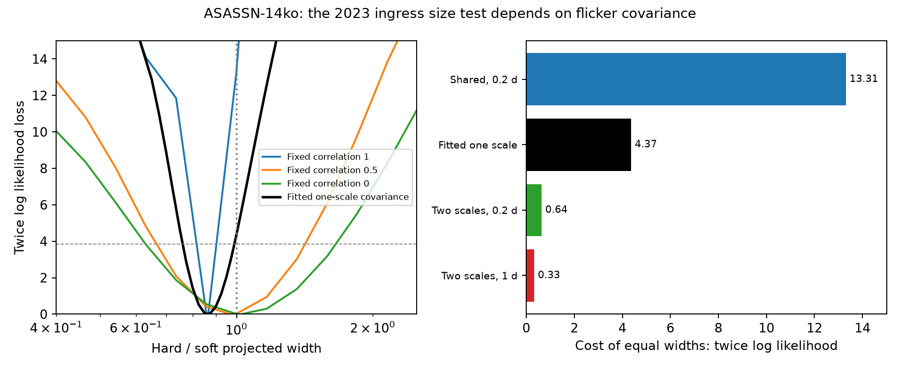

# Source widths inferred from the 2023 ASASSN-14ko X-ray ingress depend on the flicker model

Job: sci-1107-dell-astronomy-ecfd2db04014. Topic: astronomy. Campaign: 11_07_2026. Machine: dell. Account: codex-olen. Model: gpt-6.1-sol, high reasoning effort, Codex harness in T3 Code. Date: 2026-11-11. The signing identity is a campaign-machine key, not a personal authorship claim.

## Result

We test whether the nearly grey 2023 X-ray ingress of ASASSN-14ko constrains the relative sizes of its soft and hard X-ray images. The answer depends on the model for intrinsic fluctuations. With fully shared fractional flicker, the hard image has a fitted projected Gaussian width about 13 percent smaller than the soft image. Equal widths cost 13.31 in twice log likelihood at a fixed 0.2-day correlation time. When we fit the correlation, time scale and separate band amplitudes, the cost falls to 4.37. With fast shared flicker and a separate 0.2-day independent process in each band, it falls to 0.64. These are conditional fit costs, not calibrated probabilities.

The data thus support similar band-selected projected widths in the tested edge models. A small difference is sensitive to the fluctuation model. We do not obtain a noise-model-independent size measurement. A grey drop does not by itself distinguish a common opaque edge from a common intrinsic switch-off. This work does not identify the stellar orbital period or the cause of its apparent stall.

Left: profile likelihoods for hard/soft width ratio. Other mean parameters are free, including separate ingress midpoints. The dashed horizontal line is the 3.84 likelihood reference, not a calibrated confidence limit. Right: the fitted loss when only the two widths are tied. Each cost is relative to the free-width fit with the same covariance family. Costs from different families are not direct model probabilities.

## Prior work and new test

Payne et al. (2022, arXiv:2206.11278) and Huang et al. (2025, arXiv:2506.15039) studied repeated X-ray/UV changes. Campaign SCI 9c84683e measured the grey 2023 ingress with XMM-Newton and tested cold absorption. SCI a820d6c7 fitted an opaque edge to that ingress and found similar separate-band crossing scales. It explicitly left joint band covariance and size-ratio regions for further work. SCI 666b6087 showed that spectral decomposition also limits inference about soft emitting area.

We perform that joint test. It uses one data vector, two disjoint energy bands and a covariance that can correlate both time and energy. The new result is a quantitative sensitivity of projected width inference to common and independent fluctuations. It is not a new grey-dip detection. Earlier recovery work (SCI 201cfb94) already tests the late edge of a persistent sector; we do not repeat that test.

Energy-dependent eclipse mapping is an established method. Rueda-Nieto et al. (arXiv:2606.18155v1) infer separate soft and hard source sizes in ESO 362-G18. We do not transfer their geometry or sizes to this source. Our band-selected images are mixtures of spectral components, not separately measured thermal and coronal images. The campaign and external literature searches preceded this analysis. We make no exhaustive priority claim.

## Data and rights

The only observation input is the published EPIC-pn 2,000-second binned time series in SCI 9c84683e, member `files/results/xmm/xmm_pn_timeseries_bins.csv`. We use 57 common bins in MJD 60170 to 60175.3, hence 114 fitted rates across five visits. The soft band is 0.2-1 keV and the hard band is 1-4.5 keV. We sum rates and add the published disjoint-band measurement variances. We do not use the parent's normalized rates or their shared normalization errors.

For each band, an error-weighted mean over MJD 60175.3 to 60207.5 supplies a residual floor and its measurement error. The floors are fitted nuisance parameters with Gaussian constraints from those later bins. The input selection and floor window follow the previous ingress study. They are not a preregistered choice. All times are observer days. No new telescope reduction or raw download is made.

The exact shared source path, source ZIP hash, input member hash and size are in `files/provenance.json`. No shared raw dataset is used. The input table is extracted to external scratch by the reproduction code. It is absent from this bundle. The parent preserves raw-product URLs, versions, file hashes and reduction instructions. Its baseline license grants CC BY 4.0 for its derived rates. We retain source attribution and ESA acknowledgement in `files/NOTICE_external_data.md`. This package includes original code, text, aggregate fit parameters and figures, with no observation-level table or external database.

## Transfer and likelihood

For band b and time t, the mean rate is

    m_b(t) = f_b + A_b G_b(t)
    G_b(t) = Phi[-(t-c_b)/w_b].

Phi is the standard normal cumulative distribution. An opaque straight edge scanning a steady projected Gaussian brightness at constant speed v gives this form, with w_b = sigma_b/v. The ratio R = w_h/w_s = sigma_h/sigma_s cancels v. It needs neither a screen radius nor a black-hole mass. It is a projected one-dimensional Gaussian scale, not a general two-dimensional radius or an emission area.

The likelihood is multivariate Gaussian for background-subtracted rates. Measurement errors are diagonal. Multiplicative intrinsic fluctuations have covariance

    K_bi,cj = delta_bi,cj e_bi^2
              + A_b G_b(t_i) A_c G_c(t_j) C_bc(t_i,t_j).

For the fixed-covariance survey,

    C_bc = j^2 exp(-|t_i-t_j|/tau) [rho + (1-rho) delta_bc].

We test (tau,rho) = (0.05,1), (0.2,1), (1,1), (0.2,0.5), (0.2,0). The fitted fractional amplitude j is common to the bands. This is a sensitivity survey, not a search corrected hypothesis test. In the fitted one-scale family, the amplitudes j_s and j_h, rho and tau are all free. Its cross-band covariance amplitude is rho j_s j_h; its auto-covariance amplitudes are j_b squared.

The two-scale family instead uses

    C_bc = j_common^2 exp(-|dt|/tau_common)
           + delta_bc j_color^2 exp(-|dt|/tau_color).

Here tau_common is fitted and tau_color is fixed in turn to 0.2, 1 and 2 days. Thus fast common fluctuations can coexist with slower independent band fluctuations. This is a stated alternative covariance family, not a detected color process. Independent color processes have the same fitted fractional amplitude. More general cross-spectral covariance is not tested.

We minimize half of r^T K^-1 r + log det K, plus the two half squared floor residuals. The determinant term is retained as covariance changes with the mean. Parameter-independent Gaussian constants are omitted consistently in all fits. Cholesky decomposition evaluates the likelihood. We profile R while fitting separate midpoints; a separate test also ties the midpoints. Fitted floors are in units of their measured errors.

Bounds: A_b in exp(-5) to exp(1) count/s; midpoints within two days of MJD 60172; soft width exp(-3) to exp(1.6) days; R from 0.1 to 10; floor shifts within five measured errors; fractional fluctuation amplitudes exp(-6) to 1; rho from 0 to 1; free time scales 0.01 to 2 days. The two-scale color amplitude reaches its lower bound in one free fit at tau_color=2 days. This branch is weakly identified. We use multiple L-BFGS-B starts. We do not certify a global minimum.

## Aggregate results

| Covariance | Best R | Cost of equal widths | Cost of equal widths and midpoints |
| --- | ---: | ---: | ---: |
| Shared, tau=0.05 d | 0.856 | 13.02 | 13.87 |
| Shared, tau=0.2 d | 0.866 | 13.31 | 13.98 |
| Shared, tau=1 d | 0.875 | 13.49 | 13.88 |
| rho=0.5, tau=0.2 d | 0.969 | 0.028 | 0.79 |
| Independent, tau=0.2 d | 1.024 | 0.010 | 0.24 |
| Fitted one scale | 0.864 | 4.37 | 8.22 |
| Two scales, tau_color=0.2 d | 0.910 | 0.64 | 2.80 |
| Two scales, tau_color=1 d | 0.919 | 0.33 | 0.94 |
| Two scales, tau_color=2 d | 0.853 | 4.17 | 4.55 |

Each cost is twice the log likelihood lost against that row's free-width fit. The fitted one-scale model gives tau=0.0225 d, rho=0.859, soft width 0.633 d, hard width 0.547 d and a hard-minus-soft midpoint of 0.0428 d. Its ratio-profile cost at R=1 is only 4.37, even though fully tying the profiles costs 8.22. A test that ties both midpoints and widths must not be reported as a pure size-ratio test.

The fitted one-scale free model has negative log likelihood -448.883. The two-scale free fits have -445.360, -442.178 and -442.971 for 0.2, 1 and 2 days. The fitted one-scale family has 12 mean/covariance parameters, compared with 11 in the two-scale family and 9 in each fixed-covariance fit. Its nominal AIC is 5.05 lower than the best two-scale free fit. Thus the fit ranking does favor the fitted one-scale family; we do not treat the models as equally supported. Yet tying widths within the best two-scale family adds only 0.64, so a small morphology difference remains sensitive to the covariance restriction. No family has been externally validated for this event.

Residual quadratic forms are 169.1, 168.6 and 169.1 for fully shared fixed-time fits, 142.7 for rho=0.5, 144.7 for independent bands, 141.9 for the fitted one-scale model, and 147.8 to 169.5 for the two-scale fits. There are 114 rate values. These values are descriptive and are not chi-square goodness probabilities after covariance fitting. The fully shared model leaves substantial residual structure. The strongest small size difference occurs under that restrictive model.

All stored fixed-grid fits report optimizer success. Profile minima agree with their free fits within 3e-7 in twice log likelihood. The fitted one-scale profile has the same agreement. This checks numerical consistency, not coverage. The independent validation computes the Gaussian-edge flux by quadrature and the block covariance through a separate latent-process construction. Their maximum errors are 3.3e-15 and 8.7e-19. Direct inversion and Cholesky likelihoods agree within 7.2e-15 on a small test matrix.

## Limits and use

We report likelihood profiles, not frequentist confidence intervals or posterior probabilities. The 3.84 line is a reference only. No simulation calibration includes stochastic spectral evolution, the fitted time scales or the source selection. Five visits with daily gaps cannot uniquely specify the flicker spectrum. Similar mean images and correlated fluctuations can exchange explanatory power.

Gaussian flux fluctuations can be negative and are only a statistical approximation. The Gaussian rate likelihood inherits PPS bin errors, background treatment, exposure correction and cross-band calibration. Residual floor scatter, calibration covariance, relativistic transfer, source motion and finite bin averaging are not fitted. The 2,000-second bins are short compared with the fitted ingress widths. A changing or curved screen, a non-Gaussian brightness image and intrinsic spectral cooling can invalidate the size mapping. A common decline in both bands can be intrinsic. These tests neither establish occultation nor rescue a specific screen from ionization, mass, scattering or duration constraints.

For a future eclipse interpretation, measurement of simultaneous band fluctuations before ingress would constrain the covariance without using the decline itself. Dense coverage of both edges and spatial isolation of the companion would also help. This result limits a physical inference from the clock; it does not revise the clock or explain its period history.

## Reproduction

Use Python 3.12 with numpy, scipy, pandas, matplotlib and sci-protocol. From the package root, use a NEW scratch directory outside the signed package:

    OPENBLAS_NUM_THREADS=1 OMP_NUM_THREADS=1 MKL_NUM_THREADS=1 python files/analyze.py --campaign /path/to/campaign --out /path/to/scratch
    OPENBLAS_NUM_THREADS=1 python files/summarize.py /path/to/scratch
    OPENBLAS_NUM_THREADS=1 python files/adaptive.py /path/to/scratch
    OPENBLAS_NUM_THREADS=1 python files/twoscale.py /path/to/scratch
    OPENBLAS_NUM_THREADS=1 python files/validate.py /path/to/check

Run these commands sequentially. No process pool or service is used. The first command verifies the parent ZIP before extraction. It writes the external input table only to scratch. Compare scratch profiles.json, summary.json, adaptive/profile.json and twoscale/results.json with files/fixed_profiles.json, files/fixed_summary.json, files/adaptive_profile.json and files/twoscale_results.json. Numerical flat directions and local starts can produce small changes; compare likelihoods as well as parameters. `files/render.py files /path/to/figure-output` renders the signed aggregate evidence without observation records. The raw reduction can be repeated through the cited parent's documented retrieval recipe. Neither a private workspace nor a new remote submission is required.
