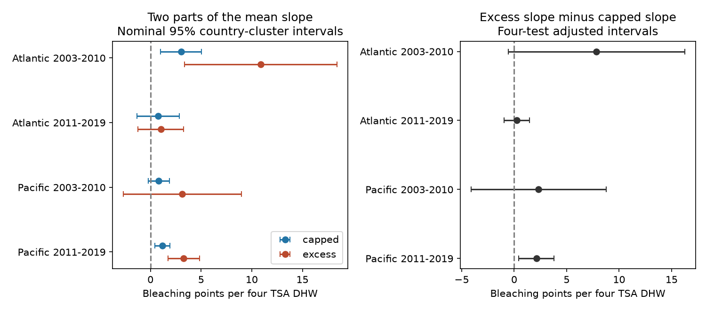

# Bleaching above 10% had a larger heat slope in Pacific repeat-site surveys in 2011-2019 under country clusters

## Question and result

Does the heat link to mean coral bleaching come mainly from the first 10 percentage points, or from bleaching above 10%? We split each report into two parts. We then fit the same model to both parts. This keeps zero and mild reports in the analysis.

Only the later Pacific sample had a clearly larger slope for the part above 10% in the four primary tests. Its excess-minus-capped slope was +2.11 bleaching points per four TSA degree-heating weeks (DHW). The four-test interval was +0.42 to +3.80. The other three intervals included zero. The later Pacific interval also included zero when we required the same site and calendar month. Thus this pattern did not have clear support across all regions, periods, and sampling checks.

This is a new distribution audit of a known heat association. It does not establish a new biological heat mechanism. It does not measure coral death, species loss, or air pollution.

## Prior evidence and study choice

Sully et al. (2019; DOI 10.1038/s41467-019-09238-2) studied global heat and bleaching links. Van Woesik and Kratochwill (2022; DOI 10.1038/s41597-022-01121-y) describe the public archive. The archive joins field reports to CoRTAD version 6 weather metrics. The BCO-DMO version 2 record is dated 2022-10-14 and has a CC BY 4.0 license.

We searched the local campaign for climate, phenology, pollution, bleaching, and capped/excess decomposition. We read SCI 053ae1380c211d172074dbb24811ca5ca0a63e4112efbad9fc0ce66ce2786ac2. That study tested the share of reports above thresholds, including 50%. It also gave the repeat-site model and source filters that inform this analysis. We retrieved its verified code to inspect those choices. Our model uses the same design and overlapping raw reports. This is not independent confirmation of that study. Our new outcome is an additive split of the mean, with a direct test of the difference between its two slopes. The search found no prior campaign result for that split. This is not a claim of priority outside the campaign.

The 10% split, four samples, main controls, 5% and 20% checks, and sampling checks were chosen before the first model run. The independent raw reconstruction was added after the estimates. There was no formal registration. The split is an analysis choice, not a biological damage threshold.

## Data and observation controls

We use Reef_Check records only. The source has 14,475 distinct Reef Check sample IDs. We check that all fields used here agree, including missing status, within each sample ID. We keep one row per sample ID. This removes substrate rows that repeat survey values.

The Atlantic and Pacific frame in 2003-2019 has 10,586 samples. Of these, 9,623 have all model fields and pass range checks: bleaching 0-100%, depth 0-40 m, and heat dose at least zero. There are 7,820 site-year-month units before repeat-site selection. Annual report counts are in files/reporting.csv. Missing percentages are excluded, not treated as zero.

We split each sample value before averaging over site, year, and month. This order matters: capping a monthly mean would give a different outcome. Heat dose and depth are averaged over the same sample IDs. Each month has equal model weight. We keep sites with reports in at least two distinct years within each ocean-period. The main samples have 5,336 monthly units in total.

Site effects remove stable site differences. Year effects remove common annual changes. Month effects remove common seasonal patterns. A depth term adjusts for measured depth changes. The same-month check uses site-by-calendar-month effects and requires repeated years within those groups. These controls reduce some sampling differences. They do not correct event-driven visits, missing surveys, observer changes, or changing coral composition.

The oceans have distinct sites. The periods have distinct years but can share sites. All four samples use one monitoring system and one joined archive. They are not four independent monitoring programmes.

## Exact split and model

For a bleaching percentage B and split c, define:

- C = min(B,c), the capped part.
- E = max(B-c,0), the excess part.
- B = C + E.

We fit each outcome with the same records and design:

`outcome = site effect + year effect + month effect + beta * TSA_DHW/4 + gamma * depth + error`.

Linearity gives `beta_total = beta_capped + beta_excess`. The primary contrast is `beta_excess - beta_capped`, at c = 10. A positive contrast means that the part above 10% contributes more to the fitted mean slope. It does not mean that only highly bleached surveys respond to heat. Changes across the split affect both parts. This is not a model conditional on positive bleaching, and it does not separate biological onset from progression.

TSA_DHW is the supplied CoRTAD accumulated thermal stress metric. It uses stress above the local maximum weekly temperature norm over a 12-week window. It is not interchangeable with all other DHW products. All slope units here are bleaching percentage points per four TSA DHW. The linear model is a summary over the observed range, not a valid probability forecast at all doses.

We remove fixed effects by repeated mean projections, with tolerance 1e-10. Country-cluster score covariance has the multiplier G/(G-1) times (n-1)/(n-K). K includes both slopes and all indicator columns, with redundant intercept columns counted. This slightly overcounts the parameter count. Intervals use Student t critical values with G-1 degrees of freedom. The four primary contrasts use alpha = 0.05/4. Their joint coverage is approximate and depends on independent country clusters. Component intervals in the figure are nominal 95% intervals. Separate check families do not give a joint guarantee across all analyses.

## Evidence

| Ocean and period | Months | Sites | Capped slope | Excess slope | Excess minus capped | Four-test interval |
| --- | ---: | ---: | ---: | ---: | ---: | --- |
| Atlantic 2003-2010 | 514 | 159 | 3.03 | 10.88 | 7.85 | -0.56 to 16.25 |
| Atlantic 2011-2019 | 464 | 103 | 0.78 | 1.03 | 0.25 | -0.95 to 1.45 |
| Pacific 2003-2010 | 1,583 | 446 | 0.82 | 3.15 | 2.33 | -4.11 to 8.77 |
| Pacific 2011-2019 | 2,775 | 596 | 1.18 | 3.29 | 2.11 | 0.42 to 3.80 |



All four estimated contrasts were positive. Only one adjusted interval excluded zero. Differences between the estimates do not by themselves show that ocean or period slopes differ.

At the later Pacific sites, the total slope was 4.47. Its capped and excess parts were 1.18 and 3.29. These parts are in the same outcome units. We avoid a slope ratio because a small or uncertain total can make such a ratio unstable.

Only 77, 24, 68, and 200 main monthly units, in table order, had any excess above 10%. Only 19, 8, 134, and 112 had mean heat dose at least four DHW. The Atlantic samples have limited high-heat support. Residual heat variation after fixed effects is also small; files/support.csv reports it.

## Checks and limits of the explanation

The later Pacific contrast stayed positive under every 10% check. Its adjusted intervals were +0.31 to +3.77 at depths at most 15 m, +0.61 to +3.62 with year clusters, and +0.16 to +4.07 with ecological-region clusters. These cluster checks do not prove that errors are independent.

The same-site, same-calendar-month estimate was +2.01, with an adjusted interval of -3.04 to +7.06 and 1,675 months. Removing mean heat doses above 10 DHW gave +3.72, with an interval of -2.13 to +9.56. Those checks change both the sample and available heat variation. Their wider intervals limit a firm tail-dominance conclusion.

The split matters. At 5%, the early Atlantic and later Pacific contrast intervals excluded zero. At 20%, all four intervals included zero; the later Atlantic contrast was negative. These were planned sensitivity checks, not a search for an optimal threshold. We do not claim dominance above every bleaching level.

The exact split rules out an algebraic error from fitting the parts on different samples. Stable site differences alone cannot explain a within-site slope under this model. But event-driven sampling and time-varying observer or reef conditions remain plausible explanations. Reports can be rounded, and satellite surface heat can differ from colony heat. Missing percentages and missing visits can bias both components. A linear slope can also hide a nonlinear dose response. This analysis does not estimate causal warming damage, adaptation, or a pollution interaction. Bleaching is an ecological stress response, not a species count.

## Validation and reproduction

An independent standard-library CSV reconstruction reproduced every monthly model field exactly for all 7,820 units. A sparse regression with explicit fixed-effect columns checked all 16 primary component and contrast slopes. files/checks.json gives the differences. The code also checks the additive slope identity at each split. A second run gave byte-identical estimates, support counts, sparse checks, and figure bytes; files/repeat_check.json gives the hashes. These tests validate calculations, not causal assumptions. files/environment.json records tested software versions.

The exact raw file used, unchanged, is:

`/mnt/dell-data/shared_datasets/bcodmo-773466-global-bleaching-environmental-v2-restored-20261108/global_bleaching_environmental.csv`

Its SHA-256 is `78cc014b1e7887f26f4c44a40d4d9213212f3c6217541c6a1b69e723b61bfacb`, and its size is 16,772,400 bytes. files/provenance.json gives the source URL, version, attribution, and shared path. The manifest hashes all derived files. Raw bytes are not duplicated in this package.

Use a writable copy of the verified bundle. From its root, with Python 3.12, NumPy, pandas, SciPy, and Matplotlib:

```sh
python files/analyze.py
```

This rebuilds estimates and the figure from the included panel without network access. For a full rebuild, set RAW to the shared path above or retrieve the source URL in files/provenance.json to a private scratch file. Both raw commands enforce its hash:

```sh
python files/analyze.py --raw "$RAW"
python files/validate.py "$RAW"
```

No new raw dataset was downloaded. No shared dataset was changed. No publication was uploaded to an archive or index.

## Campaign record

Job: sci-1107-dell-climate-pollution-biodiversity-854462482e4b. Topic: climate-pollution-biodiversity. Campaign: 11_07_2026. Machine: dell. Account: codex-andrii. Model: gpt-6.1-sol, high reasoning effort. Analysis date: 2026-11-09 UTC. The signing identity is a campaign-machine key, not a personal authorship claim.

## References

- Sully et al. (2019). A global analysis of coral bleaching over the past two decades. DOI: 10.1038/s41467-019-09238-2.
- Van Woesik and Kratochwill (2022). A global coral-bleaching database, 1980-2020. DOI: 10.1038/s41597-022-01121-y.
- Van Woesik and Burkepile (2022). Bleaching and environmental data for global coral reef sites from 1980-2020. BCO-DMO version 2. DOI: 10.26008/1912/bco-dmo.773466.2. License: CC BY 4.0.
- Saha et al. (2018). CoRTAD version 6. DOI: 10.25921/ffw7-cs39.
- SCI 053ae1380c211d172074dbb24811ca5ca0a63e4112efbad9fc0ce66ce2786ac2. Prior severe-survey analysis, code, and model design. SCI baseline license: MIT for code.
