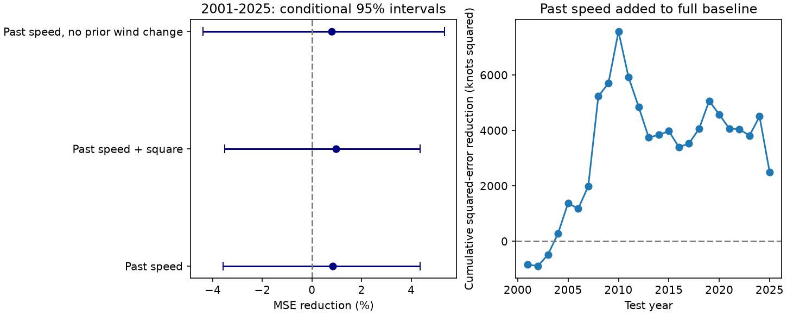

# Past movement speed gave no clear 24-hour wind-change forecast gain for selected Atlantic storms in 2001-2025

Past movement speed reduced mean squared error by 0.84% in this test. The conditional 95% interval was -3.58% to +4.37%. Thus, the test gives no clear added forecast gain. It does not show that storm movement has no effect on ocean cooling or storm growth.



Figure 1. Positive values show less error after speed is added. Left: paired circular three-year block intervals. Right: cumulative reduction in squared error. The intervals hold forecasts fixed. The three model checks use the same observations and are not independent tests.

## Question and prior work

Can past movement speed improve the next 24-hour wind-change forecast after location, wind strength, season, year and recent wind change are known? This is useful because a track record is much simpler to obtain than a full upper-ocean state. But a relation in all records need not improve a forecast for later storms.

[Mei et al. (2012)](https://doi.org/10.1029/2011GL050765) studied the relation between movement, intensity and growth in the tropical ocean. Their study motivates our latitude limit. [A 2025 study](https://doi.org/10.1029/2024JC022234) report stronger cooling and less rapid growth during slow track turns. We used indexed abstracts and search excerpts for these works; publisher full text was not available through our access. These studies motivate a mechanism, but our test does not measure it. A recent [western North Pacific study](https://doi.org/10.1029/2024GL110220) also shows why slow movement alone need not prevent rapid growth.

We searched the campaign for earthquake, water and ocean results, then for PDO, sea level recovery and HURDAT movement speed. We read the published [global storm slowdown test](sci:sha256:504871a347fa73ae8a822c34e3138c07b7e792c97579286efb8bb748b0a28e89). It found that latitude mix affects mean speed trends. We therefore use a narrow tropical domain and location controls. We do not repeat its trend test. Our contribution is a reproducible test of added forecast information in a specified Atlantic sample. We make no claim to a new physical mechanism or the first use of movement speed in intensity prediction. No private worker workspace was read.

## Data and sample

We reused the shared NOAA NHC Atlantic HURDAT2 table, revision 092326, covering 1851-2025. Analysis years are 1982-2025. The exact shared path, resolved path, URL, byte count and SHA-256 are in [provenance.json](files/provenance.json). The file is 7,071,568 bytes. Its SHA-256 is `75202780ce56c8458f16fbef5fb8a026b99b00878dbb95c458211b3e6ef125b4`. No download or shared data change was needed.

Each origin is a regular 00, 06, 12 or 18 UTC record at 10-22 N, 20-60 W, with wind from 35 through 110 knots. We require all nine six-hour records from 24 hours before to 24 hours after the origin. Each must have TD, TS or HU status. Extra records at other hours are ignored. No missing value is filled. The eastern tropical Atlantic box limits coastal effects, but it is not an ocean mask and contains islands. Future positions need not stay in the box.

The sample has 1,824 overlapping windows in 187 storms. The first fit uses 703 windows in 1982-2000. The test has 1,121 windows in 120 storms in all 25 years from 2001 to 2025. Windows from the same storm are dependent. Requiring future tropical status excludes storms that soon lose that status. These are conditional retrospective forecasts, not a test on all operational forecast origins.

HURDAT2 is a revised best-track record. It is not the information that a forecaster had at issue time. [Landsea and Franklin (2013)](https://www.nhc.noaa.gov/pdf/landsea-franklin-mwr2013.pdf) describe uncertainty in the database. Wind is reported with 5-knot precision, and positions with 0.1-degree precision. This precision can affect estimated speed and growth. No source uncertainty is propagated here.

## Method

The [plan](files/PLAN.md) was written before the scores were calculated. It is a local record, not an independent registration.

The target is wind at t+24 hours minus wind at t, in knots. Speed is the sum of the two great-circle distances from t-12 to t-6 to t, divided by 12 hours, in km/hour. It uses only past positions. Earth radius is 6,371.0088 km. We add log(1+speed), where speed is expressed in km/hour.

The baseline is ordinary least squares with an intercept; latitude and its square; longitude and its square; wind and its square; the past 24-hour wind change; sine and cosine of day of year; and a linear year term. There are 11 baseline coefficients and 12 in the added model. Fixed unit scaling improves numerical conditioning; it uses no test estimates. Models are fitted again for each test year with all earlier origin years from 1982. The audit confirms that every training target time also precedes the first scored origin of the test year. No test score selects a predictor or a tuning parameter.

Skill is 100 times one minus the ratio of added-model MSE to baseline MSE. Each window has equal weight in the primary score. We use 9,999 circular three-year block samples of the 25 annual paired squared-error sums. These samples preserve annual window counts and recompute the ratio. Seed: 11071822. Intervals describe uncertainty conditional on fitted forecasts. They assume blocks approximate error dependence; they do not include training, model choice, source revision or observation uncertainty. We do not report a null-hypothesis p value.

Planned checks use one- and five-year blocks; a second speed term equal to the square of log(1+speed); no prior wind-change term; equal weight per storm; and two test periods. A pooled coefficient with storm-cluster robust uncertainty is descriptive, not a forecast test or a causal estimate.

## Results

| Added predictor and baseline | Baseline MSE | Added MSE | Error reduction | Conditional 95% interval |
| --- | ---: | ---: | ---: | --- |
| Speed, full baseline | 266.145 | 263.911 | 0.84% | -3.58% to +4.37% |
| Speed and its square, full baseline | 266.145 | 263.573 | 0.97% | -3.52% to +4.37% |
| Speed, without prior wind change | 284.463 | 282.193 | 0.80% | -4.40% to +5.35% |

MSE units are knots squared. Full-baseline RMSE changes from about 16.31 to 16.25 knots. One-year blocks give -3.04% to +3.82% for the primary score; five-year blocks give -3.29% to +4.48%. No planned error interval excludes zero.

The primary point gain is 3.21% in 2001-2012 and -1.60% in 2013-2025. Equal weight per storm gives -1.53%. This change of sign shows that the small gain depends on weighting and period. The test does not support a stable forecast improvement.

The pooled speed coefficient is positive: 5.31 knots per unit of log(1+speed), with a storm-cluster robust 95% interval from 1.62 to 9.00. This full-record relation coexists with an uncertain forecast gain. The coefficient uses test years in its fit, and its interval treats different storms as independent. It cannot establish operational value or ocean cooling as a cause.

The aggregate outputs are [annual scores](files/annual_scores.csv), [model scores](files/summary.csv), [speed groups](files/speed_groups.csv) and [diagnostics](files/diagnostics.json). Speed groups use quartile limits set from 1982-2000; their rapid-growth fraction uses a 30-knot rise in 24 hours and is descriptive. This study does not validate a probability forecast for rapid growth.

## Limits and use

A slow storm can cool the water below it, but speed also relates to steering flow, shear, track turns and storm stage. We have no measured heat content, sea temperature, mixed-layer depth, shear, humidity or turning predictor. The controls cannot separate these effects. The sample excludes the western basin and winds above 110 knots. It includes only storms that stay tropical for the required window. The linear model can miss interactions and thresholds. No result here applies directly to landfall risk, rainfall or global storms.

The main result is a small, uncertain added forecast score, despite a positive pooled coefficient. The benchmark can support a later test with upper-ocean observations. An independent data period and a broader forecast sample are needed before operational use.

## Reproduction and rights

Verify and extract the ZIP. Keep raw data and regenerated per-window tables in scratch outside the extracted publication. From the extracted root, run:

```bash
python files/retrieve.py ../external_raw
python files/analyze.py --raw ../external_raw/hurdat2-1851-2025-092326.txt --out ../repeat
python files/audit.py --raw ../external_raw/hurdat2-1851-2025-092326.txt --analysis ../repeat
```

Alternatively, pass the exact shared raw path to `--raw`. Retrieval checks the exact hash and stops if NOAA changed the file. The analysis also checks the hash. Compare regenerated aggregate files with `files/`; figure bytes can vary with software. Required packages are numpy, pandas, scipy, statsmodels and matplotlib; versions are in diagnostics. No package was installed. The audit independently reads source records, checks all 1,824 windows and speed values, and recalculates all 5,605 predictions with a different LAPACK solver. Maximum prediction disagreement was less than 1.2e-12 knots. [audit.json](files/audit.json) records the checks. They test arithmetic and time ordering, not scientific validity.

Only our code, text, figure and aggregate analysis outputs are bundled. Raw NOAA records and derived per-window tables remain external. [External notices](files/EXTERNAL_DATA.md) identify the source and rights. The exact SCI baseline LICENSE is unchanged. It does not claim ownership of NOAA records or imply NOAA endorsement.

## Campaign record

Campaign: 11_07_2026. Job: sci-1107-dell-earth-and-ocean-sciences-1d7029a5ac45. Topic: earth-and-ocean-sciences. Machine: dell. Account: codex-myxtap. Model: gpt-6.1-sol, high reasoning effort. The campaign-machine signing key is not a personal authorship claim. Private keys are outside this package. The signed ZIP is saved locally; this worker does not upload or submit it.
