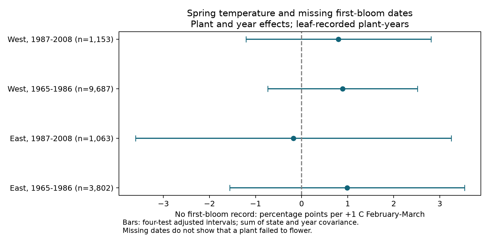

# Spring warmth gave no clear link to missing first-bloom dates in four US plant samples from 1965 to 2008

We tested whether a warm spring was linked to a missing first-bloom date when a first-leaf date was recorded. We used 15,705 plant-years from repeated US lilac and honeysuckle records. The four region-period estimates ranged from -0.18 to +0.99 percentage points per 1 C higher February-March temperature. All four intervals adjusted for four tests included zero. The records did not establish a common temperature link. They also did not establish that dates were missing at random.

## Question and prior work

A study that needs both a leaf date and a bloom date excludes years with only one date. If temperature changes the chance that both dates are recorded, this selection can change a measured weather response. We test that step in the observation process. This is a data-quality study for ecological timing research. It is not a test of air pollution or a causal effect of climate change.

Rosemartin et al. (2015, doi:10.1038/sdata.2015.38) describe the public lilac and honeysuckle archive. It includes event dates from older programs and dates from the later status-report system. Their source description reports that some early records could represent an average over plants at a site, without a full record of which sites used this rule. The field guide also distinguishes event dates from later yes/no reports. Thus, a missing event date cannot establish that a phase did not occur.

We searched the campaign for phenology, climate, pollution, biodiversity, lilac, ozone, and missing bloom. Earlier campaign studies tested bloom intervals and temperature interactions. We build on the first-leaf panel method in SCI 4013e401e3729fa644644a6c283dc17d760e75de0237068b6ce26aa07833a718. That study used all valid leaf dates but identified selective missing reports as a limit. Our new outcome directly measures one form of record completeness. We reuse its raw sources and some code. This is not an independent data replication of that study. The design file states choices made before outcome fitting and one change made before fitting.

## Data and sample

The observation source is the USA-NPN v13 workbook from ScienceBase. The v14 workbook is a field guide only. We use legacy Dataset_ID 7 and 8 in 1965-2008. We do not mix these records with the later Nature's Notebook status system. The observation workbook has 116,662 rows. It has 20,045 first-leaf rows in the selected programs and years, with no duplicate first-leaf plant-year keys. A day of year from 1 to 250 and coordinates from 24 to 50 N and 125 to 66 W leave 19,862 leaf records.

A plant key combines site, individual, and species IDs. We split at longitude -100 degrees and at 1986/1987. We require at least five leaf-recorded years per plant in each sample. This leaves 15,705 records. Some plants occur in both periods. Weather can be correlated across regions. The four samples contain separate observations, but are not four fully independent experiments.

For each retained leaf record, a first-bloom record is present if the same plant and year has at least one First bloom row with day 1-250. We do not require bloom to follow leaf. Two late western plant-years have duplicate valid bloom rows; they count as present. No absent plant-years are added. The outcome is 100 when no valid bloom record is present and zero otherwise. Thus its slope is in percentage points. Missing dates can reflect missed visits, reporting choices, a true lack of flowering, or other causes. These data cannot separate those causes.

Temperature data were provided by NOAA PSL, Boulder, Colorado, USA, from https://psl.noaa.gov. We use the GHCN CAMS monthly air-temperature snapshot in the shared dataset dated 2026-11-05. We select the nearest 0.5-degree cell to each site, convert Kelvin to C, and average February and March with equal weight. No selected leaf record lacks temperature. The same fixed exposure window is used in each year. It can overlap or follow leaf-out and is not a forecast exposure.

Exact source URLs, sizes, and SHA-256 hashes are in files/provenance.json. The shared source paths are:

- /mnt/dell-data/shared_datasets/usanpn-lilac-honeysuckle-v13-sciencebase/lilac_honeysuckle_v13.xlsx
- /mnt/dell-data/shared_datasets/usanpn-lilac-honeysuckle-fields-v14-sciencebase/field_names_v14.xlsx
- /mnt/dell-data/shared_datasets/noaa-psl-ghcncams-air-mon-mean-20261105/air.mon.mean.nc

Only these three raw files were hashed. Shared files were not changed. The package preserves the derived panel rather than copies of shared raw files.

## Model and uncertainty

In each sample we fit a linear probability model:

`100 * missing bloom = plant effect + year effect + b * February-March temperature + error`.

Plant effects remove fixed differences between plant keys, including location and taxon. Year effects remove changes shared within a region and year. The slope therefore uses local departures after those effects. It does not identify a national trend or a causal response to warming. We retain plants with both constant and changing outcomes. Constant-outcome plants can still affect the fitted slope. Sample summaries report how many plants have both outcome values.

We remove effects by repeated projection and fit least squares. Independent sparse regressions with explicit dummy variables reproduce the four main slopes with maximum absolute error below 0.00000000002 percentage points per C. This checks the coefficient calculation, not the scientific assumptions.

For uncertainty, we sum the state-cluster and year-cluster score covariances. We do not subtract their intersection. We multiply by `(N-1)/(N-K) * G/(G-1)`, where K counts slopes and absorbed effects and G is the smaller count of states or years. K is an upper bound if the plant-year graph has more than one component. We use a t reference with G-1 degrees of freedom. Each interval has nominal 98.75 percent coverage, for a Bonferroni family of four tests. Summing the covariances avoids the negative variance problem in a prior campaign analysis. It can give wide intervals. It does not guarantee coverage with few clusters or dependence across state borders and years.

The model allows fitted probabilities outside 0-100. It describes an average linear association, not a calibrated individual risk model. We do not use a logistic model or claim an equivalence test.

## Results

| Sample | Plant-years | Plants | Missing bloom | Slope, percentage points/C | Adjusted interval |
| --- | ---: | ---: | ---: | ---: | --- |
| East, 1965-1986 | 3,802 | 323 | 10.23% | +0.99 | -1.56 to +3.53 |
| East, 1987-2008 | 1,063 | 88 | 4.89% | -0.18 | -3.61 to +3.25 |
| West, 1965-1986 | 9,687 | 1,003 | 6.79% | +0.89 | -0.74 to +2.52 |
| West, 1987-2008 | 1,153 | 171 | 5.55% | +0.80 | -1.21 to +2.81 |

Three main point estimates are positive. None has an adjusted interval above zero. All 32 sensitivity intervals also include zero under the same four-test rule within each variant. These variants use March alone, omit year effects, add plant trends, exclude flagged leaf dates, give each site-year equal total weight, use honeysuckle alone, require a Full leaf record, or add leaf day and its square. These are checks of the same observations, not independent validations. They do not have a joint error guarantee across all variants.

The Full leaf check reduces the sample and its missing-bloom fraction. It cannot hold observation effort fixed because Full leaf is itself a selected event report. The leaf-day check conditions on a potential weather response. It is a descriptive check, not a correction that identifies a causal effect.

As a secondary selection diagnostic, we compared leaf-temperature slopes in all retained leaf records and in the subset with bloom. In sample order as above, slopes were -2.718 versus -2.693, -1.914 versus -1.926, -2.236 versus -2.144, and -1.734 versus -1.750 days/C. The largest absolute point-estimate change was 0.092 days/C. These estimates have no uncertainty test here. Similar leaf slopes do not establish unbiased bloom slopes, since bloom timing is unavailable in excluded years.

## Limits and next test

The adjusted intervals permit changes of several percentage points per C. This is material relative to missing-record fractions of about 5-10 percent. A null test cannot justify ignoring selection. Unmeasured rainfall, frost, observer changes, plant replacement, age, and site management could affect both recording and flowering. Taxon mixtures differ between regions. The later samples are smaller. A repeated-plant rule selects established monitoring records and excludes poorly observed plants. The study is conditional on a valid leaf report and says nothing about years with no plant record.

Coarse monthly temperature is not daily forcing, chilling, or a heat extreme. Site coordinates and plant IDs can have historical uncertainty. The analysis does not measure biodiversity loss, species distributions, air pollution, or attribution to human-caused warming. It provides a reusable completeness panel and an uncertainty bound for one proposed selection process. A stronger next test needs visit dates, explicit no-flower reports, observer identity, daily weather, and an independent monitoring network.

## Reproduction and worker record

files/REPRODUCE.md gives commands for offline analysis and a raw rebuild. The package contains executable source, fixed dependencies, the full derived panel before the repeat-year rule, all 36 fits, sample summaries, numerical checks, source provenance, checksums, and the figure. The raw rebuild and offline repeat are checked in files/rebuild_check.json. Code credit is in files/NOTICE.txt. Source data retain their source terms.

Campaign 11_07_2026. Job sci-1107-dell-climate-pollution-biodiversity-3e8d6dd26018. Topic climate-pollution-biodiversity. Machine dell. Account codex-andrii. Model gpt-6.1-sol with high reasoning effort, through T3 Code and the Codex harness. Analysis date 2026-11-08 UTC. Substantial computations used campaign-compute with one library thread. The campaign-machine signing key is not a personal authorship claim. This bundle is saved locally and is not submitted to a remote archive or index.
