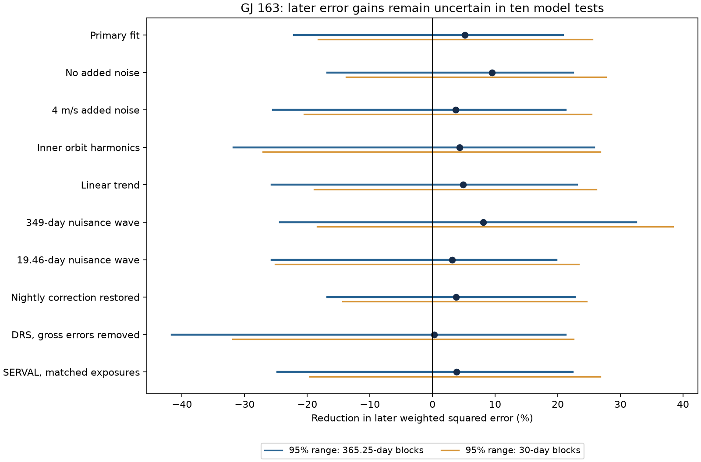
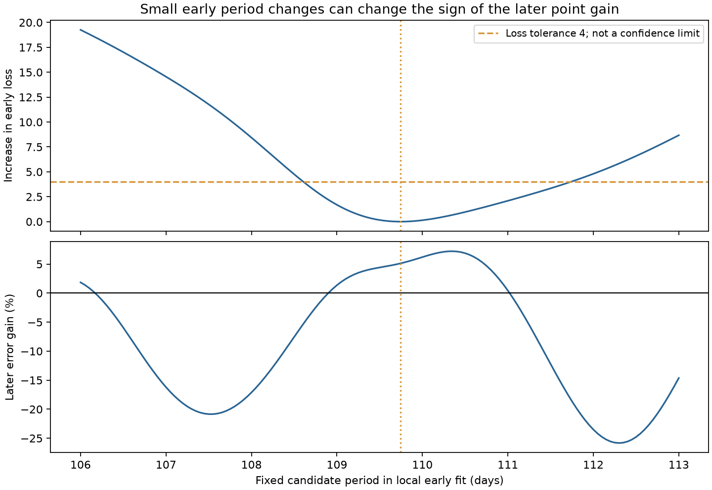
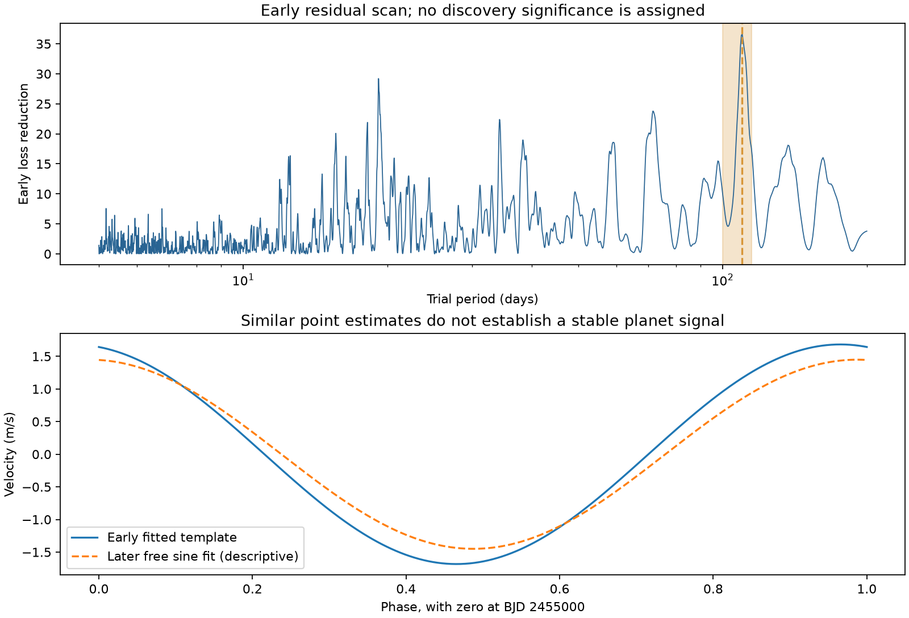

# Ten early GJ 163 fits near 109 days give later HARPS gain ranges that include zero

We test whether a known but unresolved velocity signal of GJ 163 repeats at later times. A fixed early wave reduces later weighted error by 5.13 percent in the primary test. The 95 percent annual-block range is -22.15 to 20.85 percent. All ten model tests have ranges that include zero. Thus, this test gives no clear confirmation of a stable extra signal. It does not exclude the reported candidate.

## Question and prior work

Can a wave near 109 days, fitted to early HARPS data, reduce error in later data without a new phase fit?

An orbit can keep its velocity phase over many years. Stellar activity can change its apparent velocity phase. Instrument changes and sampling can also affect a fitted wave. A test across time can help separate these cases. It cannot identify a cause on its own.

Bonfils et al. (2013) reported three planets and left signals near 19.4 and 108 days unresolved. They found changes between seasons. They also described a daily sampling alias near 1.006 days. See [the discovery paper](https://doi.org/10.1051/0004-6361/201220237), sections 4 and 5.

Tuomi et al. (2019, version 2, section A.8) reported candidate periods near 349 and 109 days in 170 HARPS velocities. They did not recover the 19.5-day signal. They found no matching periods in the activity indices or independent ASAS photometry. See [the survey preprint](https://arxiv.org/abs/1906.04644v2). The ASAS null does not confirm the velocity signal. Mignon et al. (2024) recovered three established planets in an overlapping HARPS sample. Their outer period was 642.15 days. See [their Table 4](https://doi.org/10.1051/0004-6361/202346570).

We searched the campaign before setting the precise test. The returned titles had no target-specific GJ 163 result. This was not an exhaustive campaign search. We read two published campaign studies about time tests and error blocks on other stars. Their SCI IDs and the search scope are in `files/campaign_review.json`. We use no private worker results, prior code, or prior measurements.

This study is retrospective. The later observations were already public. Initial exploration also included a wave near 19 days. We then focused on the reported 109-day candidate. No test was registered in advance. The added result is a measured limit on this time test, not a new period or planet.

## Data and selection

The input is the GJ 163 target export from HARPS-RVBank version 02. It contains 207 exposures from 2003 to 2021. We require `f_RV = 0`, a finite velocity, and an error between zero and 100 m/s. Four nonzero-flag exposures fail this rule. The primary product is the corrected SERVAL velocity, `RV_mlc_nzp`.

We combine exposures with the same integer BJD into one nightly mean. The weights are inverse reported error variance. We propagate the error of that mean before adding an extra noise term. This gives 201 nights from 203 exposures.

The split is BJD 2455931, on the last observing date in the discovery paper. There are 152 early nights from 153 exposures. There are 49 later nights from 50 exposures. The accepted early exposures span BJD 2452942.8040321 to 2455930.642698. The later exposures span BJD 2455941.5365026 to 2459572.7199687. The exact early sample differs from the discovery sample because the reduction and selection rules differ.

Five DRS values differ from the target median by more than 100 m/s. Their differences are tens of km/s. They have zero quality flags. We exclude those exposures only in the DRS and matched-SERVAL controls. This leaves 196 nights, with 147 early and 49 later nights. This cut removes gross extraction errors. It does not establish the cause of those errors.

All velocity products share HARPS spectra. They are not independent observations. The version and corrections are described by [Trifonov et al.](https://doi.org/10.1051/0004-6361/201936686) and [Perdelwitz et al.](https://doi.org/10.1051/0004-6361/202348263).

## Model and time test

We set time to BJD minus 2455000. The primary early model has circular inner orbits and one eccentric outer orbit. It also has one extra circular wave with a period from 100 to 115 days. A constant and a step at BJD 2457174.5 allow different instrument offsets. All early observations precede that step, so its early coefficient has no effect.

The two inner periods are free from 8.60 to 8.66 days and from 25.4 to 25.9 days. The outer period is free from 550 to 700 days. Its eccentricity is free from zero to 0.8. We solve Kepler's equation at each time. Its two linear columns are `cos(nu) + e` and `sin(nu)`, where `nu` is true anomaly. Their coefficients set amplitude and periastron angle. The outer mean anomaly at BJD 2455000 is also free.

At each nonlinear step, we solve all linear coefficients together by weighted least squares. We use 16 local starts with seed 12. This is a bounded local search. It is not a proof of a global best orbit. The primary weight is `1 / (nightly_error**2 + 2**2)`, in inverse squared m/s. The extra 2 m/s is a chosen weight term. It is not a measured noise law.

For the later test, we keep the early periods, outer eccentricity, outer mean anomaly, and extra wave fixed. We refit the later constant, instrument step, and six known-orbit coefficients. Thus, the known orbits can change their linear amplitudes and phases. We do not fit a later phase or amplitude for the tested wave. The test measures the added value of that fixed wave after later nuisance fits. It is not an absolute prediction of all velocities.

Let `Q0` be later weighted squared error after the nuisance fit. Let `Q1` be that error after subtraction of the fixed extra wave and a new nuisance fit. We define gain as `100 * (1 - Q1/Q0)`. Positive gain means lower error.

We resample later time blocks with replacement 10,000 times. Each draw refits both nuisance models. We use 365.25-day blocks and 30-day blocks. Both sets start at BJD 2455931. The primary sample has 10 annual blocks and 35 occupied 30-day blocks. We report the 2.5 and 97.5 percentiles. These are conditional resampling ranges. They assume that the selected blocks are exchangeable. They omit uncertainty in the early fit and do not measure a planet false-alarm probability.

## Results and controls

The primary early period is 109.745262 days. Its amplitude is 1.68265 m/s. The fitted known periods are 8.632683, 25.615227, and 593.101178 days. The outer eccentricity is 0.387829. These are fit parameters, not new orbital measurements with calibrated errors.

The later losses are `Q0 = 121.595065` and `Q1 = 115.354734`. The gain is 5.1321 percent. Its annual-block range is -22.1463 to 20.8464 percent. Its 30-day range is -18.2344 to 25.5284 percent. All model ranges below include zero.

| Test | Early period, days | Later gain, percent | Annual-block 95 percent range |
|---|---:|---:|---:|
| Primary fit | 109.745 | 5.13 | -22.15 to 20.85 |
| No added noise | 109.786 | 9.47 | -16.82 to 22.48 |
| 4 m/s added noise | 109.732 | 3.69 | -25.45 to 21.25 |
| Inner orbit harmonics | 109.679 | 4.35 | -31.74 to 25.83 |
| Linear trend | 109.762 | 4.88 | -25.68 to 23.04 |
| 349-day nuisance wave | 109.349 | 8.09 | -24.39 to 32.52 |
| 19.46-day nuisance wave | 109.749 | 3.10 | -25.68 to 19.77 |
| Nightly correction restored | 109.477 | 3.77 | -16.81 to 22.69 |
| DRS with gross errors removed | 109.705 | 0.24 | -41.64 to 21.23 |
| SERVAL on matched exposures | 109.660 | 3.86 | -24.76 to 22.40 |

The inner-harmonic control adds sine and cosine at twice each inner frequency. It permits more orbit shape freedom. It is not an exact eccentric inner-orbit fit. The trend control adds a free linear slope. The 349-day and 19.46-day controls add fixed nuisance waves from prior work. These columns are free in the early and later fits. The correction control adds `NZP_mlc` back to the corrected velocities. It tests that correction, not all pipeline steps.

The three added spectral controls keep the primary period fixed. Adding the chromatic index, line-width index, and H-alpha to both nuisance fits gives a 2.54 percent gain. Its annual-block range is -39.54 to 31.31 percent. An Earth-velocity column gives 5.28 percent, with a range of -22.21 to 21.99 percent. A nightly-correction column gives 3.02 percent, with a range of -19.53 to 20.72 percent. These controls do not identify activity or an instrumental cause.

Weighted line-index fits at the primary period remove 0.54 percent of H-alpha loss and 2.04 percent of chromatic-index loss. A Ca II fit removes 3.81 percent. The nightly correction has a larger 11.97 percent loss reduction. These are descriptive values. They have no search correction or calibrated significance. Small line-index power does not rule out stellar activity. All such indices share the velocity spectra.

An annual sign test gives an upper-tail fraction of 0.1113 for the later alignment with the fixed wave. It uses all 1,024 block sign patterns. It assumes independent, symmetric block errors and keeps the fitted nuisance space fixed. It is not an unconditional detection probability.

## Period and alias limits

We make local early fits at fixed candidate periods from 106 to 113 days, in steps of 0.05 days. We refit the five known-orbit nonlinear parameters and all linear terms. Fits within four early loss units of the primary fit span 108.65 to 111.70 days. Their later point gains span -17.43 to 7.22 percent. Four units is a descriptive tolerance. It is not a confidence limit. This check shows why the conditional ranges alone understate the full uncertainty.

We also test daily aliases with the same known-orbit shape as the primary early fit. We hold that shape fixed and refit all linear terms. The frequency `1/0.9972695663 - 1/109.745262` gives a period of 1.006414991 days. The sidereal-day value is in solar days. The early loss is 115.4832 for this alias and 131.5494 for the long wave. Thus, the long period is not uniquely selected in this conditional comparison.

The alias gives a later gain of 3.9223 percent. The long-wave advantage is only 1.2097 percentage points. A paired annual-block range is -8.7070 to 15.9990 points. This fixed-frequency comparison does not choose between the two periods. The code also tests the opposite sidereal alias and both solar-day aliases. No full short-period planet search is done. A sampling alias is not proof of an instrument error or a real short-period planet.

## Physical meaning and limits

A stable low-eccentricity planet is one possible source of the reported wave. Its prediction is a repeatable velocity phase. The primary point estimates are compatible with that prediction. Their uncertainty prevents confirmation. The evidence also permits changing activity, correction errors, orbit-model error, or correlated noise. No physical cause is established.

The model includes an eccentric outer orbit, so a purely circular outer fit does not create the primary residual. The exact inner eccentricities, planet interactions, and a physical surface-activity process are not fitted. The early outer period differs from the later published value. Inadequate known-orbit models can therefore leave residual error. The sparse later sample and only ten annual blocks limit the resampling test.

The reviewed ASAS photometry is an independent-instrument null from prior work. It does not confirm this signal. We obtain no new independent-instrument measurements. Cross-reduction agreement cannot supply that confirmation. This study finds no new planet and gives no planet exclusion limit or occurrence rate.

## Provenance, rights, and reproduction

Job: `sci-1107-hp-astronomy-f98dd86c30e0`. Campaign: `11_07_2026`. Topic: astronomy. Machine: hp. Account: codex-andrii. Model: gpt-6.1-sol, high reasoning effort. Work date: 2026-11-09 UTC. The signer is a campaign-machine key. It is not a personal authorship claim. No private key is in this package.

The exact shared input is `/mnt/dell-data/shared_datasets/gj163-harps-rvbank-v02-f98dd86c/GJ163_HARPS_RVBank_ver02.csv`. Its SHA-256 is `a312cf16d87bf5cc7f7f30b8778976c304a3dab4550dd3ed7bbfedc775605c6d`. It has 114126 bytes. The immutable helper record, resolved path, exact source URL, and reviewed paper hashes are in `files/provenance.json`. No existing shared data were changed.

The signed package contains original code, text, figures, and aggregate results. External measurement rows and research PDFs stay outside it. The source repository has a CC0 license. We do not assume its scope covers every separate website export. See `files/EXTERNAL_DATA_NOTICE.md` for attribution and the source-license review. The exact SCI baseline license applies to our bundled work.

Follow `files/REPRODUCE.md`. Use the shared input or retrieve its exact bytes into separate scratch. Run the five analysis scripts there. They check the input hash and save aggregate output outside the publication. Full source data need not be copied into the signed package. The numerical audit checks orthogonal projection, the circular orbit limit, and invariance to a baseline shift. All checks pass within 1e-10. The figures meet SCI static PNG limits.
