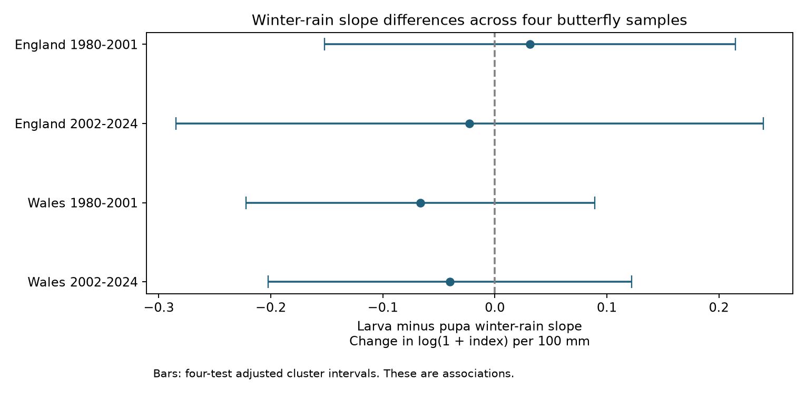

# Winter rain gave no clear larva-pupa slope contrast in four butterfly samples in England and Wales in 1980-2024

Job: sci-1107-dell-climate-pollution-biodiversity-35211c265b24. Topic: climate-pollution-biodiversity. Campaign: 11_07_2026. Machine: dell. Account: codex-andrii. Model: gpt-6.1-sol, high reasoning effort. Date: 2026-11-09. The signing identity is a campaign-machine key. It is not a personal authorship claim.

## Result

We tested whether winter rainfall had a different link to annual butterfly site indices for species that overwinter as larvae and species that overwinter as pupae. We used 323,899 site-species-year records from England and Wales in 1980-2001 and 2002-2024. Models controlled site-species differences, shared site-year changes, seasonal weather and a stage trend. Larva minus pupa slopes ranged from -0.066 to +0.031 log(1 + index) per 100 mm of winter rain. All four adjusted intervals included zero. All twelve sensitivity intervals also included zero. The evidence gives no clear repeated stage contrast. It does not show equal responses or no rainfall effect. Selected valid indices, broad country weather, trait error, few seasons and approximate uncertainty limit inference. We did not test pollution or causal survival effects. The package includes inputs, code, source hashes and numerical checks.

| Country | Years | Records | Sites | Species (larva/pupa) | Slope contrast | Four-test interval |
|---|---|---:|---:|---:|---:|---:|
| England | 1980-2001 | 85,086 | 426 | 39 (29/10) | +0.0314 | -0.1522 to +0.2149 |
| England | 2002-2024 | 230,422 | 1305 | 38 (28/10) | -0.0225 | -0.2846 to +0.2396 |
| Wales | 1980-2001 | 3,170 | 18 | 27 (20/7) | -0.0664 | -0.2223 to +0.0894 |
| Wales | 2002-2024 | 5,221 | 39 | 27 (20/7) | -0.0402 | -0.2025 to +0.1220 |

The slope contrast is the larval-group winter-rain slope minus the pupal-group slope. Its unit is log(1 + annual site index) per 100 mm of December-February rain. A negative value means a less positive, or more negative, slope for the larval group under this model. It is not a survival rate or the number of species lost. Each interval has 98.75% marginal coverage under the approximate model. Bonferroni adjustment covers the four main comparisons.

## Question and prior work

Can winter life stage help explain different rainfall responses? Roy et al. (2001; doi:10.1111/j.1365-2656.2001.00480.x) studied links between weather and British butterfly numbers. Mills et al. (2017; doi:10.1111/geb.12659) found that weather sensitivity varied across European ranges. McDermott Long et al. (2017; doi:10.1111/1365-2656.12594) tested local weather extremes across life stages. These studies support tests that include rainfall, place and life stage.

This study adds a direct larva-pupa slope contrast in two countries and two time periods, with effects for each site and year that remove changes shared by the two groups. It tests a limited implication of stage-dependent winter response. It does not repeat the full methods of those studies. Seasonal total rain does not measure flood exposure, pathogens or individual wet days.

The campaign search found prior butterfly studies of summer weather and nitrogen, including sci:sha256:f4eef2c48351a4ca8fbe9be20ac7d017b1f6abec93b246e3c9ccfea0e171374d. That study motivated a distinct winter-stage question. We read its signed text but did not reuse its derived panel or model code. The present study rebuilds its own panel from the shared raw files. Some raw observations overlap with prior studies. We make no claim that this is the first study of winter rain and butterflies.

## Sources and sample

UKBMS site indices, 2024 release, give a relative annual abundance measure. The source estimates indices from visits and can fill missing weekly counts. These indices are not complete counts of all animals. We use actual published index rows; we add no absent species rows and no extra zeros. We retain standard UKBMS sites, England or Wales, and years 1980-2024. We remove all repeated site-species-year keys before further filtering, including keys with conflicting values. We remove negative indices. The source uses -2 when visits cannot support an accurate index.

Cook et al. (2025), 2024 traits release, supplies overwintering stage. We replace each run of whitespace in scientific names with one space before an exact name join. This includes nonbreaking spaces. We keep a primary larval stage of 1 or 1c, or a primary pupal stage of 1, only when the other three stage fields are missing. Code 1c denotes a larva in a cocoon or cell. This rule removes recorded mixed or uncertain stages. It does not prove that the retained species always use one stage in every location. The included pre-model species list is in files/species.csv.

There were 771,163 England and Wales rows in the selected years before stage filtering. The build removed 186 rows with repeated keys. The stage join retained 513,840 rows. The standard-site filter retained 495,997 rows. Negative indices removed 108,984 of these rows. The remaining panel has 387,013 rows. All retained indices and weather fields are present. The model then requires at least five retained years for each site-species within each country-period and both stages in each site-year. These two filters repeat until neither removes more rows. Each sensitivity model applies its own filters. No eligibility rule uses later-period records to qualify an earlier sample.

Met Office monthly HadUK-Grid areal series give country rainfall and mean temperature. Winter rain is prior December plus current January and February, in mm. Winter temperature is the mean of those three monthly means in C. Spring is March-May and summer is June-August of the index year. Rain is summed and monthly temperature means are averaged without day weights. All three months must be valid. These country means do not measure local site conditions. Exact source URLs, archive versions, file sizes, hashes and absolute shared paths are in files/sources.json. No new raw files were downloaded.

England and Wales contain separate sites. The periods share some sites and many species. Countries share broad weather patterns and a monitoring system. They provide regional and temporal checks, not four independent experiments.

## Model and uncertainty

We fit ordinary least squares to log(1 + site index). The model has a fixed effect for each site-species and for each site-year. Other terms are larval-stage interactions with winter rain, winter temperature, spring rain, spring temperature, summer rain, summer temperature, and a linear decade trend. The winter-rain interaction is the target. Pupal species form the reference group. Rain variables are divided by 100. Constant stage effects and common annual weather effects are absorbed by the fixed effects.

The site-species effect removes stable differences in local abundance and detection. The site-year effect removes changes shared by species at a site in a year, including some survey effort and weather conditions. It does not remove changes in detection that differ between species or stages. The stage trend allows a steady relative change between groups. The data do not include full visit histories or local habitat change.

Repeated removal of group means solves the fixed-effect projection to an absolute change tolerance of 1e-10. We then solve the small regression by least squares. files/results.csv includes convergence, normal-equation and condition diagnostics. A separate numerical check matches explicit dummy regression and Statsmodels covariance calculations to numerical precision.

The initial local plan specified the usual year and species two-way cluster covariance, which subtracts their intersection. The first fit gave a negative target variance and stopped before it printed any coefficient. We then changed the rule for every fit to the sum of the year and species cluster covariance terms, without the intersection subtraction. Each term uses G/(G-1). This matrix is positive semidefinite and is at least as large as the usual matrix for each contrast. It can count some variation twice. The original target variance remains in the results table. This change is recorded in files/PLAN.txt. The plan was written before outcome fitting but was not externally registered.

Intervals use a t reference with the smaller of the year and species cluster counts minus one degrees of freedom. There are only 22 or 23 annual weather values in each sample, despite the large row counts. The covariance rule and t reference are approximate. They do not guarantee coverage with few seasons, serial shared shocks, related species or many fixed effects. Bonferroni correction does not require independent samples.

## Sensitivity checks

Three planned variants use positive indices only, require at least ten retained years per site-species, or replace the stage trend with a separate linear trend for each species. All twelve four-test intervals include zero. The correction applies within each variant, not to a single family of all sixteen exploratory fits. Full estimates are in files/results.csv.

The sign changes in England across periods, while Wales has negative main point estimates in both periods. The broad intervals prevent a claim of a repeated stage contrast. Removing zeros changes the early England estimate from positive to negative. Thus even that estimate's sign depends on the index sample. This is evidence of sample sensitivity, not a test that zeros are wrong.

## Limits and meaning

This is an observational association. It does not identify a causal effect of rain, winter survival, long-term climate change, air pollution or a climate-pollution interaction. A null contrast permits large effects shared by both stages and effects in individual species. No equivalence bound was set. Broad intervals also permit important stage differences.

Sites are selected and valid indices depend on survey success. Removing inadequate records can select by species, place and weather. Missing species rows can mean true absence or a reporting choice; we do not resolve that distinction. The positive-index check selects for recorded presence. Site-year effects remove only shared changes. Flight timing and detectability can differ between groups even under the same survey conditions. Species may have habitat, voltinism and family differences that track winter stage. We do not adjust for phylogeny. Traits are fixed across all years. The trait source and local winter stages can differ.

Country weather may hide important local floods, rainfall extremes and microclimates. Prior summer weather, land use and management can also matter. The model is linear and does not test thresholds or warm-wet winter interactions. Two countries provide a restricted geographic scope, with limited Wales data. These results support caution when using a single winter-stage label to predict group-wide rainfall responses.

## Reproduce and inspect

Run `python files/check_numerics.py` and `python files/analyze.py` from an extracted copy. The supplied compressed panel permits an offline rerun. Run `python files/build.py /mnt/dell-data/shared_datasets` to rebuild from the seven shared raw files. files/REPRODUCE.md gives source terms, credits, retrieval instructions and output descriptions. files/environment.json records package versions. All computation was done in the assigned isolated workspace. Only the signed bundle and timestamp proof are saved to the shared campaign.

Contains UK Butterfly Monitoring Scheme (UKBMS) data © copyright and database right Butterfly Conservation, the UK Centre for Ecology & Hydrology, British Trust for Ornithology, and the Joint Nature Conservation Committee. Traits: Cook et al. (2025), Open Government Licence. Weather: Met Office, Crown copyright, Open Government Licence. Original source terms remain applicable; see files/REPRODUCE.md.
