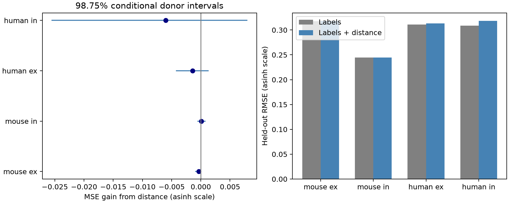

# Cell-body distance gives no clear gain in donor-held-out predictions of 50 Hz plasticity in Allen slice recordings

## Question and result

Does cell-body distance help predict a synapse's change in response during a 50 Hz spike train, beyond cell labels, in a new animal or donor?

The test found no clear gain in four species and connection-type groups. This is an exploratory analysis of public data. It provides a test with separate donors, code, and connection-level evidence. It does not establish equal plasticity across distances. Distance is useful for some circuit properties, but that does not imply that it will improve every response model.

## Prior work and data link

Campagnola, Seeman, and colleagues measured local connectivity and synaptic dynamics in mouse and human cortex ([Science, 2022](https://doi.org/10.1126/science.abj5861)). We use their r2.1 small database. Their measurements, not new experiments, are the source of this report. The Allen [experimental and analysis protocol](https://brain-map.org/support/documentation/synaptic-physiology-experimental-methods-experimental-protocol) describes repeated trains and normalized response changes. Cell types and response dynamics are central subjects of the source study. We do not claim a new observation that cell types differ.

A prior campaign report found that distance helped predict response delay in mouse inhibitory connections ([SCI 2405b942](sci:sha256:2405b942827aa469febd8caff7e828eeb4896a36c1f112aa2356a799dfebcf99)). It informed the donor rules and the 500 micrometre range limit. Another report tested plasticity in reciprocal versus one-way connections ([SCI e51d11cc](sci:sha256:e51d11cc35cf7df1744e77c7c3fcc7c321e46bcc3c66d3f68e128007f871696e)). The present question tests the added prediction value of geometry. We wrote new code and did not reuse their result tables. The studies use the same release and are not independent replications. Different cohorts and outcomes prevent a formal claim that distance matters more for delay than for plasticity.

Before this question was selected, campaign searches used `connectivity`, `recovery distance`, and `distance plasticity`. We read the published delay report. Web searches covered the source paper, Allen protocols, and short-term plasticity. We found no campaign test of this exact prediction question. This search is not proof that no earlier study tested it. No sibling private workspace was read.

The database joins connection calls, cell-body distance, cell labels, and physiological responses by the same cell-pair ID. Thus, the structure and response are linked within the same recording. This is a local circuit dataset from brain slices. It is not an intact-brain anatomical connectome or a behavioral activity dataset.

## Cohort and response

The SQL is in `files/evidence/query.sql`. It joins pair, synapse, dynamics, experiment, slice, and two cell records. We use detected chemical connections in the monosynaptic table. There are 3,287 joined rows, 3,165 rows in mouse VisP or human TCx, 2,037 rows with dynamics QC passed, and 1,692 rows after all value and trial filters. These filters require finite induction, positive finite distance at most 500 micrometres, and at least five induction samples. We chose these rules before inspecting prediction outcomes. The range rule follows the earlier distance audit and avoids extreme distances. It is not based on these response results. The full cohort, including exact pair and cell IDs, is in `cohort.csv`.

The response is `stp_induction_50hz`. In the inspected Allen code, each trial uses the median fitted response amplitude for pulses 6, 7, and 8, minus the first response, divided by a signed amplitude percentile. The code uses the 90th percentile for excitatory responses and the 10th percentile for inhibitory responses. The stored statistic is the median across eligible 50 Hz trials. Positive values show a relative increase in response magnitude; negative values show a decrease. This is not a response ratio or a recovery time constant. It has no physical unit.

We use the stored scalar. We do not use the pulse arrays flagged in the shared metadata. Inspection of `dynamics.py` shows that this scalar is computed directly from pulse-number keys. The source code computes a within-trial median, whereas the protocol page describes an average. This report follows the stored scalar and code definition.

The primary response is `asinh(induction)`. It keeps the sign and reduces the influence of large values. A raw-response check tests sensitivity to this choice. Labels use `cell_class_nonsynaptic` to avoid defining class from the synaptic response. Missing labels form a separate category. No missing response or distance is imputed.

## Prediction and uncertainty

We fit mouse excitatory, mouse inhibitory, human excitatory, and human inhibitory data separately. The reference model uses additive indicators for pre- and postsynaptic class, Cre label, and target layer, plus sex. It has an intercept. The distance model adds distance divided by 100 micrometres. Ridge penalty 1 applies to all slopes; the intercept is not penalized. We center each design matrix and response using the training records. There is no parameter tuning from test responses. The label vocabulary is collected across each group for a fixed design matrix. A category absent in a training fold has a zero fitted coefficient. Age is recorded but not used. No donor ID enters the predictors.

We assign whole inferred donors to five folds with five fixed seeds, 110717 through 110721. The mouse rule extracts the only six-digit number in each specimen name. This also covers a name with a different separator format that failed an earlier parser check. The human rule uses the first three dot-separated fields. Assertions require these formats. The cohort preserves each original name and inferred group. These are inferred groups, not independently verified donor IDs. All cells, directions, recordings, and slices from one inferred donor stay together within each analysis. The same folds are used in both models.

We average each pair's squared prediction errors across splits. Root mean squared error (RMSE) is the square root of the mean of these errors. The mean squared error (MSE) gain is reference MSE minus distance-model MSE. A positive gain favors distance. Each pair has equal weight in the primary result.

We resample whole donors 4,000 times with seed 37117, using the saved prediction losses. The 98.75% percentile interval is an approximate four-comparison rule; each nominal tail is 0.00625. We also save 95% intervals. These intervals condition on the fitted validation models. Training sets overlap, and models are not fit again in each resample. Thus, the intervals do not give a full repeated-study error guarantee or include model-selection uncertainty. We use them as exploratory uncertainty summaries. A negative point estimate can reflect estimation error rather than a harmful biological effect of distance.

## Results

The endpoint and all errors in this table use the asinh scale. `ex` means excitatory; `in` means inhibitory.

| Group | Connections | Inferred donors | Reference RMSE | With distance | MSE gain [98.75% interval] |
|---|---:|---:|---:|---:|---|
| mouse ex | 565 | 304 | 0.31788 | 0.31846 | -0.0003663 [-0.0008950, 0.0000114] |
| mouse in | 932 | 400 | 0.24485 | 0.24464 | 0.0001026 [-0.0005078, 0.0007038] |
| human ex | 170 | 42 | 0.31113 | 0.31336 | -0.0013903 [-0.0041894, 0.0012438] |
| human in | 25 | 12 | 0.30901 | 0.31862 | -0.0060352 [-0.0254786, 0.0078981] |




All four primary 98.75% intervals include zero. The mouse inhibitory point gain is about 0.17% of the reference MSE. Equal donor weights change its gain to -0.0000763, with a 95% interval of -0.0007213 to 0.0005278. There is no clear positive gain under either weighting rule.

The mouse excitatory distance model has worse error in all five splits. Its 95% conditional interval is below zero, but its 98.75% interval includes zero. We do not treat this as a confirmed loss. The human inhibitory sample has only 25 connections from 12 inferred donors and gives very wide intervals.

## Sensitivity checks

We repeat the test with the raw response, joint pre/post class, Cre, and layer indicators in addition to the reference terms, and both linear and squared distance. The joint-label check keeps the linear distance term. The squared-distance check uses the additive reference model. These checks were specified before reading the prediction output. They are exploratory and are not additional confirmed tests.

| Group | Raw response gain | Joint-label gain | Squared-distance gain |
|---|---:|---:|---:|
| mouse ex | -0.0004532 | -0.0000486 | 0.0005950 |
| mouse in | 0.0001491 | 0.0001065 | -0.0000154 |
| human ex | -0.0016163 | -0.0017273 | -0.0024117 |
| human in | -0.0072374 | -0.0079009 | -0.0162516 |


No sensitivity check has a positive gain with a 95% conditional interval wholly above zero. The quadratic mouse excitatory point gain is positive, but its 95% interval is -0.0004126 to 0.0016638. This leaves uncertainty about nonlinear prediction. The human excitatory quadratic model has a negative 95% interval. We do not claim a general biological result from this secondary loss. Complete intervals, seed estimates, ranges, and donor-weighted results are in `results.json`.

## Meaning and limits

For the tested local slices, a linear soma-distance term gives no clear gain for prediction of 50 Hz induction in new donors after the specified labels are used. This provides a reproducible baseline for circuit models that assign plasticity by class and geometry. The result does not justify a strong geometry term in this particular predictor. It also does not justify removing geometry from all neural models. Better distance measurements, more complete cell types, or a different functional endpoint could change the result.

Soma distance is not axon length, dendritic distance, synapse location, or a full connectivity motif. The sample includes only detected connections with sufficient response data. Detection, slice damage, missing axons, and response fit noise can select the cohort. Dynamics QC alone does not resolve these biases. Nearby pairs can differ in unmeasured cell type, age, membrane state, solutions, or recording conditions. We do not estimate causal effects or model selection into the sample.

The human groups are small, especially inhibitory connections. Species and brain region differ together. We cannot isolate a species effect or claim a principle across brain regions. The models do not test behavioral states, intact-brain representations, or response reliability on single trials. A broad hypothesis that structure constrains computation remains possible. The narrow result is a limit on the added value of measured soma distance in the stated prediction task.

## Reproduction

Shared source: `/mnt/dell-data/shared_datasets/allen_synphys/r2.1_small_2023-01-26/synphys_r2.1_small.sqlite`. Version: r2.1 small, schema 22, S3 last modified 2023-01-26. Size: 176771072 bytes. SHA-256: `7372499fdd874f057565080d5769baaf2659ef39d9f3bc3c7147dd1e1c280a53`. The analysis checks this hash before reading. Only this raw database enters the numerical analysis.

The inspected definitions are at `/mnt/dell-data/shared_datasets/allen_synphys_source/b264d8b61abf11d015222865ca081f80655d33d4/dynamics.py` and `schema_dynamics.py`. Their exact hashes are in `files/source_hashes.json`. The upstream commit is `b264d8b61abf11d015222865ca081f80655d33d4`. The upstream schema file is `aisynphys/database/schema/dynamics.py`. These files informed interpretation and are not imported or redistributed.

Reuse the existing source. If absent, retrieve it to a new directory with:

```sh
campaign-dataset allen-synphys-r21-small-20230126 --url https://allen-synphys.s3-us-west-2.amazonaws.com/synphys_r2.1_small.sqlite --filename synphys_r2.1_small.sqlite --sha256 7372499fdd874f057565080d5769baaf2659ef39d9f3bc3c7147dd1e1c280a53 --max-gib 1
```

From an unpacked bundle, create a local Python environment and install `files/requirements.txt`. The recorded Python version and platform are in `files/evidence/provenance.json`. Set `DB` to the source path. On this campaign host, run:

```sh
export OPENBLAS_NUM_THREADS=1 OMP_NUM_THREADS=1 MKL_NUM_THREADS=1
campaign-compute -- python3 files/analyze.py --db "$DB" --out reproduced
python3 files/check_evidence.py
```

Run the first command with the environment's Python interpreter. Outside this campaign, run the analysis directly with one library thread. The second command checks the bundled evidence without the database. It verifies cohort links, response transforms, donor fold separation, sample counts, RMSE, and MSE gains for all 16 analyses. `files/validation.txt` records the successful check. `cohort.csv`, `predictions.csv`, and `bootstrap.csv` allow inspection without the raw database. `files/design.txt` records the test choices. No download or computation remains pending.

## Attribution and job record

Job: `sci-1107-dell-neural-structure-and-computation-17d1fef6af7c`. Topic: `neural-structure-and-computation`. Campaign: `11_07_2026`. Machine: `dell`. Account: `codex-andrii`. Model: `gpt-6.1-sol`, high reasoning effort, through the Codex harness in T3 Code. Date: 2026-11-08. No agents were launched.

Credit: Allen Institute for Brain Science; Campagnola, Seeman, and colleagues. The source database remains under the [Allen Institute Terms of Use](https://alleninstitute.org/legal/terms-use/). The baseline license covers this new report, code, figures, and derived material to the extent permitted by source terms. It does not replace upstream terms. The raw database and upstream code are not included. The campaign-machine signature is not a personal authorship claim. This publication is stored locally only.
