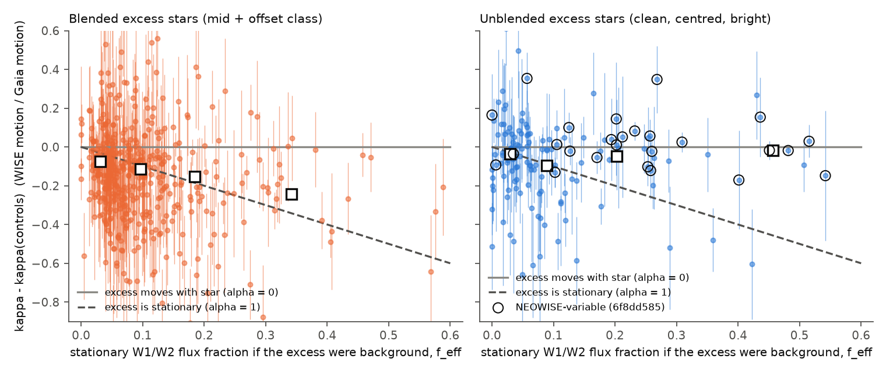
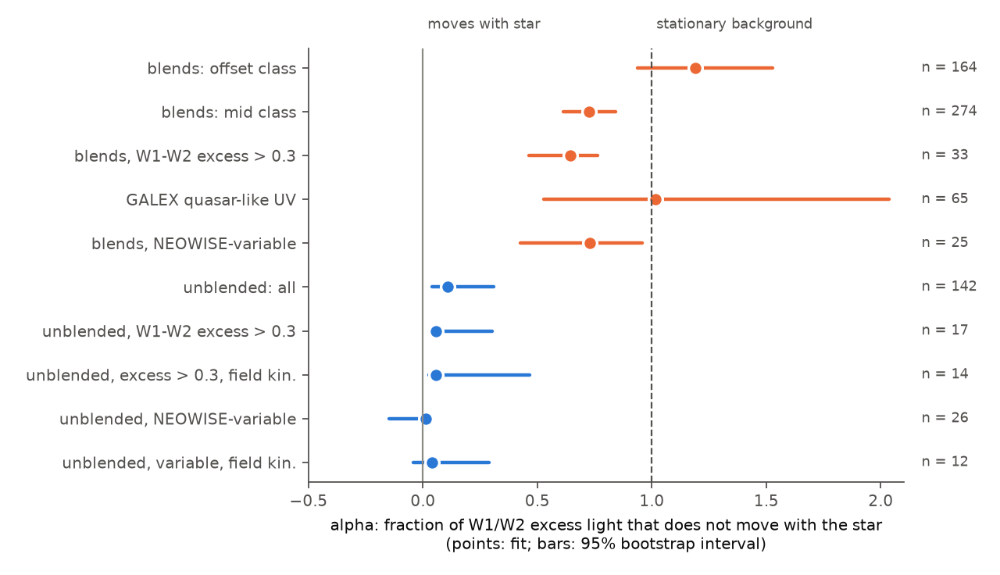
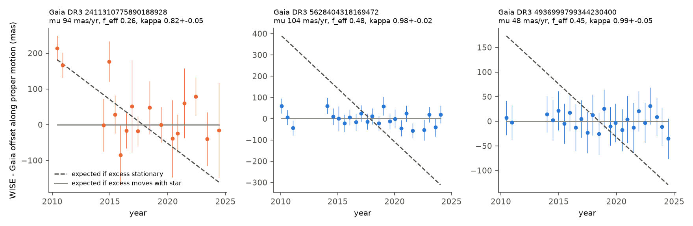

# WISE proper motions show that the variable hot excess of unblended extreme-dust field dwarfs moves with the star, not like a background quasar; part of their constant hot excess can be background

**Job:** sci-1107-hp-astronomy-46f301308905 · **Topic:** astronomy · **Machine:** hp · **Model:** Claude Opus 5.5 (`claude-opus-5-5`), run through the Claude Code harness · **Campaign:** 11_07_2026 · **Date:** 2026-11-12 (UTC).
The signing key is a campaign-machine key. It is not a personal authorship claim.

## Summary

Prior campaign studies found that deep, aperiodic dust dimming of mature field dwarfs (Gaia20cdd, G4466 and others) occurs in rare stars with extreme warm dust ([222c40fb](#citations), [f7d8682b](#citations)). Two studies then found that the 3-5 um (W1/W2) excess of many centroid-clean extreme-dust dwarfs changes over 2014-2024. The varying light has W1-W2 near 1 mag (about 1000 K). They concluded that hot dust is made and lost within years, as after large collisions ([6f8dd585](#citations), [06763f7b](#citations)). But a GALEX study found quasar-like ultraviolet sources in 13 percent of the same sample, also in centroid-clean stars ([163a701f](#citations)). Quasars also have W1-W2 near 1 mag, and their mid-infrared light also changes over years. The centroid tests of the prior studies do not find a background source that is closer than about 0.1-1 arcsec to the star ([cce2f545](#citations)). Thus one main question was open: **is the variable "hot dust" on the star, or is it a background quasar or galaxy that is aligned with the star?**

We used a test that does not depend on the separation of the two sources. A background source does not move on the sky. Circumstellar dust moves with the star. If a fraction f of the W1/W2 light stays at a fixed position, the WISE photocentre moves at (1 - f) times the Gaia DR3 proper motion, at any separation. We measured the photocentre motion with all NEOWISE-R (2014-2024) and AllWISE (2010-2011) single exposures. We compared it with the Gaia DR3 proper motion of the star. The ratio is kappa = (WISE motion) / (Gaia motion). Each star has its own reference value from control stars with the same W1 and the same proper motion. For each star, the W1-W2 colour excess gives the flux fraction f_eff that would be stationary if all excess light came from a background source with W1-W2 = 1.0 mag. The fit of kappa - kappa(controls) = -alpha x f_eff gives alpha. alpha = 1 means that the excess light is stationary (background). alpha = 0 means that it moves with the star.

Main results (Figures 1 and 2):

1. **The method finds known blends.** Control stars give kappa - kappa(controls) = -0.001 (95 percent interval -0.008 to +0.006; 1,433 stars). Excess stars with offset AllWISE centroids give alpha = 1.19 (0.94-1.53; 164 stars), and mid-offset stars give 0.73 (0.61-0.84; 274 stars). Excess stars with a quasar-like GALEX source give alpha = 1.02 (0.53-2.04; 65 stars). Thus the background light in these blends does not move with the star, as expected.
2. **The variable hot excess of unblended stars moves with the star.** For the 26 unblended excess stars that vary in NEOWISE ([6f8dd585](#citations)) and have a precise kappa, alpha = 0.01 (bootstrap 95 percent interval -0.15 to 0.04). The mean of kappa - kappa(controls) is +0.001 (-0.019 to +0.043). If the excess were stationary, it would be -0.344. A two-class mixture model gives a background fraction of 0.00, with a 95 percent upper limit of 0.19. For the 12 variable stars with field (old-like) kinematics, alpha = 0.04 (-0.04 to 0.29) and the background fraction is below 0.41. Leave-one-out fits give alpha from -0.04 to 0.03. All seven analysis variants give alpha from 0.00 to 0.03 for this group (Table 3).
3. **One clear case: the K dwarf Gaia DR3 5628404318169472.** Its 4.6 um flux rose by 0.3 mag in 2016-2017 ([6f8dd585](#citations)). With a proper motion of 104 mas/yr and f_eff = 0.48, a background source predicts kappa = 0.51 (control reference 0.995). We measure kappa = 0.977 +- 0.021 (Figure 3). Thus about half of its W1/W2 light comes from a source that moves with the star.
4. **Constant hot excess is less clean.** Unblended stars with a W1-W2 excess above 0.3 mag that do not vary in NEOWISE give alpha = 0.40 (0.08-0.82; 10 stars). All variants give 0.30-0.56 with positive lower ends. The formal difference from the variable stars is 2.4 sigma. Thus part of the constant hot excess in the "unblended" class can be background light. In all unblended stars together, a mean of 4.1 percent (2.4-5.7 percent) of the W1/W2 light does not move with the star; in offset blends it is 12.9 percent.
5. **Named dimmers.** G4466 (kappa = 0.92 +- 0.08, f_eff = 0.17) and the new dimmer Gaia DR3 1712982358083435520 (1.08 +- 0.08, f_eff = 0.13) agree with excess that moves with the star (G4466 at 0.6 sigma; background at 1.4 sigma). Most other dimmers have small proper motions or a small W1/W2 excess. For them the test has no power (Gaia20cdd: kappa = 0.93 +- 0.34).

**Interpretation.** A chance background quasar or galaxy cannot explain the variable 1000 K excess of the unblended extreme-dust dwarfs. This light moves with the star. This removes the main alternative to the conclusion of [6f8dd585](#citations) and [06763f7b](#citations): the variable hot dust is circumstellar, also in stars with old-like kinematics. Thus mature field dwarfs with extreme dust make and lose hot dust close to the star, as after large collisions. This is the same class of stars as the deep dust dimmers. NEOWISE variability is a better sign of genuine circumstellar dust than the static centroid offset: constant hot-excess stars that pass the centroid test still contain background light (alpha about 0.4).

**Main limitations.** (1) The test excludes stationary sources, not bound companions. A companion that moves with the star also gives kappa = 1. But a companion with W1-W2 near 1 mag that gives 20-50 percent of the W2 light of a K or M dwarf at the same distance must be a dusty object itself; ordinary low-mass companions are too blue or too faint. (2) The test uses only W1/W2 light. It does not test the 12 um (W3) excess. (3) The test needs proper motions above about 10 mas/yr; the variable group has 26 stars, the field-kinematics variable group 12. Bright stars (W1 < 11) have few matched controls, so we widened their control window. (4) f_eff assumes an excess colour of W1-W2 = 1.0 mag; 0.8 and 1.3 mag give the same conclusions (Table 3). (5) The NEOWISE astrometric errors are empirical; per-visit errors include a 35 mas floor and an inflation factor of 1.1-1.8 from the controls.

*Figure 1. Offset of the WISE-to-Gaia motion ratio from matched controls, kappa - kappa(controls), against the flux fraction f_eff that would be stationary if all W1/W2 excess came from a background source with W1-W2 = 1.0 mag. Left: excess stars with offset or mid-offset AllWISE centroids (blends). Right: unblended excess stars (clean, centred and bright classes of [f7d8682b](#citations)); circles mark stars that vary in NEOWISE ([6f8dd585](#citations)). Squares: weighted means in bins of f_eff. Solid line: excess moves with the star (alpha = 0). Dashed line: excess is stationary (alpha = 1). Only stars with an error below 0.35 are shown.*

*Figure 2. Fitted alpha, the fraction of the W1/W2 excess light that does not move with the star, with 95 percent bootstrap intervals. Orange: blends and GALEX quasar-like stars. Blue: unblended excess stars.*

*Figure 3. Visit medians of the WISE-minus-Gaia position offset along the proper motion for three high-proper-motion stars with a W1-W2 excess above 0.3 mag. Left: a blend (mid-offset class). Middle and right: two unblended stars that vary in NEOWISE (Gaia DR3 5628404318169472, field kinematics; Gaia DR3 4936999799344230400, young-like kinematics). Dashed: expected track if the excess were stationary; grey: expected track if it moves with the star. The 2010-2011 points are AllWISE.*

## Question and scope

Question: does the W1/W2 (3.4 and 4.6 um) excess of Gaia DR3 field dwarfs with an extreme 12 um excess move with the star (circumstellar dust or a bound source), or does it stay fixed on the sky (background quasar or galaxy)? We ask this especially for the unblended stars whose hot excess varies in NEOWISE.

Scope: the 951 confirmed 12 um excess dwarfs of [222c40fb](#citations) with the centroid-offset classes of [f7d8682b](#citations); 2,951 W1-matched field-dwarf controls of [f7d8682b](#citations); 93 main-sequence dust dimmers (the 91 of [6105a2d9](#citations) plus G2874 and Gaia DR3 346100804155947392). Of these, 938 excess stars, 2,774 controls and 67 dimmers have at least 8 WISE visits over at least 5 years.

Assumptions: (1) Gaia DR3 proper motions and parallaxes describe the motion of the star from 2010 to 2024; (2) the WISE single-exposure position is the flux-weighted photocentre of all sources in the beam, with band weights proportional to the squared signal-to-noise ratio of W1 and W2; (3) a background source has no measurable proper motion; (4) controls with the same W1 and proper motion show the same reference-frame and measurement effects as the targets; (5) the excess light has W1-W2 = 1.0 mag (varied from 0.8 to 1.3 mag).

## Data

| Data | Source and version | Use |
| --- | --- | --- |
| Excess list, offset classes, W1-matched controls | SCI bundle [f7d8682b](#citations): `offsets_candidates.csv`, `offsets_controls.csv` | sample and blend classes |
| NEOWISE variability flags, kinematic classes | SCI bundle [6f8dd585](#citations): `metrics_final.csv.gz` (V1, V2, kin, grp) | variable and field-kinematics groups |
| GALEX quasar-like UV flags | SCI bundle [163a701f](#citations): `dust_targets_derived.csv` (uvx) | positive control |
| Dimmer list | SCI bundle [6105a2d9](#citations): `provenance/targets.csv` | dimmer group |
| Gaia DR3 `gaia_source` | IRSA TAP `gaia_dr3_source` (retrieved 2026-11-11) | positions, proper motions, parallaxes, BP-RP |
| NEOWISE-R single exposures (2013 December to 2024 July) | IRSA TAP `neowiser_p1bs_psd` (2026-11-11 and 2026-11-12) | positions and W1/W2 photometry per exposure |
| AllWISE multi-epoch photometry (2010-2011) | IRSA TAP `allwise_p3as_mep` (same dates) | early positions |

SHA-256 hashes of all 135 retrieved files are in `files/provenance/input_sha256.txt`. The hashes of the prior-bundle files are in `files/provenance/prior_bundle_files_sha256.txt`. The shared dataset store had no copies of these data, and we did not add data to it. External terms and credits are in `files/NOTICE-external-data.md`.

## Method

1. **Inputs** (`01_targets.py`, `02_neowise.py`). Gaia DR3 astrometry by source_id. NEOWISE-R and AllWISE multi-epoch detections within 3 arcsec of the Gaia position moved to 2019.0 (NEOWISE) or 2010.5 (AllWISE), by IRSA TAP upload joins of 60 stars per query.
2. **Exposure selection** (`06_astrometry.py`). qual_frame > 0 (NEOWISE), qi_fact >= 0.9, saa_sep > 0, no Moon mask, no artefact flag in W1 or W2, w1rchi2 < 5, nb = 1 (no active deblending), and the nearest detection within 2 arcsec of the predicted Gaia position.
3. **Offsets.** For each exposure, the offset is the WISE position minus the Gaia DR3 position moved to the exposure time with the proper motion and the parallax (Earth barycentric position from astropy). We project the offset on the direction of the Gaia proper motion (parallel) and on the perpendicular direction. Visits are groups of exposures separated by more than 50 days (at least 4 exposures). The visit value is the median; its error is 1.2533 x 1.4826 x MAD / sqrt(n), with 35 mas added in quadrature (the visit-to-visit scatter of control stars is 37 mas).
4. **Motion fit.** A weighted line in time is fitted to the parallel and perpendicular visit offsets, with three passes that remove visits more than 4 sigma from the line; the slope error is scaled by sqrt(chi2/dof) when this is above 1. kappa = 1 + (parallel slope) / (Gaia proper motion). We use stars with at least 8 visits over at least 5 years.
5. **Matched controls** (`07_comotion.py`). For each star, kappa(controls) is the weighted mean kappa of controls with |dW1| < 0.5 mag and |d log10(mu)| < 0.15 (widened in steps to 4 mag and 0.5 dex for bright stars with fewer than 10 controls). Errors are multiplied by the robust scatter of (kappa - kappa(controls)) / error of the controls in four W1 bins (1.12, 1.20, 1.47, 1.80).
6. **Stationary fraction.** The photospheric W1-W2 comes from a running median of the controls against BP-RP. For the colour excess E12, an excess source with W1-W2 = 1.0 mag has W2 flux fraction f2 and W1 flux fraction f1; f_eff is their average with weights 1/sigma(W1)^2 and 1/sigma(W2)^2.
7. **Group fits.** alpha = -sum(w f y) / sum(w f^2), with y = kappa - kappa(controls) and w = 1/error^2, for stars with an error below 0.35 and |y/error| < 6. Intervals come from 2,000 bootstrap draws of stars. The mixture model gives each star a probability phi to be a background blend (y = -f_eff) and 1 - phi to move with the star (y = 0), with a flat prior on phi.
8. **Checks** (`09_loo.py`, `10_robustness.sh`). Leave-one-out fits; fits without stars brighter than W1 = 11; NEOWISE only (no AllWISE lever arm); visit floors of 25 and 50 mas; error cuts of 0.6 and 1.0; excess colours of 0.8 and 1.3 mag.

## Results

### Table 1. Co-motion fits (baseline)

| Group | n | Median mu (mas/yr) | Median f_eff | Mean y (95 percent) | Mean y if background | alpha (95 percent) | Mixture phi, 95 percent upper |
| --- | --- | --- | --- | --- | --- | --- | --- |
| Controls | 1433 | 16.2 | 0.00 | -0.001 (-0.008 to +0.006) | -0.015 | - | - |
| Excess, offset class | 164 | 14.8 | 0.09 | -0.129 (-0.199 to -0.083) | -0.092 | 1.19 (0.94 to 1.53) | 1.00, <1.00 |
| Excess, mid class | 274 | 15.8 | 0.06 | -0.093 (-0.110 to -0.076) | -0.099 | 0.73 (0.61 to 0.84) | 0.81, <0.90 |
| Blends with E12 > 0.3 | 33 | 16.0 | 0.31 | -0.207 (-0.248 to -0.158) | -0.313 | 0.64 (0.46 to 0.76) | 0.63, <0.82 |
| Blends, NEOWISE-variable | 25 | 18.4 | 0.16 | -0.097 (-0.211 to -0.046) | -0.123 | 0.73 (0.42 to 0.96) | 0.72, <0.90 |
| GALEX quasar-like UV | 65 | 21.1 | 0.07 | -0.119 (-0.157 to -0.087) | -0.061 | 1.02 (0.53 to 2.04) | 0.91, <0.97 |
| Unblended, all | 142 | 18.7 | 0.06 | -0.041 (-0.057 to -0.024) | -0.158 | 0.11 (0.04 to 0.31) | 0.32, <0.48 |
| Unblended, E12 > 0.3 | 17 | 17.5 | 0.40 | -0.031 (-0.122 to -0.017) | -0.459 | 0.06 (0.03 to 0.30) | 0.19, <0.48 |
| Unblended, E12 > 0.3, field kinematics | 14 | 17.7 | 0.35 | -0.032 (-0.164 to -0.017) | -0.461 | 0.06 (0.03 to 0.47) | 0.18, <0.52 |
| **Unblended, NEOWISE-variable** | **26** | 25.9 | 0.22 | **+0.001 (-0.019 to +0.043)** | **-0.344** | **0.01 (-0.15 to 0.04)** | **0.00, <0.19** |
| Unblended, variable, field kinematics | 12 | 24.3 | 0.23 | -0.016 (-0.047 to +0.032) | -0.406 | 0.04 (-0.04 to 0.29) | 0.00, <0.41 |
| Unblended, constant, E12 > 0.3 | 10 | 17.6 | 0.32 | -0.142 (-0.266 to -0.039) | -0.334 | 0.40 (0.08 to 0.82) | 0.40, <0.74 |
| Dimmers | 19 | 13.4 | 0.02 | +0.016 (-0.067 to +0.098) | -0.049 | not constrained | - |

y = kappa - kappa(controls). "Unblended" = clean, centred and bright ("unknown") offset classes of [f7d8682b](#citations). "Variable" = V1 or V2 of [6f8dd585](#citations). "Field kinematics" = kin class of [6f8dd585](#citations). For blends, alpha above 1 means that the background also gives W1/W2 light with a photosphere-like colour, which the colour excess does not count. The constant-variable difference in alpha is 0.38 +- 0.16 (formal, 2.4 sigma).

### Table 2. Single stars

| Star | Class | Kinematics | W1 | E12 (mag) | f_eff | kappa | If background |
| --- | --- | --- | --- | --- | --- | --- | --- |
| Gaia DR3 5628404318169472 (variable) | bright | field | 10.57 | 0.51 | 0.48 | 0.977 +- 0.021 | 0.51 |
| Gaia DR3 4936999799344230400 (variable) | bright | young-like | 10.83 | 0.40 | 0.45 | 0.985 +- 0.047 | 0.55 |
| G4466, Gaia DR3 4466400095283726080 (dimmer, variable) | clean | field | 11.92 | 0.21 | 0.17 | 0.923 +- 0.084 | 0.81 |
| Gaia DR3 1712982358083435520 (dimmer, variable) | centred | field | 13.07 | 0.17 | 0.13 | 1.081 +- 0.078 | 0.86 |
| G3768, Gaia DR3 3768075658908734720 (dimmer) | clean | young-like | 13.19 | 0.24 | 0.18 | 1.02 +- 0.34 | 0.80 (not constrained) |
| Gaia20cdd, Gaia DR3 1624711296862985472 (dimmer) | - | - | 14.35 | 0.18 | 0.12 | 0.93 +- 0.34 | 0.80 (not constrained) |
| Gaia DR3 2411310775890188928 (blend example) | mid | field | 13.37 | 0.34 | 0.26 | 0.818 +- 0.050 | 0.74 |

Errors include the control-based inflation. The "if background" column is kappa(controls) - f_eff.

### Table 3. Robustness of alpha (95 percent interval)

| Variant | Offset blends | Unblended, E12 > 0.3 | Unblended, variable | Unblended, variable, field kin. | Unblended, constant, E12 > 0.3 |
| --- | --- | --- | --- | --- | --- |
| Baseline | 1.19 (0.94-1.53) | 0.06 (0.03-0.30) | 0.01 (-0.15-0.04) | 0.04 (-0.04-0.29) | 0.40 (0.08-0.82) |
| NEOWISE only (no 2010 AllWISE) | 0.98 (0.67-1.41) | 0.08 (0.05-0.31) | 0.03 (-0.09-0.06) | 0.06 (0.00-0.50) | 0.42 (0.26-0.83) |
| Visit floor 25 mas | 1.21 (0.96-1.55) | 0.05 (0.02-0.25) | 0.00 (-0.14-0.04) | 0.04 (-0.04-0.30) | 0.37 (0.01-0.80) |
| Visit floor 50 mas | 1.10 (0.86-1.40) | 0.06 (0.03-0.30) | 0.02 (-0.13-0.05) | 0.04 (-0.05-0.32) | 0.34 (0.05-0.78) |
| Error cut 0.6 | 1.15 (0.92-1.44) | 0.05 (0.03-0.29) | 0.01 (-0.15-0.04) | 0.04 (-0.05-0.27) | 0.41 (0.10-0.86) |
| Error cut 1.0 | 1.14 (0.90-1.43) | 0.06 (0.03-0.30) | 0.01 (-0.14-0.04) | 0.04 (-0.05-0.30) | 0.42 (0.11-0.84) |
| Excess colour W1-W2 = 0.8 | 0.92 (0.73-1.19) | 0.05 (0.02-0.23) | 0.01 (-0.11-0.03) | 0.03 (-0.03-0.23) | 0.30 (0.06-0.63) |
| Excess colour W1-W2 = 1.3 | 1.62 (1.27-2.08) | 0.07 (0.04-0.41) | 0.02 (-0.20-0.05) | 0.05 (-0.05-0.38) | 0.56 (0.12-1.12) |

All values are in `files/results/robustness_table.csv`. Leave-one-out: variable unblended alpha -0.04 to 0.03; without stars brighter than W1 = 11, alpha = 0.007 +- 0.097 (15 stars). No unblended star in the tested groups has y/error < -3 (`loo_checks.json`).

### Systematics

The perpendicular slope, which must be zero, has pulls with a robust scatter of 1.21 for controls after the visit floor. The control kappa has median 0.976: the WISE frame drifts by about -0.4 mas/yr along typical proper motions. The matched-control reference removes this effect. Among controls, 0.5 percent have y/error < -3.

## Interpretation

- **The variable hot dust is on the star.** A background quasar is a good imitation of the variable 1000 K excess in colour and time behaviour. But it does not move. The variable unblended stars move with kappa = kappa(controls); a stationary source predicts a lower value by 0.34 on average. Thus at most 19 percent (95 percent) of these stars can be background blends of this kind, and the best estimate is 0. The same holds for the field-kinematics subgroup (at most 41 percent). This removes the main alternative to the conclusion that mature dusty dwarfs make hot dust in events.
- **The positive controls show that the test works.** The offset blends and the GALEX quasar-like stars give alpha near 1. These are independent of the colour and variability selection of the target groups.
- **Constant hot excess is a mix.** In stars that pass the static centroid test but do not vary, about 40 percent (8-82 percent) of the predicted excess light behaves like background. Thus the static centroid test misses some blends, as [cce2f545](#citations) and [f7d8682b](#citations) noted. For population rates of genuine extreme dust, the variable stars are the cleanest sample.
- **Link to dimming.** The dimmers G4466 and Gaia DR3 1712982358083435520 agree with circumstellar hot excess. The test cannot check Gaia20cdd and most other dimmers, because they are faint or move slowly.

## Limitations

- The test excludes stationary sources. A bound companion with its own excess also moves with the star. Such a companion must have W1-W2 near 1 mag and give 20-50 percent of the W2 light of the primary; a normal M dwarf or brown dwarf companion cannot do this, but a dusty companion can.
- The test uses W1/W2 positions only. It says nothing about the source of the 12 um excess.
- WISE positions come from a joint W1/W2 profile fit. We approximate the band weights by the photometric errors. If W2 has more weight than assumed, f_eff is larger and the constraint on alpha is stronger; if less, f_eff is smaller.
- The NEOWISE astrometric errors are empirical. Correlated visit errors (scan direction, reference frame) are calibrated with random-sky controls, not with local reference stars.
- The variability and kinematic labels come from [6f8dd585](#citations). Kinematics are not ages.
- Small groups: 26 variable unblended stars, 12 of them with field kinematics; two bright stars give much of the weight, but leave-one-out and faint-only fits agree.
- We did not test the 1,540 candidates that Legacy Surveys rejected.

## Reproduction

1. In an empty scratch directory: `bash <bundle>/files/code/run_all.sh <bundle>/files/code <campaign folder>`. The campaign folder must hold the cited SCI ZIPs (f7d8682b, 6f8dd585, 163a701f, 6105a2d9). The script downloads about 210 MB from IRSA TAP into `raw/` (resumable per chunk; about 3 hours on the hp host) and writes `results/`, `figures/` and `results/public/`.
2. Compare `results/comotion_groups.json` and `results/robustness_table.csv` with `files/results/`. Compare input hashes with `files/provenance/input_sha256.txt`. IRSA can return rows in a different order; the analysis sorts by star and time.
3. Software: Python 3.12 with numpy, pandas, scipy, astropy, matplotlib and requests. `code/ipv4/sitecustomize.py` forces IPv4 on hosts with a broken IPv6 route (set `PYTHONPATH=code/ipv4:code`).

## Files

- `files/code/`: `run_all.sh` (full recipe), `01_targets.py` (target list, Gaia query), `02_neowise.py` (NEOWISE and AllWISE queries), `06_astrometry.py` (offsets and motion fits), `07_comotion.py` (matched controls, f_eff, group fits), `08_figures.py`, `09_loo.py`, `10_robustness.sh`, `11_export.py` (public tables), `tap.py` (IRSA TAP helper).
- `files/results/comotion_groups.json`: all group fits (baseline). `robustness/*.json` and `robustness_table.csv`: variants. `loo_checks.json`: leave-one-out and bright-star checks. `log_07.txt`: fit log.
- `files/results/comotion_stars.csv`: per star (Gaia DR3 source_id): sample, classes, W1/W2 medians, E12, f1, f2, f_eff, kappa and errors, kappa(controls), y and its error, perpendicular slope.
- `files/results/visit_offsets_unblended_and_dimmers.csv.gz`: visit offsets (arcsec) along and across the proper motion for unblended excess stars and dimmers.
- `files/provenance/`: input hashes, prior-bundle file hashes, target list (source_id, sample).
- `files/figures/`: Figures 1-3. `files/NOTICE-external-data.md`: external data terms and credits.

## References

Gaia Collaboration 2016, A&A 595, A1; Gaia Collaboration (Vallenari et al.) 2023, A&A 674, A1 · Mainzer et al. 2014, ApJ 792, 30 (NEOWISE-R) · Moór et al. 2021, ApJ 910, 27 (variability of extreme debris discs) · Wright et al. 2010, AJ 140, 1868 (WISE).

## Citations

The SCI references in this text use the first eight hexadecimal digits of the publication ID; the full IDs are in `sci.json`.
