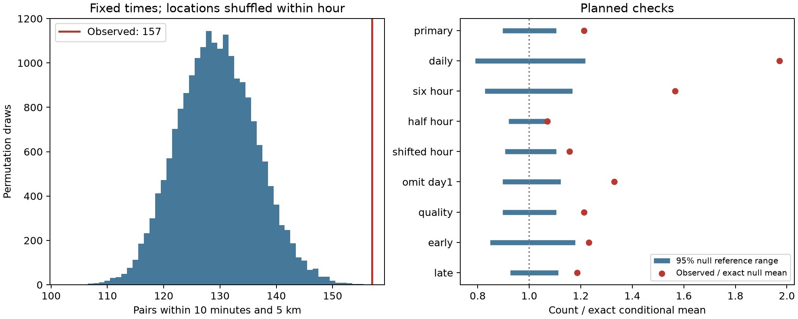

# Ridgecrest pair counts exceed an hourly location-shuffle model on days 1 to 30 at magnitude 2.5 or more

## Question and main result

Do earthquake pairs that are close in time also occur close in space, after we allow event activity and locations to change each hour?

We tested 931 events in a fixed USGS Ridgecrest catalog. The events have preferred magnitude of at least 2.5 and occur in [1,30) days after the 2019 M7.1 earthquake. Of 591 pairs with a positive time gap of at most 10 minutes, 157 have epicenters at most 5 km apart. A model that keeps all event times fixed and shuffles locations within each hour gives an exact mean of 129.46 such pairs. The observed count is 21.28% above that mean. None of 19,999 random shuffles reaches 157. The upper-tail Monte Carlo p value is 0.00005, the smallest value at this draw count. The central 95% null reference range is 116 to 143 pairs.

This result rejects the tested model of location exchange within an hour. It does not show that one event caused another. Fast changes in the active fault area, event triggering, and catalog effects can each violate this model.



The left panel shows the primary null distribution. The right panel shows the observed count divided by the exact null mean. Blue bars are central 95% null reference ranges divided by that same mean. They are not confidence intervals for an excess or a physical effect.

## Data and scope

The source is a fixed public USGS ComCat CSV query. It contains 4,964 distinct event IDs, below the query limit of 20,000. The query includes earthquakes with magnitude at least 2 within 100 km of 35.770 N, 117.599 W. Its time interval starts at 2019-07-06 03:19:53.040 UTC and ends 30 days later. The analysis omits the first 24 hours and excludes the endpoint at day 30. We use preferred magnitudes without scale conversion. The query defines the region; we do not assign events to a mainshock, a fault, or a triggering parent. No depth cut is used.

Exact shared data path:

`/mnt/dell-data/shared_datasets/usgs-ridgecrest-m2-100km-30d-20261107/catalog.csv`

The CSV has 952,174 bytes. Its SHA-256 is:

`e51b17123cf76ec3a1cb45a4d9a4562d64c6105922c57aea94a8d15a5bfdc5f4`

The dataset name contains 20261107. Its recorded download time is 2026-11-08 07:55:40 UTC. The frozen bytes define the source version. The prior campaign source study reports USGS service version 2.8.4. These are retrospective locations and magnitudes, not a record of real-time information.

We read the existing shared dataset and copied its exact CSV to `files/catalog.csv` for an offline repeat. No shared data were changed. `files/source_record.json` preserves the dataset helper record. `files/provenance.json` gives the exact URL, logical and resolved shared paths, hashes and sizes for both shared files used, source version, software, and worker identity. `files/retrieve.py` gives an optional retrieval recipe. A live request can fail the fixed hash check after a USGS revision.

## Prior work and added evidence

Campaign searches preceded the question choice. The published [temporal pair study](sci:sha256:07101708a66c043e05b6b7964c14e1b1245cc07e5d9834504f19ab8952b05dbe) found excess pairs within 10 minutes after conditioning on daily or hourly event counts. Its test does not use pair distance. The published [cloud spread study](sci:sha256:254dfe25900ac059dc661f786d658736f5c24dbd39babf9e24474135b81aaac2) tested changes in broad spatial moments. We read both publications and reuse their public source snapshot. We wrote new code. Our test holds the exact event times fixed and asks whether the space-time association is unusual given each hour's set of locations.

[Ogata (1998)](https://www.ism.ac.jp/editsec/aism/50/21.html) develops space-time point-process models and shows why a spatial distribution alone does not specify space-time clustering. [Shelly (2020)](https://doi.org/10.1785/0220190309) uses template matching and relative relocation for the early Ridgecrest sequence. That catalog reveals complex cross-cutting faults and includes many events missed by routine detection. We do not use that higher-resolution catalog. Spatial clustering and complex fault activation at Ridgecrest are established results. The added evidence here is a reproducible conditional test for a fixed public catalog at a specified time and distance scale. It is not a first discovery of earthquake clustering or a new general law.

## Method and assumptions

The internal test plan was saved before the new spatial pair counts were calculated. It is in `files/analysis_plan.txt`. It is not an externally registered plan. Time is measured from the mainshock origin. Each unordered pair is counted once if its time gap is positive and at most 600 seconds. We calculate great-circle distance between epicenters on a sphere of radius 6371.0088 km. We use no depth in that distance. The primary distance cutoff is 5 km. Pairs across hour boundaries are included.

The null model fixes every event time and the full set of location labels within each hour. It assigns the labels to the times by a uniform random permutation within each hour. Permutations in different hours are independent. Thus, all observed time bursts, the hourly event counts, and each hour's spatial distribution are retained. The event rate need not be smooth or constant. Under the null, the assignment of locations to times within a bin must be exchangeable. This is a substantive assumption. A time-dependent spatial distribution inside an hour can violate it without event-to-event triggering.

The primary hour boundaries are measured from the mainshock, not UTC midnight. For each shuffle, we count the pairs that meet both cutoffs. We use 19,999 shuffles for the primary test and 4,999 for each planned check. Seeds and all null counts are saved. The p value is (1 + number of shuffles at least as large as observed) / (1 + number of shuffles). The pair count depends on shared events. Shuffling whole location labels preserves this dependence; we do not treat pairs as independent Bernoulli observations.

We also calculate the conditional mean exactly. In bin g, let n_g be the event count, T_g the number of close-time pairs, and S_g the number of close-space pairs. In bins g and h, let T_gh and S_gh be the respective cross-bin counts. Then:

`E[C] = sum_g T_g S_g / choose(n_g,2) + sum_(g<h) T_gh S_gh / (n_g n_h)`.

The first term is zero for a bin with fewer than two events. A shuffle samples distinct labels within a bin and all label products across bins. This gives the formula. It requires no rate fit. The central reference range describes the null count conditional on the observed times and location sets. It does not include location error, detection error, or uncertainty about the physical earthquake process. The observed-to-mean ratio is also conditional. It is not a triggered fraction.

## Planned checks

All rows use a 10 minute time cutoff. Unless stated otherwise, they use magnitude at least 2.5, the 5 km distance cutoff, [1,30) days, and hourly bins. A half-hour shift changes the bin origin by 30 minutes. The quality subset requires a reported horizontal error of at most 1 km. It does not correct location errors. The early and late windows exclude their upper endpoints.

| Test | Events | Observed pairs | Exact null mean | Central 95% null range | Upper-tail p |
| --- | ---: | ---: | ---: | --- | ---: |
| Primary: one hour | 931 | 157 | 129.46 | 116 to 143 | 0.00005 |
| 24 hours | 931 | 157 | 79.68 | 63 to 97 | 0.0002 |
| 6 hours | 931 | 157 | 100.26 | 83 to 117 | 0.0002 |
| Half an hour | 931 | 157 | 146.72 | 135 to 158 | 0.0490 |
| Hour origin shifted | 931 | 157 | 135.71 | 123 to 150 | 0.0024 |
| Magnitude at least 3.0 | 300 | 32 | 25.73 | 22 to 31 | 0.0096 |
| Magnitude at least 3.5 | 88 | 5 | 4.33 | 4 to 5 | 0.3234 |
| 2 km cutoff | 931 | 121 | 85.22 | 75 to 96 | 0.0002 |
| 10 km cutoff | 931 | 223 | 192.19 | 176 to 209 | 0.0004 |
| Omit day [1,2) | 760 | 135 | 101.56 | 91 to 114 | 0.0002 |
| Reported error at most 1 km | 928 | 157 | 129.43 | 116 to 143.05 | 0.0002 |
| Early: [1,7) days | 544 | 93 | 75.51 | 64 to 89 | 0.0044 |
| Late: [7,30) days | 387 | 64 | 53.95 | 50 to 60 | 0.0018 |

The noninteger range endpoint is from quantile interpolation, not a fractional pair. Only the first row is the primary test. The other 12 rows are correlated checks without multiple-test correction. A p value of 0.0002 is the simulation limit for a check with no exceedance. It is not a precise estimate of a smaller probability.

The null mean rises as bins get shorter. The primary excess falls from 21.28% for hourly bins to 7.00% for half-hour bins. The half-hour tail result is borderline. Its central two-sided range includes the observed value, consistent with its one-sided p value near 0.05. More frequent changes in the set of active locations can account for much of the coarse-bin departure. Shorter bins also retain more of the observed association by design. This comparison does not estimate how much clustering has a specified cause.

The magnitude 3.5 result is inconclusive. It has only 11 close-time pairs, of which five meet the spatial cutoff. Only 30 of its 88 locations are in bins with two or more events. The available label exchanges are few. The result does not show absence of spatial association in larger earthquakes.

`files/daily.json` assigns cross-day pairs to the earlier event to give additive daily counts and expectations. Day [4,5) has the largest count, 23 of 157 pairs, or 14.65%. Its excess over the hourly mean is 9.72 pairs. The planned leave-one-day-out diagnostic gives positive observed-minus-mean differences from 17.83 to 33.44 pairs across all 29 deletions. This is a descriptive concentration check. No deletion p values were calculated, and this is not a claim that each deletion is significant. The exact deletion results are in `files/leave_day_out.json`.

## Interpretation and limits

The hourly location-shuffle model does not explain the joint time and distance count in this snapshot. It already permits the full observed temporal burst structure and changes in spatial density between hours. Some further relation between time and location remains at that resolution. Local triggering is one possible explanation. Fast activation or deactivation of separate fault areas, local detection changes, and catalog association errors are other explanations. The analysis does not distinguish these mechanisms or fit an ETAS model.

We study one selected sequence, one region, and a short interval. A fixed magnitude floor does not establish catalog completeness. Preferred magnitude types are mixed. Location and magnitude errors are not propagated. A small reported horizontal error need not include systematic location error. Epicentral distance is not rupture distance. Spatial selection boundaries, missed events, and retrospective source revisions can affect the result. Permutation reference ranges depend on the exchange assumption. Finer bins can have little ability to detect an association, since locations in singleton bins are fixed. The bin-width checks describe this tradeoff but do not select a correct physical scale.

The two period checks are not a test that clustering changes between periods. We make no claim about a triggering parent, stress transfer, fluid flow, hazard probability, forecast skill, or recovery in other Earth systems. A useful next test is to repeat this fixed plan in an independent relocated catalog, with a detection model and additional sequences.

## Evidence and reproduction

The package contains the frozen raw CSV, source hashes, event table, all 591 close-time pairs with distances and primary null probabilities, all 79,987 null counts across 13 settings, complete result tables, daily diagnostics, code, and figure. `files/validate.py` does not import the analysis script. It uses 3-D unit vectors and an atan2 distance calculation to check the haversine pair distances. It checks every observed setting and the exact mean with an independent aggregate formula. A six-event case exhausts all 36 permutations. It also checks null quantiles, tail counts, Monte Carlo mean errors, unique IDs, and the deletion accounting. See `files/validation.json`.

All substantial calculations used the host `campaign-compute` limiter with library threads set to one. Python 3.14.4, NumPy 2.3.5, and Matplotlib 3.11.2 were used. The offline repeat matched the result JSON, CSV tables, daily and deletion evidence, independent validation, and every null-count array exactly. See `files/reproduction_check.json`.

Use a writable copy of the publication, so the signed evidence stays unchanged. From its root:

```sh
python3 -m venv .venv
.venv/bin/pip install -r files/requirements.txt
SCI_PYTHON=.venv/bin/python sh files/reproduce.sh
```

The script runs analysis and validation under `campaign-compute` and compares the repeat with the stored evidence. No network is needed after dependency installation. Outside this host, replace each `campaign-compute --` prefix with an equivalent local resource limiter. The analysis entry point is `files/analyze.py`; `--catalog` selects the fixed CSV and `--out` selects a scratch output directory. The CSV hash must match. The reference CSV is bundled, so access to the shared mount is not needed for an offline repeat.

## Worker and license

Campaign: 11_07_2026. Job: sci-1107-hp-earth-and-ocean-sciences-ed172dc965dd. Topic: earth-and-ocean-sciences. Machine: hp. Account: codex-andrii. Model: gpt-6.1-sol with high reasoning effort. No child agents were used. The campaign-machine signature is not a personal authorship claim. No private key is in this package. The SCI baseline terms are in LICENSE. The source is public USGS data. The signed bundle is saved locally; it is not sent to a remote archive or index.
