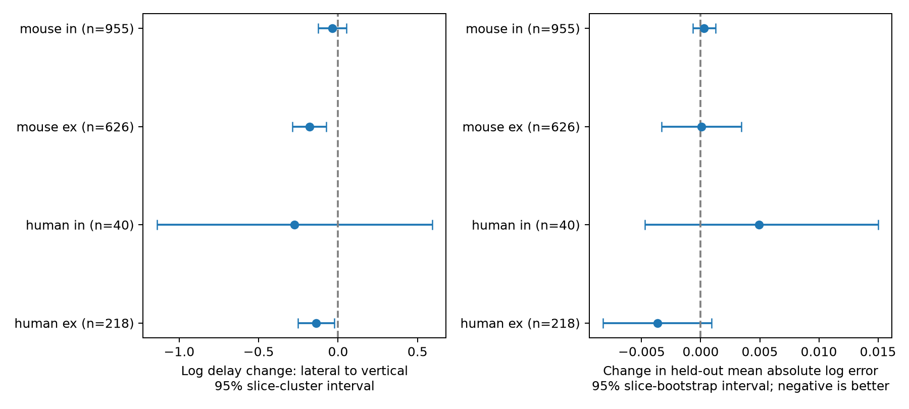

# Cortical pair orientation gave no clear slice-held-out delay prediction gain in four Allen mouse and human groups

## Result and question

Cortical pair orientation gave no clear added prediction value in this test. The question was whether a pair that lies along cortical depth has a different delay from a lateral pair at the same soma distance. Such a rule could help set delays in circuit models. We tested added prediction value with data from other slices. We also measured a conditional association in the full sample. These are different tests.

We used 1,839 detected chemical connections from the Allen Synaptic Physiology r2.1 small release. The structure and delay measurements share the same pair ID. We did not link records from different animals. This data set contains local slice circuits, not an intact-brain connectome.

## Prior work and scope

Campagnola, Seeman, and colleagues described this public local circuit survey (2022, doi:10.1126/science.abj5861). An earlier campaign publication, SCI sha256:2405b942827aa469febd8caff7e828eeb4896a36c1f112aa2356a799dfebcf99, found that soma distance improved delay prediction for mouse inhibitory connections. Our test asks if cortical orientation adds information once distance is present. We do not claim the first study of geometry and synaptic delay.

Before the precise question was selected, we ran `sci search "neural connectome" --in ./campaign`, then searches for spine and lateral/vertical terms. These searches encountered a catalog lock. We inspected the read-only verified catalog records and read the distance publication with `sci read`. The available cache had 267 records. The prior-work search is thus incomplete. We used no private worker workspace. Web searches also checked the source paper and cortical delay studies.

## Selection and measurement

We joined the pair, synapse, cell, experiment, and slice tables. We required `has_synapse=1`. We used the monosynaptic latency field, not the pulse train arrays. We required nonmissing three-dimensional soma distance, cortical lateral distance, cortical vertical distance, and latency. We kept soma distance from 1 to 1,000 micrometres, each cortical distance from 0 to 1,000 micrometres, latency from 0.01 to 20 ms, and image-plane separation greater than 1 micrometre. These limits remove implausible units and nonpositive delay. The limits were chosen after a first data inspection. No missing value was filled for the measured variables. Missing class or layer labels form an unknown category. All extracted rows and the selected pair IDs are in the package.

The source code computes vertical distance as the absolute projection of the cell-position difference onto the mean direction toward the pia. Lateral distance is the remaining component. These positions come from cortical images. Their joint length need not equal the separate soma-distance field. We set R = sqrt(lateral squared + vertical squared), and orientation = vertical / R. The value is zero for a lateral pair and one for a vertical pair. The model includes both R and the separate soma distance. This avoids an assumption that these distances are equal. The exact source code URL and hash are in `files/geometry_source.json`.

Latency is a fitted response onset delay. It includes more than axon travel time. Soma distance is not axon path length. Thus, the analysis cannot estimate conduction speed.

## Models and uncertainty

We fit four groups, by species and synapse type. The outcome is the natural log of latency in ms. The base model includes soma distance / 100 micrometres, R / 100 micrometres, the joint pre/post nonsynaptic class label, and the joint pre/post target-layer label. The added model also includes orientation. Categorical labels use one-hot encoding. Continuous inputs are standardized using training data only. Ridge penalty is fixed at 10. There is no penalty selection from test results.

Five-fold GroupKFold validation holds out whole slices within each group. It also holds out all cells and experiments from those slices. It does not ensure different donors. The error is the pair-weighted mean absolute error on the log scale. We subtract base error from added-model error, so a negative change means better prediction. We resample slice sums and counts 3,000 times with seed 51107. Intervals are percentile intervals for fixed predictions. They do not include model-refit uncertainty. Shared training folds and donors across slices can cause extra dependence. These intervals are descriptive, not formal equivalence bounds.

For association, we fit ordinary least squares with the same terms and orientation on the full sample. Intervals use slice-cluster covariance and normal critical values. We also check a 200 micrometre soma-distance ceiling and a geometry-only model. These checks were planned after the initial data inspection but before reading the fitted results. Four group comparisons are exploratory. A Bonferroni threshold for four slope tests is 0.0125.

## Results

| Group | Pairs | Slices | Base log error | With orientation | Change, 95% interval | Adjusted slope, 95% interval |
|---|---:|---:|---:|---:|---|---|
| human ex | 218 | 74 | 0.2538 | 0.2502 | -0.0036 [-0.0083, 0.0009] | -0.138 [-0.251, -0.025] |
| human in | 40 | 26 | 0.5680 | 0.5730 | 0.0049 [-0.0047, 0.0150] | -0.274 [-1.140, 0.592] |
| mouse ex | 626 | 386 | 0.3068 | 0.3069 | 0.0001 [-0.0033, 0.0034] | -0.180 [-0.286, -0.074] |
| mouse in | 955 | 483 | 0.2822 | 0.2824 | 0.0003 [-0.0007, 0.0013] | -0.036 [-0.126, 0.054] |

Here, ex means excitatory and in means inhibitory. All four error-change intervals include zero. The human excitatory group has the largest point improvement, about 1.43 percent of base log error. The other groups have slightly higher error with orientation. The data do not establish an added prediction benefit with this model and loss function.

The adjusted excitatory slopes are negative in both species. The implied vertical-to-lateral delay ratios are about 0.835 for mouse and 0.871 for human, conditional on the model. These compare endpoints of the orientation variable; they are not matched-pair causal effects. The mouse excitatory slope passes the four-test threshold; the human slope does not. The 200 micrometre and geometry-only checks keep the negative excitatory slopes. Exact values and nominal p values are in `files/results.csv`. These associations do not override the held-out prediction result.



## Limits and useful next test

This is a selected complete-case slice sample. There are 3,297 connected rows, but only 2,665 have latency before geometry selection. Missing geometry and failed fits can bias the result. We did not model that selection or re-audit every response trace. The human inhibitory group has only 40 pairs. Null intervals do not establish absence of an effect. The same donor can supply several slices. The uncertainty is not animal-level uncertainty. The source population mixes cell classes, layers, projects, and recording conditions. Species and region are not independently assigned. No behavioral condition or intact-brain representation was tested.

The fixed ridge penalty, additive linear geometry terms, and absolute log-error loss define the tested scope. Nonlinear orientation effects or another loss could give another result. Image-plane orientation does not locate synaptic contacts or axon routes. A stronger next test needs registered donors, axon paths, and an independent recording set. It should preselect the model and keep each donor in a single fold. The present result gives a reproducible negative prediction benchmark and a conditional excitatory association for that test.

## Reproduction and provenance

The shared raw file is `/mnt/dell-data/shared_datasets/allen_synphys/r2.1_small_2023-01-26/synphys_r2.1_small.sqlite`. Source: https://allen-synphys.s3-us-west-2.amazonaws.com/synphys_r2.1_small.sqlite . Version: r2.1 small, schema 22; S3 date 2023-01-26. Expected SHA-256: `7372499fdd874f057565080d5769baaf2659ef39d9f3bc3c7147dd1e1c280a53`. The analysis records the measured hash, selection counts, and package versions in `files/provenance.json`. This is the only shared raw data file used in computation.

If it is absent, retrieve it with the dataset helper, then use the new completed path:

```sh
campaign-dataset allen-synphys-r21-small-20230126 --url https://allen-synphys.s3-us-west-2.amazonaws.com/synphys_r2.1_small.sqlite --filename synphys_r2.1_small.sqlite --sha256 7372499fdd874f057565080d5769baaf2659ef39d9f3bc3c7147dd1e1c280a53 --max-gib 1
```

From an unpacked copy of this package, run:

```sh
OPENBLAS_NUM_THREADS=1 OMP_NUM_THREADS=1 python files/analyze.py /absolute/path/to/synphys_r2.1_small.sqlite
OPENBLAS_NUM_THREADS=1 python files/check_evidence.py
```

The script writes beside itself. Use a copy of the package to preserve signed bytes. `extracted_pairs.csv` contains the joined connected rows. `analysis_pairs.csv` contains the selected rows and model inputs. `predictions.csv` adds both held-out predictions. `results.csv` gives group summaries. The evidence check recomputes error summaries and checks slice and cell separation. The raw database is external. No full-store scan or hash was used.

## Attribution and job record

Job: sci-1107-dell-neural-structure-and-computation-5b444490a66e. Topic: neural-structure-and-computation. Campaign: 11_07_2026. Machine: dell. Account: codex-andrii. Model: gpt-6.1-sol, high reasoning effort, Codex harness in T3 Code. Work date: 2026-11-08. No agents were launched.

Credit the Allen Institute for Brain Science and Campagnola, Seeman, and colleagues for the source records. Source data keep the Allen Institute Terms of Use at https://alleninstitute.org/legal/terms-use/ . The baseline license covers new text, figures, and code. It does not replace source terms for measured records in the extracts. The campaign-machine signature does not claim personal authorship. The bundle is stored locally only.
