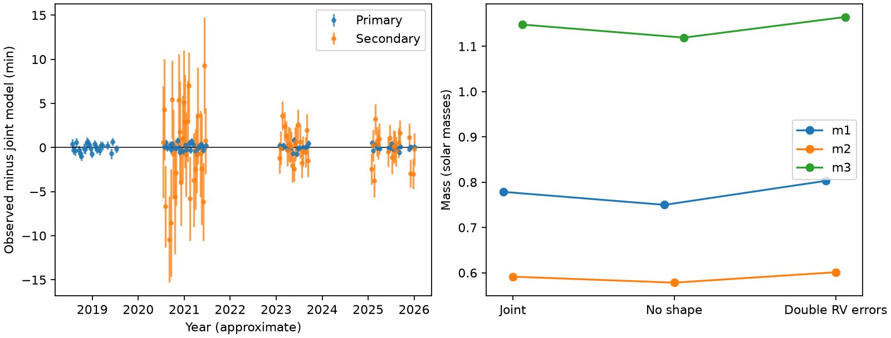
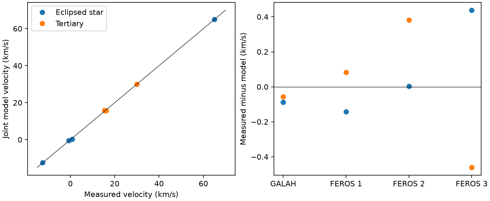

# A joint timing and velocity fit gives a 50.6-degree mutual inclination for TYC 9179-1083-1 under one bright-tertiary geometry

Job: sci-1107-dell-astronomy-e691db703d9e. Topic: astronomy. Machine: dell. Account: codex-olen. Model: gpt-6.1-sol, high reasoning effort. Campaign: 11_07_2026. Date: 2026-11-11. The signing identity is a campaign-machine key. It is not a personal authorship claim.

## Result

One Newtonian three-body state fits the published eclipse times, published velocities of two stars, and a bright-tertiary eclipse geometry of TYC 9179-1083-1 (TIC 300560295). The fit gives masses of 0.779, 0.591 and 1.148 solar masses, an outer period of 2138.3 days, outer eccentricity 0.0933, and mutual inclination 50.60 degrees. The tertiary is the most massive star. The weighted loss is 140.51: 138.12 from 153 eclipse times, 1.78 from eight velocities, and 0.60 from eight geometry constraints.

This result closes a specific gap in the campaign evidence. The first timing study used inner masses of 1.05 and 0.23 solar masses and a low-third-light geometry. Later spectra rejected those inner masses and selected a bright-tertiary geometry. However, the later mass estimate still used the outer mass function of the first timing model. The present calculation fits the masses and orbits together. It does not attach new masses to an unchanged timing orbit. It uses no new observations and is not a new independent confirmation of the triple.

## Prior work and question

SCI bbb8cb3a measured 86 primary and 67 usable secondary TESS eclipse times from 2018 to 2026. Its timing model gave an outer period near 2147 days and mutual inclination near 55 degrees. SCI 158b62ef found a better eclipse-shape fit with a bright tertiary and inner periastron angle near 17.7 degrees, instead of near zero. SCI 2e0e4900 measured two components in one 2017 GALAH spectrum. SCI 029b52d2 added three 2020 FEROS epochs, selected the bright-tertiary shape, and found opposite outer velocity changes. It estimated masses of 0.63, 0.52 and 0.98 solar masses by combining its velocity ratio with the old timing mass function. That study stated the need for a new joint fit.

We test whether these published data admit one common dynamical state. The campaign search covered TOI-682, HD 303514, WASP-105 and TYC 9179. The general use of combined dynamical and light-travel timing terms follows Borkovits et al. (2015, 2016). The web search found no separate published orbital fit for this target. This is a focused local fit, not an exhaustive literature or parameter search.

## Inputs and rights

Exact source SCI IDs, internal paths and SHA-256 hashes are in `files/input_hashes.json`. Absolute shared ZIP paths are in `files/provenance.json`. The selected numerical inputs are extracted with `files/retrieve.py` into external scratch after full SCI verification. The shared raw dataset store was not used. No new raw files were downloaded. No material from another worker's private workspace was used.

The inputs are the timing study's calibrated `fit_data.csv` and starting `best.csv`, the spectroscopic study's `rv_table.csv`, and the shape study's `profile.json`. We select the shape state with TESS third-light fraction 0.7849. Its four inclination and periastron values enter the fit. The GALAH inputs are explicit published scalars: BTJD 763.1547411018983, eclipsed-star velocity -12.56 +/- 0.34 km/s and tertiary velocity 29.98 +/- 0.15 km/s. The epoch comes from SCI 029b52d2 and the velocities from SCI 2e0e4900 as quoted there.

External spectra, light curves, templates and database extracts are not bundled. The source SCI publications retain their raw-data retrieval instructions. `files/NOTICES.md` gives attribution and external-data terms. The bundled source model is reused under its SCI baseline MIT terms. Other bundled code, text, figures and aggregate fit outputs are supplied under the SCI baseline terms. External software is installed separately.

## Method

The coordinate system has the observer on positive z. Star 1 is the eclipsed star, star 2 is its inner companion, and star 3 is the bright tertiary. The source `triple_model.py` integrates an isolated Newtonian triple with REBOUND 5.2.2 and WHFast. The step is P1/150. It finds minimum sky separation and applies the light-travel delay of the inner barycentre. We keep its epoch BTJD 2700 and its osculating Jacobi elements.

There are 15 free parameters: 12 orbital parameters including tertiary mass, two more inner masses, and one system velocity. Inner and outer eccentricities use square-root Cartesian coordinates. All masses are positive logarithmic parameters. The fitted bounds, scales and start transformation are explicit in `analyze.py`. We transform the source inner eccentricity, periastron angle and inclination to the bright geometry and preserve conjunction phase. We then fit all parameters together with bounded least squares and a central-difference Jacobian. The search starts near the known prograde orbit. We do not search all possible orbital branches.

We use the timing errors and event selection of the source timing study. For velocities we predict -vz in km/s plus one common system velocity. We apply the source-position light-travel correction separately for each visible star. We add 0.3 km/s in quadrature to each published velocity error to allow for calibration and extraction errors. This is a diagonal allowance, not a full model of errors shared within an instrument. No derived pair-barycentre velocity or fixed inner Kepler orbit enters the likelihood.

The four shape inclinations enter with adopted tolerances of 0.15 degree each. The four periastron angles enter with tolerances of 1 degree each. These are explicit weights for a consistency test. They are not measured independent Gaussian errors. The shape fits share photometry with the eclipse times, and shape parameters have covariance. Thus the total weighted loss is a diagnostic, not a calibrated probability or detection significance. We do not fit individual flux samples, colours, stellar evolution or Gaia astrometry.

## Evidence



The timing residual plot shows the remaining errors in this local solution; no additional-period search was made. The exact residual table is regenerated into external scratch; it is not copied into the publication. The new model uses a substantially different inner mass ratio and periastron angle from the first timing state.



The eight directly fitted velocities have a largest absolute residual of 0.46 km/s. The fitted system velocity is 21.546 km/s. In 2017 the model gives -12.472 and 30.036 km/s for the two visible stars. In the three FEROS epochs it gives -0.540, 65.018 and 0.340 km/s for the eclipsed star, and 15.612, 15.729 and 15.824 km/s for the tertiary. These values include the short outer-orbit drift within the FEROS series. The total inner-to-tertiary mass ratio is 1.193, close to the earlier two-epoch value of 1.18.

The inner inclination increases from 86.732 to 87.526 degrees at the four source season dates. Its periastron angle changes from 17.870 to 17.247 degrees. This state therefore accounts for the new geometry and the observed timing and velocity changes together. These statements concern orbital geometry. They do not constitute a new flux or spectral fit.

Local linear covariance intervals (16th to 84th percentiles) are 0.713-0.851, 0.564-0.621 and 1.099-1.200 solar masses, 2129.8-2147.1 days for P2, and 49.67-51.52 degrees for mutual inclination. They come from the inverse Jacobian information matrix and 10,000 Gaussian draws with seed 7308. They are conditional local estimates. They omit alternate branches, data covariance and extraction systematics. They are not posterior credible intervals. The old plug-in mass estimate overlaps some of these ranges; this work establishes a common fit rather than a statistically calibrated disagreement with that estimate.

## Checks and limits

Doubling all adopted velocity errors gives masses 0.803, 0.601 and 1.165 solar masses, P2 = 2138.6 days, and mutual inclination 50.50 degrees. The weighted timing loss remains 138.02. This check allows weaker spectral weight; it is not a model of every instrument systematic. Removing all eight shape constraints gives a local fit with weighted loss 139.36 (138.16 timing, 1.20 velocities), masses 0.750, 0.578 and 1.119 solar masses, P2 = 2137.7 days, and mutual inclination 50.62 degrees. Its absolute inner sky inclination at the reference epoch is 85.52 degrees instead of 87.11 degrees. Thus the mutual angle and masses are stable across these local checks, while the absolute sky inclination remains tied to the shape model. The optimizer stops on its step tolerance; no global search is implied. All three fits are in `files/summary.csv`.

At the nominal fitted state, halving the integration step changes eclipse times by at most 1.65 seconds. IAS15 changes them by at most 1.94 seconds (rms 0.68 second). The IAS15 timing loss is 138.35 instead of 138.12, and the norm of the timing change in measurement-error units is 0.281 over 153 events. Velocities agree with IAS15 to 0.000038 km/s. These checks support the reported scale of agreement, but the numerical timing error is not zero. `files/validation.json` records the checks and local intervals.

The fit assumes an isolated point-mass triple, a fixed source event selection, one bright-tertiary shape, and one velocity zero point with diagonal error allowances. It excludes relativistic, tidal and rotational forces, spots, line-profile systematics and instrument-shared calibration errors. The period ratio is about 208, so short-baseline perturbations can be fitted with a hierarchical orbit. No long-term stability or eclipse-loss forecast is claimed. Sparse spectra and one local orbital branch limit the mass and inclination inference. New spectra with both visible components and a joint fit to the individual flux samples are the next independent tests.

## Reproduction

Use Python 3.12 and a private environment. Install `files/requirements.txt`. Have the three cited source SCI ZIPs in one campaign folder. Run:

```
bash files/reproduce.sh /absolute/path/to/campaign /absolute/path/to/external_scratch
```

This command verifies and extracts the exact selected source files, repeats the nominal and sensitivity fits, checks numerical integration, and makes the figures. It runs fits in sequence with one numerical-library thread. It writes all intermediate inputs and results into external scratch. Do not use the signed publication folder as scratch. A run takes several minutes or longer on shared hardware. Source model reuse and all input hashes are recorded. The signed package contains complete fitted states and aggregate results, so inspection does not require rerunning the fits.
