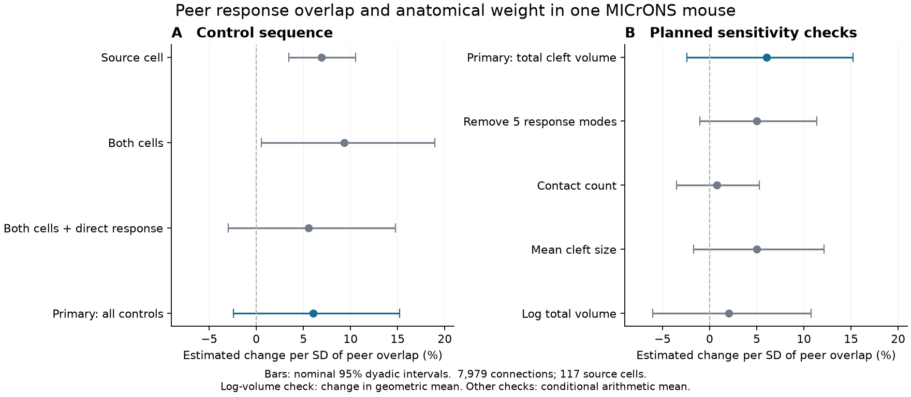

# Peer response overlap gave no clear cleft volume relation after cell and pair controls in one MICrONS mouse

## Result

We tested whether an axon assigns more anatomical weight to targets whose measured movie responses overlap with those of its other targets. After cell and pair controls, the estimated total synapse cleft volume was **6.02 percent larger per standard deviation of peer response overlap**. The nominal 95 percent interval was **2.44 percent smaller to 15.21 percent larger**. The two-sided nominal p value was 0.167. Thus this test does not resolve a positive relation, a small negative relation, or no relation.

The sample has 7,979 connected pairs, 117 source cells and 4,772 target cells from one mouse. Removing each source in turn kept positive estimates, from 4.17 to 8.16 percent larger. This deletion range tests sensitivity to one source. It is not a confidence interval.

The study addresses a stated limit of an earlier campaign weight-shuffle result. It adds separate source and target cell effects, direct response similarity, and continuous pair geometry controls. It does not repeat the earlier statistic or show that the earlier result is false. It also does not show that target strength accounts for the earlier result. All planned full-control sensitivity intervals included no change.



Figure 1. Points show estimated weight changes per standard deviation of peer response overlap. Bars show nominal 95 percent dyadic intervals. The vertical dashed line marks no change. Panel A adds controls. Panel B shows the planned checks. The log-volume check describes a geometric mean; other checks describe a conditional arithmetic mean. These intervals describe one selected tissue sample under an approximate dependence model. They do not describe variation across mice.

## Question and prior evidence

Ding and colleagues found that functional similarity relates to synaptic connectivity in the MICrONS mouse. They also reported extra response similarity among cells with a common input. Their work motivates tests of target groups as well as single pairs. Their paper and the MICrONS Consortium resource link neural activity and electron microscopy from the same cells. The project includes Allen Institute contributions. We use their fixed v1 analysis tables. [Ding et al.](https://doi.org/10.1038/s41586-025-08840-3), [MICrONS Consortium](https://doi.org/10.1038/s41586-025-08790-w).

A campaign report found a small excess of inverse weighted response dimension under two within-axon weight shuffles. The unrestricted excess was 2.48 percent; coarse restrictions gave 0.99 percent. It stated that the shuffles did not keep target incoming weight totals. We test this open issue with a cell-adjusted mean model and a related but different response-overlap statistic. The same source cohort allows a direct scope comparison. We wrote new code and did not reuse its arrays, fits or code. [Prior weight study](sci:sha256:3f421179a43c393dc713cd33133e8e34e31dbc6459112398b0c663ec77c2e8fb).

The earlier equal-weight target-group study also reported a small dimension effect under coarse matching. Another campaign study showed that cell effects and the graph support matter for a contact-count test in these tables. We use those reports as design context. Our outcome is weight allocation in fixed target groups, rather than group selection or the direct pair similarity slope. [Group dimension study](sci:sha256:237ceddd0b8275e28d52b80882000b6ecf42f71aed54134a02409ce29d7ae2c6), [cell-adjusted contact study](sci:sha256:8a590e728fd86661a1ec13978f22ab06ca9465111c259538d17a946b40263cae).

Our hypothesis is that a target with more response overlap with its axon's other targets receives greater total cleft volume, after controls for each cell and for direct pair properties. This tests one component of group weight allocation. It is not a full test of the higher-order rule in Ding et al.

## Data and cohort

The node table has 12,894 cells. The edge table has 1,693,276 rows. We selected rows labelled Connected, excluded self pairs, and required positive total cleft volume, mean cleft size and contact count. We required valid matched node responses and at least ten selected targets for each source. This gave exactly 7,979 directed connections in 117 source groups, the same cohort as the prior weight study. No directed pair is repeated. Each source has 10 to 281 selected targets.

All selected responses, proximity lengths and coordinate distances are finite and valid. Every response vector has 120 entries. We center each vector across entries and divide it by its Euclidean norm. Dot products reproduce released measured signal correlations to a maximum error of 1.86e-7. These vectors are trial means, not trial residuals or independent observations. Their entries are not treated as a continuous time series.

Total cleft volume is the sum of synapse cleft volumes on one connection, in released voxel-volume units. It equals contact count times mean cleft size exactly in the selected records. Cleft volume is an anatomical proxy. We did not measure conductance, release probability or causal influence.

We reused these raw files in place and checked only their hashes. We made no downloads and changed no shared data.

| Shared file | Bytes | SHA-256 |
| --- | ---: | --- |
| `/mnt/dell-data/shared_datasets/microns-funconn-ding2025-v1-node-data/node_data_v1.pkl` | 294635032 | `5a310585ccefcfb2f14d15b2cc2e607e730b0ec0a86587e606af362463abf6ef` |
| `/mnt/dell-data/shared_datasets/microns-funconn-ding2025-v1-edge-data/edge_data_v1.pkl` | 201511086 | `efcd387233960026464f285597fd5bc1c3a00432e4d62570bc578149a9707bbb` |

These compatibility paths refer to the shared HP SSD store, not the failed Dell disk. The exact source URLs, resolved storage paths and checks are in `files/provenance.json`. The release is `node_and_edge_properties/v1`; it is not the current live segmentation.

## Peer overlap and weighted dimension

Let u_j be the centered unit response of target j. For a source with n observed targets, define K_jk = (u_j dot u_k)^2. Define the peer response overlap of target j as

`c_j = sum over k != j of K_jk / (n - 1)`.

The target's own response norm and the anatomical weights do not enter this average. Positive and negative correlations both count as overlap after squaring. The selected sample mean is 0.02477 and its standard deviation is 0.01297. Each predictor is scaled with this sample standard deviation. The response vectors are fixed for all outcome fits.

This statistic has an exact relation to the earlier weighted dimension. For positive weights p with sum one, the earlier inverse dimension is Q(p) = p-transpose K p. Let p = uniform + delta, with sum delta zero. Since K has unit diagonal,

`Q(p) = Q(uniform) + 2*(n-1)/n * sum_j delta_j*c_j + delta-transpose K delta`.

Thus peer overlap describes the first-order change near equal weights. The last term is nonnegative because K is positive semidefinite. Our regression addresses alignment of weight with this first-order overlap. It does not estimate the full quadratic statistic Q or reproduce its permutation test. The identity is standard quadratic algebra, not a new theorem. Direct numerical checks agree within 2.78e-17.

## Mean model and controls

For connected pair i to j, the primary conditional mean model is

`E[volume_ij | design] = exp(source_i + target_j + beta*c_z_ij + pair_controls_ij)`.

The pair controls are direct source-target measured response correlation, its square and cube; natural log axon proximity length and its square; natural log dendrite proximity length and its square; and natural log soma coordinate distance and its square. We standardize all columns before fitting. The proximity lengths describe anatomical opportunity, not a conduction path. Soma coordinates are used only as a released coordinate-distance proxy. Target area, layer and other fixed target attributes are absorbed by target effects. Interactions and all fine geometry are not absorbed.

We fit Poisson pseudo maximum likelihood with iterative fitting of cell margins and BFGS for the ten continuous coefficients. A Poisson mean estimator can be used for continuous nonnegative outcomes without a Poisson variance assumption. We use a robust variance, not a model Poisson variance. This is an established method, not a new estimator. [Santos Silva and Tenreyro](https://doi.org/10.1162/rest.88.4.641).

At every coefficient evaluation, the fitted weights reproduce observed source and target totals in the selected table. The primary maximum relative margin error is 9.84e-11. These are totals over the selected connections, not each neuron's complete brain input or output. The model keeps graph support and these margins. It does not keep each source's weight multiset and is not a uniform random weight shuffle.

The bipartite graph has 4,889 role vertices, one component and 3,091 independent cycle contrasts, computed as edges minus vertices plus components. Repeated removal of degree-one vertices leaves 5,025 edges, 117 sources and 1,818 targets. The other 2,954 edges have no contrast after both cell effects. Their weights are fit by cell effects. The independent solver fits only the core and recovers the same primary slope.

## Conditional uncertainty

We residualize each predictor against the source and target indicators with fitted mean weights. The inverse projected information matrix gives one influence value per edge for beta. The dyadic variance sums squared influence totals at each biological cell and subtracts squared totals at each unordered cell pair. This includes shared cells that change source and target roles, as well as reciprocal observations. We multiply by 117/116 and use a t reference with 116 degrees of freedom. This follows the dyadic sandwich method. [Aronow, Samii and Assenova](https://doi.org/10.1093/pan/mpv018).

The calculation conditions on the measured response vectors and chosen target sets. It permits score dependence for shared endpoint cells. It does not permit arbitrary dependence between disjoint pairs in the same tissue. In particular, response measurement errors can enter several peer scores through shared target groups. Many target effects are sparse, and finite-sample bias or standard error error can remain. The reported intervals are approximate and nominal. They are not an animal-level sampling result.

## Results and planned checks

| Model | Estimated change per SD, percent | Nominal 95 percent interval, percent |
| --- | ---: | --- |
| Source effect only | 6.94 | 3.47 to 10.51 |
| Source and target effects | 9.35 | 0.52 to 18.96 |
| Both cell effects and direct response controls | 5.52 | -2.98 to 14.77 |
| Primary: all controls | 6.02 | -2.44 to 15.21 |
| Remove five common response modes, all controls | 4.99 | -1.05 to 11.39 |
| Contact count outcome, all controls | 0.79 | -3.52 to 5.30 |
| Mean cleft size outcome, all controls | 4.99 | -1.69 to 12.13 |
| Log total volume outcome, all controls | 2.02 | -6.04 to 10.77 |

For the mode-removal check, we remove the first five right singular vectors of all centered unit node responses, center and normalize again, and recompute peer overlap and direct correlation. The overlap standard deviation is then 0.005361. This check uses the same mouse and is not held-out validation. The log-volume model uses least squares after both cell effects and controls; its percentage is a geometric mean change. All other rows use the multiplicative arithmetic mean model.

Adding target effects did not reduce the point estimate. Adding direct similarity reduced it, and added geometry had little further effect. This sequence does not establish mediation or an explanation of the prior dimension statistic. The checks use related data, different scales and sometimes different outcomes. We do not treat them as independent replications or make a family of significance claims. `files/results.json` gives all coefficients, scales, intervals and solver diagnostics.

## Numerical checks

An independent sparse-indicator IRLS calculation agreed with the primary beta within 1.82e-10 and all ten coefficients within 5.75e-8. It took seven iterations. Independent fits of the two extreme source-deletion cases agreed within 2.86e-9. The full profile gradient was below 4.89e-10 per edge. Finite differences agreed with the profile gradient within 1.45e-11 and with its projected Hessian within 1.27e-8.

Explicit target-pair loops agreed with the peer-overlap formula within 2.78e-17. An explicit sum over all pairs of edges that share a neuron agreed with the dyadic variance within 3.04e-18. A small reciprocal example also passed. A synthetic exact multiplicative mean recovered known coefficients within 6.51e-12. Source hashes, unique pairs and the volume product identity passed. See `files/audit.json`, `files/provenance.json` and `files/DEVELOPMENT.md`.

## Limits and next tests

This is one selected mouse, partial tissue and one table version. We condition on detected connections and on the chosen source groups. Selection can create relations that do not hold among all possible pairs. Functional matching, incomplete axons, cell-specific reconstruction, finite trial means and remaining geometry can affect the result. The controls are a specified mean model, not proof that confounding is removed. We did not fit missing connections or sample uncertain cell matches.

The broad primary interval includes modest positive effects. A null decision is not evidence for equivalence. The earlier weighted dimension result remains valid under its stated shuffles. Our result leaves a separate weight-to-peer-overlap association unresolved after the specified controls. It neither establishes nor excludes a higher-order wiring mechanism.

We did not measure neural computation, dynamic stability, trial noise, decoding or reliability. More overlap can support robustness or reduce response diversity; the statistic cannot choose between these interpretations. We did not test a second animal, a behavioral condition or a separate region as an independent replication. No cross-species principle follows.

Useful next tests are the same pre-specified score in an independent linked anatomy-activity sample, trial-split response estimates, and a conditional weight model with full source and target margins plus fine contact opportunity. Such a model must also control weight concentration to compare the full quadratic dimension statistic fairly. The current scripts provide the fit and audit steps for that work.

## Inspect and reproduce

The signed publication contains our code, this text, the original figure and aggregate evidence. It excludes raw tables, response arrays, selected edges, fitted cell effects, edge scores and source-specific deletion records. Those are external records or derived databases. Source terms and credit remain in `files/EXTERNAL_DATA_NOTICE.md`. The exact SCI baseline license applies to the bundled original work. We do not replace or claim ownership of external data terms.

Copy the publication to a working directory. Keep signed files unchanged. With the pinned source files in the shared store, run these commands from the copy. Choose a scratch directory outside the publication. Python 3.12, NumPy, SciPy, pandas, matplotlib and Pillow are needed; exact versions are in `files/environment.json`.

```bash
export OMP_NUM_THREADS=1 OPENBLAS_NUM_THREADS=1 MKL_NUM_THREADS=1
python files/prepare.py --datasets /mnt/dell-data/shared_datasets --scratch ../external_reproduction --provenance ../reproduced_provenance.json
python files/analyze.py --scratch ../external_reproduction --out ../reproduced_results
python files/audit.py --scratch ../external_reproduction --out ../reproduced_results/audit.json
python files/figure.py --results ../reproduced_results/results.json --out ../reproduced_results/figure.png
```

Run commands in sequence. Each computation uses one numerical thread. The primary analysis and all 117 deletions finish on two or fewer CPUs without a service. The deletion loop saves each completed estimate in external scratch. To resume only that loop, add `--deletions-only` to the analyze command. That option requires the completed main results and `primary_internal.npz`. `--skip-deletions` reproduces the main models without that sensitivity check.

If inputs are absent, `files/retrieve.sh` gives sequential immutable-store helper commands with the required URLs and hashes. Do not change existing datasets. The public release uses pickle; preparation checks exact hashes before it reads those trusted files. No retrieval or preparation script writes external records inside the signed publication. Regenerated record-level files remain subject to the source terms and must retain attribution if shared. All steps needed for reproduction survive in this package and the documented external sources.

## Job and credit record

Data credit: Zhuokun Ding, Paul G. Fahey, Stelios Papadopoulos and colleagues; the MICrONS Consortium; Allen Institute contributors. Citation and data terms are listed above and in `sci.json`. The analysis uses their linked anatomy and neural activity resource.

Campaign: 11_07_2026. Job: sci-1107-hp-neural-structure-and-computation-3219a2e38c4f. Topic: neural-structure-and-computation. Machine: hp. Account: codex-olen. Model: gpt-6.1-sol, high reasoning effort. We used one worker and no subagents. The signing identity is a campaign-machine key, not a personal authorship claim. No private key is included. This job signs and verifies a local bundle and does not upload or submit it to a remote archive or index.
