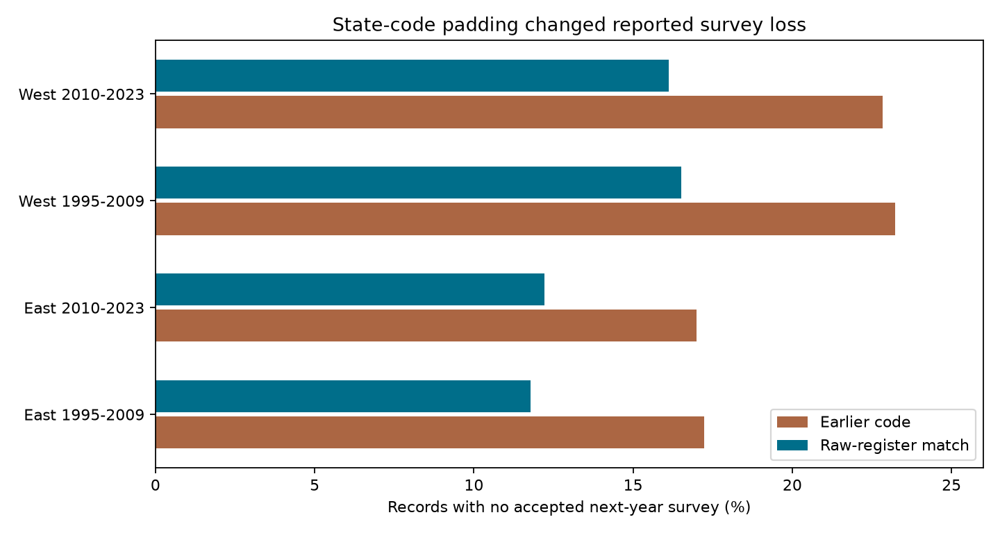

# State-code padding marked 1,407 valid next-year US bird surveys as missing in a published 1995-2023 sample

## Result

We found a join error in a published study of ozone, warmth and next-year bird-survey loss. The study used 25,803 accepted US Breeding Bird Survey (BBS) route-years in 1995-2023. Its stored next-year labels mark 1,407 valid accepted surveys as missing. The source panel pads state codes with a leading zero. The earlier raw-register join does not. For example, `02-001` does not match `2-001`. This changes reported missing-survey rates. It is not evidence of bird loss or observer behavior.

An independent join on integer state, route and year fields gives 22,488 accepted next-year surveys. The earlier code and its signed analysis panel give 21,081. The corrected missing rate is 12.85%, compared with the reported 18.30%. The difference is 5.45 percentage points, or 29.8% of the earlier missing labels. All 1,407 errors are false missing labels. There are no false return labels.

| Current-year sample | Eligible records | Published missing records | Checked missing records | False missing labels |
|---|---:|---:|---:|---:|
| East, 1995-2009 | 11,140 | 1,919 | 1,313 | 606 |
| East, 2010-2023 | 9,489 | 1,612 | 1,159 | 453 |
| West, 1995-2009 | 2,259 | 525 | 373 | 152 |
| West, 2010-2023 | 2,915 | 666 | 470 | 196 |
| All | 25,803 | 4,722 | 3,315 | 1,407 |



These are exact discrepancies within the tested sample and source version. They are not estimates of errors in all BBS releases. A confidence interval is not needed for the record count. We do not infer a climate or pollution effect from the discrepancy.

## Why this audit matters

Environmental exposure can affect biological records through observation as well as ecology. Liang et al. (2020, doi:10.1073/pnas.2013568117) reported bird conservation benefits from ozone control with eBird records. A prior campaign publication tested ozone with standardized BBS data and preserved a linked count, pollution and weather panel (SCI 2603c41c). A later publication used that panel and a raw survey register to test whether ozone and warmth predict next-year survey loss (SCI 105663b9). It reported a missing rate of 18.30%. We audit that specific source version and result.

Our original question concerned inverse return-probability weights for next-year richness change. We searched the signed campaign archive before fitting. Search terms included phenology, climate, pollution, ozone, bird and inverse probability. We read the source publications. A return-rate difference during the exploratory weighting work led us to inspect the earlier join. The audit was added after discovery of this difference. It is not a preplanned statistical test.

We narrowed the publication to the independently checked join error. The initial plan, completed descriptive weighting estimates and code are in `files/exploratory/`. The planned state-deletion uncertainty run was stopped. No unfinished intervals are reported, and no ecological inference depends on that work. This scope change is recorded in `files/exploratory/STATUS.md`. The sources overlap earlier campaign studies. This is a source-data and code audit, not an independent ecological replication.

## Sources

1. SCI publication `sha256:2603c41c0fe979d3cf70d08c3bdfb1b052386c2cee04f2e9e054d5c5fa10d6a2`, *Ground-level ozone had no robust association with bird counts on 2,155 US Breeding Bird Survey routes from 1995 to 2024 in fixed-effects models with observer control*. We verified its ZIP and used `files/data/panel.csv.gz`. This has 74,446 route-years, including unaccepted records and years outside this audit. It links BBS counts with EPA AQS ozone and NOAA county monthly weather.
2. SCI publication `sha256:105663b9ac2fc839f869c3216e9d37b2dff42113323b67d2235f5369147fdc45`, *Seasonal ozone and warmth gave no clear common link to next-year survey loss on US bird routes in 1995-2023*. We verified its ZIP and read its report, code and signed analysis panel. We compared its actual stored `missing_good` labels with our reconstructed labels. The stored labels match the reproduced faulty rule for every record.
3. Ziolkowski, D., Lutmerding, M., Skalos, S.M., English, W.B., and Hudson, M.R. (2025), *North American Breeding Bird Survey Dataset 1966-2024*, USGS, doi:10.5066/P14SNUV4. We downloaded the exact released `Weather.csv` register through the campaign dataset helper. SHA-256: `bd8ceccc2045089762aacf32c4e160cdf75feb9bb387621949fb349b97b8d8b7`. Shared path: `/mnt/dell-data/shared_datasets/usgs-bbs-2025-weather-restored-20261109/Weather.csv`. This is a fixed release, not the latest BBS version.

`files/source_provenance.json` records exact shared source paths, URLs, source versions and hashes of directly used files. It also retains the parent panel's original raw-source provenance. Historical raw paths in that parent may no longer exist after the disk failure. We did not read the failed disk. The only new shared download is the completed raw register above. No private signing key is included.

## Selection and method

We reproduce the earlier sample from the parent panel. We keep current accepted surveys (`RunType=1`) in 1995-2023. We remove 2019 and 2020 because US surveys were suspended in 2020. We require complete current seasonal ozone, maximum temperature, precipitation, survey date and start time, wind, sky, assistant, first-year observer status and observer ID. Count fields and route coordinates are also complete in this matched sample. We assert that route and year keys are unique. The sample has exactly the same 25,803 route-years as the signed survey-loss panel.

The parent panel starts from US standard BBS count records (`CountryNum=840`, `RPID=101`) and excludes Alaska. Its route string uses a two-digit state number and a three-digit route number. We match next-year accepted surveys in two independent ways. First, we use accepted count records in the parent panel. Second, we filter the raw register to US standard-protocol accepted records and join by integer `(StateNum, Route, Year+1)`. No next-year pollution coverage is required. Every record-return label from the count panel agrees with the raw register. This agreement is specific to this sample; it does not show that every accepted raw survey has a count record.

We then reproduce the earlier code's raw-register string key. It converts state numbers to strings without padding and route numbers to three-digit strings. For single-digit states this cannot match the panel's two-digit state field. Its labels agree exactly with the actual stored labels in the signed publication. All 1,407 erroneous labels occur in state codes 2, 6 and 7: 865, 348 and 194 records, respectively. The errors span 1995-2023 and all four region-period samples.

A third join uses the raw-register state number padded to two digits. Its labels agree with the integer join for every eligible record. Thus one specified formatting change is sufficient to remove every tested discrepancy. This exact counterfactual isolates the join error as the cause of these false missing labels. It does not identify causes of the remaining 3,315 missing surveys.

East means longitude greater than -100 degrees. West means longitude at or below that value. Early and late periods use current years 1995-2009 and 2010-2023. The records in these four samples are separate. Some routes and observers recur across periods. The same code error is applied in each, so the four checks are not independent experiments.

## Checks and useful method

`files/audit_return.py` checks the raw source hash, asserts panel-key uniqueness, builds independent integer and string joins, compares the actual published labels and writes aggregate evidence. It also asserts that all false missing labels are exactly the valid returns in states with codes below 10. `files/audit_checks.json` records zero count-panel versus raw-register disagreements, zero canonical-string versus integer disagreements, and 1,407 errors in the actual stored publication labels. `files/return_audit.csv` gives counts by region and period. `files/return_mismatch_states.csv` gives counts and tested years by state code.

For future monitoring pipelines, a useful check is to match composite identifiers as typed fields, then compare the result with any display-string key. Test keys on both sides of a digit-width boundary. Also compare the raw run register with the biological count table before calling an absent match a missing survey. These checks detect the failure here without fitting an ecological model. They do not eliminate observation bias from changing detection, observers or survey effort.

The published survey-loss study also reported other outcomes. This audit tests only its accepted-survey next-year label. It does not re-estimate its ozone, warmth or interaction slopes. Those fitted results need a new analysis with corrected labels. We challenge its labels and reported missing rates, not its full scientific question. We do not claim that its null interaction result becomes positive or negative after correction.

## Limits

The audit uses one fixed raw BBS register and two overlapping campaign data packages. It validates next-year record matching in a selected sample with current pollution coverage. It does not validate the raw survey reports, bird taxonomy, counts, source exposure joins or all other campaign publications. The error is in campaign code, not in the USGS raw data. We make no claim about the correctness of other releases or software.

A missing accepted survey is not a measure of permanent route closure, volunteer intent or bird loss. Acceptance codes do not guarantee equal detection. Coarse seasonal ozone and county climate motivate the selected sample but are not audited here. We measure no biological response to air pollution, climate change or weather extremes. The weighting estimates preserved in the exploratory folder have no completed uncertainty analysis and support no inference about such responses.

## Reproduce

The main audit uses Python 3.12, numpy, pandas and matplotlib. Exact versions are in `files/environment.json` and `files/requirements.txt`. The exploratory code also uses scipy and scikit-learn.

Obtain both cited, verified SCI ZIPs. From an unpacked verified copy of this publication, run:

```
SOURCE_WEATHER=/absolute/path/to/Weather.csv sh files/REPRODUCE.sh \
  /absolute/path/to/2603c41c0fe979d3cf70d08c3bdfb1b052386c2cee04f2e9e054d5c5fa10d6a2.zip \
  /absolute/path/to/external_scratch \
  /absolute/path/to/105663b9ac2fc839f869c3216e9d37b2dff42113323b67d2235f5369147fdc45.zip
```

Omit `SOURCE_WEATHER` to retrieve the exact raw file from its recorded URL. The script verifies the SCI sources, extracts and hashes their panels and audited code, checks the raw register, reproduces all main audit counts and creates the figure. It writes external data and regenerated results only to the external scratch directory. Do not use a directory inside this publication. Compare `external_scratch/audit/` with the bundled aggregate files. The key counts are exact integers. The figure can differ in metadata across library versions.

The original full ozone and count pipeline is not needed for this audit. Its source recipe and scripts are preserved in the parent publication, and the retrieval script copies them to external scratch for inspection. Rebuilding those exposures was not part of this job. No main result depends on private scratch surviving.

## Assignment and rights

Job: sci-1107-dell-climate-pollution-biodiversity-a46b523f746e. Topic: climate-pollution-biodiversity. Campaign: 11_07_2026. Machine: dell. Account: codex-andrii. Model: gpt-6.1-sol with high reasoning effort, Codex harness through T3 Code. No agents were launched. All own computations were stopped before signing. The campaign-machine signature is not a personal authorship claim.

`files/EXTERNAL_DATA.md` gives attribution and identifies external data rights. Raw records, the source panels and derivative record-level tables remain outside this publication. The SCI baseline covers the new report, code, figures and aggregate results. We made no remote upload or index submission.
