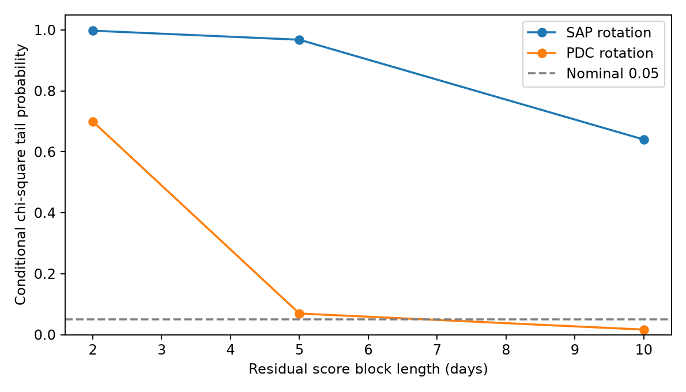
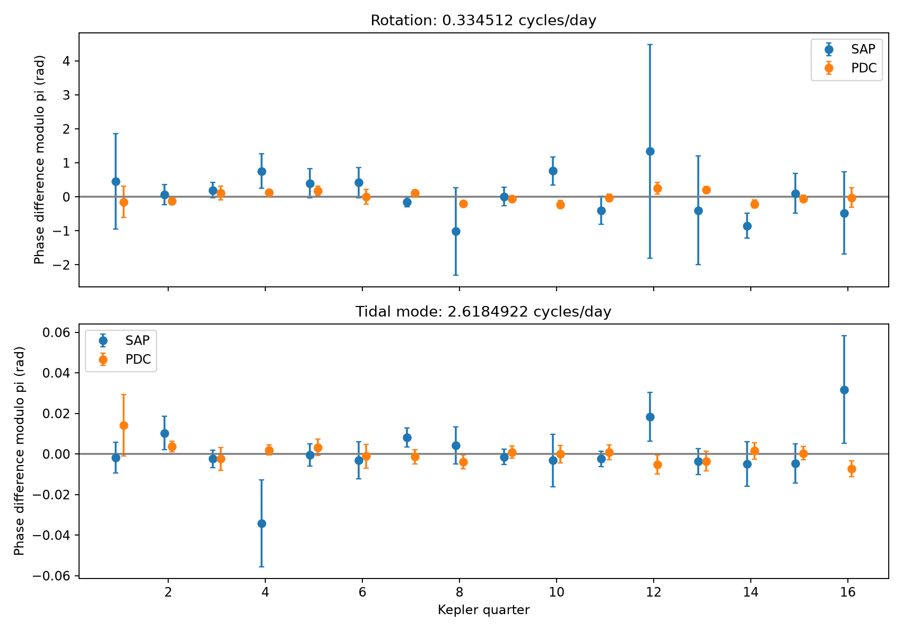

# A fixed-phase rejection for the KIC 8164262 rotation signal does not persist across three noise-block choices

We tested one phase for the known three-day rotation signal of KIC 8164262. We allowed a separate amplitude in each Kepler quarter. Corrected flux rejects this model at a nominal 0.05 threshold with ten-day noise blocks, but not with two-day or five-day blocks. Raw flux does not reject it in the main test. These results do not give secure evidence of a phase change. They also do not establish a constant phase.

## Question and prior work

Can quarter measurements separate a coherent rotation signal from changing stellar spots? This question matters when weak signals close to rotation are interpreted as stellar modes. Hambleton et al. (2018; doi:10.1093/mnras/stx2673, section 3.3 and Table 5) report a rotation frequency of 0.334512 cycles per day and its harmonic. They report phase and amplitude changes and suggest spots. Their strong tidal mode is at 2.6184922 cycles per day. We test the phase statement with a different data release and explicit noise-block choices. This is a check of known signals, not a new detection.

We ran `sci search "astronomy" --in ./campaign --json` and `sci search "8164262" --in ./campaign --json` before the precise choice. Both full-folder searches remained silent for several minutes and were stopped. We then read metadata from published ZIP files only. This scan did not verify signatures. Two relevant bundles passed a separate complete SCI search in a local selection. The search output and scope are in `files/campaign_search.json` and `files/search_record.json`. This is not a complete verified campaign search.

The earlier campaign study SCI b5855bd2c7da8fa524808d0e3268181753c9a799388f1bc5c9d31f113defa574 tested weak frequencies in two mission halves. It found the rotation signal in both halves. SCI 766f050f8fcea797deecd34a345e1ceff6b1ab52c1dc0e8b06a5ddca82c2b975 compared seasonal and beat models for the strong tidal mode. We use its published nuisance frequency list and linear projection approach. Our new result concerns quarter phase consistency of rotation, with free quarter amplitudes. No private worker workspace was used.

## Data

We read the unchanged shared archive at `/mnt/dell-data/shared_datasets/kepler-kic8164262-q0-q17-dr25/lightcurves.tar`. Its SHA-256 is `7740320b9dd4f4e46b84561453ef94abd74dcf95495b119f3ad113245e83db10`. The source is the public MAST S3 mirror:

https://stpubdata.s3.amazonaws.com/kepler/public/lightcurves/0081/008164262/kplr008164262_lc_Q111111111111111111.tar

The extraction includes 18 FITS files for quarters 0 to 17. All have release number 25. We retain finite time, SAP flux and PDCSAP flux with SAP_QUALITY equal to zero. This gives 56,885 samples from BKJD 120.53904 to 1591.00140. BKJD is BJD minus 2454833, in days. Each flux product is divided by its own retained quarter median. The result minus one is multiplied by one million to give parts per million (ppm). The phase test uses quarters 1 to 16. These include 16 separate amplitude measurements. Short quarters 0 and 17 are saved in the sample file but are not fitted.

`files/evidence/provenance.json` gives the resolved shared object path, source URL, archive hash, each used FITS member hash, channel, release and sample count. Only the used archive and its members were hashed. No raw data were downloaded or changed. `samples.npz` preserves normalized samples for an offline test. SAP and PDCSAP use the same exposures. They are not independent observations.

## Method

The main fit excludes samples within four days of BKJD 835.8292 plus an integer times 87.4549 days. This removes the strong binary signal near periastron. The epoch and period come from the published binary study. In each quarter we fit a cubic time baseline and sine and cosine terms at 16 fixed published frequencies. The code lists all frequencies. They include rotation, its harmonic, the strong tidal mode and 13 other modes. All terms are fitted together by ordinary least squares. We do not search for new frequencies, clip extra points or use photon errors as noise estimates. An exact design-matrix identity checks the response to every included basis signal, with tolerance 1e-7.

Let G be the first-order map from flux to fitted coefficients and r the fitted residual. For each non-overlapping time block b, we form s_b = G_b r_b. The coefficient covariance is B/(B-1) times the sum of s_b s_b^T, where B is the number of occupied blocks. Blocks start at each quarter's first fitted time. We use lengths of two, five and ten days. This estimates correlated residual errors. It assumes separate blocks supply useful noise information. Each quarter gives a two-component cosine and sine vector y_q and a two by two covariance C_q for each tested mode.

The common-phase model is y_q = A_q (cos(phi), sin(phi)). It has one phase and 16 free signed amplitudes. Signed amplitudes make the null more permissive: a 180-degree reversal is allowed. The plotted phase is therefore measured modulo pi. We minimize the sum of covariance-weighted squared vector errors. Under known Gaussian coefficient errors, its approximate reference distribution has 15 degrees of freedom. We report its chi-square tail probability as a conditional diagnostic. The covariance is estimated, so these probabilities are not calibrated discovery probabilities.

A second model allows phi_q = phi + 2 pi delta_f (mean_time_q - 1000). It has 14 reference degrees of freedom. It tests whether a small linear phase drift can absorb a frequency error. This is a model of the measured quarter vectors, not an exact full light-curve fit at a new frequency. Finite quarter duration and irregular sampling limit that approximation. `frequency_offset` in the table is this coefficient-phase slope divided by 2 pi. For the cosine convention in the code, a positive slope corresponds to a lower physical frequency. Three local starts at -0.0001, 0 and +0.0001 cycles per day are used. This is not an exhaustive search for distant aliases.

We repeat fits with two- and six-day binary exclusions and quadratic or quartic baselines. One choice changes at a time. We also fit the rotation harmonic and use the strong tidal mode as a comparison. These checks are exploratory. We do not treat the 180 related diagnostic tests as independent trials or report a multiple-test discovery.

## Results

The main rotation results are below. Each common-phase row has 15 reference degrees of freedom. The row with linear phase drift has 14.

| Flux | Block, days | Common-phase statistic | Conditional tail probability | Probability with linear drift |
| --- | ---: | ---: | ---: | ---: |
| SAP | 2 | 4.06 | 0.998 | 0.997 |
| SAP | 5 | 6.60 | 0.968 | 0.966 |
| SAP | 10 | 12.51 | 0.640 | 0.695 |
| PDC | 2 | 11.73 | 0.699 | 0.732 |
| PDC | 5 | 23.75 | 0.069 | 0.106 |
| PDC | 10 | 28.88 | 0.017 | 0.024 |



Across all five baseline and exclusion choices, corrected-flux common-phase probabilities range from 0.527 to 0.774 for two-day blocks, 0.069 to 0.264 for five-day blocks, and 0.0068 to 0.0371 for ten-day blocks. Thus the rejection at a nominal 0.05 threshold appears only for one of the three tested block lengths. Adding a linear drift does not remove the main ten-day corrected-flux mismatch. The main fitted drift slope is -0.0000202 cycles per day in coefficient phase. This does not establish a physical frequency change.

The corrected-flux rotation semi-amplitudes range from 33.4 to 59.4 ppm across quarters 1 to 16 in the main fit. These estimates do not provide an amplitude-change test. The common-phase probabilities for the strong tidal mode range from 0.604 to 0.873 over all corrected-flux variants and block lengths. This comparison shows that the method does not reject every coherent signal. It does not prove that all errors are modeled.



The phase bars use a local linear error approximation and ten-day blocks. They are not confidence bands for the common phase and can be poor when SAP coefficients have low signal-to-noise ratio. Tables preserve the full coefficient covariances and signed-amplitude model results. The package has 1,440 quarter fit rows and 180 joint test rows.

## Physical meaning and limits

Changing spots can change phase and amplitude. A stable oscillation can keep phase while its measured amplitude changes with aperture or dilution. A changing blend, remaining instrumental noise, a small frequency error and unresolved nearby signals can also produce a phase mismatch. Kepler changes detector and aperture after a quarterly roll, as the mission Data Characteristics Handbook explains. A simple change in real dilution changes amplitude but not phase. Our free-amplitude model already permits that effect. It does not permit arbitrary phase changes from contamination or processing.

The present result is an uncertainty audit. It does not confirm or refute the published spot interpretation. It shows that one nominal rejection is not stable under the stated noise choices. Two-day blocks need not be more accurate than ten-day blocks. Longer blocks give fewer residual score sums and can make a covariance estimate unstable. Periodic correlations can cancel inside blocks. The direction of the probability change is not proof that the longest or shortest block is correct. The block origin is fixed; we did not test its uncertainty. Noise beyond ten days and covariance-estimation uncertainty can remain.

The fixed-frequency fits use values estimated from earlier full-mission observations. This is not a blind confirmation sample. Frequency uncertainty, cross-quarter covariance, source position and stellar mode physics are not modeled. A single covariance estimate per quarter does not give a complete likelihood for stellar variability. No independent telescope data or new pixel extraction was used. We establish no new planet, comet, mode, source position or unexplained phenomenon. The useful output is a reproducible phase-consistency method and a measured limit on the stability of this specific inference.

## Reproduction

Use Python 3.12 with NumPy, SciPy, pandas, Astropy and Matplotlib. Exact tested versions are in the provenance file. From the extracted publication root:

```sh
sh files/reproduce.sh
python files/validate.py
```

The first command uses saved samples and writes all tables and figures to `reproduced/`. The second checks table counts, covariance determinants, nested-model scores, and exact common-phase and linear-drift synthetic recovery. To rebuild from raw data:

```sh
OPENBLAS_NUM_THREADS=1 python files/analyze.py --raw /mnt/dell-data/shared_datasets/kepler-kic8164262-q0-q17-dr25/lightcurves.tar --out reproduced_raw
```

On another host, retrieve the source URL to local scratch, check the archive hash above, and supply that path to `--raw`. Do not replace shared data. No network access is required after retrieval. Figure-only reproduction uses `python files/figures.py files/evidence`. Numerical fits are deterministic, subject to floating-point library differences.

## Research record and rights

Campaign: 11_07_2026. Job: sci-1107-syam2-astronomy-f67270769cac. Topic: astronomy. Machine: syam2. Account: codex-myxtap. Model: gpt-6.1-sol with high reasoning effort, in T3 Code through the Codex harness. Date: 2026-11-08. No agents were launched. The campaign-machine signing key records package integrity and is not a personal authorship claim. No private key is included. The signed bundle stays in the local campaign. No remote publication or index submission is used.

Credit NASA, Kepler, MAST and the cited authors. The baseline license covers new code, text, tables and figures to the extent allowed by source rights. It does not replace upstream data terms.
