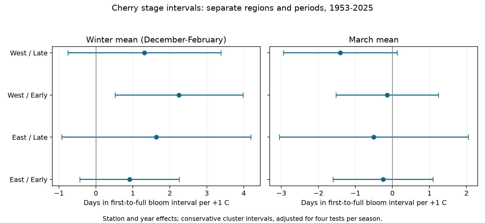

# Winter warmth was linked to longer cherry bloom intervals in western Japan in 1953-1988, with uncertain replication

We tested links between seasonal temperature and the time from first flowering to full bloom. We used 4,140 paired station-years from 66 Japanese stations in 1953-2025. Four separate region and period models had station and year effects. Winter slopes were positive in all four samples. Only western Japan in 1953-1988 had an interval above zero after adjustment for four tests: +2.25 days per C, with an interval of +0.52 to +3.98. Station trends and trees on station grounds kept this early western link. Consecutive-year changes gave an interval that included zero. The three other main winter intervals and all four March intervals included zero. Thus these data did not establish a clear repeated link. Selected station records, shared weather across regions, unknown tree changes, coarse weather, and monthly windows that can extend past flowering limit inference. The interval does not measure the full flowering season. We do not test pollution, daily extremes, pollinator effects, or causal climate change. The package includes a new paired panel, source hashes, code, all estimates, a raw rebuild, and numerical checks.



## Question and prior work

Does a warm winter have a link to the time from first flowering to full bloom, after control for March temperature? A longer interval could reflect a change in the spread of flower opening within a tree. It is not the time from the first flower to the last flower. The record cannot show food supply for pollinators.

JMA defines first flowering as the first day with five or six open flowers on the sample tree. Full bloom is the first day when about 80 percent of buds are open. The main cherry type is Somei-yoshino. Some stations use other species. We use only the standard-type flags, to reduce this source of bias. See the JMA methods and flag guide in the citations.

Katsuki et al. (2026, doi:10.1007/s00484-026-03185-6) studied cherry at its warm southern range limit. They found longer flower opening periods with low winter chill. The local campaign publication sci:sha256:d997794cd5da3aabb17a004339fe9e877502137746ec1c02d19fd110ce5bb960 tested winter delays in cherry bloom across three national networks. It studied bloom dates and thermal-time models. Our test uses first and full bloom together, a current raw JMA archive, and a different weather source. It asks if the stage interval has a repeated seasonal association. It does not test a new chilling model or reproduce that publication's date slopes. No code or private worker files were reused.

We ran SCI searches for climate, pollution, phenology, and cherry in the campaign. The full cherry search and a verified read of the relevant winter study are included. The search matches cited words as well as focal topics. The plan was saved before fits. The regions, periods, filters, and sensitivity models were not chosen from fitted results. This is an exploratory study, not a registered study.

## Data and observation controls

The sources are JMA's all-event archive, files 004.csv and 005.csv, downloaded on 2026-11-08; NOAA GHCN-CAMS monthly temperature version 3.01, snapshot 2026-11-05; and NOAA ISD station history, snapshot 2026-11-08. `files/provenance.json` gives source URLs, exact shared paths, sizes and SHA-256 hashes for the three files used. The code reads the shared files in place. No raw archive is copied into this bundle. Data provided by NOAA PSL, Boulder, Colorado, USA, from https://psl.noaa.gov.

We join the final three digits of the JMA international station number to NOAA WMO numbers 47xxx. We use the latest listed ISD location for each station code. We restrict locations to 30-38 N and 128-142 E. West is longitude below 136 E; East is longitude at least 136 E. The two periods are 1953-1988 and 1989-2025. The split gives two time samples of similar length. It is not a fitted change point. The regional samples use different stations. Their climate is still related. The time samples use some of the same stations, so they are not fully independent replications.

A date must be a valid month-day in its stated year. JMA zero codes are missing. We keep first and full dates with flags 8 or 9. These flags mean the standard type, on station grounds or nearby. We keep full-minus-first intervals from 0 to 40 days. The selected intervals range from 1 to 19 days. We require at least 15 pairs for a station in each period. The geographic first-date sample has 4,243 rows. Of these, 4,195 have eligible pairs. The record-length rule leaves 4,140 pairs at 66 unique stations. `coverage.csv` gives counts before this last rule. `all_records.csv` preserves missing full dates and all selection flags. `panel.csv` preserves the exact analysis input.

Pairing reduces bias from a change in station mix between first and full dates. Station effects control for constant local conditions. Standard-type flags reduce species mixing. The on-grounds check reduces location mixing. These controls do not remove changes in sample tree, tree age, visit schedule, observers, local heat, or station location. The archive has no visit log in the fields used here. A flag is not a tree identity. The selected stations are not a random sample of wild populations. A missing full date can have a biological or reporting cause. We cannot separate these causes.

For each station we take the nearest 0.5-degree temperature cell. Winter is the equal-weight mean of prior December and current January and February. Spring is March. The input and included temperature columns are in kelvin; a one-kelvin increment equals one degree Celsius. The regressions include intercepts, so this unit offset does not change any slope. The March window is fixed across stations and years. It can contain days after an event and can miss April conditions. Thus the March slope is a seasonal association, not an estimate of temperature during the interval.

## Model and uncertainty

In each region and period we fit interval = station effect + year effect + winter slope times winter mean + March slope times March mean + error. Year effects remove common annual conditions; the temperature terms then use differences in local weather within each year, after removal of station means. This is a stronger control than a station-only model. It can leave little local temperature variation. Spatially smooth temperature error can still cause bias. The independent audit found residual winter standard deviations of only 0.096-0.130 C and March standard deviations of 0.108-0.167 C. Thus a one-degree slope is a scale unit, not a typical remaining contrast. In the early West, one residual winter standard deviation (0.105 C) corresponds to an estimated 0.24 extra days, with an adjusted interval of about 0.05 to 0.42 days. Small remaining exposure variation makes measurement error a major concern.

For each coefficient, we use the largest variance from station clustering, year clustering, and their two-way cluster estimate. This avoids a smaller interval due to the subtraction in the two-way calculation. The reference distribution is Student t with degrees of freedom equal to the smaller cluster count minus one. The table uses 98.75 percent individual intervals, for an approximate 95 percent family of four tests per seasonal predictor. The two seasonal families are separate; there is no joint eight-test guarantee. Cluster intervals are approximate and do not cover model error or all spatial dependence.

The planned checks add separate station trends, use only flag-8 trees on station grounds, omit year effects, or use differences in consecutive years with year effects. A common linear station trend is redundant with year effects. The code omits one station trend to keep the design full rank. We also fit first and full dates on the same pairs. Their slope difference must equal the interval slope. Sensitivity results are diagnostic, not separate confirmation tests.

## Results

Values below are days per one degree Celsius higher seasonal mean, conditional on the other season and the model controls.

| Region | Period | Pairs | Stations | Winter slope [adjusted interval] | March slope [adjusted interval] |
| --- | --- | ---: | ---: | --- | --- |
| East | Early | 1147 | 33 | +0.91 [-0.44, +2.26] | -0.25 [-1.60, +1.10] |
| East | Late | 930 | 31 | +1.63 [-0.92, +4.19] | -0.50 [-3.06, +2.05] |
| West | Early | 1104 | 33 | +2.25 [+0.52, +3.98] | -0.14 [-1.53, +1.24] |
| West | Late | 959 | 30 | +1.31 [-0.76, +3.38] | -1.40 [-2.94, +0.13] |

All four winter estimates are positive. Only the early western interval excludes zero. This estimate remains positive with station trends (+2.27 days per C) and with trees on station grounds (+2.21). Their adjusted intervals also exclude zero. The consecutive-year estimate is +1.68, with an interval of -0.04 to +3.39. The later western and both eastern main intervals include zero. We did not establish a clear repeated winter link across the four samples. We did not test whether the slopes differ between periods, and we do not claim that an effect stopped.

All four primary March estimates are negative, but all four adjusted intervals include zero. Without year effects, all four winter intervals exclude zero and three of the four March point estimates become positive. This model dependence limits claims about local winter conditions. National annual conditions, unmeasured weather, and broad trends can contribute to station-only results. The year-effect model does not prove that its remaining association is causal.

The full model table is `files/models.csv`. All sensitivity estimates and first/full-date estimates are included, including uncertain results. There is no selection of stations or exposure windows by significance. The signs are consistent with a winter-related spread in flower opening, but monthly means do not measure chilling fulfilment. We did not measure bud development, temperature thresholds, frost injury, or flower abundance. The data cannot select a physiological explanation over unmeasured weather and observation change.

## Validation and reproduction

`build.py` rebuilds both the broad first-date sample and the selected panel from the three raw files. `analyze.py` recreates all fitted results and the figure from the included panel. `audit.py` uses a separate QR projection to check the main two-temperature coefficients. The checks test unique station-years, interval arithmetic, source flags, design rank, coefficient calculations, and the identity between interval slopes and differences of event-date slopes. Raw rebuild agreement is recorded in `raw_rebuild.json`. All three derived CSV files matched byte for byte. The separate QR coefficient errors were below 5e-10, and all final model designs had full column rank. These checks verify calculations; they do not validate causal assumptions.

Run from the extracted bundle:

```sh
OPENBLAS_NUM_THREADS=2 OMP_NUM_THREADS=2 python files/analyze.py
OPENBLAS_NUM_THREADS=2 OMP_NUM_THREADS=2 python files/audit.py
```

For a raw rebuild, run `python files/build.py /path/to/shared_datasets /path/to/scratch_output`. Compare its `panel.csv` and `all_records.csv` with the included files. Then run the analysis. See `files/reproduce.txt` for retrieval and snapshot rules. The thread counts above are a practical runtime choice, not a scientific requirement. The tested Python package versions are in `validation.json`.

## Scope and provenance

This study gives a new paired-data panel and a limited association test. It does not establish a causal climate-change effect, species loss, species distribution change, pollution effect, weather-extreme effect, or pollinator mismatch. Monthly exposure error, correlated regions, selected long records, tree changes, and approximate uncertainty remain limits. A longer first-to-full interval is not proof of a longer flowering season.

Job: sci-1107-dell-climate-pollution-biodiversity-37dc172992da. Campaign: 11_07_2026. Topic: climate-pollution-biodiversity. Machine: dell. Account: codex-andrii. Model: gpt-6.1-sol, high reasoning effort, through the Codex harness in T3 Code. The campaign-machine signature identifies the bundle. It is not a claim of personal authorship. No private key is included. The bundle is stored locally; no remote archive or index is used.
