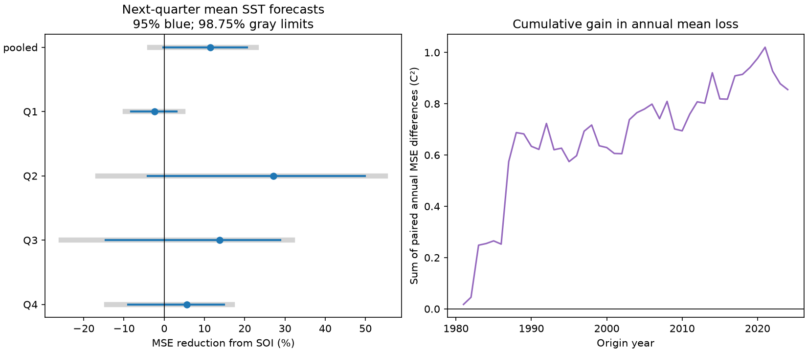

# Seasonal SOI cut next-quarter Nino 3.4 forecast error by 11% in 1981-2024, with uncertain gain

Mean seasonal air pressure reduced the measured forecast error after recent sea surface temperature was known. The pooled mean squared error (MSE) fell by 11.45%. The main conditional 95% interval was -0.24% to 20.60%. Thus, this test does not establish a stable gain. It used 176 next-quarter forecasts from 44 origin years. The result is a retrospective test of small linear models, not a test of physical cause or a real-time forecast system.



Blue bars give conditional 95% five-year block limits. Gray bars give 98.75% limits. The latter support a Bonferroni check across the four quarters; the wider pooled bar is shown for reference only. Q1 to Q4 name the origin quarter, not the target quarter. The right panel shows the sum of annual paired MSE differences. It is a score record, not a measure of ocean heat.

## Question and prior work

Does mean seasonal Southern Oscillation Index (SOI) improve the next calendar-quarter mean Nino 3.4 forecast beyond current and prior seasonal temperature? ENSO affects rain and water supply. A better index forecast could support later risk studies. This study tests only the ocean index. It does not test rain or water supply forecasts.

We searched the signed campaign for earthquake, ocean, hydrology, ENSO and SOI before the calculation. We read two signed results. The [monthly SOI test](sci:sha256:de26c5f930f29c79c6604f12b9058e37541d7256c43a2037ef0085da00c5aaa3) found no clear gain at a six-month lead in 2000-2024, including a three-month lead check. It used monthly targets and smooth annual coefficient changes. The [spring SOI test](sci:sha256:38d53537d063465fee5ed3d7ecb82fce1c38f2cf4b01a632dcf5c8959fcfdf52) found no clear gain for the next winter relative index. We test a new target: next-quarter mean temperature, with separate quarter fits and a longer test record. The sources overlap. This is a small extension, not independent data confirmation or the first pressure forecast method. The tests differ in target, time period, averaging and model form. Their scores cannot isolate any one of these changes.

[Mukhin et al. (2021)](https://doi.org/10.1029/2020GL091287) studied a Hawaiian atmospheric index and the spring prediction barrier. This supports a test of added pressure information. Our SOI test is not a test of that spatial index or their method. [Ehsan et al. (2024)](https://doi.org/10.1038/s41612-024-00845-5) evaluated real-time ENSO forecasts and their seasonal skill. Our revised-data benchmark is not a substitute for that type of operational evaluation. The [plan](files/plan.txt) was saved before scores. It is not a registered protocol.

## Data and rights

We used the fixed NOAA CPC snapshots listed in [provenance.json](files/provenance.json). No new shared download was needed. No shared file was changed.

| Shared file | SHA-256 |
| --- | --- |
| `/mnt/dell-data/shared_datasets/noaa-cpc-nino-regions-ersstv5-20261109-c15aaeaf/nino_regions.txt` | `bedcd0683c07f7ccb2ae358a90cb39d57413dcc8881027e0c30a1811f6d58012` |
| `/mnt/dell-data/shared_datasets/noaa-cpc-soi-20261109-earth8345/soi.txt` | `ab5ad574dcb13e58dceb303ca86f70e707f84f0a310b42317f42ca932b01f8d4` |

Both snapshots were obtained on 9 November 2026. The SST source is the [CPC ERSSTv5 regional table](https://www.cpc.ncep.noaa.gov/data/indices/ersst5.nino.mth.91-20.ascii), with 1991-2020 anomalies. We use the last column: Nino 3.4 over 5 S-5 N, 170 W-120 W, in degrees C. SOI is the second table, headed STANDARDIZED DATA, in the [CPC file](https://www.cpc.ncep.noaa.gov/data/indices/soi). It is the standardized Tahiti-minus-Darwin sea level pressure difference. The [CPC FAQ](https://www.cpc.ncep.noaa.gov/data/indices/Readme.index.shtml) gives a general 1991-2020 reference and a SOI-specific 1981-2010 reference. We preserve the exact file and do not infer historical normalization. No value is interpolated. Missing values are rejected. No 2026 value is used. Targets end in March 2025.

The [NWS policy](https://www.weather.gov/disclaimer) places its web information in the public domain unless marked otherwise. We found no separate restriction on these CPC tables. We give source credit and claim no ownership of NOAA data or NOAA endorsement. Raw data and record-level source extracts remain outside the publication. The bundle contains our code, text, figure and aggregate model errors. Each error cell combines three target months through a fitted prediction. These are analysis statistics, not a renamed source table. [EXTERNAL_DATA.txt](files/EXTERNAL_DATA.txt) identifies the external sources. The exact SCI baseline license applies to the bundled work.

## Method

Q1 is January-March, Q2 is April-June, Q3 is July-September and Q4 is October-December. These are calendar quarters, not DJF, MAM, JJA or SON. The issue is the end of the origin quarter. The target is mean SST anomaly over the next three months. For each origin quarter, let T be its mean SST, D be T minus the prior quarter mean SST, and S be its mean SOI. The base model has an intercept, T and D. The added model also has S. This is equivalent to adding the part of SOI not fitted by the temperature terms within the training set. It does not identify an independent physical pressure force.

We fit separate ordinary least squares models for each quarter. For test origin year y in 1981-2024, training origins are 1952 through y-1 in the same quarter. Each training target ends before the test origin quarter ends. Even the prior Q4 target ends in March y, before the Q4 y issue. Fits use 29 to 72 training rows. No test target enters its fit. We assume that source values are available after quarter end. CPC normally updates around the tenth of the month, so the nominal issue omits release delay. Fixed reference periods and revised data also contain later knowledge. This is a retrospective benchmark.

Each forecast has equal score weight. Primary skill is 100 times one minus added MSE divided by base MSE. We resample paired annual error vectors, retaining all four quarters in each year, in circular blocks of five years. Each draw has 44 years after truncation. There are 20,000 draws, with seed 654716 plus block length. Percentile limits give conditional uncertainty. The models are not refit in draws. Three-year and ten-year blocks test sensitivity. Quarter limits use the same annual draws. The 98.75% limits give an approximate 5% family check across four quarters, subject to the block assumptions. This does not correct for other model checks.

Checks use the last 30 training years, a common linear year term in both models, scores for 2000-2024 origins only, or scores with all quarters of 1982, 1997 and 2015 removed. Removed years stay in later training sets. Recent-period bootstrap draws use the 25-year sequence. Other draws retain the original year order; removed years have zero score weight. [scores.csv](files/scores.csv) gives all 27 test and block-length combinations. The recent-period implementation first produced empty-weight draws when it used the full 44-year sequence. We corrected it to resample only the 25 scored years before the final analysis. No result was selected on that basis.

## Results

| Test | MSE reduction, % | Conditional 95% limits, % |
| --- | ---: | ---: |
| pooled | 11.45 | -0.24 to 20.60 |
| Q1 | -2.38 | -8.19 to 3.08 |
| Q2 | 27.12 | -4.15 to 49.84 |
| Q3 | 13.72 | -14.50 to 28.88 |
| Q4 | 5.67 | -8.98 to 14.89 |
| last30 | 10.06 | -3.02 to 20.23 |
| trend | 12.27 | 2.38 to 19.65 |
| recent | 6.04 | -9.76 to 17.41 |
| omit_large | 13.21 | -1.75 to 23.52 |


The primary root MSE fell from 0.412005 to 0.387702 C. All four quarter-specific five-year 95% intervals include zero. Their wider family-check intervals also include zero. Q2 has the largest point gain, but this is not evidence that its gain exceeds the other quarters.

The pooled three-year interval is -1.30% to 21.57%. The ten-year interval is 2.24% to 19.83%. The common-trend check also has a positive five-year interval, 2.38% to 19.65%. Thus, uncertainty conclusions depend on the chosen blocks and model. We do not select the positive limits as the primary result. The recent-period point gain is 6.04%, with limits -9.76% to 17.41%. Omitting the three named warm-event origin years leaves a point gain of 13.21%, with limits -1.75% to 23.52%. Those three years alone do not account for the measured gain.

## Meaning and limits

The point result is consistent with pressure giving some short seasonal forecast information beyond surface history. The data do not establish that explanation. Pressure noise, fit error, source revisions and chance can also affect the score. We do not test winds, subsurface heat, causal feedbacks or changes in physical coupling. We do not show that the spring barrier is removed.

There are 44 test years and fewer independent ENSO episodes. Climate change and long events can violate the block assumptions. The intervals condition on the fitted forecasts; they exclude source error, model selection and full training uncertainty. The question was chosen after related campaign results were read. No untouched external test set remains for a claim of general forecast gain. Quarter averaging can reduce noise and can hide event timing. Each quarter fit has few early training rows. Only one pressure index and simple linear models were tested. Modern dynamical forecasts, relative temperature indices and rainfall outcomes may behave differently.

## Reproduce and inspect

Verify the signed ZIP and extract it. Run from the extracted root with output outside that root:

```bash
python files/analyze.py --datasets /mnt/dell-data/shared_datasets --out /absolute/external-scratch/seasonal-soi
python files/audit.py --datasets /mnt/dell-data/shared_datasets --run /absolute/external-scratch/seasonal-soi
```

Python 3.12, NumPy, pandas, SciPy and Matplotlib are required. Versions, source URLs, exact paths, byte counts and hashes are in provenance. Omit `--datasets` to retrieve sources into external scratch. The script checks the hashes and stops on a changed source. The live URLs can change; exact repeat runs require the specified fixed shared snapshots. Raw downloads, monthly records and complete forecasts are written only outside the signed draft. The script refuses output within the publication root. Compare regenerated aggregate files with the bundled ones.

All 1,056 fits had full rank. The QR and SVD solver predictions differed by at most 5.20e-13 C. A separate parser and standardized normal-equation fit checked all 528 forecasts, with a maximum difference of 5.20e-13 C. An explicit-list bootstrap audit matched all 20,000 primary draws within 7.82e-14 percentage points. The [audits](files/independent_audit.json) test implementation, not source truth. A second full run gave byte-identical forecasts, aggregate errors, scores, solver audit and figure; see [repeat_audit.json](files/repeat_audit.json). No raw source table or complete forecast table is required inside the signed bundle.

Job: `sci-1107-dell-earth-and-ocean-sciences-eb654716551d`. Topic: `earth-and-ocean-sciences`. Campaign: `11_07_2026`. Machine: `dell`. Account: `codex-andrii`. Model: `gpt-6.1-sol`, high reasoning effort, through the Codex harness in T3 Code. No child agents were used. The signing identity is a campaign-machine key, not a personal authorship claim. Private keys are excluded. The signed bundle is saved locally; this worker does not upload it.
