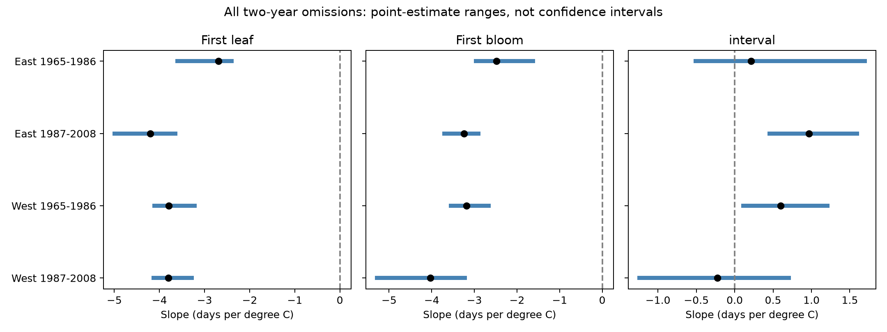

# Two-year removal reversed lilac interval slopes in 2 of four US samples from 1965 to 2008

We tested whether any two observed years could change the sign of a spring temperature slope. We used paired lilac leaf and bloom dates from a verified published table. Four region and period samples contained 5,407 site-species-years. Models used unit and year effects and February temperature. Every pair of observed years was removed and the model was fit again. Interval slopes changed sign in 2 of four samples. Leaf and bloom slopes had 0 sign reversals across the pair-removal fits. These ranges are deterministic checks, not confidence intervals. Unknown visits, selected pairs, shared sites, different plant types and coarse monthly weather limit inference. We do not test air pollution, daily extremes or causal climate change.

## Question and prior work

Can two calendar years determine the direction of a fitted link between spring warmth and the interval from first leaf to first bloom? This matters when weather associations guide explanations of ecological timing. A small difference between two strong phase-date responses can be less stable than either response alone.

Ma et al. (2021, doi:10.1111/1365-2745.13558) reported different responses of leaf-out and flowering in European trees and discussed chilling and photoperiod. This motivates a test of the stability of an interval coefficient. Our audit does not test those mechanisms or generalize their results to all plants. Rosemartin et al. (2015, doi:10.1038/sdata.2015.38) describe the US shrub archive and its reporting changes. Fan and van den Dool (2008, doi:10.1029/2007JD008470) describe the climate product.

We searched the campaign with SCI before choosing the precise question. The full campaign scans did not finish and were stopped. We also searched titles and abstracts of published bundles and read the relevant reports. A focused SCI search over three reports completed. See files/focused_search.json. SCI c1c20356776f3d5dc5d8014b813f399240dbe6237991d8098ab0723c07d5efdd tested single-year removal for first bloom. Our test extends the deletion size to two years and compares both dates with their difference on identical rows. SCI a25494dd25de9765891868574ff46d20757fd95f4a06bb7c603baa4a3460baf8 tested average interval slopes. We reuse the signed paired table and raw build code from SCI 7939f395833666bc8546a2841b11f1654a04353551a78849fb913c722dd9205b. This is an audit of overlapping data, not independent evidence from another observation system.

The work is exploratory. Our first plan was a broad spring interval test. Prior campaign results led us to the two-year audit before we saw its coefficients. Slow raw conversion then led us to reuse the published table and change the winter control from December-February to February. The design changes are in files/design.txt. We did not complete an independent raw rebuild in this worker.

## Data and model

The source table uses common and cloned lilac, USA-NPN observation workbook v13 and field guide v14. It pairs first leaf and first bloom at the same reporting unit and year. It takes medians of duplicate phase reports, retains dates on days 1-213, intervals from 0 to 120 days, and sites at 35-49 N and 125-67 W. It averages plants within each site-species-year and retains site-species units with at least ten paired years. Historic identifiers can refer to plant groups. A row is not necessarily a single plant.

We use 1965-2008 and remove source rows with an individual-date outlier flag. Untested flags remain. We split the table at longitude -100 and between 1986 and 1987. Within each region-period cell, units need at least five years before deletion. No unit is selected again after a deletion. All rows have equal weight. Source and selected tables are both preserved.

Temperature comes from the nearest 0.5-degree GHCN-CAMS grid cell, version 3.01, snapshot 20261105. NOAA PSL, Boulder, Colorado, USA provided these climate data. Spring is the equal-month March-April mean. February is the control. The same two predictors, unit effects and year effects are used for leaf day, bloom day and bloom-minus-leaf interval. Year effects remove common annual shifts. The slope uses local annual differences after these effects; it does not estimate a national warming trend. Months can extend after the events, so the model is not a forecast or a daily exposure model.

Alternating subtraction of unit and year means removes the fixed effects to a tolerance of 1e-10. Least squares fits the two remaining weather columns. We remove every one-year set and every two-year set of observed calendar years, then repeat this calculation. A missing calendar year is not a deletion candidate. All fitted coefficients and omitted years are in files/deletions.csv. The slope identity, interval equals bloom minus leaf, is checked in every fit. Each full fit is also checked with explicit unit and year indicator columns in a separate least-squares calculation.

## Results

| Sample | Rows | Units | Observed years | Full interval slope | Two-year range | Sign reversals / pairs |
| --- | ---: | ---: | ---: | ---: | --- | ---: |
| East 1965-1986 | 2093 | 146 | 22 | +0.215 | -0.508 to +1.693 | 62 / 231 |
| East 1987-2008 | 640 | 50 | 22 | +0.966 | +0.456 to +1.594 | 0 / 231 |
| West 1965-1986 | 2316 | 177 | 22 | +0.601 | +0.111 to +1.207 | 0 / 231 |
| West 1987-2008 | 358 | 50 | 18 | -0.225 | -1.241 to +0.706 | 28 / 153 |

Single-year removal already reversed the interval slope in 2 of 22 early East fits and 2 of 18 later West fits. No single-year removal reversed it in the other two samples. Thus the two-year audit widens the measured sensitivity; it does not find a new minimum deletion threshold. Across the four samples there were 846 two-year fits for each outcome, or 2,538 outcome estimates. All 1,692 leaf and bloom two-year slopes stayed negative.

All slopes are days per degree C. A positive interval slope means a longer recorded leaf-to-bloom interval in warmer springs. A sign reversal is relative to the full-sample slope. It is not a statistical rejection.

Figure 1. Black points show full slopes. Blue lines show the minimum and maximum after all pairs of years are removed. The ranges are not confidence intervals.

| Sample | Full leaf slope | Leaf two-year range | Full bloom slope | Bloom two-year range |
| --- | ---: | --- | ---: | --- |
| East 1965-1986 | -2.695 | -3.605 to -2.398 | -2.480 | -2.960 to -1.627 |
| East 1987-2008 | -4.205 | -4.992 to -3.647 | -3.239 | -3.704 to -2.907 |
| West 1965-1986 | -3.789 | -4.107 to -3.217 | -3.188 | -3.548 to -2.666 |
| West 1987-2008 | -3.803 | -4.131 to -3.286 | -4.028 | -5.281 to -3.218 |

The largest full-fit difference between the two numerical methods was 3.3e-13 days per degree C. See files/validation.json. The audit gives no sampling confidence interval and no probability that an omitted year set will occur again. It tests only sensitivity to deletion of observed years under the stated model.

## Limits and interpretation

These four samples are separate sets of rows, but they share some sites across periods and weather can be correlated across regions. Common lilac is mainly western and cloned lilac is mainly eastern. A region difference cannot identify a plant-type effect. The later samples are smaller. Complete pairs, flag exclusion and record-length rules can select unusual reporting units and years.

Unit effects hold fixed site differences constant; year effects remove shared annual changes. Neither recovers unknown visit schedules, plant replacement, irrigation, age or local weather. Deleting years can change both weather support and site composition. A stable coefficient can still be biased. A sign reversal can reflect a coefficient close to zero rather than a distinct biological regime. No measure of observation effort is available for the historical pairs. We do not fill missing events or treat them as biological absences.

The result is a diagnostic for ecological timing analyses. It cannot establish air pollution effects, daily heat or frost effects, species loss, plant-pollinator mismatch, or causal effects of human climate change. New regions, comparable plant types, daily weather and recorded visits are needed to test explanations independently. The preserved deletion table permits other robustness summaries without a new raw-data download.

## Reproduction and provenance

Run `python files/audit.py` from the extracted bundle root to repeat the main audit offline. files/REPRODUCE.txt gives the source-table import and optional raw rebuild recipe. files/source_provenance.json records exact shared raw paths, URLs, source versions and SHA-256 hashes inherited from the source publication. files/provenance.json records the source bundle and table hashes used here. The source table, source manifest, source build code and source verification result are included. The source publication passed complete SCI verification. No shared dataset was changed. Source text, data and code retain their source license and attribution. The baseline license covers this new report, code, derived evidence and figure.

Campaign: 11_07_2026. Job: sci-1107-dell-climate-pollution-biodiversity-2962daf53771. Topic: climate-pollution-biodiversity. Machine: dell. Account: codex-andrii. Model: gpt-6.1-sol, high reasoning effort, in T3 Code through the Codex harness. Date: 2026-11-08 UTC. No child agents were used. The campaign-machine signing key is not a claim of personal authorship. The signed bundle is stored locally with no remote upload or index submission.
