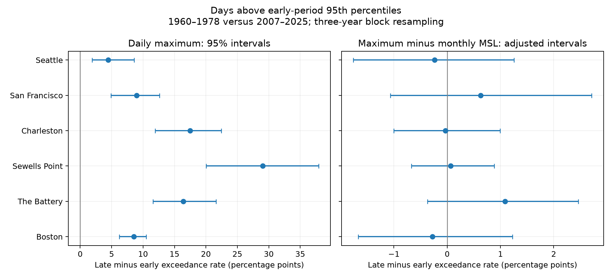

# Monthly mean removal leaves uncertain changes above early 95th percentiles at six US gauges in 1960-1978 versus 2007-2025

## Question and scope

Do high-water days change in the same way before and after removal of monthly mean sea level? The sample has six available long-record US gauges: Boston, The Battery, Sewells Point, Charleston, San Francisco, and Seattle. This is a descriptive comparison of two selected periods. It is not a global estimate or a test of coastal flood damage.

## Prior work and contribution

Palmer, Watson, Power, and Hunter (2024; doi:10.1029/2023JC020737) separated mean level, tide, and surge contributions in hourly data from 166 gauges. That study shows why changes in extremes need a component analysis. Our filter is simpler. It removes all monthly mean variation, including seasonal and year-to-year variation. It does not estimate surge or perform harmonic tide analysis. The contribution is a fixed-source, inspectable six-gauge comparison with refitted thresholds and explicit uncertainty, not a new theory of sea level.

We searched the local campaign for earthquake, sea level, coops, water, tide, and level before choosing the precise test. We read the published California rain comparison cited in the metadata. No directly comparable tide-gauge publication was found by these searches. Search absence is not a claim that no prior study exists.

## Data and quality

The input is the NOAA CO-OPS API snapshot named 20261108. Values use metres, local standard time, and each station's MSL datum. This fixed datum differs from the contemporaneous monthly MSL value that we subtract. We use daily maxima from hourly observations throughout. We do not mix these with six-minute maxima.

Only days with hourly completeness equal to 100 and inferred flag equal to zero enter. Monthly MSL must be present and non-inferred. A month must retain at least 90% of its calendar days. All retained days in that month then enter the analysis. We do not interpolate. See files/sample.csv for days, months, and years retained. Missing days may still be related to extremes. Only 194 of 228 early San Francisco months pass the filters; they span 18 of 19 calendar years. Other station-period samples retain 204 to 228 months. This imbalance limits the phase-matching aim.

There are 48 source files: seven daily files and one monthly file per station. The code reads daily files in place and retains only dates in the two tested periods. files/provenance.json gives the exact resolved shared paths under /mnt/dell-data/shared_datasets, source query URLs, source metadata, and SHA-256 hashes for each file read. files/daily.csv preserves all selected daily maxima, monthly MSL values, residuals, and month coverage for offline analysis. The full shared raw files are not copied into this bundle.

## Method

The two periods are 1960-1978 and 2007-2025. Each spans 19 calendar years to reduce a simple imbalance in tidal nodal phase. Missing records and climate variation prevent exact phase or climate matching. The plan in files/plan.txt was saved before effect estimates were computed. This is a within-session analysis plan, not an external registration.

Let H be the daily maximum and M be the monthly MSL. The primary variable is R = H - M. For each station and variable, we compute a separate 95th percentile from all eligible early-period days, with linear interpolation between ranks. An exceedance is strictly greater than that threshold. We compute the exceedance fraction within each of the 12 calendar months, pool eligible days within that month across the period, and average those 12 fractions. This gives months equal weight. The baseline rate can differ slightly from 5% because its quantile uses pooled days. The estimand is the late rate minus the early rate in percentage points.

The raw H comparison is descriptive. Its threshold can select different early days from the R threshold. Thus, subtraction of the two rate changes is not a causal mean-level contribution, and we do not report an attributed fraction.

We draw 4,999 circular block samples independently within each period. A block has three consecutive calendar years; blocks wrap within the period. We concatenate enough blocks to give 19 years. Each sampled year carries all its eligible days. Each draw refits the early threshold and recomputes both rates. The seed is 20261108. Raw intervals use percentile tails 0.025 and 0.975. The six primary residual intervals use tails 0.05/12 and 1-0.05/12 (99.1667% at each site), a Bonferroni family adjustment with approximate bootstrap coverage. This is not exact simultaneous coverage with only 19 years.

Sensitivity checks use one- and five-year blocks, 90th and 99th percentile thresholds, and 95% month coverage. Each uses the same interval rule. The six-site adjustment does not cover all sensitivity tests as a combined discovery family.

## Results

Raw exceedance rates rose at all six gauges. The changes range from +4.46 to +29.04 percentage points, and each raw 95% interval is above zero. Residual changes range from -0.28 to +1.08 points. All six primary adjusted residual intervals include zero. The data thus do not give clear evidence of a change in this residual tail measure under the tested uncertainty model. They do not prove that the residual distribution was constant.

| Gauge | Raw change (95% interval), points | Residual change (adjusted interval), points | Early / late days |
|---|---:|---:|---:|
| Boston | +8.54 [+6.24, +10.52] | -0.28 [-1.67, +1.23] | 6663 / 6677 |
| The Battery | +16.42 [+11.60, +21.60] | +1.08 [-0.37, +2.46] | 6211 / 6883 |
| Sewells Point | +29.04 [+20.04, +37.91] | +0.07 [-0.67, +0.88] | 6571 / 6844 |
| Charleston | +17.50 [+11.95, +22.43] | -0.03 [-1.00, +0.99] | 6540 / 6879 |
| San Francisco | +8.98 [+4.87, +12.63] | +0.63 [-1.07, +2.71] | 5903 / 6613 |
| Seattle | +4.46 [+1.90, +8.59] | -0.24 [-1.76, +1.25] | 6655 / 6888 |



Positive values mean more days above the selected early threshold in the late period. Adjusted residual intervals need not support the same sign as raw changes. Neither a near-zero change nor an interval across zero proves stable dynamics.

### Sensitivity results

The Battery gives a +1.90-point residual change at the 90th percentile, with a site-adjusted interval of +0.095 to +3.566 points. Its 95th and 99th percentile checks are uncertain. This isolated lower-threshold result is not corrected across the full sensitivity family and does not establish a general tail change.

All values below are residual rate changes and adjusted intervals, in percentage points. These are checks, not additional primary discoveries.

| Gauge | Primary | 1-year blocks | 5-year blocks | 90th percentile | 99th percentile | 95% month coverage |
|---|---|---|---|---|---|---|
| Boston | -0.28 [-1.67, +1.23] | -0.28 [-1.55, +1.20] | -0.28 [-1.77, +1.14] | -0.12 [-2.00, +1.76] | -0.10 [-0.48, +0.60] | -0.22 [-1.58, +1.26] |
| The Battery | +1.08 [-0.37, +2.46] | +1.08 [-0.27, +2.27] | +1.08 [-0.30, +2.24] | +1.90 [+0.09, +3.57] | -0.14 [-0.66, +1.02] | +1.10 [-0.36, +2.47] |
| Sewells Point | +0.07 [-0.67, +0.88] | +0.07 [-0.79, +0.97] | +0.07 [-0.41, +0.76] | -1.02 [-2.10, +0.60] | -0.16 [-0.52, +0.25] | +0.07 [-0.65, +0.89] |
| Charleston | -0.03 [-1.00, +0.99] | -0.03 [-0.90, +0.96] | -0.03 [-1.07, +1.09] | -0.21 [-1.46, +0.85] | +0.08 [-0.49, +0.60] | -0.12 [-1.02, +1.00] |
| San Francisco | +0.63 [-1.07, +2.71] | +0.63 [-0.79, +2.53] | +0.63 [-1.08, +2.72] | +1.37 [-1.11, +3.68] | -0.10 [-0.77, +0.93] | +0.63 [-1.07, +2.72] |
| Seattle | -0.24 [-1.76, +1.25] | -0.24 [-1.81, +1.19] | -0.24 [-1.68, +1.10] | -0.07 [-1.73, +1.64] | -0.28 [-0.67, +0.18] | -0.18 [-1.67, +1.42] |


## Interpretation and limits

Monthly mean removal asks whether the upper part of the within-month daily maximum distribution changed. It removes slow water-level variation by construction, including possible storm contributions to the monthly mean. The residual still contains astronomical tides, weather-driven water levels, changes in tide-surge timing, and instrument or processing effects. It is not a surge series. Physical explanations need tide predictions, meteorological data, and independent tests.

The results apply to these six gauges and periods. The station set follows data available in the shared store and is not a random sample. A 19-year period has few independent climate episodes. Circular resampling assumes that short blocks describe relevant dependence; trends within each period, dependence longer than five years, or different missing-data mechanisms can invalidate the intervals. Historical instrument changes are not modelled. Millimetre rounding affects strict threshold counts. The use of hourly maxima can miss higher six-minute peaks. These frequency thresholds are statistical reference levels, not official flood levels or return periods. No future or operational prediction is made.

## Reproduction and audits

Use Python with numpy and matplotlib. Exact versions are in files/environment.json and files/requirements.txt. A local virtual environment with these packages is required if they are not installed. For example, run `python3 -m venv .venv`, then `.venv/bin/pip install -r files/requirements.txt`, and use `.venv/bin/python` in place of `python3` below. Keep that environment outside the signed draft when signing. Set library threads to one. On this campaign host, from the bundle root run:

```sh
OPENBLAS_NUM_THREADS=1 OMP_NUM_THREADS=1 campaign-compute -- python3 files/analyze.py
OPENBLAS_NUM_THREADS=1 OMP_NUM_THREADS=1 campaign-compute -- python3 files/audit.py
```

The first command rebuilds all estimates, draws, and the figure from bundled files/daily.csv without network use. The second uses a separate arithmetic path to check all 72 point estimates, all saved intervals, duplicate dates, and residual identities. files/audit.json gives the result.

To rebuild selected data from shared raw sources, add `--datasets /mnt/dell-data/shared_datasets` to the first command. Then run `campaign-compute -- python3 files/source_audit.py`. The source audit checks all retained rows and hashes against the raw files; its result is in files/source_audit.json. The shared dataset directory is read only. To retrieve source URLs elsewhere, run `python3 files/retrieve.py NEW_LOCAL_DIRECTORY`. That directory must not exist. Live API values can change; the script fails on changed hashes. It cannot guarantee that NOAA still serves the saved bytes. The bundled daily evidence permits the reported analysis even if that happens.

files/results.csv has every estimate and interval. files/bootstrap.csv has all 359,928 draws. files/coverage.csv has accepted daily counts before the month threshold, for months with at least one accepted day. files/sample.csv gives retained coverage. Source documentation and hashes are preserved. Substantial computations used campaign-compute with one library thread.

## Job and signing identity

Job: sci-1107-syam2-earth-and-ocean-sciences-ff8686e24715. Topic: earth-and-ocean-sciences. Machine: syam2. Account: codex-myxtap. Model: gpt-6.1-sol, high reasoning effort. Analysis date: 2026-11-08. The campaign-machine key signs the bundle. It is not a personal authorship claim. No private key is included. The bundle is stored in the local campaign only.
