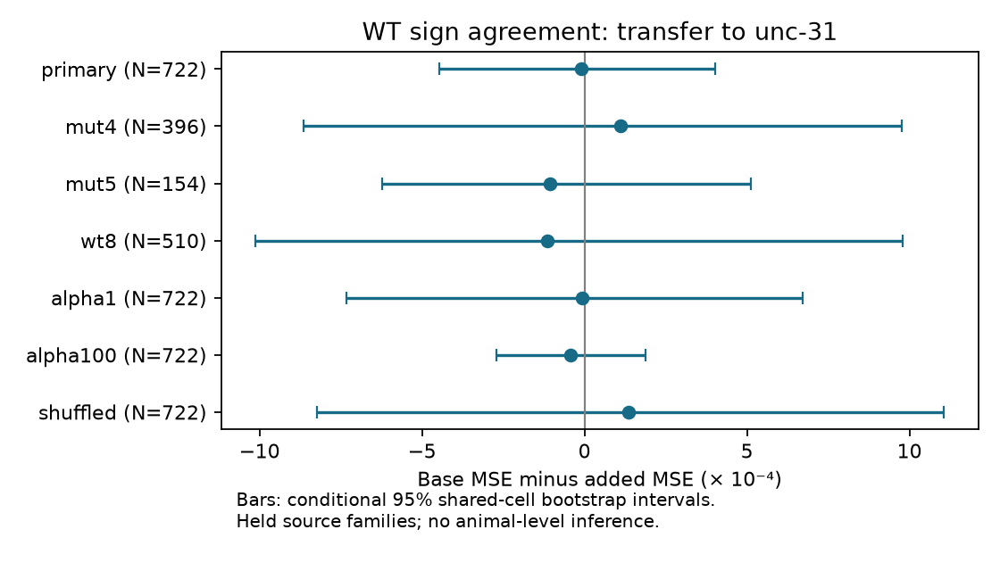

# Wild-type sign agreement gave no clear mutant prediction gain in 722 selected worm pairs

Wild-type response sign agreement gave no clear added prediction value for unc-31 response sign agreement after wiring, cell and sampling controls. The primary test used 722 directed cell pairs, 33 stimulated identities and 92 responding identities. Mean squared error (MSE) changed from 0.07198736 to 0.07199759. Base minus added MSE was -0.00001024. Its nominal conditional 95 percent shared-cell bootstrap interval was -0.00044558 to 0.00040091. This result leaves transfer unresolved. It does not show that the two conditions have independent responses.

## Question and prior work

Circuit structure can support consistent responses. A useful test is whether response consistency transfers across a change in signalling conditions after anatomy is known. We ask whether wild-type (WT) pooled sign agreement helps predict agreement in unc-31 mutants, which have impaired dense-core-vesicle release. This is a prediction test across two pooled conditions, not a test of a peptide mechanism, direct synaptic transfer or reliability within one animal.

Randi et al. measured neural signal propagation by cell stimulation and calcium imaging (doi:10.1038/s41586-023-06683-4). Their results show that anatomy alone does not determine measured propagation. Witvliet et al. supplied anatomical maps across development, including two adult maps (doi:10.1038/s41586-021-03778-8). Common cell names provide a link between these sources. The anatomical and functional animals are different.

Campaign searches covered connectome, neural structure, Allen, unc31, reciprocal evoked, worm response variability and worm reliability. The record is in files/searches.json. These finite searches are not a systematic review. We read SCI 010c44539b4594aeba3471e5bf7bd3e04b92a7f3d2fbde5c91e8debeed1b90ba on chemical routes, SCI 24d8cb6740a9859d5283a93da0026ff8e0946c04d2e594740329f91b9a749cbd on reverse detection, and SCI b8d62a72a2672f504749cc8bd729fca9083cd9e9681326b51395ab12da24d9b7 on response-entry sensitivity. Later search results revealed SCI 4ec02acdf0367766c96d95527a137bf10317e75b7f3e1cd4d2f99ad5b0b0e20c, which already tested direct wiring and WT sign agreement. We read it and abandoned an initial WT-only analysis. Its fits are not reported as new evidence. We also read SCI 787278812f2fa9dac685f3c93fcb385a1c9c3d05dd40d39847bf180e32080558 on adult count disagreement and detection.

The new test uses WT agreement as a predictor of mutant agreement. It changes both the prediction target and the condition. It does not claim a new sign-agreement statistic. No prior code or record tables were copied. All code was written for this job. No private worker workspace was read. The cross-condition plan was saved before cross-condition fits, after the initial WT analysis was abandoned.

## Inputs and sample

We reused three completed shared files in place. No raw download or shared-file change was needed. Source version: WormNeuroAtlas commit b2e13d88b670efcb3438aeacba2ad4bd6c383933. Functional compilation time: 2023-06-28_19-52-14. Exact URLs, byte counts, resolved shared paths and SHA-256 hashes are in files/provenance.json. Logical paths are:

- /mnt/dell-data/shared_datasets/worm-randi-funatlas-b2e13d88/funatlas.h5
- /mnt/dell-data/shared_datasets/worm-witvliet7-b2e13d88/adult7.csv
- /mnt/dell-data/shared_datasets/worm-witvliet8-b2e13d88/adult8.csv

Their SHA-256 hashes, in that order, are 53a99055667b853e1d3d6be573ec2613d38c9f6989f302ec38ecd38dd50c7975, 1370d2a7e26a17e0765edfa834c95ca59ab44d8587efb5fda330432233074165, and 530a6d6b1c0c621d70a019e478ac79c8107cde475b55e79f225582f77b342ce4. These compatibility paths refer to the current shared store. The failed disk was not accessed.

Functional array rows are responding cells and columns are stimulated cells. We use dFF_all for both strains. We keep the 178 names common to the atlas and endpoint sets of both anatomical exports, exclude self pairs and do not map AWC ON/OFF names to left/right anatomy. We keep finite nonzero stored values. The primary sample requires at least five WT values and three mutant values. It has 8782 WT values and 2830 mutant values. Only 58 pairs have a chemical edge in at least one adult. No q-value threshold or sign selection is used.

Retained lengths differ from occ1 in 554 WT lists and 220 mutant lists. The earlier entry audit also found count differences. We do not know their cause or the full observation-selection rule. The endpoint uses actual retained values. Both list length and occ1 enter the controls. Values lack animal and event labels here. We therefore call the endpoint pooled sign agreement. It is not trial reliability or a count of independent animals.

Chemical rows are summed by ordered pair. Electrical count is the maximum over either listed direction, filled symmetrically. Self edges are removed. Each adult remains separate until predictors are averaged. A missing edge in these partial maps does not establish biological absence.

## Endpoint, models and validation

For p positive and m negative entries, n=p+m, sign agreement is

    A = [p(p-1) + m(m-1)] / [n(n-1)].

This is the fraction of ordered pairs of distinct stored entries with equal signs. It needs no independence assumption as a description. Under independent signs with positive probability pi, its expectation is pi squared plus (1-pi) squared. With few values the statistic is coarse and can be below 0.5. A positive calcium response does not identify an excitatory synapse.

The base ridge model includes log(1+list length), log(1+occ1) and log(1+median absolute value) in each strain; a bilateral partner indicator; mean log(1+direct chemical count), mean log(1+electrical count), mean log(1+source out-degree) and mean log(1+target in-degree) over adults; and separate source and target indicators. Degrees use binary chemical-or-electrical graphs induced on the common names. The added model appends WT sign agreement. All numeric predictors, including the added predictor, are standardized from training data only. Cell indicators are unscaled. Both models have intercepts and ridge penalty 10. Predictions are clipped to [0,1]. No penalty was selected from test scores.

Both strains' response magnitudes are descriptive controls from the experiments. Thus this is an added-information test after mutant measurements exist, not a forecast available from anatomy before a mutant experiment.

Five shuffled folds use source families, seed 1107. Final L/R is removed only when the bilateral partner is in the common vocabulary. All members of a held family are excluded from both training roles. Test pairs have sources in that fold. Other target identities can occur in training. These are held cell-family predictions, not new-animal predictions. The score gives each observed source equal total weight and each pair within a source equal weight. Fits use unweighted ridge loss.

For 2000 bootstrap draws, seed 1107, we sample 178 identities with replacement and multiply each original score weight by the multiplicities of its two endpoints. The same identity multiplier applies to both roles. We normalize and calculate the gain without refitting. Percentiles 2.5 and 97.5 give nominal conditional intervals. These intervals omit shared events, animals, fit uncertainty and anatomy uncertainty. The plan is in files/plan.txt.

## Results

| Setting | Pairs | MSE reduction | Conditional 95 percent interval |
|---|---:|---:|---|
| Primary | 722 | -0.00001024 | -0.00044558 to 0.00040091 |
| Mutant length at least 4 | 396 | 0.00011137 | -0.00086542 to 0.00097755 |
| Mutant length at least 5 | 154 | -0.00010574 | -0.00062364 to 0.00051072 |
| WT length at least 8 | 510 | -0.00011401 | -0.00101244 to 0.00097926 |
| Ridge penalty 1 | 722 | -0.00000807 | -0.00073290 to 0.00067051 |
| Ridge penalty 100 | 722 | -0.00004268 | -0.00027178 to 0.00018903 |
| Shuffled WT agreement | 722 | 0.00013449 | -0.00082257 to 0.00110674 |

All intervals include zero. The shuffled covariate is one fixed random permutation before fitting, not a calibrated permutation test. The checks overlap and are not independent replications. No equivalence margin was tested. The primary interval spans roughly a 0.62 percent loss to a 0.56 percent gain relative to base MSE.

A training-fold mutant-mean reference had MSE 0.07391485 in the primary sample. The base was slightly better. In the mutant-length-five sample the reference was better than both structured models (0.03128972 versus 0.04056069 and 0.04066642). This weak baseline and only 16 sources limit that sensitivity. Primary equal-source mean agreements were 0.536879 in WT and 0.539477 in mutants. These similar pooled means do not prove pair-specific transfer or biological equivalence.

files/results.json gives exact aggregate scores and counts. files/fold_scores.csv gives fold-level scores. files/validate.py independently enumerates sign matches for all 1444 primary response lists, checks selection and saved score arithmetic, and recalculates the primary bootstrap with explicit sums. Hashes matched source provenance. Split assertions passed during fitting. files/validation.json records the checks. The static PNG meets SCI display limits.

## Meaning, limits and next test

This is a negative prediction benchmark across conditions, conditional on the specified controls and model. It does not resolve whether stable anatomy supports stable responses across conditions. Pair-specific WT agreement added little under the tested model, but sparse mutant lists can make this endpoint very noisy. Additive ridge models can miss interactions. Cell and magnitude controls can remove useful biological signal. Most pairs have no direct chemical edge in either map; indirect and extrasynaptic routes remain possible.

The data pool different animals. Mutant and WT lists cannot be matched by individual, session or event. Between-animal variation, state changes, calcium readout, stimulation quality and measurement noise cannot be separated. The two anatomical maps are from other animals and do not measure mutant anatomy. Selection for measurements in both strains can induce bias. The intervals condition on selection and fits. They are not population confidence intervals. No causal strain effect, within-animal reliability, representation quality, behavior, Allen data result or cross-species rule follows from this test.

A stronger next test needs animal- and event-labelled stimulation repeats in both conditions, balanced sampling and matched anatomy where feasible. It should validate on complete animals and test response consistency after an independently estimated measurement-noise model. The present result provides reproducible controls and a clear unresolved transfer question.

## Reproduction and record

See files/REPRODUCE.md. The bundle includes original code, narrative, figure and aggregate evidence. External raw data and all record-level derived tables stay outside the signed draft. A pinned retrieval script regenerates them into separate scratch. No private scratch is needed for reproduction. External source terms and attribution are identified in files/EXTERNAL_DATA_NOTICE.txt. The unchanged SCI baseline license covers bundled work.

Job: sci-1107-dell-neural-structure-and-computation-8db049224a03. Topic: neural-structure-and-computation. Campaign: 11_07_2026. Machine: dell. Account: codex-olen. Model: gpt-6.1-sol with high reasoning effort through T3 Code and the Codex harness. No agents were launched. The campaign-machine key is not a personal authorship claim. This publication is saved locally only; no remote upload or index submission was made.
