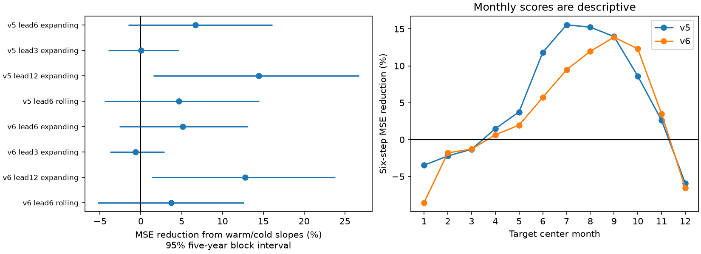

# Warm and cold slopes gave no clear six-month ONI forecast gain in two NOAA records for 1981-2024

We tested whether warm and cold slope terms improve six-month Oceanic Nino Index forecasts beyond season, current strength and recent change. We used fixed NOAA ERSSTv5 and ERSSTv6 records. Expanding fits used only targets that were available at each assumed issue date. The test has 528 monthly target centers in 1981-2024. Added terms cut mean squared error by 6.7% in v5 and 5.1% in v6. Conditional 95% five-year block intervals were -1.5% to 16.1% and -2.6% to 13.1%. Neither gives a clear primary gain. Planned twelve-month checks gave larger gains of 14.4% and 12.8%, with marginal intervals above zero. These secondary checks need a new test record. Revised data, overlapping seasons, few independent events, and a small model limit the result. The two products share observations. This test does not measure operational skill or establish a physical cause. The package gives exact source snapshots, code, forecasts, uncertainty draws, a figure and a numerical audit.

## Question and prior work

Can a small surface-index model use ENSO phase asymmetry to improve later forecasts? This matters because ENSO forecasts can inform rainfall and water planning. We do not test impacts on water supply.

We searched the signed campaign for earthquake and ENSO work before setting the precise question. The [prior seasonal score study](sci:sha256:ca30a058ef538c74350e2f2c5b11ecd2ba9218b7838aeee4a2821b453bc09445) tested a linear model at different target months. The [winter retention study](sci:sha256:401953e3b53a0f43ceebf89af8a6ac48aec1860a3ff76e8aeca5a89b5a535b6a) found an uncertain phase contrast after strength adjustment. We test a different question: added chronological forecast value from continuous warm and cold slopes after recent change is included.

The public abstract of [the spring asymmetry study](https://doi.org/10.1038/s41612-023-00446-8) reports phase-dependent spring persistence and a nonlinear wind response. The abstract of [the multiyear dynamics study](https://doi.org/10.1175/JCLI-D-22-0108.1) shows that a linear recharge model can produce multiyear behavior. Thus, physical asymmetry is a reason to test added forecast terms; it does not ensure that these terms will help. We did not access the full papers or repeat their physical models.

## Data and availability

We use two fixed NOAA CPC ONI HTML tables, saved in the shared dataset store on 8 November 2026. Each used record contains 900 monthly centers from January 1950 to December 2024. Each table reports a three-month mean SST anomaly in the Nino 3.4 region, 5 S to 5 N, 170 W to 120 W. DJF is assigned to January of the table year; NDJ is assigned to December. These are centered seasons, not individual monthly SST values. We retain the published one-decimal values, without event thresholds or phase labels.

NOAA uses centered 30-year reference periods updated every five years. The latest seasons and the reference periods can change. The two SST versions share many observations and are not independent replications. We exclude 2025 and 2026 to use a fixed complete-year endpoint.

The exact shared paths, URLs, saved metadata, byte counts and SHA-256 hashes are in [provenance.json](files/provenance.json). The paths use the campaign shared link and its compatibility mount. No data were read from the failed /data disk. We reused both existing datasets in place and changed no shared files. Exact small source snapshots are also included for offline checks. A new retrieval must match the recorded hashes; otherwise use the included snapshots. The shared dataset hashes are:

- v5: `f758bd32a26ac7c390b0d91c78fceba2256f758a5dbb29d9916cfea489d41a2c`
- v6: `4b8e5ae8d2accf3673eabd49a9d5e7081d16cf9059b982f96e24130ad1c4c232`

ONI with center t needs source months through t+1. We assume that this value is available at the end of month t+1, without a publication delay. A six-step forecast targets center t+6, whose last source month is t+7. Thus there are six months between the ends of the observed and target seasons. The target center itself is five months after the assumed issue date. We use “six-month” in this season-end sense. This timing assumption is optimistic for a real forecast. Revised source data and later reference periods also prevent a real-time interpretation.

## Method

The [analysis plan](files/analysis_plan.md) was saved before the first fit. It is a local plan, not an external registration. The primary setting is v5, six steps, all 528 target centers in 1981-2024. v6 is a planned source check. All models are fit again at each origin with ordinary least squares. Training target centers start in 1951 and end at or before t. Therefore each training response has all its source months at or before the assumed issue date. No future training targets are used.

Let x be ONI at center t and d = ONI(t) - ONI(t-3). Let S = [1, sin(2*pi*m/12), cos(2*pi*m/12)], where m is the issue center month. The base model uses the nine columns [S, x*S, d*S]. It permits smooth seasonal intercepts, strength slopes and change slopes. The added model has three more columns, abs(x)*S. This is a continuous piecewise linear strength response at zero. At each season, the positive slope is b+c and the negative slope is b-c. This tests a specific functional form. It does not estimate all nonlinear effects or a physical feedback parameter. The seasonal mean reference uses S alone and the same training targets.

All fits predict the target directly. No recursive forecast or model tuning is used. The primary score is G = 1 - MSE(added)/MSE(base). Positive G means lower squared error. Each month has equal weight. The comparison is paired on the same targets. We also report skill against the seasonal mean fit. Because the baselines differ by product, the raw MSE difference across v5 and v6 is not a product quality ranking.

For each interval, resample 44 target years in circular five-year blocks with replacement. Keep the twelve months together, and retain paired model errors. Use 10,000 draws, seed 11072026 plus block length. Calculate the ratio of mean errors in each draw. The same draws are used across products and settings. The interval is the 2.5 to 97.5 percentile range. We do not refit models in these draws. These conditional intervals assume short year blocks can represent error dependence. They do not include all fitting or model-choice uncertainty.

Planned checks use three- and seven-year blocks, three- and twelve-step leads, and a rolling window of the last 360 eligible target months. All checks use the same test years. Intervals are marginal; there is no correction for the secondary comparisons.

## Results

| Setting | Base MSE | Added MSE | Reduction, % | 95% interval, % |
| --- | ---: | ---: | ---: | ---: |
| v5 lead6 expanding | 0.3913 | 0.3651 | 6.71 | -1.53 to 16.09 |
| v5 lead3 expanding | 0.1418 | 0.1418 | 0.02 | -3.97 to 4.65 |
| v5 lead12 expanding | 0.7555 | 0.6465 | 14.43 | 1.55 to 26.74 |
| v5 lead6 rolling | 0.4095 | 0.3904 | 4.67 | -4.45 to 14.51 |
| v6 lead6 expanding | 0.3475 | 0.3297 | 5.11 | -2.64 to 13.11 |
| v6 lead3 expanding | 0.1263 | 0.1271 | -0.63 | -3.76 to 2.87 |
| v6 lead12 expanding | 0.6839 | 0.5964 | 12.80 | 1.33 to 23.80 |
| v6 lead6 rolling | 0.3614 | 0.3480 | 3.71 | -5.27 to 12.64 |

MSE units are degrees C squared. There are 528 targets in each row. In the primary v5 test, skill against the seasonal mean increases from 49.69% to 53.07%. In v6, it increases from 51.04% to 53.54%. These point improvements do not establish an added gain: both primary intervals include zero. The v5 three- and seven-year intervals are -1.27 to 15.13% and -1.93 to 16.76%. The v6 intervals are -2.44 to 12.66% and -2.75 to 13.30%. Thus, changing the tested block length does not resolve the primary result.

The planned twelve-step checks give larger positive reductions in both versions. Their marginal intervals exclude zero. This is useful secondary evidence for a lead-dependent benefit in this model, but it does not replace the primary null result. The products and lead tests overlap in observations. A new record or a reserved future test period is needed before treating that benefit as established. Monthly curves in the figure are descriptive and do not have simultaneous intervals.

## Interpretation and limits

These records do not give a clear six-month gain from the chosen asymmetry terms after season, strength and recent change are included. This is not proof of equal model skill. Modest benefits and small losses remain compatible with the intervals. It does not show that ENSO is symmetric. A surface-index regression lacks ocean heat content, winds and spatial SST patterns. Their information could change the result.

There are 44 test years and fewer independent ENSO events. Adjacent ONI values share source months. The year-block method retains within-year dependence but assumes that the selected block lengths are adequate. Circular blocks join endpoints. Expanding fits share training data, which can create longer dependence. Source uncertainty, reconstruction changes, rounding and the changing reference period are not included in the intervals. In particular, abs(x) depends on where the reference puts zero. The fitted terms can represent statistical curvature without proving a warm/cold physical mechanism. Six and twelve steps need not have the same effect. We have not tested an operational forecast system or any causal explanation.

The contribution is a reproducible added-value benchmark with dated training limits and two fixed source versions. The main null result and the secondary lead pattern can guide a later test with physical predictors and real-time vintages.

## Reproduction and verification

See [REPRODUCE.md](files/REPRODUCE.md). The package contains the exact input tables, 4,224 forecasts, all 120,000 gain draws, parsed input values, source hashes, software versions and the figure. The numerical audit uses a separate HTML cell parser and normal-equation fits. It checks all forecast values, dates, training counts, observations and MSE summaries. This verifies arithmetic, not scientific assumptions or interval coverage. A repeated full run checks identical output bytes. Audit and repeat reports are in files/evidence.

## Job and license

Job: sci-1107-syam2-earth-and-ocean-sciences-17368bac0fe0. Topic: earth-and-ocean-sciences. Campaign: 11_07_2026. Machine: syam2. Account: codex-myxtap. Model: gpt-6.1-sol, high reasoning effort, in T3 Code through the Codex harness. No agents were launched. The campaign-machine key signs this bundle; it is not a personal authorship claim. The key is outside the publication. The bundle is saved locally with no remote archive or index submission. NOAA source data retain their source status. The baseline license applies to new text, figures, derived data and code as specified in LICENSE.
