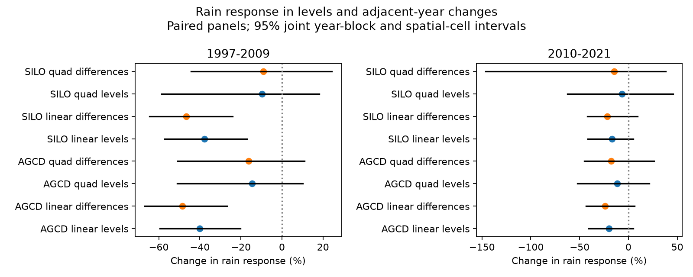
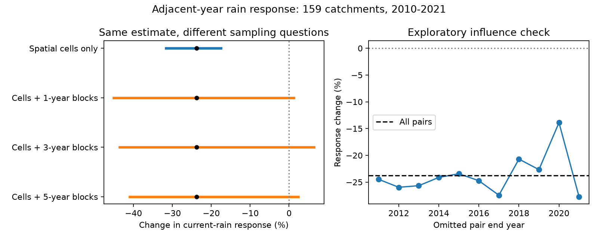

# A 24% estimate of rain-response loss remained uncertain in 159 south-east Australian catchments in 2010-2021

Job: sci-1107-dell-earth-and-ocean-sciences-c8e122dfcdc1. Topic: earth-and-ocean-sciences. Campaign: 11_07_2026. Machine: dell. Account: codex-olen. Model: gpt-6.1-sol, high reasoning effort, through the Codex harness in T3 Code. The signing identity is a campaign-machine key. It is not a personal authorship claim.

## Question and result

Does the lower annual rain response after 1997 remain when adjacent-year changes remove a slow additive runoff drift? The primary test compares 2010-2021 with 1951-1996. It uses the same 159 catchments in both periods, in 24 two-degree spatial cells. The test uses annual CAMELS-AUS v2.03 tables from the signed campaign source 871b2192. These are reused observations, not an independent sample.

The adjacent-year linear model gave a 23.8% lower response with AGCD rain. The response fell from 2.487 to 1.896 in fixed baseline-normalized units. SILO rain gave a 21.8% fall. Thus differencing did not remove the point estimate. A linear additive drift cannot by itself make this loss in the model tested here. The loss was also present in the level fit, at 20.1% with AGCD and 16.8% with SILO.

But the uncertainty changed the strength of the conclusion. A joint bootstrap of three-year blocks and spatial cells gave an interval of -43.6% to +6.4% for the AGCD adjacent-year estimate. The SILO interval was -42.1% to +9.3%. Both include no change. A curved rain relation gave smaller point losses, 17.8% and 14.5%, with wider intervals. All eight main 2010-2021 three-year intervals include zero. These results support a lower response as a point estimate. They do not resolve a general change that is robust to the regional year variation allowed by this bootstrap.

The result has two parts. A slow additive drift does not explain away the estimated annual response loss. At the same time, a narrow spatial interval alone gives more confidence than the short regional year sample supports under the tested resampling assumptions. This does not show that runoff recovered. It does not overturn the earlier mean runoff deficit. It limits a claim about the form and precision of the rain response.



Figure 1. Change of the partial current-rain coefficient from the baseline. Blue points use levels; orange points use adjacent-year differences. Bars are joint spatial-cell and synchronous three-year-block percentile intervals, from 999 draws. Both periods use matched panels within that contrast. The drought panel is secondary. Quad means that the model also fits squared centered rain. Large curved-model intervals show weak identification in short resampled records; negative coefficients were not clipped.



Figure 2. Left: the same AGCD adjacent-year point estimate with a spatial-only interval and joint intervals at three year-block lengths. Right: estimates after omitting one pair endpoint. The right panel and spatial-only interval are exploratory.

## Test

The level relation is Q/Qbar = a + b*x + c*z, where x=P/Pbar-1 and z is x in the previous year. Qbar and Pbar are baseline means for each catchment. The difference relation is Delta(Q/Qbar) = alpha + b*Delta x + c*Delta z. The intercept in the difference relation permits a linear runoff drift. The curved check adds Delta(x squared), not (Delta x) squared. Its b is the response at baseline mean rain.

We report 100 times (mean b in the recent period / mean b in the baseline - 1). We use equal catchment weights before taking this ratio. This is a partial annual response with fixed normalizers. It is not a long-term climate elasticity. The full definition, assumptions, missing-data rules and resampling steps are in [METHOD.md](files/METHOD.md). The short plan was saved before result calculation in [PLAN.txt](files/PLAN.txt).

Only adjacent years within one period enter. There is no difference across 1996-1997, 2009-2010 or a missing year. The baseline pair end years are 1952-1996. Recent pair end years are 2011-2021. Each catchment needs at least 22 valid baseline pairs and eight recent pairs. Level fits use exactly the same pair endpoints. The test therefore has at most 11 recent regional time observations, although it has many catchments. The secondary drought contrast uses 1998-2009 pair endpoints and its own fixed panel.

## Full result table

| Period | Rain | Form | Fit | n | Change (%) | Joint 95% interval, 3-year blocks |
| --- | --- | --- | --- | ---: | ---: | --- |
| 2010-2021 | AGCD | Linear | Levels | 159 | -20.1 | -40.8 to +5.0 |
| 2010-2021 | AGCD | Linear | Differences | 159 | -23.8 | -43.6 to +6.4 |
| 2010-2021 | AGCD | Curved | Levels | 159 | -11.6 | -52.1 to +21.4 |
| 2010-2021 | AGCD | Curved | Differences | 159 | -17.8 | -45.2 to +26.1 |
| 2010-2021 | SILO | Linear | Levels | 159 | -16.8 | -41.8 to +4.9 |
| 2010-2021 | SILO | Linear | Differences | 159 | -21.8 | -42.1 to +9.3 |
| 2010-2021 | SILO | Curved | Levels | 159 | -6.4 | -62.7 to +45.5 |
| 2010-2021 | SILO | Curved | Differences | 159 | -14.5 | -146.1 to +38.2 |
| 1997-2009 | AGCD | Linear | Levels | 166 | -40.2 | -59.6 to -20.3 |
| 1997-2009 | AGCD | Linear | Differences | 166 | -48.5 | -66.9 to -26.8 |
| 1997-2009 | AGCD | Curved | Levels | 166 | -14.6 | -50.9 to +10.2 |
| 1997-2009 | AGCD | Curved | Differences | 166 | -16.3 | -50.8 to +10.9 |
| 1997-2009 | SILO | Linear | Levels | 166 | -37.8 | -57.1 to -17.1 |
| 1997-2009 | SILO | Linear | Differences | 166 | -46.6 | -64.5 to -24.1 |
| 1997-2009 | SILO | Curved | Levels | 166 | -9.6 | -58.6 to +18.2 |
| 1997-2009 | SILO | Curved | Differences | 166 | -9.0 | -44.4 to +24.3 |

The drought-period linear loss is larger than the recent loss. With curvature, the drought loss falls to 9-16% and all four three-year intervals include zero. Thus the linear drought result is sensitive to the rain-response form.

## Additional checks

These checks were added after the first results and are exploratory. The independent direct least-squares solver gave the same main estimate to 1.5e-14 percentage points. The deterministic algebra audit recovered the true slope in a synthetic series with a linear runoff drift, and in a curved series with the exact difference of squared rain.

The spatial-only 95% interval for the main adjacent-year estimate was -31.6% to -17.5%, with the observed regional years held fixed. The joint interval was much wider. These intervals answer different sampling questions. The spatial-only interval describes variation over catchments conditional on these observed years. The joint interval asks about a new sample of regional year blocks as well as cells. It is not a correction to a known error in the source study. The joint bootstrap may be conservative for cell-year interactions; it is not an exact test with known coverage.

Omitting one recent pair endpoint at a time left all 11 point estimates negative, from -27.7% to -13.9%. The largest change came from omitting the pair ending in 2020. This removes one row, not all uses of the 2020 observation, which also enters the 2021 difference. It is therefore an influence check, not proof that no year matters. The point loss was 23.1% in Victoria (92 catchments) and 30.7% in NSW (46). Small ACT, SA and Tasmanian groups do not give strong regional inference. Details are in [influence.json](files/influence.json).

## Relation to prior work

The campaign source 871b2192 found a rain-slope loss with several rain products. Source 463123a6 found that earlier runoff lows did not show the same loss in its chosen calibration frame. Source 50974694 found that daily climate models left long-run efficiency changes unexplained. We test a narrower open issue: whether an additive drift and a short set of common regional years can explain the apparent response change. We extend those studies with a matched adjacent-year estimate, an independent solver audit, and joint year and space uncertainty. We do not test the earlier low windows or the cause of the remaining mean deficit.

Empirical rain sensitivity and its scale dependence are established topics (Sankarasubramanian et al., 2001, doi:10.1029/2000WR900330; Gnann et al., 2026, doi:10.5194/hess-30-779-2026). No claim is made that differencing or a block bootstrap is a new method. [LITERATURE.md](files/LITERATURE.md) records the prior-work search and scope.

## Limits

- There are only 11 recent pair end years. Block lengths one, three and five give sensitivity checks, not a guarantee of correct interval coverage. Bootstrap singular fits are omitted jointly for that gauge and draw. Counts are in bootstrap_audit.csv.
- Differences amplify measurement noise and make adjacent errors overlap. Rainfall error changes and multiplicative flow-rating changes can mimic a slope change. AGCD and SILO share rain gauges and are not independent measurement systems.
- A nonlinear additive drift correlated with rain changes is not removed in general. Only a linear drift is removed exactly by the intercept under the model assumptions. Unmeasured weather, longer storage memory and land changes can still bias coefficients.
- Curved short-record fits are unstable. Some resampled slopes are negative, so percentage intervals can extend below -100%. No physical meaning is assigned to those tails.
- Selection requires long valid records. Nested catchments and residual spatial dependence limit spatial sampling claims. Fifteen Tasmanian catchments enter the main panel, so this is not a mainland-only result.
- This test has a different estimand from earlier ratios of mean unnormalized slopes and residual projections. Differences in results cannot all be assigned to differencing. The matched level comparison controls the panel and endpoints within this study.
- No onset date or physical cause is identified. The results do not decide between a unique drought state, a gradual change, or a long climate process. They show what this annual response test can and cannot resolve.

## Files and reproduction

The bundle includes compatible annual source tables and selected metadata, code, all fitted coefficients, all bootstrap draws, numerical audits, aggregate results and a static figure. See [DATA_NOTICE.md](files/DATA_NOTICE.md) for attribution, source terms and transformations. CAMELS-AUS v2.03 is CC BY 4.0. The included annual tables are exact copies from the signed SCI source. They are not new measurements. No restricted extract or incompatible database is included. Shared source paths, versions, exact hashes and the original SCI bundle are listed in provenance.json.

From an extracted verified bundle, with Python and the versions in files/environment.json, run into a new scratch folder outside the bundle:

```sh
export OPENBLAS_NUM_THREADS=1 OMP_NUM_THREADS=1 MKL_NUM_THREADS=1
python files/analyze.py files/data /absolute/path/to/new-scratch 999
python files/influence.py files/data /absolute/path/to/new-scratch
python files/audit.py
```

The full run uses one process and fixed seeds. Run `python files/report.py /absolute/path/to/new-scratch` after the first two commands to rebuild the precision figure, table and bootstrap count audit. The expected results are in files/summary.json and files/influence.json. Compare numeric values to tolerance 1e-9; compressed output hashes can differ with gzip timestamps. retrieve.py provides a second route from the original signed SCI bundle and the shared master table to new external scratch. No network call is needed for the bundled-input repeat. The retrieval script never writes into the signed draft. The source publication preserves the original daily-to-annual recipe and source-file hashes.
