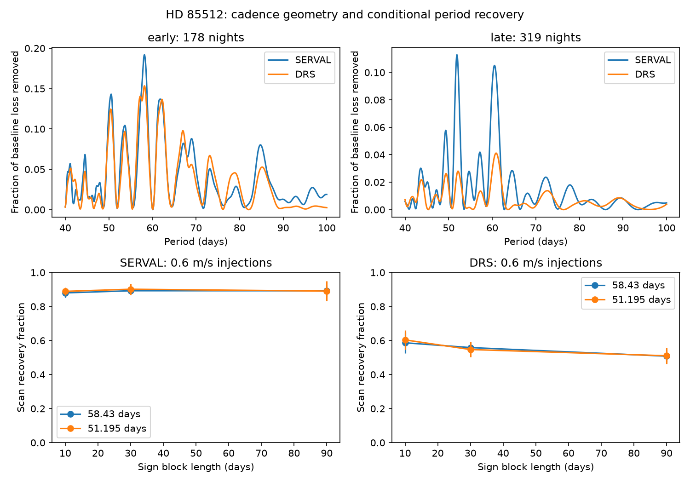

# A 51.195-day fit captures at most 31 percent of a pure 58.43-day wave after a quadratic trend in 319 late HD 85512 nights

The later observing times of HD 85512 do not force a pure 58.43-day sine wave to appear at 51.195 days. After removal of a quadratic trend, the latter fit can capture only 21.07 to 30.46 percent of the weighted energy of the former wave. These are exact linear model bounds over all phases for the stated times and weights. All 64 noise-free phase trials recover the injected period in a 40 to 100 day scan.

This result rules out exact confusion from the tested cadence and baseline alone. It does not reject a planet or prove stellar rotation. Noise can change the selected period. The conditional recovery rate for a 0.6 m/s wave depends strongly on the residual model and on one known extreme night. No new planet or physical signal is found.

The top panels show descriptive scans in the two time spans. The lower panels show recovery within two percent of the injected period for the main residual model, which removes the strongest fitted wave before residual sign draws. The lines join midpoints of phase ranges. Vertical bars show ranges over eight phases, not confidence intervals. There is no detection threshold in this recovery definition.

## Question and prior evidence

Can the observing times alone account for the reported change from a 58-day velocity signal to a signal near 51 days? Pepe et al. (2011), doi:10.1051/0004-6361/201117055, reported the candidate at 58.43 days. Laliotis et al. (2023), doi:10.3847/1538-3881/acc067, found a changing signal and favored stellar rotation. Their conclusion is prior work. We do not claim to discover that change.

We searched public prior work and the shared campaign before this precise test. Campaign searches included astronomy, GJ 3293, GJ 674, and HD 85512. We read the two verified HD 85512 publications cited in sci.json. The first tests transfer of an early wave. The second finds a large paired-reduction residual on one night. Our test adds an exact cadence bound and conditional scan-recovery trials. We reuse their data inventory, split, periods, and warning. We wrote new code. This is a selected follow-up, not a blind candidate search.

The Laliotis study provides context from other instruments as well as HARPS. We did not obtain new independent velocities. It does not independently confirm the cadence calculation or the extreme-night effect reported here. Both velocity products in this test use the same HARPS spectra.

## Input and selection

We use HARPS RVBank version 02. The frozen CSV has 1,184 exposures and 673,702 bytes. Its exact URL, credits, rights boundary, and SHA-256 are in files/EXTERNAL_DATA.md. We reused ./datasets/hd85512-harps-rvbank-v02-c7e45fd0/hd85512.csv in place. The resolved shared path is in files/summary.json. No shared file was changed.

We select BJD < 2457163, f_RV = 0, mask K5, finite required fields without missing sentinels, and positive velocity errors. This avoids the 2015 fibre change and later data. There are 1,010 selected exposures. We combine both velocity products on each floor(BJD - 0.5) night with the same exposure weights, 1/e_RV_mlc_nzp squared. The formal night error is the inverse square root of the summed weights.

There are 497 nights. We split at BJD 2455700, as in the earlier campaign study: 178 early and 319 late nights. The fit weight is 1/(night error squared + 1.5 squared), in m/s units. This noise floor is a fixed weight choice, not a fitted noise model. Using common exposure weights prevents a difference caused solely by different night averaging. It does not make the two reductions independent.

## Exact geometry test

For each span, we multiply all design columns by the square root of the fit weight. We project sine and cosine columns off a free quadratic baseline. QR factorization gives an orthonormal two-column basis for each projected wave. The singular values of the cross product of these bases are the canonical correlations. Their squares give the exact minimum and maximum fractions of one wave's energy that the other period can fit. Energy here means weighted squared signal after the baseline projection, not total physical energy.

| Span | Nights | Minimum fraction | Maximum fraction |
| --- | ---: | ---: | ---: |
| Early | 178 | 0.281318 | 0.597857 |
| Late | 319 | 0.210733 | 0.304561 |
| Late, extreme paired night removed | 318 | 0.210210 | 0.303728 |

These bounds apply to either direction of the pair of two-dimensional wave spaces. They assume a single pure sine, the stated fixed periods, the stated weights, and a quadratic baseline. The late cadence leaves at least 69.54 percent of a pure wave's projected energy outside the wrong fixed-period fit. A wrong-period fit cannot exactly reproduce that signal under these assumptions. Other periods, eccentric waveforms, time-dependent activity, and correlated errors are not covered by this bound.

A scan uses 1,001 evenly spaced frequencies from 1/100 to 1/40 per day, plus the two exact tested periods. For each of 64 noise-free phases at each period in each span, the largest projected score selects the exact injected period. A direct full least squares calculation agrees with the late DRS projected score within 3.8e-11 weighted squared-error units. These checks test the algebra and code, not the physical noise model.

## Measured scans and conditional noise trials

The early strongest scan period is 58.140 days in SERVAL and 58.190 days in DRS. The late peaks are 51.894 and 60.901 days. These descriptive maxima have no calibrated search false alarm probability. A free quadratic and one sine/cosine pair are fitted at each frequency.

For the late span, we form two noise templates. The main template removes the fitted quadratic and strongest scan wave. The second removes only the quadratic and thus retains more measured periodic structure. We multiply each template by random signs shared within fixed 10-, 30-, or 90-day blocks anchored at BJD 2452990. We project off the quadratic again, add a sine of known period, amplitude, and phase, and scan the full grid. There are 999 draws for each of eight evenly spaced phases. Amplitudes are 0.6 and 2.0 m/s; the smaller value is close to the early fitted amplitude. We inject both tested periods.

These are conditional sensitivity trials. They assume independent symmetric block signs. They do not fit an activity covariance model, account for all signal selection, or give planet false alarm probabilities. There is no signal detection threshold. Recovery means only that the scan maximum lies within two percent of the injected period. A separate measure asks whether the wrong exact period has a larger score than the correct exact period.

| Late 58.43-day injection at 0.6 m/s, 90-day blocks | Recovery range across phases |
| --- | ---: |
| SERVAL, strongest wave removed | 86.1 to 92.4 percent |
| SERVAL, quadratic only removed | 68.0 to 74.9 percent |
| DRS, strongest wave removed | 47.2 to 54.4 percent |
| DRS, quadratic only removed | 25.9 to 41.9 percent |

The widest fixed-pair wrong-period fraction is 25.7 percent in the last setting. This is not the same as the full-scan wrong-neighborhood rate. In that setting the latter is 1.4 to 16.9 percent. Other scan maxima occur outside both neighborhoods. The full tables for both injected periods, both amplitudes, both templates, and all blocks are in summary.json. Monte Carlo fractions use 999 draws per phase. Their maximum binomial standard error is about 1.6 percentage points, conditional on the template and phase. Phase ranges are not uncertainty intervals.

## Extreme-night control

The earlier paired-reduction audit found that one night dominates residual loss. We remove the night with the largest absolute DRS-minus-SERVAL difference from the median and repeat the entire analysis. This control is chosen with prior knowledge of that warning. It is not an independently validated rejection rule.

The late DRS maximum moves from 60.901 to 51.975 days; SERVAL stays at 51.894 days. The geometry bound changes little. In 90-day draws with the strongest wave removed, DRS recovery of the 0.6 m/s 58.43-day injection rises to 84.4 to 92.4 percent. With only the quadratic removed it is 61.3 to 72.4 percent. Thus one extreme night changes both the descriptive peak and the simulated noise template. It is unsafe to assign the main product difference solely to routine extraction precision. The cause of the extreme night remains unknown.

Across all main trials with a 2.0 m/s 58.43-day injection, recovery is at least 99.8 percent. These conditional high-amplitude trials do not set a general planet exclusion limit. Exact results for the removal control are in drop_summary.json.

## Physical interpretation and limits

A stable circular orbit produces a coherent sine. The exact bound shows that cadence and the stated baseline cannot by themselves make that pure sine identical to the alternative fixed-period wave. Evolving active regions, a weak orbit plus activity, correlated calibration errors, or extraction errors can change the scan maximum when noise is present. The conditional trials demonstrate that weak-signal recovery is sensitive to the residual template. They do not select among these causes.

The two periods differ in frequency by about 1/414 days, not exactly one inverse year. A simple annual-alias label is therefore insufficient. Our calculation directly uses the observing times instead of assuming that label. It does not test every nearby alias or prove a physical period drift.

No original spectrum, acquisition log, or independent instrument was inspected for the extreme night. The pre-fibre cut avoids one known instrument change but cannot remove all artifacts. The fitted residual templates can underestimate or distort real stellar covariance. Removing the strongest wave can remove part of the true noise, while retaining it can treat a physical signal as noise. Neither template is established as correct. Alternative baselines and weights can change the geometry bounds. There is no new planet claim, independent confirmation, or robust rejection of the original candidate.

## Reproduction, rights, and identity

The package contains original code, text, figures, and aggregate results. External source records and record-level transforms stay outside it. See files/REPRODUCE.md for retrieval, hash checking, and both analysis commands. See files/EXTERNAL_DATA.md for source terms and attribution. The exact SCI baseline license applies to bundled materials. We do not relicense the external database.

Job: sci-1107-dell-astronomy-3fcc7c0ed62d. Topic: astronomy. Campaign: 11_07_2026. Machine: dell. Account: codex-andrii. Model: gpt-6.1-sol, high reasoning effort. Date: 2026-11-09. The campaign-machine key is not a personal authorship claim. No agents were launched. The signed bundle is saved locally. We make no remote upload or index submission.
