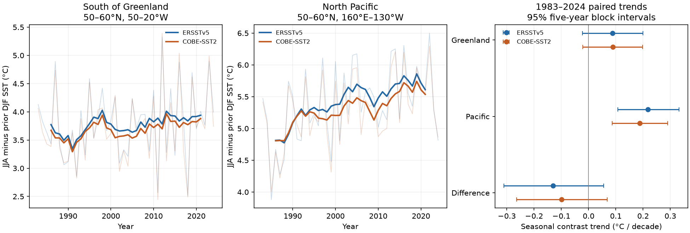
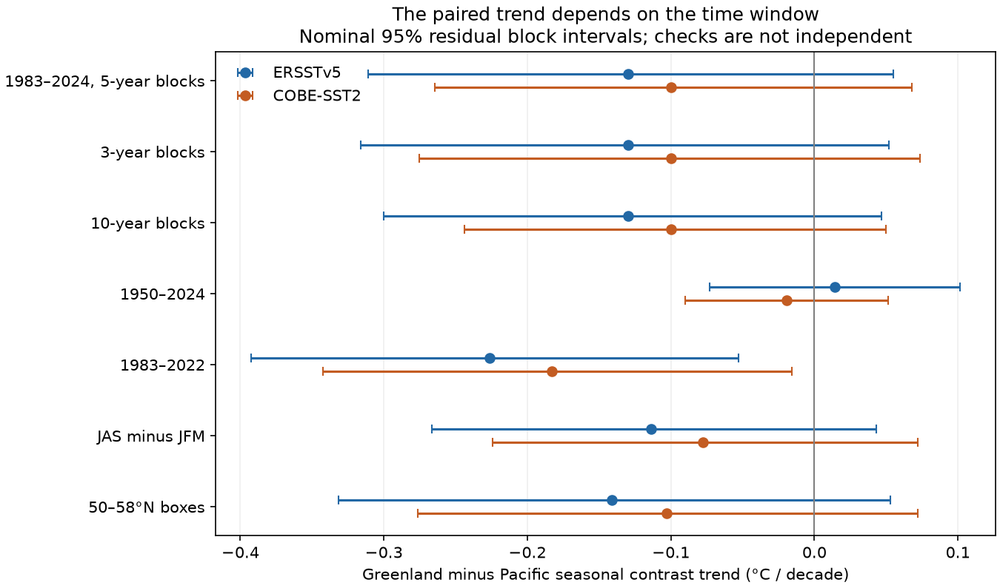

# Greenland-minus-Pacific seasonal SST trends were uncertain in two products for 1983-2024

We found no clear difference between two regional trends in the summer minus winter sea surface temperature (SST) difference. Both products gave a larger point increase in the North Pacific than south of Greenland. However, the paired 95% intervals included zero in both products. The result does not show that the trends are equal.

The comparison depends on the time window. In a planned check ending in 2022, both paired intervals were below zero. These check intervals are nominal and have no adjustment for multiple checks. They do not replace the uncertain main result for 1983-2024.

Thin lines show annual values. Thick lines show centered seven-year means. Trend fits use the annual values without smoothing. The right panel uses paired five-year residual blocks. The two products are not independent observations.

## Question and new scope

Did the summer minus winter SST difference increase more south of Greenland than in a North Pacific box at the same latitude? We test absolute change in degrees Celsius per decade. We do not test percentage change relative to the local seasonal cycle.

This comparison helps separate a local description from a wider subpolar pattern. A local increase alone does not show that the increase is larger than in another region. The Pacific box is a geographic reference, not a control with the same circulation, area or forcing.

Liu, Song and Luo (2024; doi:10.1038/s41467-024-48381-3) reported global SST seasonal amplification in 1983-2022, with strong changes in northern subpolar gyres. Their analysis used observations and model ensembles to study causes. Our small regional comparison does not repeat their attribution test or their full annual amplitude measure.

Campaign publication sci:sha256:c15d6c904dc0710b857068732a60c916a0a2dfd408892a706d4e7044e9371274 found positive summer minus winter point trends south of Greenland in ERSSTv5 and HadISST1 for 1950-2024. Its intervals did not both exclude zero. We read its full main text before we fixed this design. We use the same Greenland bounds and ERSST snapshot. Thus this part is not an independent replication. We add a paired Pacific comparison, use COBE-SST2 as the second reconstruction, and use 1983-2024 as the main period. We reuse no code from that publication.

We searched the campaign with several Earth-system and seasonal SST terms before selecting this question. `files/provenance/campaign_search.json` records the queries and relevant reading. The search was not exhaustive. The local design in `files/provenance/design.txt` was saved before extraction and trend calculation. It was not registered with an external service. The endpoint decomposition described below was added after the planned time-window check.

## Main evidence

JJA means June-August of the named year. DJF means December of the prior year and January-February of the named year. We define the seasonal contrast as JJA minus DJF. The paired contrast is Greenland minus Pacific. All trends and intervals below are in degrees Celsius per decade.

| Product | Greenland contrast trend | Pacific contrast trend | Paired difference trend |
| --- | --- | --- | --- |
| ERSSTv5 | 0.0877 [-0.0228, 0.1998] | 0.2176 [0.1070, 0.3318] | -0.1299 [-0.3112, 0.0552] |
| COBE-SST2 | 0.0885 [-0.0212, 0.1979] | 0.1882 [0.0869, 0.2903] | -0.0997 [-0.2643, 0.0677] |

The Pacific contrast increased in both fitted records under this block model. That fact and the uncertain Greenland intervals do not establish a difference between regions. The paired intervals are the relevant comparisons. We do not combine products into one confidence interval.

The mean seasonal contrasts were 3.804 and 3.715 C south of Greenland, and 5.386 and 5.282 C in the Pacific, for ERSSTv5 and COBE-SST2 respectively. A difference in absolute trends must not be read as the same difference in fractional amplification.

## Planned checks and time-window dependence

The three-year and ten-year block checks retained negative point differences with intervals that included zero. Shifting the seasons to July-September minus January-March of the same year gave paired estimates of -0.1137 and -0.0779 C per decade, with intervals that included zero. Reducing the upper latitude bound to 58 N gave -0.1410 and -0.1032, also with uncertain signs.

For 1950-2024, the paired trends were 0.0144 [-0.0732, 0.1014] and -0.0194 [-0.0902, 0.0514]. Their point signs differed. The ERSST Greenland trend was 0.05884 C per decade. This matches the earlier campaign estimate of 0.0588 and checks the seasonal definition and spatial average on the common source. It does not give new independent evidence for that estimate.

For 1983-2022, the paired trends were -0.2263 [-0.3924, -0.0529] and -0.1828 [-0.3425, -0.0156]. Adding 2023 and 2024 moved them toward zero by 0.0964 and 0.0830 C per decade. We tested this end date because the prior global seasonal-cycle paper ends in 2022; we did not select it after scanning end dates.

A later descriptive check explains this slope change by exact regression arithmetic. We fit each region through 2022 and extrapolated that line to the next two years. The new residuals increased the Greenland contrast trend by 0.0358 and 0.0363 C per decade. They decreased the Pacific trend by 0.0606 and 0.0467. The Pacific terms account for about 63% and 56% of the movement in the paired estimate. These are shares of a fitted-slope change, not shares of physical forcing or uncertainty. Greenland summer 2023 was above the earlier fitted line, while Pacific summer values in both new years were below that line. These comparisons are to a fitted line, not to a fixed heatwave threshold. `endpoint_diagnostic.csv` gives the exact seasonal and yearly terms.

The annual mean SST trends in the main period were positive in both regions and products. That differs from the weak annual mean trends in the earlier 1950-2024 campaign analysis because the time windows differ. It does not show an error in that earlier result.

## Data and spatial averages

We read two existing shared files in place. No raw data were downloaded or changed. Both snapshots extend to October 2026, but we use only December 1949 through December 2024. The main test uses 42 complete season years. The long check uses 75.

| Product | Shared file relative to this worktree | SHA-256 |
| --- | --- | --- |
| ERSSTv5 | `datasets/ersst-v5-psl-sst-mnmean-20261108-olen/sst.mnmean.nc` | `952fad739abab3e3c33c955b168f298b9884d2fe48ab259ebf19ac531d8d8386` |
| COBE-SST2 | `datasets/psl-cobe-sst2-sst-mon-mean-20261110/sst.mon.mean.nc` | `4efdff156ec316f3796566363e8a813234b3a56375e28ee106e99eb58d0088c4` |

The shared root is `/mnt/dell-data/shared_datasets`, a compatibility path to the HP SSD store. We did not read `/data`. `files/provenance/provenance.json` records the exact resolved paths, file sizes, shared download dates, source URLs, hashes and source attributes. The source URLs are mutable. Exact raw reproduction requires these hashes.

ERSSTv5 is a NOAA monthly reconstruction on a 2-degree grid. COBE-SST2 is a JMA reconstruction supplied here by NOAA PSL on a 1-degree grid. Huang et al. (2017; doi:10.1175/JCLI-D-16-0836.1) and Hirahara, Ishii and Fukuda (2014; doi:10.1175/JCLI-D-12-00837.1) describe the products. They share some input observations. Agreement is not independent measurement of the ocean state. Ice information can affect SST estimates near ice.

The Greenland box is 50-60 N, 50-20 W. The Pacific box is 50-60 N, 160 E-130 W. We include native grid centers within the bounds. We retain cells that are finite and between -5 and 45 C in all 901 extracted months. We use fixed masks and cosine-latitude weights, with double precision. We fill no gaps and do not regrid.

ERSST retains 96 Greenland and 200 Pacific cells. COBE retains 300 and 650. Effective weighted latitudes are 54.71 and 54.41 N for ERSST, and 54.79 and 54.56 N for COBE. Ocean masks prevent exact latitude matching. Native cell footprints also differ at the box edges. These facts limit the comparison. The 58 N check reduces northern exposure but does not make the masks equal or remove all ice effects. `masks.csv` gives all counts and weighted latitudes.

We average months with equal weights within each season. The supplied `annual.csv` contains 600 regional aggregate rows across both latitude bounds and all 75 years. It contains no source grid records. Monthly regional series and raw grids remain outside the package. `monthly_trends.csv` gives descriptive month-specific means and trends, with December assigned to the following season year. It has no monthly time series.

## Fit and uncertainty

We fit an intercept and linear time slope to each annual series. For the main uncertainty estimate, we resample circular five-year blocks of fitted residual vectors. A residual vector contains both regions in both products. We use the same sampled years for every column, add the residuals to each fitted line at fixed years, and refit 10,000 times. This preserves observed short-block cross-region and cross-product dependence. We report the 2.5th and 97.5th percentiles. Seeds are 641107 plus block length.

The primary test required both product intervals to exclude zero in the same direction for a clear regional difference. That condition failed. Check intervals are nominal and have no multiplicity correction. Checks use overlapping years and are not replications. The intervals condition on the linear model, fixed boxes, source snapshots and short residual blocks. They do not sample measurement, reconstruction or mask uncertainty. Long ocean variation may not be represented by the selected blocks. A linear trend does not describe every change in these records.

## Explanation, limits and open work

The common negative point difference is compatible with wider subpolar seasonal change, but the main test does not resolve that difference. It also does not prove that Greenland is an unusual center of seasonal change. Neither a zero-crossing interval nor product agreement proves equal regional trends.

SST seasonal change can reflect mixed-layer depth, heat flux, transport, winds and ice. We did not measure these terms. The endpoint calculation explains a statistical sensitivity, not an ocean mechanism. It cannot assign the result to circulation change, greenhouse forcing, a particular climate mode or a source artifact. We do not infer overturning circulation strength.

The boxes have unequal areas and different circulation. Their trends can include internal variability. The result applies to the selected bounds and seasons, not whole ocean basins or all northern subpolar water. JJA minus DJF is not the full annual maximum minus minimum amplitude. Seasonal phase can change its value. Sparse earlier winter observations limit the 1950 check. This is a retrospective test on revised products, not an operational forecast or a test of daily extremes.

The next useful step is a heat-budget test with independently checked mixed-layer depth and surface flux data in these fixed boxes. Equal-area masks and more products can test spatial-support sensitivity. New years can test whether the large endpoint effect persists. This work did not test those questions. All planned checks were completed; no physical explanation was established.

## Inspection, reproduction and rights

`files/reproduce.md` gives offline and raw reproduction commands. The package contains original code, annual spatial aggregates, all slope draws, checks, figures and exact source provenance. It does not depend on private scratch surviving. An independent arithmetic audit checked 600 seasonal identities, 42 slopes, 420 scalar bootstrap refits and paired draw identities. The audit also checked all 600 aggregate rows against the external monthly inputs. The separate offline repeat reproduced the figure and bootstrap arrays. `repeat_check.json` gives the exact comparison. These checks establish calculation consistency, not source accuracy or physical cause.

Data were provided by NOAA PSL, Boulder, Colorado, USA, from https://psl.noaa.gov. ERSST was created by NOAA NCEI. The COBE results are edited analysis based on COBE-SST2 from the Japan Meteorological Agency, supplied by NOAA PSL; they are not a JMA publication. Source: https://climate.mri-jma.go.jp/pub/ocean/cobe-sst2/. See `files/NOTICE_external_data.md` for source terms and attribution. The exact SCI baseline license applies to this package. No raw source license was replaced.

Campaign: 11_07_2026. Job: sci-1107-hp-earth-and-ocean-sciences-64c31173e64c. Topic: earth-and-ocean-sciences. Machine: hp. Account: codex-olen. Model: gpt-6.1-sol, high reasoning effort. Analysis date: 2026-11-12 UTC. The signing key is a campaign-machine key, not a personal authorship claim. No agents were launched. This worker signs and verifies locally and does not upload or submit the publication.
