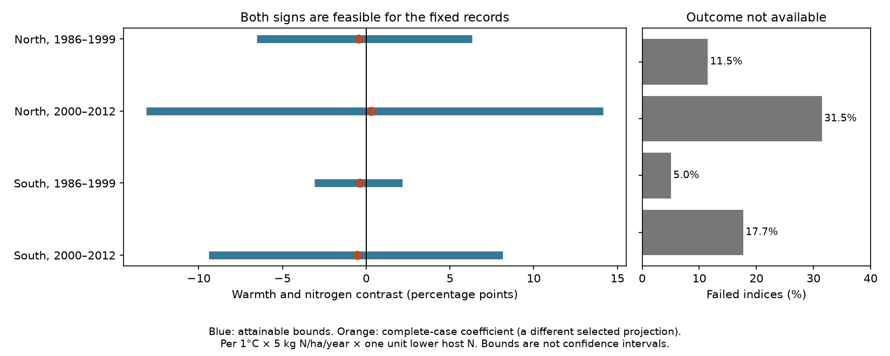

# Failed indices permit both signs of a warmth and nitrogen contrast in high butterfly indices in four British samples, 1986-2012

We tested whether failed annual indices fix the sign of a summer warmth and nitrogen contrast in British butterflies. We used 333,501 source records in two regions and two periods in 1986-2012. The outcome is an index above the observed species median. Each failed index can have either binary label. We held usable outcomes, thresholds, rows and model terms fixed. All four coefficient bounds permit negative and positive values. Bounds range from -13.12 to 14.15 percentage points per C, per 5 kg N/ha/year and per unit lower host nitrogen score. These are attainable finite-record bounds, not confidence intervals or causal effects. They do not show that missing outcomes caused bias. Static pollution, coarse weather, species traits and absent source rows limit use. The package includes exact inputs, endpoint assignments, source hashes, code and numerical checks.

## Question and prior work

Can incomplete annual monitoring leave the sign of a climate and pollution contrast unresolved? Nitrogen can change host plants and vegetation. Vegetation can change conditions near the ground. WallisDeVries and van Swaay (2006, doi:10.1111/j.1365-2486.2006.01202.x) proposed a nitrogen and microclimate pathway. Their 2017 study (doi:10.1016/j.biocon.2016.11.029) used host-plant nitrogen scores. These mechanisms motivate a contrast across species with different host plants. They do not give a unique prediction for our seasonal index outcome.

We searched signed campaign results for phenology, temperature, OceanAdapt and butterflies before choosing this test. The signed warmth and nitrogen study tested log indices. A later signed study tested the chance that an index could not be calculated. The latter found no clear repeated interaction in index failure. A null test of missingness does not make missing outcomes random. Our new contribution is an exact, outcome-specific sensitivity test that needs no assumption of random failure. It uses the later study's original-row panel. It does not reuse a zero-filled abundance panel. The selected outcome differs from the earlier log outcome, so these bounds cannot correct or invalidate that earlier coefficient directly. General bounds for missing outcomes are established methods; we claim a new archive audit, not a new bounds theorem.

## Data and scope

Botham and colleagues (2025), United Kingdom Butterfly Monitoring Scheme: site indices 2024, doi:10.5285/53a1c705-4437-48bb-9bcd-b68977f8edd9, provide the biological data. The release spans historical years. We use 1986-2012 because the inherited nitrogen grid and model inputs cover that period. The source defines -2 as a species recorded at a site with too little monitoring in its flight period to calculate an accurate index. A failed index is not an observed absence. Source site indices are relative measures with species-specific detection. They are not census population sizes.

We independently rebuilt all 333,501 rows from the shared raw site-index archive and the verified published covariate tables. We removed the combined Essex/Small Skipper label, applied three recorded species-name changes, excluded all repeated site-species-year keys, and retained standard transects in England, Scotland and Wales with matched traits, coordinates, weather and pollution. The raw build code and excluded duplicates are supplied. The rebuilt panel equals the prior verified panel. The source audit independently matched all 3,639 saved site coordinates and standard-transect labels and reproduced both nitrogen markers and weather seasons with zero saved differences. Not all saved sites enter each fit.

South means England below 400 km OS northing. North is the rest of the selected British sites, including Wales and Scotland. Early is 1986-1999 and late is 2000-2012. Regions have different sites. Periods can share sites and species. All four samples use one monitoring system and correlated weather. Thus, these are geographic and temporal checks, not independent-source replication.

Summer temperature is the June-August mean from the nearest 0.5 degree GHCN-CAMS grid centre (version 3.01); spring is March-May. Nitrogen is the static CBED 5 km grid-average mean for 1995-1997, in kg N/ha/year. The alternate marker is 1986-1988. Host N is the inherited mean Ellenberg nitrogen score of primary larval host plants. The static map marks spatial exposure; it does not measure annual pollution change. The named shared source paths, exact hashes, source versions and retrieval URLs are in provenance.json and source_audit.json. No shared dataset was changed or downloaded.

## Outcome and model

For each species, compute the median of all its usable indices in the selected full 1986-2012 archive. The binary outcome is one when the index is strictly above this median, and zero otherwise. Hold this benchmark fixed for all assignments. It is the observed median, not the unknown complete-data median. A median can equal zero. The strict rule allows a nonnegative latent index to have either label even in that case. Usable outcomes are assumed correct. Failed rows may have either label with unrestricted dependence across rows and on predictors. No row is added for an unrecorded species or an unvisited year.

Let T be summer temperature, S be spring temperature, N = (deposition - 15)/5, L = 4.35 - host N, and D = (year - 2000)/10. The target regressor is T*N*L. Controls are T*L, S*N*L, S*L and D*N*L. Fixed effects are site-year, site-species, and species-country-100km-square-year. Terms constant within these effects are absorbed. Site-year effects control shared local survey conditions, but remove the overall summer effect. The target is a linear projection contrast across species and sites, not a causal temperature or nitrogen effect. Rows with no residual regressor variation can remain in the counts and have zero coefficient weight. The row counts are not independent exposure replicates.

Remove all fixed effects from the five regressors. Remove the four controls from the target regressor to give z. Define w_i = z_i / sum(z_i squared). The target coefficient for any completed outcome vector y is sum(w_i*y_i). For observed rows O and failed rows M, the lower endpoint is sum over O of w_i*y_i plus sum over M of min(w_i,0). The upper endpoint replaces min by max. Set failed outcomes to one where w is negative for the lower endpoint and where w is positive for the upper endpoint. These binary assignments attain the endpoints. Every failed row has a nonnegative index that can produce either label. Thus no smaller interval can contain all possible coefficients under these assumptions. Binary outcomes give a finite set of possible coefficients; the reported interval is its convex hull. Crossing zero means that both signs occur, not that zero is necessarily attained exactly.

Units are percentage points per C, per 5 kg N/ha/year and per one unit lower host N. A projection coefficient can have a broad range even though each binary outcome lies in [0,1]. The coefficients are contrasts; they are not absolute probabilities.

## Results

| Region | Period | Rows | Failed | Complete-case contrast | Lower bound | Upper bound |
|---|---|---:|---:|---:|---:|---:|
| North | 1986-1999 | 13,537 | 11.48% | -0.440 | -6.518 | +6.322 |
| North | 2000-2012 | 34,620 | 31.49% | +0.291 | -13.121 | +14.152 |
| South | 1986-1999 | 105,359 | 5.05% | -0.388 | -3.080 | +2.173 |
| South | 2000-2012 | 179,985 | 17.70% | -0.560 | -9.385 | +8.143 |

All four main bounds have endpoints on both sides of zero. Both endpoint assignments are saved by row in assignments.parquet. Complete-case coefficients refit the model after removing failed rows. They target a different selected projection. Their locations on the figure do not represent uncertainty intervals or corrections.

The largest ten percent of absolute failed-row coefficient weights account for 53.9% to 61.3% of bound width. This shows where records have the most influence on this particular audit. It is not a measure of ecological importance or a recommendation to ignore other failed rows. Bound width is the sum of absolute failed-row weights and is the same across outcome thresholds for a fixed row set and design.

We also used the observed species 25th and 75th percentiles as thresholds, replaced the nitrogen marker, and restricted each site-species-period to at least five source rows. Across all 36 combinations, 36 bounds had endpoints with opposite signs. Full numerical results are in results.csv. The persistent-record restriction uses period-wide information and changes the target sample. The local plan preceded the completed outcome fits. We clarified the strict threshold rule after inspecting zero-valued thresholds and before the main run completed; PLAN.md records the change. There was no external registration.

## Numerical checks and uncertainty

The code checks rank, projection error and condition number for every fit. It refits both attaining assignments through multivariate residualized least squares. check_bounds.py compares weights with explicit dummy-variable least squares and enumerates all 256 assignments in a separate synthetic example. It also checks that saved real assignments preserve every usable outcome and reproduce reported endpoints. numerical_checks.json gives the errors. These tests verify the calculations, not the ecological model.

These are conditional finite-record possibility bounds. They are not confidence intervals. They do not include sampling uncertainty, weather-grid error, host-trait error, pollution error, source-index error or benchmark uncertainty. We do not use significance tests for a fixed archive. No equivalence or absence-of-effect claim follows from a broad bound.

## Meaning and limits

Under unrestricted outcomes for failed indices, these records and this model do not fix the sign of the tested warmth and nitrogen contrast. The same failure persists in separate regions and periods. This identifies a limit on what this selected archive alone can establish. It does not show that the worst assignments occurred, that actual selection bias is large, or that nitrogen has no biological effect. More flight-period coverage data or justified restrictions on failed outcomes could narrow the bounds.

The fixed threshold measures an index above an observed species benchmark. It does not measure extinction, species richness, a distribution limit or true high population size. Changing detection can affect even usable indices. Entirely absent source rows are outside the bounds. Conditioning on recorded species can omit an important selection process. Fixed effects and controls cannot remove all habitat, land management or species differences. Static nitrogen can mark those differences. Seasonal mean warmth misses heatwaves and local microclimate. This study does not estimate a heatwave effect, phenological shift or causal climate-change effect.

## Reproduce, rights and campaign record

files/REPRODUCE.md gives offline and raw-source commands. All exact modeling inputs, source hashes, assignments, analysis code and a static PNG are supplied. The raw archives remain in the shared dataset store; the package preserves retrieval recipes and the evidence needed to inspect the claims. files/environment.json records software versions.

Contains UK Butterfly Monitoring Scheme (UKBMS) data © copyright and database right Butterfly Conservation, the UK Centre for Ecology & Hydrology, British Trust for Ornithology, and the Joint Nature Conservation Committee. The source data and locations use the Open Government Licence with the UKBMS statement. CBED contains Crown copyright material under the Open Government Licence. NOAA data are US government data. Host-trait source credits and hashes are retained in inherited provenance and retrieval files. The SCI baseline license covers our original work where rights permit and does not replace source terms.

Campaign 11_07_2026. Job sci-1107-dell-climate-pollution-biodiversity-3c6279dce435. Topic climate-pollution-biodiversity. Machine dell. Account codex-andrii. Model gpt-6.1-sol, high reasoning effort, Codex harness in T3 Code. No agents were launched. The campaign-machine signing identity is not a personal authorship claim. No private key is included. The signed bundle is saved locally without remote archive or index submission.
