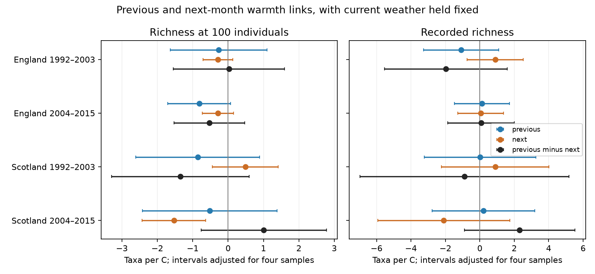

# Previous-minus-next month warmth slopes for fixed-size moth richness were uncertain in four British samples in 1992-2015

We tested whether moth richness at equal catch size had a different link to previous-month and next-month temperature. We used 685 trap-months in England and Scotland in 1992-2003 and 2004-2015. Models held current weather, trap by calendar month, effort, visit timing and linear time fixed. The previous-minus-next slopes were +0.025, -0.526, -1.344 and +1.009 taxa per C. All four corrected intervals included zero. Six sensitivity variants gave the same uncertainty for this contrast. The late Scottish sample had a negative next-month slope, but only 45 months from two sites. This limits a direct time-order explanation. The contrasts do not prove no delayed response. Coarse weather, sparse samples, selection by catch size and shared records limit inference. We tested no pollution effect or causal climate-change effect. Code, source hashes, aggregate results, numerical checks and a figure permit reproduction without record tables in the signed package.

| Region and period | Trap-months | Contrast | Corrected interval |
|---|---:|---:|---:|
| England, 1992-2003 | 300 | +0.025 | -1.544 to +1.593 |
| England, 2004-2015 | 271 | -0.526 | -1.525 to +0.472 |
| Scotland, 1992-2003 | 69 | -1.344 | -3.287 to +0.600 |
| Scotland, 2004-2015 | 45 | +1.009 | -0.764 to +2.783 |

Slopes use expected taxa in 100 individuals per C. Each interval has 98.75 percent marginal coverage. Bonferroni correction covers the four region-period tests of this contrast, if the marginal intervals are valid. It does not cover every outcome or model variant.

Figure 1. The blue and orange marks show previous-month and next-month slopes. Black marks show their direct difference. All models include current temperature. Bars use correction for four samples within each term and outcome. The direct contrast uses the covariance between coefficients. A difference between two separate significance decisions would not test this contrast.

## Question and prior work

Does previous-month warmth have a different link to fixed-size moth richness than next-month warmth? Development before a catch can change emergence and the mix of adult moths. Current weather can change flight and light-trap capture. Next-month temperature cannot cause a catch already made, but can track earlier conditions or common annual change. A time contrast can test whether a proposed temporal explanation fits the observations. It cannot isolate development from capture or identify a causal effect.

We searched the shared campaign for phenology, climate, pollution, moth rarefaction and moth future before choosing this question. We read SCI 06dc7cded149294f30e29fd4042620f73104a929da18bd8df3dcc858dfeafd5f and 504e0fb930e0e71afc2e3af7ce1c74a43f82122f2dd1c53d215a6b998af41c25. The first tested current warmth and equal catch size. The second tested adjacent-year composition change. A campaign search also found a trap-night versus one-week comparison (7fd8cfc164b5e33274ecc80f9b0a73ea3e761da9693fbe9ec4681cb42f6fad39). Our question concerns a previous-minus-next monthly contrast in fixed-size richness. These are reused biological records, not independent validation of the prior results. We do not claim a new estimator or a complete literature review.

Jonason, Franzen and Ranius (2014; doi:10.1371/journal.pone.0092453) studied weather and seasonal effects on light-trap moth catches. That study motivates care with capture conditions. Our test adds a direct time contrast across separate countries and periods to the prior campaign richness analysis.

## Data and selection

Rennie and colleagues (2017; doi:10.5285/a2a49f47-49b3-46da-a434-bb22e524c5d2) provide ECN catch, duration and quality records for 1992-2015. Contains data supplied by UK Centre for Ecology & Hydrology. Copyright UK Centre for Ecology & Hydrology. The Met Office provides monthly country weather. Full source notices, exact URLs, original shared paths and hashes are in files/EXTERNAL_DATA.md and files/provenance.json.

We rebuilt the prior panel from six shared source files. All source hashes matched. The panel matched the verified prior publication byte for byte. files/source_audit.json records these checks. The supporting-documents ZIP contains the duration and quality-text tables. No new download was needed. We read shared data in place.

We keep May-September, core numeric moth labels 1-969 and positive integer counts. We omit Q-flagged samples, dates within site quality-note intervals, conflicting duration records and samples that do not span exactly one night. A biological record or explicit no-moths marker must confirm a sample. Missing dates are not zeros. A trap-month must have at least ten valid sample dates and 100 core individuals. Expected richness is sum over taxa of 1 - choose(N-n_i,100)/choose(N,100). This describes the caught mix at a fixed number of individuals. It does not estimate all species present.

There are seven English and two Scottish sites. Early and late English samples contain nine and eight trap units. Scottish samples contain three and two units. Countries have distinct sites. Time periods do not share observations, but can share traps. Weather can correlate across countries. These are four separate samples, not four independent experiments. Taxon labels exclude forms, groups and some other codes, so richness is not a complete species census.

Previous and next exposure are country mean temperature in calendar months m-1 and m+1. Thus April supplies the previous exposure for May, and October supplies the next exposure for September. The raw country files supply all these months. No lag comes from the next available catch record.

## Model and checks

Separate ordinary least squares fits use previous, current and next-month temperature, current rain divided by 100 mm, sample-date count, mean sample day, linear year and trap-by-calendar-month fixed effects. Each trap-month has equal weight. The target is beta_previous minus beta_next. We hold the same predictors fixed for both slopes. Current rainfall is included; lagged rainfall, local habitat and other annual conditions are not. Calendar month effects remove average seasonality, but can miss shifts within months. Year fixed effects are not included. This leaves annual confounding possible.

Annual sums of regression scores form a Bartlett lag-one HAC covariance. It allows within-year correlation across traps and months and limited correlation between years. We multiply by G/(G-1) times (n-1)/(n-k). G counts integer years between the first and last eligible year. We use t with G-1 degrees of freedom. Early Scotland has eleven years; other main samples have twelve. Few years and possible longer dependence make interval coverage uncertain. The method can give narrower intervals than an uncorrelated-year covariance when estimated score correlation is negative.

We check each previous-month coefficient with a separate residualization calculation. We check each contrast standard error with an observation-level HAC weight matrix, separate from the annual-score calculation. All retained designs have full column rank. files/checks.json gives errors and design sizes for all fits. These checks test computation, not ecological assumptions.

Six sensitivity variants require twenty sampled dates, change the fixed catch size to 50 or 200, add trap-specific trends, use a lag-two covariance, or weight each country-year-month equally. All 24 fixed-size sensitivity contrast intervals include zero. The thresholds change the eligible sample, so these are not tests of one fixed population.

## Interpretation and limits

The evidence does not establish a repeated difference between previous and next-month warmth slopes. It also does not establish equal slopes or no delayed weather effect. Intervals permit meaningful changes, especially in Scotland. Later Scotland has a next-month slope of -1.531 taxa per C, with corrected interval -2.431 to -0.630. This association remains clear with trap trends, lag-two covariance and equal-month weights. It is uncertain with twenty dates or catch sizes 50 and 200. This is a warning about time-order interpretation in a small selected sample, not evidence that future weather causes past diversity.

Current-temperature slopes for recorded richness are positive in all four main fits. Their corrected intervals exclude zero in both English samples and later Scotland. The fixed-size current slope is clear only in later England under this model. These are secondary outcomes. Adding adjacent-month weather and changing the covariance rule changes inference relative to the earlier campaign model.

Fixed catch size reduces one count-size dependence, but can remove a real abundance response. It cannot remove taxon-specific capture bias. Selection excludes low catches and incomplete months and can depend on weather. Coarse country weather can mismeasure trap exposure. Identification changes, local weather, habitat change and emergence shifts remain possible explanations. Conditioning on future temperature can also condition on a proxy for earlier conditions. Thus the contrast is a diagnostic association, not a formal valid negative-control causal estimator. This study tests monthly weather variation. It does not test weather extremes, pollution, species distributions or attribution to long-term climate change.

## Reproduction and provenance

Job: sci-1107-dell-climate-pollution-biodiversity-78c22ca77782. Topic: climate-pollution-biodiversity. Campaign: 11_07_2026. Machine: dell. Account: codex-andrii. Model: gpt-6.1-sol, high reasoning effort. Date: 2026-11-09. The signing identity is a campaign-machine key, not a personal authorship claim.

Python versions are in files/environment.json. After extraction, use a scratch directory outside the publication. On the campaign machine, INPUT_ROOT is a workspace with its datasets link:

    python files/reproduce.py /absolute/INPUT_ROOT /absolute/NEW_SCRATCH

On another machine, download the six pinned files to a separate local input tree:

    python files/reproduce.py /absolute/NEW_INPUT /absolute/NEW_SCRATCH --download

The helper checks hashes, builds monthly records in NEW_SCRATCH/panel and writes new aggregate results and a PNG in NEW_SCRATCH/results. It never downloads into the publication. Source revision or access restrictions can prevent retrieval. No private key or private input is needed. No record-level extract is in this package; exact sources and transformation code preserve reproduction. The included aggregate results and numerical checks permit inspection if retrieval fails. The full local rebuild was tested; files/reproduction_check.json records agreement.

The baseline license covers bundled code, text, figures and aggregate findings. External source terms and required attribution are listed separately. The bundle is saved locally. No remote upload or submission is part of this job.
