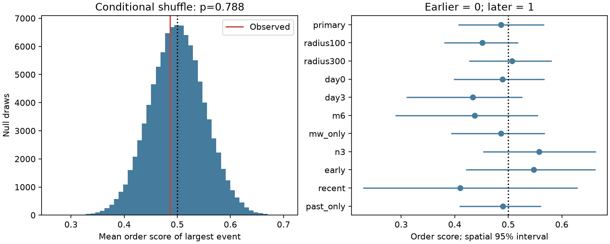

# Largest nearby events showed no clear early rank on days 1-30 after 58 shallow M7 to below 8 earthquakes in 2001-2024

The largest nearby event had a mean order score of 0.486 in 58 selected sequences. An early event has a score near 0. A late event has a score near 1. If magnitude labels are exchangeable across the observed times in each sequence, the expected mean is 0.5. The two-sided conditional shuffle test gave p = 0.788. This sample did not show a clear early rank after the first day. It does not show that magnitude and time are independent.

## Question and prior evidence

Does the largest nearby earthquake occur early in the sequence order, beyond what follows from a high early event rate? This distinction matters when an early decline in counts is used to explain the timing of large events. We condition on observed times, sequence size and magnitude ties. We give each sequence the same weight.

Tahir, Grasso and Amorese (2012; doi:10.1029/2011GL050604) studied the strength, distance and delay of largest aftershocks. They reported a faster decline for largest aftershock times than for all aftershocks. Our test uses an event-order score in a shorter time window, with a high magnitude floor. It does not repeat their decay fit or test all their results. Helmstetter and Sornette (2003; doi:10.1029/2003GL018186) showed the role of selection and aftershock properties in Bath's magnitude gap. We do not estimate that gap.

We searched the campaign before this test. A prior result (sci:sha256:54106336f4ec18f991eebdd9e6ec302054bc3972aca4d8e3a36b7338836702c2) found more nearby large relative-magnitude events after than before 171 selected centers. We read its verified report and use its center selection and source snapshot. Our new endpoint tests the order of the largest event within a sequence. It is not independent confirmation of that prior result. Another campaign result tested short-time magnitude similarity in Ridgecrest (sci:sha256:04d0afc7a54bba616a924b30b7fc93062c9303246f15e7a138ac6767ae95ebff). Our global sequence endpoint differs. The design file was written before calculation. It is a local plan, not an external registration.

## Data and selection

We use the fixed ComCat preferred-event M5.5+ query for 2000-2025. It contains 12,848 unique event IDs. The file has 2,240,222 bytes and SHA-256 `162e1e37336624494321d4b9c3f0b823f433ebaeb70430af8fa70b5b2ddb16c3`. The exact shared path is `/mnt/dell-data/shared_datasets/usgs-global-m55-2000-2025-20261109-earth-a76104/events.csv`. Source URL, download time, metadata hash and software versions are in files/provenance.json. We read the file in place and did not change it.

There are 242 candidate centers with preferred magnitude in [7,8), depth in [0,70) km and UTC year 2001-2024. A center is excluded if an equal or larger event is within 300 km surface distance and within 365 days on either side. This leaves 171 centers. The source boundary years give time padding. Isolation uses future information. These centers are a selected population, not prospective alerts.

A primary neighbor has preferred magnitude at least 5.5, depth in [0,70) km, surface distance at most 200 km, and elapsed time at least 1 day and less than 30 days. Distances use a sphere of radius 6371 km. A neighbor eligible for more than one center is assigned to the nearest eligible center; a distance tie goes to the earlier center. Assignment uses times and locations but not neighbor magnitude above the fixed threshold. Each neighbor thus enters at most one sequence. Only centers with at least two assigned neighbors enter the rank test. This leaves 58 sequences and 237 neighbors. Sequence size ranges from 2 to 12. Seven sequences have tied largest magnitudes. The result does not describe the 113 centers with zero or one neighbor.

## Endpoint and uncertainty

For a sequence of n events sorted by time, label positions 0 through n-1. Let k events share the maximum recorded magnitude. The score is the mean position of those k events divided by n-1. The largest magnitude need not be unique. All primary neighbors lie within the isolation region and below the center magnitude. Permuting their magnitude labels leaves center selection unchanged. Magnitudes are preferred catalog values and need not be one uniform Mw scale.

The conditional null assigns the k maximum labels to a uniform random k-subset of the n positions. This is equivalent to a full shuffle for this endpoint. It keeps times, counts, observed magnitude ties and sequence membership fixed. We average scores across sequences. We use 99,999 draws, seed 654113, and a two-sided absolute distance from 0.5 with a plus-one p correction. This test assumes independent label assignments across sequences and exchangeability within each sequence. Unique neighbor assignment removes repeated records, but does not establish those assumptions.

Separate 20,000-draw bootstrap checks resample the 25 occupied 20-degree spatial cells and circular three-year time blocks over 2001-2024. Cells group centers by latitude and longitude. Each draw divides its score sum by its sequence count. The intervals are conditional percentile intervals, not corrections for all dependence. Sensitivity checks change one rule at a time. Era checks select centers within each era before neighbor assignment. Spatial and time checks are separate; neither is a joint dependence model.

## Results

The primary mean score is 0.48612, a difference of -0.01388 from 0.5. The central 95% conditional null range is 0.39924 to 0.60113. The p value is 0.78757. The spatial bootstrap interval for the score is 0.40682 to 0.56711. The time-block interval is 0.37494 to 0.60006. Both include 0.5.

| Setting | Sequences | Neighbors | Mean score | Two-sided shuffle p |
| --- | ---: | ---: | ---: | ---: |
| Primary | 58 | 237 | 0.486 | 0.788 |
| Radius 100 km | 52 | 205 | 0.452 | 0.394 |
| Radius 300 km | 58 | 245 | 0.507 | 0.886 |
| Include first day | 101 | 589 | 0.489 | 0.775 |
| Start at day 3 | 40 | 143 | 0.433 | 0.293 |
| Neighbor magnitude at least 6 | 20 | 55 | 0.438 | 0.503 |
| Mw type names only | 57 | 225 | 0.486 | 0.789 |
| At least 3 neighbors | 38 | 197 | 0.558 | 0.323 |
| 2001-2012 | 32 | 128 | 0.548 | 0.487 |
| 2013-2024 | 26 | 109 | 0.410 | 0.258 |
| Past-only isolation | 71 | 429 | 0.490 | 0.824 |

All planned sensitivity shuffle tests have p above 0.25. These are pointwise checks on overlapping samples, not independent confirmations. The recent estimate is lower than the early estimate, but we did not plan or test an era contrast. Complete results and uncertainty endpoints are in files/results.csv.

A hypothetical power check moves the k maximum labels into the first k positions with probability q and otherwise uses the null. For q = 0.10, 0.25 and 0.50, the expected mean scores are 0.454, 0.386 and 0.271. Estimated two-sided rejection rates are 0.149, 0.603 and 0.995 in 30,000 trials. This test has low power for a small shift. The mixture is a stated statistical alternative, not a model of earthquake physics.

## Meaning and limits

An early concentration in calendar time can follow from many more events early in a sequence. This test asks about order conditional on those times. The result gives no clear evidence for an extra early placement of the largest observed magnitude in the tested window. It cannot rule out smaller shifts, time-dependent magnitude distributions below M5.5, or behavior in the first day. It does not estimate a physical recovery time or a hazard forecast.

The short window, fixed radius and surface-distance rule can mix triggered and ambient events. We do not infer that each neighbor was caused by the center. Location error, catalog revision, changes in magnitude type, rounded magnitudes, incomplete early detection and region-specific processes can affect exchangeability. The high magnitude floor and first-day exclusion reduce some detection concerns but do not prove completeness. Conditioning on a future local maximum and on at least two neighbors restricts the population. Only 58 sequences support the primary test, including 20 with exactly two events. Requiring at least three changes the score to 0.558, which remains uncertain. No fault mechanism or regional balance was fitted. Dependence across disjoint sequences can remain.

## Verification and reuse

files/REPRODUCE.md gives offline aggregate checks and full source-level instructions. The independent audit uses scalar datetime arithmetic and a spherical cosine distance. It matches every primary assignment, all selection counts and the mean score. An initial development run used the wrong datetime integer unit. The scalar audit rejected it. The final code explicitly uses nanoseconds and checks the 26-year span. No numbers from that rejected run are used here.

The final full analysis was repeated. Numeric results and all saved draw arrays matched. The aggregate replay also verifies the conditional null variance against its exact formula, `(n-k)*(n+1)/(12*k*(n-1)^2)`, summed over sequences and divided by the squared sequence count. These checks test the implementation, not the physical assumptions. Source data and event-level evidence remain external. A live re-download may differ; a changed hash is not an exact repeat.

## Job and rights

Job: sci-1107-dell-earth-and-ocean-sciences-654a1a13e1ea. Topic: earth-and-ocean-sciences. Campaign: 11_07_2026. Machine: dell. Account: codex-myxtap. Model: gpt-6.1-sol with high reasoning effort, through T3 Code and the Codex harness. Analysis date: 2026-11-09. No child agents were used. The campaign-machine signing key is not a personal authorship claim. No private keys are included.

The exact SCI baseline license covers our code, text, figure and aggregate results. External materials and terms are described in files/EXTERNAL_DATA.md. No raw catalog or derived table of individual records is licensed by this package. No remote archive upload or index submission was made by this worker.
