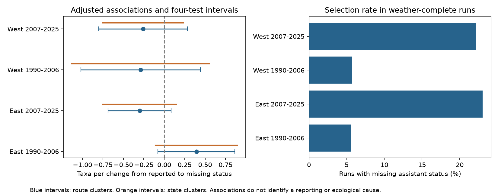

# Missing assistant status gave no clear common count association in four US bird survey samples in 1990-2025

We tested whether an unreported assistant field was linked to the number of bird taxa recorded on a survey. We used 55,627 pairs of consecutive surveys on the same route with the same observer. Separate models covered western and eastern US routes in 1990-2006 and 2007-2025. The adjusted associations ranged from -0.30 to +0.39 taxa. All four primary intervals included zero after correction for four tests. Some sensitivity results differed. These data do not give a clear common count association with missing assistant status. They do not establish that complete-case analysis is safe.



## Question and prior work

Environmental studies use bird counts to test climate and pollution effects. Weather, observer skill and record selection can also affect those counts. Robbins (1981) used Breeding Bird Survey (BBS) records to study weather and activity. Official BBS instructions restrict surveys during strong wind and prolonged rain. Accepted surveys thus already select weather conditions.

Several campaign studies tested temperature and wind slopes in BBS records. SCI b9f3a0b8 (full ID in sci.json) compared temperature slopes before and after requiring reported assistant status. It found no clear slope change. It did not test whether missing status was linked to the count level. A stable weather slope does not imply equal counts in selected and excluded records. We test this separate issue. Biological observations overlap with the prior campaign studies. This is a follow-up, not independent validation of the archive.

We searched campaign results and read prior publications before selecting the precise question. An initial morning-temperature-rise question was abandoned because a search found the same test. We inspected the frequency of missing assistant status before the new plan. The plan was written before model fits. It was local and was not registered. No prior code or derived panel was copied.

## Data and selection

We used the public USGS 2026 BBS release for 1966-2025, DOI 10.5066/P144YU3S. Only Weather.csv and route coordinates entered the analysis. The source XML supplied field definitions. The weather file has 144,146 rows. TotalSpp is the number of recorded taxa. It includes some subspecies, hybrids and groups. It is not true species richness.

Assistant records whether another person wrote the data for the observer. It does not mean a second independent bird observer. Codes 0 and 1 mean no assistant and an assistant. Blank means no data. We define M=1 for blank, and M=0 for either reported value. Missing status does not prove an assistant was absent.

We kept US routes from 24 to 50 N and -125 to -66 degrees longitude, in 1990-2025. West is longitude below -100 degrees; East is longitude at least -100 degrees. These are separate route sets. States can cross this boundary. The periods use separate years, but can share routes and observers. They are not four independent experiments.

There were 85,460 runs in scope, 75,937 accepted standard runs (RunType=1, RPID=101), and 75,576 runs after weather and timing filters. We required 1-200 taxa, a positive observer ID, day of year 121-212, start clock 02:00-08:00, and duration 180-480 minutes. Fahrenheit was converted to Celsius. Start temperature had to be -10 to 40 C and end temperature -10 to 45 C. Start and end wind codes had to be 0-5. Sky codes had to be 0, 1, 2, 4, 5, 7 or 8. Missing weather code 9 was excluded. Assistant status could be blank, 0 or 1. No selected route-year was duplicated.

Pairs had to be consecutive calendar years with the same route and observer, within one period. We did not bridge gaps, including the absence of field surveys in 2020. A run can occur in two adjacent pairs.

| Sample | Weather-complete runs | Missing assistant | Matched pairs | Reported to missing | Missing to reported |
|---|---:|---:|---:|---:|---:|
| East 1990-2006 | 23,343 | 5.56% | 17,970 | 951 | 276 |
| East 2007-2025 | 26,156 | 23.02% | 19,278 | 492 | 1,388 |
| West 1990-2006 | 12,398 | 5.76% | 8,907 | 503 | 131 |
| West 2007-2025 | 13,679 | 22.13% | 9,472 | 271 | 718 |

The number of missing records increased between periods. Transitions occurred in both directions, but were uneven. Records that stay in one reporting state inform controls, not a direct change in M. The full transition table is in files/audit.json.

## Model and uncertainty

Each model regressed the annual change in TotalSpp on the annual change in M. Controls were annual changes in start and end temperature (per 5 C), day of year and its square, start clock, duration, and categorical start and end wind and sky indicators. State-by-ending-year intercepts were removed by group means. First differences remove fixed route and observer levels for each pair. They do not remove local annual habitat change, observer ageing or time-varying record practices.

The target coefficient is an adjusted count association with a change from reported to missing status. The linear model assumes that the reverse transition has the opposite association. It also assumes a common slope within each region and period. It is not an effect of causing a record to be missing. The primary model does not control actual assistant presence because that value is unknown in the missing group.

Primary uncertainty uses a route-cluster sandwich. It permits dependence among overlapping pairs on a route. The finite-sample factor is G/(G-1) times (N-1)/(N-H-rank(X)), where H is the number of absorbed state-year groups and X is the demeaned design. We use Student t with G-1 degrees of freedom. Primary intervals use quantile 1-0.05/8 for four-test Bonferroni coverage. Coverage remains approximate and depends on the model and cluster assumptions.

Some weather columns are redundant. A pseudo-inverse handles them. The target is identified after nuisance removal in all fits. Residual regression checks the primary coefficients. A separate Statsmodels fit and cluster covariance check coefficients and standard errors.

## Results

Units are recorded taxa per change from reported to missing assistant status, conditional on the controls.

| Sample | Routes | Estimate | Individual 95% interval | Four-test interval |
|---|---:|---:|---|---|
| East 1990-2006 | 1,982 | +0.393 | +0.024 to +0.763 | -0.078 to +0.865 |
| East 2007-2025 | 2,042 | -0.300 | -0.603 to +0.002 | -0.686 to +0.086 |
| West 1990-2006 | 1,154 | -0.290 | -0.863 to +0.283 | -1.021 to +0.441 |
| West 2007-2025 | 1,160 | -0.258 | -0.684 to +0.167 | -0.801 to +0.284 |

No primary four-test interval excludes zero. Three point estimates are negative, but the early eastern estimate is positive. This does not establish a regional or period difference; we did not test those contrasts. The early western interval also permits a deficit just larger than one taxon. We do not claim equivalence.

Sensitivity estimates follow. Their intervals and sample sizes are in files/results.csv.

| Check | East early | East late | West early | West late |
|---|---:|---:|---:|---:|
| Dates within seven days | +0.238 | -0.187 | -0.029 | +0.012 |
| Even ending years only | +0.167 | -0.516 | -0.012 | -0.271 |
| Add reported assistant presence | +0.524 | -0.289 | -0.158 | -0.092 |

Even ending years remove direct overlap of annual pairs. In this check, the later eastern four-test interval is -0.998 to -0.035. With a reported-assistant-presence indicator added, the early eastern interval is +0.036 to +1.012. The latter target compares missing status to reported absence of an assistant, rather than the mixture of reported states. Neither exception repeats across all samples. The correction applies within each sensitivity set, not across all checks. These exceptions prevent a broad null claim.

Clustering by state leaves all four primary intervals across zero. State counts are 37 in East and 17 in West. The corresponding intervals appear in orange in the figure. Few clusters limit this check. State clusters do not capture every regional shock.

## Limits and use

This audit tests an observable count association for one metadata field. It does not test missingness at random for true assistant status. True status is unknown when the field is blank. Equal adjusted counts could coexist with selection bias in a different outcome, species or nonlinear weather response. Counts also cannot separate detection, vocal activity, movement and local abundance.

Weather-complete records, accepted runs and persistent observers are selected samples. We did not model missing surveys or other incomplete fields. Later data have more missing assistant status. Changes in data systems, observer practice or assistant use could drive missingness. No validated records identify those causes. A small conditional association does not show that deleting missing records is harmless.

Weather and clocks are measured at endpoints. Local clock time is not time from sunrise. Duration can respond to bird counts and weather; conditioning on it can change the association. Annual route and observer matching does not measure observer hearing or local habitat change. State-year controls do not remove all spatial dependence. Route and state uncertainty calculations are approximate.

These selected roadside data do not represent all bird habitats. This study does not test pollution, extreme heat, climate trends, mortality, range shifts or ecological timing. Its use is narrower: it supplies a reproducible check of a reporting filter used in weather-biodiversity analyses. A clear common missing-status count association was not found under the tested models.

## Reproduction and provenance

Exact source URLs, file sizes, logical shared paths, resolved paths and SHA-256 hashes are in files/provenance.json. Shared inputs are reused in place:

- /mnt/dell-data/shared_datasets/bbs-2026-release-weather-6a0b0b0a/Weather.csv
- /mnt/dell-data/shared_datasets/bbs-2026-release-routes-6a0b0b0a/Routes.csv
- /mnt/dell-data/shared_datasets/bbs-2026-release-metadata-6a0b0b0a/metadata.xml

The weather SHA-256 is 4bcdb3346dcc44839690702f76c10306a19329260e99e16576b1a92f4465f67d. All three file hashes were checked against the shared download records. Only these inputs were hashed. files/retrieve.sh records atomic retrieval commands. Raw data are not copied into this bundle. Source XML is included for field interpretation.

Python 3 with NumPy, pandas, SciPy, Matplotlib and Statsmodels is needed. Versions for the analysis are in files/environment.json. From the extracted bundle root:

```sh
OPENBLAS_NUM_THREADS=2 python files/analyze.py files/panel.csv /tmp/bbs-missing-offline
OPENBLAS_NUM_THREADS=2 python files/validate.py files
```

The offline route rebuilds pairs, models and the figure. It does not audit excluded raw rows. To rebuild selection, run:

```sh
OPENBLAS_NUM_THREADS=2 python files/analyze.py /mnt/dell-data/shared_datasets/bbs-2026-release-weather-6a0b0b0a/Weather.csv /tmp/bbs-missing-raw /mnt/dell-data/shared_datasets/bbs-2026-release-routes-6a0b0b0a/Routes.csv
```

Choose new output folders. Code makes no network calls. files/panel.csv preserves selected model inputs; files/pairs.csv records pair IDs; design NPZ files preserve the four primary demeaned designs. files/validation.json records independent numeric checks. files/reproduction_check.json records the raw-versus-offline comparison. Thread settings are speed choices, not campaign limits.

## Job and rights

Campaign 11_07_2026. Job sci-1107-dell-climate-pollution-biodiversity-7d3bd3330dd6. Topic climate-pollution-biodiversity. Machine dell. Account codex-andrii. Model gpt-6.1-sol with high reasoning effort, through the Codex harness in T3 Code. One finite worker; no child agents were launched. The campaign-machine signing key is not a personal authorship claim. No private key is included. The baseline license covers this new text, code, figure and derived evidence, subject to source rights. Signed files remain in the local campaign archive.
