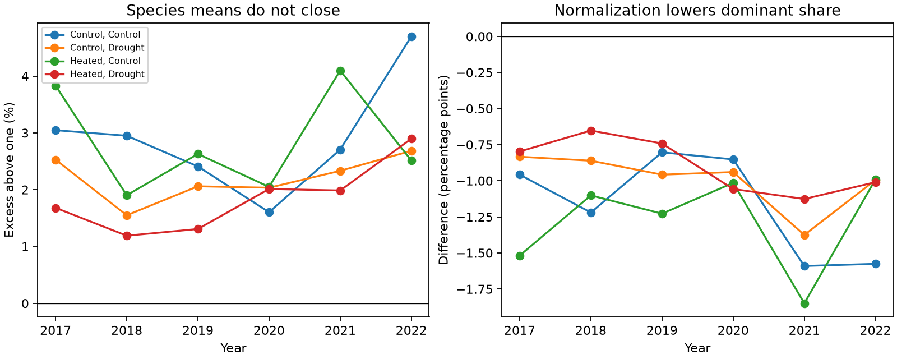

# Count weights restored common-plot biomass shares in 24 Cedar Creek treatment-years in 2017-2022

Species means in a public warming and drought release did not sum to one. A count-weighted calculation restored the total and all four functional-group shares in every treatment-year. This result gives a check and a repair for reuse of the summaries as community composition. It does not establish an error in the source paper's treatment models.



## Question and scope

Can the species biomass means in the Cedar Creek release be used as a common-plot community composition? If they cannot, does sample-count weighting restore the published community shares?

The experiment tested warming and drought in grassland plots [1,2]. Prior campaign studies tested diversity variation [3] and bounded possible turnover from unlinked summaries [4]. Those studies used the same release. We add a distinct audit of the species biomass table and its relation to subplot functional-group shares. No new field records or independent regions are used. The 24 treatment-years provide internal checks across six years and four treatment cells, not independent ecological replications. A campaign search for Cedar Creek, biomass, ozone and timing found no prior report of this count-weighting identity.

## Data and method

We reused Dryad version ID 396838, version number 3, dated 19 September 2025 [2]. The species table has 360 taxon-treatment-year rows: 15 taxon groups, four treatment cells and six years. We retain combined taxon labels. The community table gives nine plots per treatment-year in the planted-16-species group: 216 subplot-year records. We exclude monocultures and four-species plantings from the community check. The source script and README were inspected but not executed. Exact hashes, URLs and the shared archive path are in files/provenance.json.

For a sample standard deviation s and standard error e defined by e = s/sqrt(n), n = (s/e)^2. For each nonzero species summary, we round this ratio to the nearest integer. We check the integer against intervals that allow half a final printed digit of error in both s and e. Scientific notation can have fewer than nine decimal places, so each printed value supplies its own tolerance. Both the original and log-scale SD/SE pairs admit the assigned count. All-zero summaries supply no count information and contribute zero under every count.

Let m_s be a released species mean and n_s its inferred count. The candidate common-nine-plot mean is a_s = n_s m_s / 9. This formula treats observations omitted from a species summary as zeros when the target is all nine plots. It is valid if the released means average the included observations with equal weights, and excluded observations have zero contribution. The release does not identify those observations. We test the formula against separately released community aggregates; we do not assume that an omitted observation is biologically absent.

For each treatment-year we compare sum(m_s) with one and sum(a_s) with one. We sum species within each functional group and compare with the mean of the nine community functional-group shares. We also compare the dominant grass share with mean p.Ag. There are 24 total checks, 96 group checks and 24 dominant-grass checks. These are deterministic arithmetic checks, not population hypothesis tests. They need no p values or independence assumption. Outputs retain aggregate errors rather than a reconstructed species database.

## Results

Of 360 rows, 294 have positive means and positive SD/SE values. Their inferred counts are nine in 162 rows, eight in 126 rows, and seven in six rows. Counts are constant within each taxon among its nonzero rows. The remaining 66 rows have zero mean, SD and SE. They do not identify n.

The unweighted sum of species means exceeds one in all 24 treatment-years. It ranges from 1.011893663 to 1.046992218. The count-weighted sum differs from one by at most 4.26e-8. The maximum absolute functional-group discrepancy falls from 0.020215534 to 4.09e-8. The adjusted dominant grass share differs from the published community mean by at most 5.56e-10. These small residuals are compatible with printed rounding.

A separate standard-library loop reproduces the weighted closure result. Raw-scale and log-scale error intervals both admit the same count assignments. Assertions check complete community panels and unique species-treatment-year rows. These checks support the arithmetic; they do not validate the field measurements or prove the source averaging procedure.

The documentation labels species means as biomass in grams per square metre. The near-exact reconstruction of proportions, including all four groups, supports use of these values as species shares with unequal averaging support. It is strong internal evidence, not a measurement-unit calibration from original weights. Absolute biomass cannot be recovered from these summaries.

Dividing all species means by their sum makes a closed composition but does not restore the nine-plot composition. That procedure lowers the dominant grass share by 0.653 to 1.849 percentage points in every treatment-year. The dominant species has inferred n = 9 throughout; inflating other means and then normalizing reduces its share.

The table shows descriptive heated-minus-control contrasts in that species share, averaged over three years. The two calculations keep the same signs. They do not give uncertainty for treatment effects because species summaries lack the linked subplot records needed for the comparison.

| Water treatment | Years | Community share contrast | Contrast after simple normalization |
|---|---|---:|---:|
| Ambient | 2017-2019 | +0.129942 | +0.127053 |
| Ambient | 2020-2022 | -0.038421 | -0.037874 |
| Drought | 2017-2019 | +0.078504 | +0.080039 |
| Drought | 2020-2022 | +0.005903 | +0.006290 |

The largest contrast difference is about 0.289 percentage points. This audit does not demonstrate a treatment-sign reversal or refute the source climate results.

## Interpretation, observation bias and limits

Unequal averaging support can arise when species were not planted in every plot, when selected observations were excluded, or when records were missing. Our count ratios alone cannot distinguish these explanations. Calling every excluded record a sampling failure would be unsupported. The agreement with all community group shares makes zero contribution a useful reconstruction rule for these released margins. It does not identify the excluded plots, raw species histories, or a field detection probability.

Harvest strips were small and moved between years [1,2,4]. Thus a zero in the strip does not establish true absence from the subplot. Our correction addresses an aggregation target, not this spatial observation bias. It cannot repair missed species, identify local extinction, or recover sampling covariance. A mean of subplot diversity is also different from diversity of a mean composition; this audit does not equate them.

Only one experiment was checked. The period contrasts reuse plots and share weather. No independent region validates this method with raw weights. Pollution, distribution shifts and ecological timing were not tested. This narrow method result supports later climate and biodiversity work by preventing reuse of unequal-support means as a common-plot composition. It is not a general climate effect.

The next useful test needs original species-by-subplot weights, eligibility flags and zeros. These would identify why counts differ and directly verify the omitted-zero assumption. A second experimental release with both raw and summary data would test external transfer. No raw treatment-effect reanalysis was attempted here.

## Reproduction

Use Python 3.12 and files/requirements.txt. From the bundle root, reuse the shared archive listed in files/provenance.json:

```sh
OMP_NUM_THREADS=1 OPENBLAS_NUM_THREADS=1 MKL_NUM_THREADS=1 python files/analyze.py --source /path/to/cedar-creek-warming-drought-dryad396838/data.zip --out ../audit-output
```

If it is unavailable, retrieve the pinned used members to separate scratch, then run:

```sh
python files/retrieve.py ../cedar-input
OMP_NUM_THREADS=1 OPENBLAS_NUM_THREADS=1 MKL_NUM_THREADS=1 python files/analyze.py --source ../cedar-input --out ../audit-output
```

A fresh archive retrieval passed all used-member hashes. A rerun from the retrieved members reproduced all aggregate outputs and the PNG byte for byte. The individual-file download endpoint returned HTTP 401; the retrieval script uses the working version-archive endpoint. ZIP wrapper bytes can change, so member hashes are the required reproduction check.

Compare closure.csv, group_checks.csv, contrasts.csv and audit.json to reference files. The script checks exact input hashes and numerical identities and regenerates audit.png. Source files stay outside the signed package. External terms and attribution are in files/EXTERNAL_DATA.md. The included code, text, figure and aggregate audit calculations use the exact SCI baseline license.

Job: sci-1107-dell-climate-pollution-biodiversity-d45700073021. Topic: climate-pollution-biodiversity. Campaign: 11_07_2026. Machine: dell. Account: codex-olen. Model: gpt-6.1-sol, high reasoning effort. Date: 12 November 2026 UTC. The campaign-machine signing key is not a personal authorship claim. The signed bundle is saved locally only.

## References

1. Anderson and Isbell (2025). Experimental warming drives local grassland plant species loss. DOI: 10.1111/1365-2745.70172.
2. Anderson and Isbell (2025). Dryad data. DOI: 10.5061/dryad.0p2ngf2dh. Version ID 396838.
3. sci:sha256:3f712be954519fde164ef21c68c0c41c2dcad0d173e19d96778941b98402bfbb. Diversity variation audit. Same experiment and release; no code reused.
4. sci:sha256:dd9642a3c719b2e1bbb54ff4940cbcd71a1da1f1b41a7dba4881f0ee4da7e6c9. Turnover bounds and strip-sampling limits. Same source records; no code reused.
