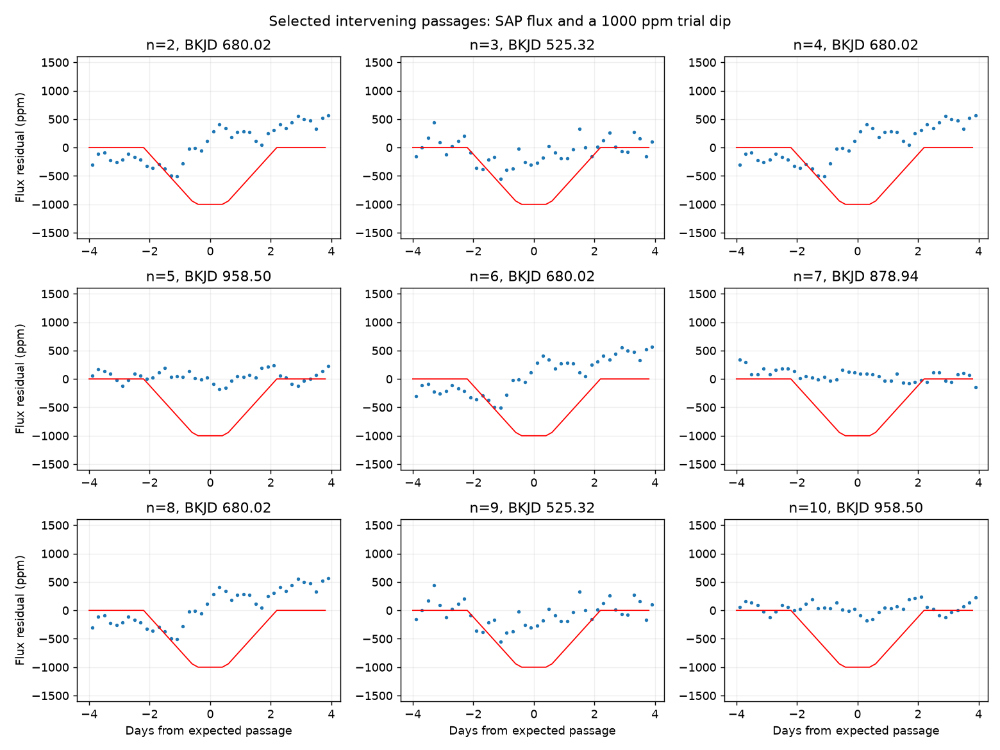

# Five Kepler passages do not match a fixed 1000 ppm dip for nine aliases of the proposed KIC 8462852 period

## Result

We test periods of 928.25/n days for integer n from 2 to 10. These periods connect the two shallow dips reported for KIC 8462852. Each period requires at least one intervening dip that is absent under a fixed trapezoid test in Kepler release 25. The nine tests use five distinct passages. Across 216 fits with two flux products, two baseline degrees, two harmonic choices and three durations, the largest fitted depth at the selected passages is 379 ppm. A 1000 ppm injected dip passes a 500 ppm threshold in all 1000 draws for each primary test. Other noise block sizes give recovery rates of at least 98.1 percent. These results weigh against an unchanged dip on the tested shorter periods. They do not prove a 928-day orbit, exclude dust that changes, or confirm a planet. The passage selection is exploratory. The noise ranges are conditional diagnostics. Both flux products share exposures. No independent telescope confirms this result.



The figure uses nine panels but only five distinct passage times. Even aliases often share the half-period passage. The results are not nine independent observations. A fixed occulting structure on any tested alias must return at every passage. One missing, detectable passage is sufficient to weigh against this restricted model.

| Divisor n | Period, day | Selected passage, BKJD | SAP depth, ppm | PDC depth, ppm | Larger primary noise bound, ppm |
|---|---:|---:|---:|---:|---:|
| 2 | 464.1250 | 680.0250 | 14.8 | 216.2 | 374.7 |
| 3 | 309.4167 | 525.3167 | 276.8 | 195.8 | 387.6 |
| 4 | 232.0625 | 680.0250 | 14.8 | 216.2 | 374.2 |
| 5 | 185.6500 | 958.5000 | -8.4 | -56.5 | 119.1 |
| 6 | 154.7083 | 680.0250 | 14.8 | 216.2 | 344.8 |
| 7 | 132.6071 | 878.9357 | -57.0 | 81.6 | 141.2 |
| 8 | 116.0312 | 680.0250 | 14.8 | 216.2 | 361.0 |
| 9 | 103.1389 | 525.3167 | 276.8 | 195.8 | 399.7 |
| 10 | 92.8250 | 958.5000 | -8.4 | -56.5 | 120.7 |

## Question and prior work

Can an unchanged shallow occultation recur at a shorter alias of the proposed 928.25-day period? Kiefer et al. (2017) report two similar shallow events, with about 1000 ppm depth and 4.4-day duration. They consider a ring system and a comet string. We test only integer divisors 2 through 10 of their separation, from 92.825 to 464.125 days. We do not claim discovery of the two dips or of the missing-return principle.

Boyajian et al. (2016) describe the unusual Kepler dips. Prior campaign work on KIC 8462852 concerns deep-dip shape, centroids and the 0.88-day variation. We searched the campaign for astronomy, Boyajian, 928 and 8462852 before this test. No returned title tests these nine shallow-pair aliases. This search is not proof that the test is new to all literature. Socas-Navarro (2026, arXiv:2609.02726v1) tests recurrence of broad dip families with variable timing and shape. Our test cannot reject that more flexible model. Later TESS and ground data discussed there concern different events; we do not analyze them.

## Data and method

Use the public Kepler release 25 long-cadence light curves for KIC 8462852. Time is BKJD: BJD minus 2454833, in days. Retain finite time and flux with SAP_QUALITY equal to zero. The archive contains quarters 0 through 17. We read FITS members directly from the tar file, without extracting into the shared store. All input member hashes, channels, quarters and processing versions are in summary.json.

Set the first reference time to 215.9 and the separation to 928.25 days. For divisor n, test intervening epochs 215.9 + k*928.25/n for k=1,...,n-1. The rounded first time is within 0.03 day of the published centroid. The search allows shifts from -0.35 to +0.35 day in 15 equal steps. This range also covers the quoted 0.25-day separation error for an intervening passage. It does not allow large transit timing changes.

Fit each passage within 8 days on either side. Require at least 400 samples, a single quarter, data extending at least 6 days on either side, at least 80 percent of nominal cadences in the 5.1-day event-and-shift window, and no internal gap above 0.3 day in that window. Nominal cadence is 0.02043365 day. The fit does not interpolate missing samples. Of 45 possible intervening passages counted separately by alias, 28 pass these rules in both products. Some epochs are repeated across aliases. All usable fits are in passages.csv; unusable passages do not supply negative evidence.

Divide each local flux by its median and express the change in ppm. Fit an intercept, a line, two sine/cosine pairs at periods 0.88 and 0.44 day, and a negative trapezoid. The trapezoid has a 4.4-day total duration and a 1-day flat bottom. Its depth is a free signed coefficient. It is a simple symmetric approximation to the published dip, not a copy of the original asymmetric fit. Nuisance terms and dip depth are fitted jointly by linear least squares. Partial regression with a QR basis gives the same depth. We use equal weights. For each passage report the largest depth across the 15 timing shifts.

For each alias, select the usable passage with the smallest value of the larger absolute depth from SAP and PDCSAP. This rule uses the measured data. The selection is exploratory and favors a quiet passage. An initial scratch selection used the most negative depth and could select severe model failure near a deep dip. That rule was discarded before the final analysis. The final complete passage table permits inspection of this choice. The result is conditional on a fixed repeating dip; it is not a calibrated blind-search false-alarm rate.

For each selected passage and product, subtract the best shifted joint fit. Center its residuals. Multiply residuals within each 0.5-day time block by an independent random sign. Make 1000 draws. The primary reported upper diagnostic is the observed largest depth plus the 99th percentile of the largest noise-only depth across shifts. It is not a simultaneous 99 percent confidence limit across passage selection, aliases or all noise models. Model errors, nonstationary noise and pipeline attenuation are not bounded by this calculation. Negative fitted depths remain signed measurements.

Inject a 1000 ppm nominal-time trapezoid into the measured local flux. Apply the same partial regression and timing maximization, with the same residual perturbations. Recovery means largest fitted depth above 500 ppm. This is a sensitivity diagnostic, not a detection significance. Injection occurs after the Kepler pipeline, so it cannot test signal removal by that pipeline. Repeat with 0.25, 1 and 2-day noise blocks. Use random seed 851. The code and summary store every noise setting and outcome.

## Controls and physical scope

Across the 18 primary product/passage tests, all 1000 injection draws pass the 500 ppm threshold. Across the other block sizes, the smallest recovery fraction is 0.981. The largest upper diagnostic across all block sizes is 521.1 ppm after upward rounding. This supports useful local sensitivity under the residual model. It does not measure all uncertainty.

At each selected passage, vary baseline degree between 1 and 2, harmonic count between 0 and 2, and total duration between 4.0, 4.4 and 4.8 days. Across the 216 product/alias fits the largest depth is 378.8 ppm after upward rounding. These are related fits. No new source is detected.

The two known dips provide positive controls. With the same local model, SAP depths are 1424 and 1043 ppm; PDCSAP depths are 1248 and 1290 ppm. The first event has only 76.5 percent quality-zero coverage, so its positive-control fit uses a relaxed 70 percent coverage cut. It does not supply a missing-return constraint. Recovery of both known events shows that the local estimator can retain shallow dips, but the first depth differs appreciably from the published value. This limits claims of precise depth calibration.

The selected passages use quarters 5, 7, 9 and 10, and channels 84, 4 and 32. SAP and PDCSAP share the same exposures. Agreement between them is a processing check, not independent confirmation. Quality cuts and quarter boundaries limit some artifacts but do not exclude aperture, gain or pointing errors. We do not fit target pixels, neighbor stars or cotrending basis vectors. Although the code reads background columns, it makes no quantitative background claim. A stable 1000 ppm profile on one of the tested aliases is disfavored by at least one selected passage. A weaker, wider, asymmetric or changing dip may behave differently. Dust can change between returns. A ring can precess. Such models are not excluded. Nor does removal of these aliases prove that the shallow pair shares one object or a 928.25-day orbit.

## Provenance, rights and reproduction

Job: sci-1107-dell-astronomy-851ae629904a. Campaign: 11_07_2026. Topic: astronomy. Machine: dell. Account: codex-andrii. Model: gpt-6.1-sol, high reasoning effort, through the Codex harness in T3 Code. Analysis date: 2026-11-09. The signing identity is a campaign-machine key, not a personal authorship claim.

Shared input path: /mnt/dell-data/shared_datasets/kepler-kic8462852-all-lc-dr25-851ae629/lightcurves.tar, accessed through ./datasets. It was installed with campaign-dataset after checking dataset names and the public S3 object listing. Source URL and byte hash are in files/summary.json. SHA-256: 33dbe1a703ca0f07fe38805f74d7a194ba8a8c344b5436c937136c358d4801bf. Size: 7,536,640 bytes. The S3 listing gives a last modification in August 2019. The exact bytes, not a live archive query, define this input. The initially requested tar name had an extra zero and returned 404; the correct object name is fixed in the retrieval code. The existing Q9-only shared dataset was inspected for metadata but was not separately used; Q9 is also in this tar.

This work uses data collected by the Kepler mission. Funding for the Kepler mission is provided by the NASA Science Mission Directorate. We thank NASA, the Kepler team, STScI and MAST for public access. External data terms are described in files/EXTERNAL_DATA.md. Raw data and papers are not in this bundle. Our code, narrative, original figures and calculated results are supplied under the exact SCI baseline license. No third-party paper table or database extract is relicensed here.

To reproduce, use Python 3.12 and install files/requirements.txt in your own environment. Exact versions used are in files/summary.json. Select an output directory outside this publication. Retrieve the fixed raw input into external scratch, or use the shared input in place:

```sh
python files/retrieve.py /absolute/path/to/scratch/raw
OPENBLAS_NUM_THREADS=1 python files/analyze.py /absolute/path/to/scratch/raw/lightcurves.tar /absolute/path/to/scratch/results
```

The analysis writes its figure, summary and complete usable-passage fits into the requested output directory. Do not use the signed publication as an output directory. Files/summary.json stores aggregate fits, input provenance and sensitivity results. Files/passages.csv stores all usable analytic fits, including those not selected. No external raw records are bundled. Reproduction needs the frozen input plus common numerical packages. The shared raw file can be reused without a download. A second run checks deterministic output bytes; see files/validation.json. The archive remains local; this worker does not upload or submit it.
