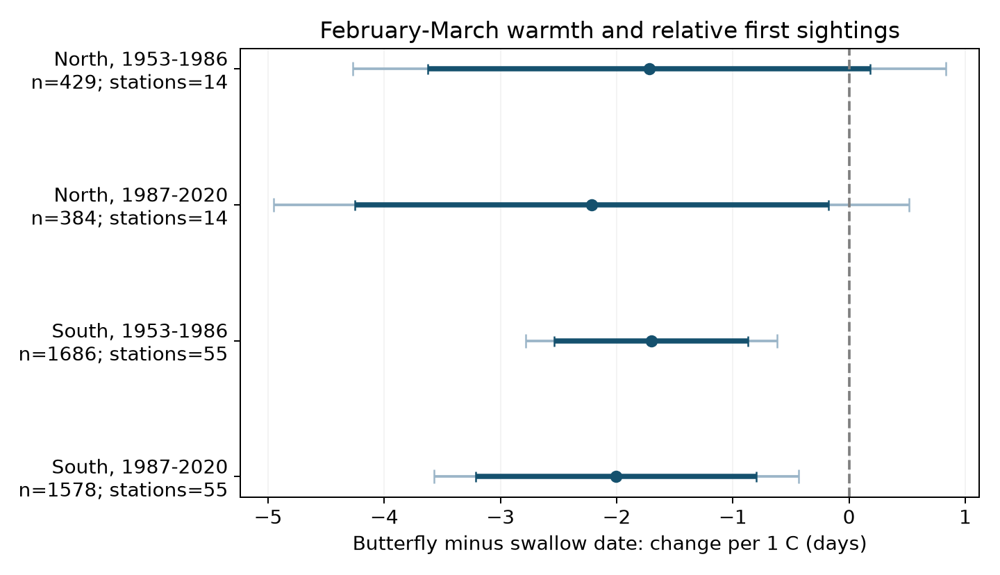
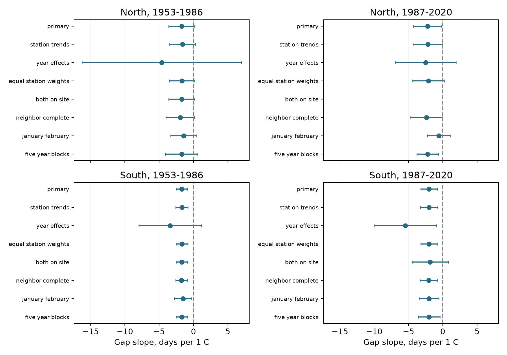

# February-March warmth had negative butterfly-minus-swallow sighting slopes in four Japan samples in 1953-2020

We tested whether a warm early spring changed the date of the first small white butterfly sighting relative to the first barn swallow sighting at the same Japan station. We used 4,077 paired station-years at 69 stations in 1953-2020.

All four estimated slopes were negative. In southern Japan, the primary model gave a change of **-1.70 days per C in 1953-1986** and **-2.00 days per C in 1987-2020**. Both southern intervals excluded zero after a correction for four tests. Both northern corrected intervals included zero. The point estimates thus repeated in sign across regions and periods, but clear primary uncertainty intervals repeated only in the South.

This result depends on the model. With shared year effects, all four corrected intervals included zero. With five-year time blocks, the later southern corrected interval also included zero. The records do not establish a causal climate effect, true arrival or emergence dates, a feeding relation, or a harmful timing mismatch.



Thick bars show marginal 95% intervals. Thin bars show family 95% intervals for the four main slopes, with a Bonferroni correction. Negative values mean that butterfly first sightings move earlier relative to swallow first sightings in warmer years. They do not always mean that the absolute time between the two sightings becomes shorter.

## Question and prior work

Different species can respond to different parts of the annual weather cycle. A species that spends winter near the observation site can respond to local warmth. A migrant can also respond to conditions along its route. Koike, Fujita and Higuchi found different temperature and long-term timing relations among birds, small white butterflies and cherry trees at Niigata. Their study included starling egg laying, rather than swallow first sightings. [Koike et al., 2006](https://doi.org/10.57466/ger.10.2_167). Doi and colleagues studied how different seasonal climate changes can give different plant and insect timing responses in Japan. We use its abstract as context. [Doi et al., 2008](https://doi.org/10.3354/cr00741).

A campaign study found that animal first-detection dates moved later than local warming alone predicted. It also found mixed support for detection bias. We read this result before choosing the present test. [Campaign detection study](sci:sha256:25581ede440edd79d3b5549f9356af2671302c458326692ce9859e87cbe76d7a). Our study compares two first-sighting items within the same station-year. This reduces differences between a sighting and a fixed-tree observation. It cannot cancel species-specific detection error.

The raw JMA observations overlap those in that campaign study and in older journal studies. This is a new paired analysis of public records. It is not a new survey or an independent replication of the underlying observations. The two regions have no stations in common. The two periods have no years in common, but use the same selected stations and the same observation system.

## Data and sample

We used the Japan Meteorological Agency annual phenology archive, items 019 (first swallow sighting, *Hirundo rustica*) and 020 (first small white butterfly sighting, *Pieris rapae*). We parsed all 102 stations for 1953-2020, or 6,936 station-years. The archive had 4,418 pairs with valid dates and regular-target report marks. We kept stations with at least 15 such pairs in each period and a first recorded latitude at or above 30 N. This rule gave 69 stations and 4,077 pairs. We did not select on gap size or weather. No selected date was after June.

A report mark of 8 means the regular target was observed on station grounds. A mark of 9 means it was observed nearby. We excluded substitute targets and dates that JMA excludes from its statistics. JMA states that before 1987, some nearby records were marked as on the grounds. Zero is a missing date. It does not identify whether the animal was absent, the observer did not see it, or the observation did not occur. Animal observations ended after 2020. The source format and observation guide are preserved in `files/docs/`.

We fixed North at a first-history latitude of 37 N or more. South is 30 N to less than 37 N. We used the same stations in both periods.

| Region and period | Pairs | Stations | Fraction of eligible station-years with a pair | Mean butterfly minus swallow date, days |
|---|---:|---:|---:|---:|
| North, 1953-1986 | 429 | 14 | 90.1% | +0.16 |
| North, 1987-2020 | 384 | 14 | 80.7% | +1.28 |
| South, 1953-1986 | 1,686 | 55 | 90.2% | -6.50 |
| South, 1987-2020 | 1,578 | 55 | 84.4% | -2.68 |

These raw means use the available pairs. They are not adjusted trend estimates. Their period differences must not be read as effects of warming.

Temperature data were provided by the NOAA PSL, Boulder, Colorado, USA, from [its website](https://psl.noaa.gov/data/gridded/data.ghcncams.html). We used GHCN-CAMS version 3.01, a 0.5-degree monthly station-based grid. [Fan and van den Dool, 2008](https://doi.org/10.1029/2007JD008470). We matched the cell nearest the station-history position on March 1, among cells with complete monthly data in the Japan block for 1952-2020. We converted K to C. The greatest selected match distance was about 29 km. For 496 pairs, no station-history entry covered March 1, so we used the entry with the nearest start date. These pairs were in 1953-1961; one was in 1961.

Exact raw inputs under `/mnt/dell-data/shared_datasets/`:

| Directory | File | SHA-256 |
|---|---|---|
| `jma-phenology-ruinenchi-all-20261108` | `ruinenchi_all.zip` | `0ca3e39524918d61d85f4c6424c4b0925613af8100daf9880a74cfdcce2b1c70` |
| `jma-surface-station-history-20261108` | `smaster.index.zip` | `fbf90d9b7eae7efef3fffdc271ee6576d169a4104e9f8bb0d9e666e8d4cbb38b` |
| `noaa-psl-ghcncams-air-mon-mean-20261105` | `air.mon.mean.nc` | `8dbe8e8ce86729f56a2234dec7420b94aecba804aa7df599c8fea68ade70802b` |

We measured and checked these hashes. The JMA files are retrieval snapshots, not numbered releases. The NOAA live file can change. `files/data/provenance.json` gives the full shared paths, resolved paths, source URLs, sizes, download records and hashes. The bundle keeps the exact event source tables and all monthly weather values used in the model panel. It does not duplicate the global temperature file.

## Method

The signed outcome is:

`gap = butterfly first-sighting day - swallow first-sighting day`

The primary model, fit separately in each region and period, is:

`gap = station/report-mark-pair intercept + beta * mean(February, March) + January temperature + linear year trend + error`

The month means have equal weight. The day numbers use the Gregorian calendar. We use separate intercepts for each station and pair of report marks. Thus, a persistent difference between on-grounds and nearby reports at a station does not supply the weather coefficient. The common linear trend controls a smooth change over time. It does not remove all shared annual conditions. We set the question, windows, sample rules, main model and checks in `files/protocol.md` before model fitting. This is a local plan, not an external preregistration.

Uncertainty uses two-way cluster covariance: station covariance plus year covariance minus their intersection covariance. Each component has finite-cluster and residual degrees-of-freedom corrections. We use a Student t reference with the smaller cluster count minus one degree of freedom. The primary table gives marginal 95% intervals and a Bonferroni family 95% interval for four slopes. These are approximate intervals with only 14 northern station clusters. The correction does not cover every diagnostic and sensitivity result.

## Results and checks

| Region and period | Gap slope, days per C | Marginal 95% interval | Family 95% interval |
|---|---:|---:|---:|
| North, 1953-1986 | -1.720 | -3.625 to +0.184 | -4.273 to +0.832 |
| North, 1987-2020 | -2.217 | -4.256 to -0.179 | -4.950 to +0.515 |
| South, 1953-1986 | -1.702 | -2.535 to -0.870 | -2.784 to -0.621 |
| South, 1987-2020 | -2.004 | -3.211 to -0.797 | -3.571 to -0.436 |

The butterfly date slopes ranged from -3.12 to -4.88 days per C. The swallow date slopes ranged from -1.40 to -2.88 days per C. Each gap slope equals the butterfly slope minus the swallow slope under the same design. This is a stronger butterfly response in the recorded dates, rather than a comparison of slopes from different samples.

The planned checks gave these results:

- Station trends, equal total station weights, and complete reports in both adjacent years kept all four gap slopes negative. Both southern family intervals stayed below zero in these checks.
- With shared year effects, slopes remained negative, from -2.50 to -5.44 days per C. All four family intervals included zero. This model uses local spatial temperature differences within a year and removes the common annual weather signal. It is a different and less precise conditional test.
- With both sightings on station grounds, the early southern result stayed negative with a family interval below zero. The later South had only 209 pairs and its interval included zero. The later North had only 21 pairs and did not meet our model-size rule. This does not establish that changes in observation location have no effect.
- The January-February window gave negative slopes in all four samples. Only the later southern family interval excluded zero. Separate February and March terms gave clear negative February coefficients in both southern samples; all March intervals included zero. These checks do not establish the correct biological window.
- With five-year time blocks, the early southern family interval stayed below zero. The later southern interval was -4.22 to +0.22 days per C. The later northern interval excluded zero under this check, but its primary family interval did not. We do not replace the primary finding with that check.
- On the full eligible station-year universe, warmth slopes for the probability of a paired report ranged from +0.12 to +2.73 percentage points per C. All marginal and corrected intervals included zero. These uncertain results do not show that missing pairs are random.

All planned models are in `files/results/estimates.csv`, including the check with too few records. The figures and source rows let a reader inspect how the findings depend on the sample and model.



The bars show marginal 95% intervals. The five-year rows use time-block uncertainty. The absent later northern on-grounds result has too few records. The January-February row changes the weather window and uses prior December as a control.

## Interpretation and limits

The negative slopes agree with the explanation that local early-spring warmth advances butterfly activity more strongly than swallow arrival. This is one possible explanation. The records alone cannot test emergence, migration decisions or detection separately. Warm weather can also change animal visibility, search conditions and local abundance. A shared additive sighting delay can cancel in the paired gap; species-specific delays do not cancel. Matching sighting mode does not match observer effort or the chance of detection.

The February-March window extends past at least one sighting in 84, 63, 1,369 and 1,233 pairs in the four table rows. At least one sighting precedes March 1 in 0, 0, 155 and 87 pairs. Thus, the primary window is not a strict exposure period before the outcome, especially in the South. The earlier-window check reduces this problem but gives weaker uncertainty results. Fixed monthly means cannot measure short heat events, chilling, frost, humidity or snow exposure.

Long records and complete pairs are a selected part of the observation network. Station moves, habitat change, animal abundance, observer changes and undocumented search effort can affect the dates. Weather-station coordinates need not equal the sighting location. The early history fallback and coarse grid can add exposure error. Shared year effects remove the common weather signal and give uncertain slopes. Five-year block results show that longer time dependence also matters. Neither covariance model covers every possible dependence across nearby stations and years.

We do not test air pollution, weather damage, species loss, distribution change, or a direct interaction between these species. This study addresses ecological timing within the campaign objective. It gives a paired benchmark for later work with effort and abundance data. It does not prove that long-term warming changed this gap by the year-to-year slope.

## Validation and reproduction

Independent checks covered all 13,872 source station-year-item cells, date conversions, report marks, eligibility rules, adjacent-year reports and gap arithmetic. Full dummy-variable OLS and independent within-category fits agreed with the four primary coefficients to less than 2e-12. A separate covariance implementation agreed to less than 5e-13. A repeated analysis reproduced all 52 model rows. A repeated raw build reproduced all 6,936 panel rows exactly. Check records are in `files/results/`.

Use Python 3.12 and the versions in `files/requirements.txt`. `files/environment.json` records the actual environment. From the publication directory, reproduce the analysis offline into a new directory:

```sh
bash files/run.sh /absolute/path/to/reproduction
```

To rebuild the panel from the shared raw files:

```sh
python files/build.py --datasets /mnt/dell-data/shared_datasets --out /absolute/path/to/rebuilt_data
python files/analyze.py --panel /absolute/path/to/rebuilt_data/panel.csv.gz --out /absolute/path/to/rebuilt_results
```

To retrieve raw inputs into a private directory on another host:

```sh
python files/retrieve.py --dest /absolute/path/to/private_inputs
```

The retrieval script requires the recorded hashes and fails if a live source has changed. The preserved panel supports exact offline analysis without those live sources. Do not write rebuilt outputs into the signed package. `files/data_dictionary.md` explains the data and model fields.

## Attribution and job record

Job: `sci-1107-hp-climate-pollution-biodiversity-da2f3f4e4dfa`. Topic: `climate-pollution-biodiversity`. Campaign: `11_07_2026`. Machine: `hp`. Account: `codex-myxtap`. Model: `gpt-6.1-sol`, high reasoning effort. Work date: 2026-11-08.

We adapted source definitions, station-history parsing and grid matching from [SCI 318a5fc6](sci:sha256:318a5fc615fbc27066113a1b2030d518edcaca085bd734f564628791e2c7c865), which provides code under the SCI baseline MIT terms. JMA and NOAA retain credit for their source data and guides. Source URLs and hashes are preserved. The campaign-machine signature is not a personal authorship claim. We made no remote upload or index submission.
