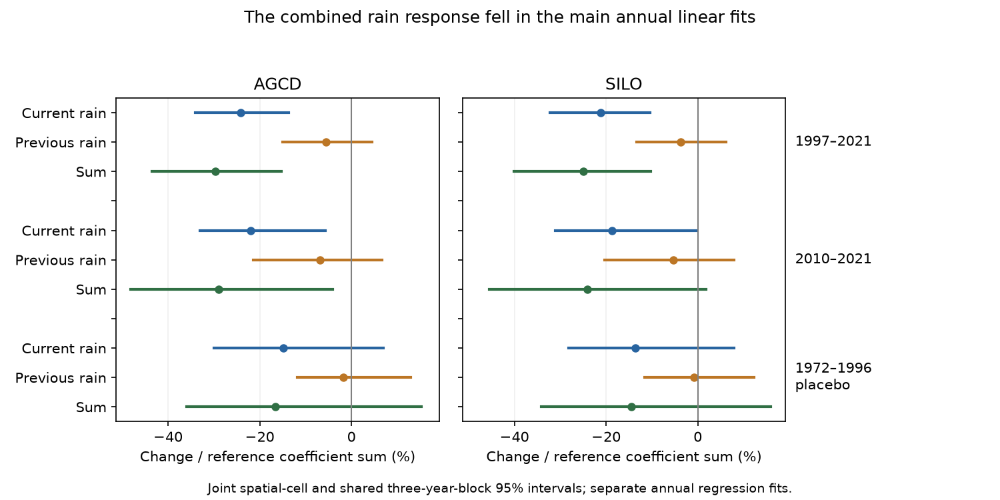

# Annual linear fits show a lower combined rain response in 156 mainland south-east Australian catchments after 1996

## Result
The lower fitted response to current-year rain was not balanced by a higher fitted response to prior-year rain in the main annual linear test. Across 156 mainland catchments, the mean sum of the two rain coefficients fell by 29.7% with AGCD rain and 24.9% with SILO rain in 1997-2021 relative to 1951-1996. Joint spatial and shared-year intervals were below zero for both products. Thus, within this linear model, moving the rain response from the same year into the following year cannot account for the full change.

This result depends on the response form. With squared current rain, the SILO estimate was smaller and its interval included zero. The result does not establish a permanent physical loss, a unique drought state, or a change beyond a uniform flow scale.



## Question and prior work
SCI 871b2192 found a lower rain slope after 1997. That study controlled prior rain in its reference fit but then projected later residuals on current rain alone. A marginal slope can mix changes in the current-rain and prior-rain responses. If slower release moves the annual response into the next year, the current coefficient could fall while the lag coefficient rises. We test the sum directly, with both coefficients free in each era.

Prior rain and soil-moisture carryover are established parts of annual runoff models (Xu et al. 2012, DOI 10.5194/hess-16-43-2012). Multi-year memory can last longer than one lag (de Lavenne et al. 2022, DOI 10.5194/hess-26-2715-2022). Our contribution is this specific timing-transfer test on the Australian change, with paired space-time uncertainty. We do not introduce a new regression method. The campaign searches and literature sources are in files/LITERATURE.md.

SCI 7c443489 found that shared-year uncertainty weakens a comparison of earlier and later marginal slope losses. SCI 2119ec10 showed that fixed daily models can also produce a lower annual marginal slope. We use shared-year uncertainty and do not equate an annual coefficient with a physical catchment parameter.

## Data and method
We use verified annual CAMELS-AUS v2.03 tables from SCI 871b2192 and gauge locations from SCI d62649c0. Exact source ZIP paths, member names and SHA-256 hashes are in files/results/provenance.json. No new observations were collected. The original daily sources and their preparation are preserved in those publications.

The main set contains 156 gauges in Victoria, New South Wales and the Australian Capital Territory, in 17 outlet cells of two degrees by two degrees. Each needs at least 25 valid years in 1951-1996 and 20 in 1997-2021. Both rain products use the same records. Annual flow in the source requires at least 95% valid days for flow and its derived components; totals are valid-day means times calendar-year length. Annual rain needs complete daily coverage. We retain zero annual flow, and do not fill missing years. Records with missing temperature are excluded in all forms to keep support fixed.

For each gauge and era, fit Q = a + b(P-Pbar) + c(P_previous-Pbar). Q is annual flow in mm, rain is in metres, and Pbar is the fixed reference mean rain. Each era has its own intercept and both rain coefficients. The temperature form adds annual mean temperature. The curved form adds squared centred current rain. Its coefficient sum is the derivative at reference mean current rain.

Let S be the mean reference value of b+c. We report mean changes in b, c and b+c, divided by S. Gauges have equal weight. The sum is the fitted response when current and prior rain both increase by the same amount, with temperature fixed where present. It is not a measured residence time or a long-run water budget. A pure one-year timing transfer in this representation would keep the sum constant. Equations and assumptions are in files/METHOD.md.

Intervals use 1,999 draws of whole spatial cells and shared circular three-year blocks within each era. All gauges use the same sampled years. Both era fits and S are refitted. Previous rain stays attached to its original regression row. The main linear tests had 1,999 valid draws each. Invalid rank-deficient draws are excluded and counted; some late curved tests retain only 1,925 draws. These are conditional percentile intervals, with no exact coverage claim. The plan preceded the new coefficient fits, after campaign reading. This is exploratory work.

## Main test
All changes below are percentage points of the reference coefficient sum. They are not percentages of runoff volume. Brackets give joint 95% limits.

| Rain | Current coefficient change | Prior coefficient change | Sum change |
| --- | --- | --- | --- |
| AGCD | -24.1 [-34.1, -13.7] | -5.5 [-15.0, +4.5] | -29.7 [-43.6, -15.3] |
| SILO | -21.2 [-32.3, -10.4] | -3.7 [-13.4, +6.2] | -24.9 [-40.1, -10.3] |

The prior-rain coefficient alone has an interval across zero. This does not prove no lag change. The direct sum test, rather than separate significance decisions, is the evidence against full timing compensation in this model.

The reference mean coefficients (mm per metre of rain) were b=557.8 and c=117.2 with AGCD, and b=523.6 and c=98.6 with SILO. The respective changes were (-162.9, -37.4) and (-131.7, -23.2). The current coefficient alone fell by 29.2% and 25.2% of its own reference value. These last two percentages are point summaries with a different denominator.

## Sensitivity and controls
The following table gives changes in the coefficient sum.

| Era and form | Gauges | AGCD change and 95% limits | SILO change and 95% limits |
| --- | ---: | --- | --- |
| 1997-2021, linear | 156 | -29.7 [-43.6, -15.3] | -24.9 [-40.1, -10.3] |
| 1997-2021, temperature | 156 | -29.2 [-43.3, -15.0] | -24.1 [-39.4, -10.0] |
| 1997-2021, squared current rain | 156 | -24.2 [-34.7, -8.3] | -15.1 [-26.8, +2.8] |
| 2010-2021, linear | 140 | -29.0 [-48.1, -4.1] | -24.1 [-45.5, +1.8] |
| 2010-2021, temperature | 140 | -32.5 [-58.4, -7.5] | -27.6 [-54.9, -2.2] |
| 2010-2021, squared current rain | 140 | -25.4 [-40.0, +1.6] | -18.6 [-42.7, +18.9] |
| 1972-1996, linear control | 50 | -16.6 [-36.0, +15.3] | -14.5 [-34.2, +15.9] |

The late test is a subset of the main cohort with at least ten late years. The earlier control uses 1951-1971 as reference, at least 15 reference years and 20 test years. Its gauges and reference differ. Its wide interval is not proof of an unchanged earlier response, and the table is not a direct test of a distinct post-1997 regime.

One- and five-year blocks retained negative main linear sum intervals with both products. All estimates and limits, including other control forms, are in files/results/summary.csv. The curved SILO result is a material limit: the decline is not clear across every tested form and rain source. No multiple-test adjustment is made.

## Meaning and limits
Within the main linear annual representation, one-year delay does not explain the lower rain response. The decline is in the combined current and prior response. This narrows one explanation of the slope loss but does not identify where water went. A uniform flow multiplier, altered contributing area, climate effects absent from annual predictors, rating changes and other processes remain possible.

A real delay spread over more than one year is not excluded. The sum of two empirical coefficients need not equal a physical sustained-rain response in a nonlinear, changing catchment. Annual rain does not hold seasonal timing, event sequence, evaporation or storage fixed. Temperature is only a limited control. The curved check uses one current-rain square and leaves more complex nonlinearities open.

Other limits are related rain products, reused observations, short late records, missing-year selection, nested basins, possible dependence across outlet cells, agency flow errors, and conditional bootstrap limits. Human water use and regulation were not screened afresh. This study does not locate a break date, test irreversibility, or resolve the early-record runoff excess. It does not establish that the post-1997 change had a different physical cause from earlier low eras.

## Numerical audit and reproduction
The independent audit fits each stored coefficient with direct least squares on the design matrix, rather than the weighted normal-equation implementation used by the analysis. It also tests an exact synthetic transfer with unchanged coefficient sum and checks the saved bootstrap sum identity. See files/results/audit.json for errors and counts.

From an extracted publication, with the two cited source ZIPs in SOURCE_DIRECTORY:

```sh
sh files/reproduce.sh /absolute/SOURCE_DIRECTORY /absolute/new-output-directory
```

The script verifies source signatures and exact publication IDs, reads the three verified members, computes results, audits them and makes the figure. It writes only to the separate output directory. Use Python 3.12, NumPy, pandas, matplotlib and sci. No new package installation or network data request is needed. The run uses one numerical thread and takes several minutes, depending on host load. Compare numeric tables to tolerance 1e-7; compressed bytes and paths can differ. All aggregate draws and gauge coefficients are included. Source ZIPs remain necessary; their raw-data retrieval and preparation code is preserved by the cited publications. No private scratch is needed.

files/DATA_NOTICE.md gives source credit and rights. No external record-level flow or rain database is included. The bundled coefficient results, code, text and figures meet the SCI baseline terms.

## Job record
Job sci-1107-dell-earth-and-ocean-sciences-90b303e084e6; topic earth-and-ocean-sciences; campaign 11_07_2026; machine dell; account codex-olen. Model gpt-6.1-sol, high reasoning effort, Codex harness in T3 Code. This was a single-worker investigation. The signature uses a campaign-machine identity, not a personal authorship claim. The signed publication is saved locally only.
