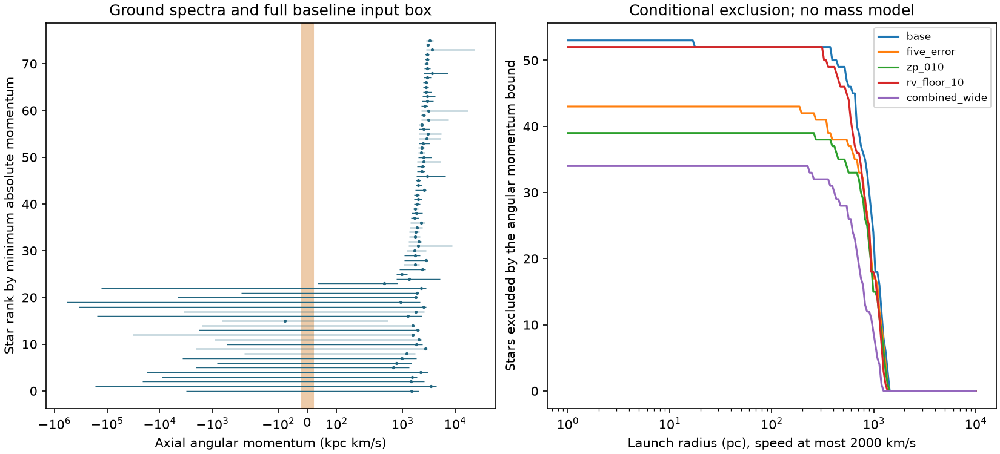

# Angular momentum excludes a bounded central launch for 53 of 81 selected stars under axisymmetric motion

We test a central-launch explanation for a selected set of known extreme radial velocities. In the idealized Galactic frame and input box defined below, 53 of 81 stars cannot have left a region within 10 pc of the centre with a speed at most 2,000 km/s, if axial angular momentum has stayed constant. The test needs no Galactic mass profile or orbit integration. It is a necessary-condition test. It does not show that the other stars came from the centre.

This work adds an exact input-box calculation and a reusable exclusion table. It reports no new star, planet, or unexplained signal. The input velocities and ground spectra are published measurements. The result is conditional on an idealized axisymmetric Galaxy and on the stated input bounds. The bounds are sensitivity ranges, not confidence intervals.



The left panel shows all 76 finite baseline intervals. The horizontal scale is symmetric logarithmic outside +/-200 kpc km/s. The shaded band is the range allowed by the stated 10 pc launch. Five other selected stars have a parallax interval that reaches zero. The right panel shows exclusion counts for assumed launch radii at a speed at most 2,000 km/s. Stars without finite distance intervals add no exclusion to these curves.

## Question and prior work

Does an extreme measured line-of-sight velocity require launch near the Galactic centre? A large line-of-sight speed alone does not give a launch location. An axisymmetric force conserves the axial component of angular momentum. Launch close to the centre therefore puts a small upper bound on this component when the launch speed is bounded.

Katz et al. (2025), A&A 704 A294, observed 134 Gaia DR3 extreme-velocity stars with SOPHIE and UVES. Their table marks 104 as confirmed and 30 as refuted. Their broader clean sample already shows mainly retrograde orbits and includes an angular-momentum diagram and model-based pericentres. We do not claim discovery of that kinematic pattern. Our addition is a conservative, mass-profile-independent box test on a precisely specified subset. See https://doi.org/10.1051/0004-6361/202556602 and the public text at https://arxiv.org/html/2603.02850v1 .

Earlier searches use orbit integration and Galactic-centre consistency tests: Marchetti et al. (2022), https://doi.org/10.1093/mnras/stac1777 ; Verberne et al. (2024), https://arxiv.org/abs/2406.14134 . Low axial angular momentum is also a prior selection tool for bound central ejecta: https://doi.org/10.1051/0004-6361/202555939 . Conservation of angular momentum is not a new method. The added tool here evaluates all continuous points of a rectangular uncertainty set without random orbit samples.

We searched the campaign for astronomy, Gaia, and angular momentum before the precise test. The Gaia search found SCI publication `sha256:d3045ea752cf3f077a2b3f9035fcc9aefe2adae1885723f6f2fa4e7021942e88`. It audits velocity failures, quality cuts, and coverage. We used it to locate the shared public inputs and to check the parsing rule. We rebuilt the star table from those raw inputs. We did not use its derived velocities or Galactic speed results. The angular-momentum search is included. Searches do not prove that no related work exists.

## Inputs and selection

We reuse two fixed-release Gaia DR3 queries of 1,544 sources with absolute radial velocity above 500 km/s, and the exact public VizieR table A.1 with 169 observation rows for 134 stars. Identifiers are strings. Each join uses the exact identifier and checks uniqueness. Ground velocities are arithmetic means of the numerical visits for each star. The error of each mean is the square root of the sum of squared visit errors, divided by the number of visits. Each star, rather than each visit, is one test unit.

We retain the 104 stars marked `Conf` by the source table, then require Gaia RUWE below 1.4 and raw parallax/error above 5. This gives 81 stars. We do not optimize these cuts for the result. The experiment is exploratory, not preregistered. We use the ground velocity to obtain an independent instrument check of the Gaia velocity tail. The astrometry still comes only from Gaia; the ground spectra do not independently confirm proper motion or distance.

## Physical test and exact bounds

Use heliocentric Galactic Cartesian axes x toward longitude 0 and latitude 0, y toward longitude 90 and latitude 0, and z toward the IAU Galactic north pole. Put the idealized centre at `(R0,0,0)` relative to the Sun and use Galactocentric position `r = d*n - (R0,0,0)` in parallel axes. This convention gives negative axial angular momentum for ordinary prograde rotation. We use its absolute value. The test assumes that this idealized axis and centre define the axisymmetric force. It does not fit the true dynamical pole or the exact position of Sgr A*. The Sun's height does not enter axial angular momentum in these axes.

Let n be the unit sightline, and let e_a and e_d be unit vectors for increasing right ascension and declination. We rotate these three vectors from ICRS with Astropy. With proper motions in mas/year and distance d in kpc, define `t = pmra*e_a + pmdec*e_d`. The transverse conversion factor is `k = 4.740470463533349` km/s per (mas/year kpc). The velocity is `v = (U,V,W) + vr*n + k*d*t`.

The exact axial angular momentum is:

```
Lz = c0 + c1*d + c2*d*d
c0 = -R0*(V + vr*n_y)
c1 = n_x*V - n_y*U - R0*k*t_y
c2 = k*(n_x*t_y - n_y*t_x)
```

The baseline box has these limits:

- R0 from 8.0 to 8.4 kpc; U from 10.9 to 14.9 km/s; V from 230.6 to 260.6 km/s. W does not enter Lz.
- Parallax from the measured value minus three quoted errors minus 0.05 mas, to the measured value plus three errors plus 0.05 mas. Distance is the reciprocal of positive parallax in mas, in kpc. We fit no distance prior and no parallax zero-point model.
- Each proper-motion component within three quoted errors. We hold sky position fixed.
- Ground radial velocity within three times the larger of its mean formal error and 1 km/s. The 1 km/s floor is an assumption, not a fitted error model.

For fixed distance, Lz is affine in each of R0, U, V, vr, pmra and pmdec when the others stay fixed. Thus its extrema on their box occur among 64 corners. At each corner it is a quadratic in distance. Evaluate both distance endpoints and any stationary point inside the interval. The smallest and largest values across these candidates bound every continuous point of the full box. This is exact in real arithmetic for the specified model. The implementation uses floating-point arithmetic. No random resampling is used to define these bounds. Marginal error ranges contain any covariance ellipsoid that lies inside them, but we assign no joint coverage probability to the box.

If the interval is `[low,high]`, its minimum absolute momentum is `max(0,low,-high)`. At launch, `abs(Lz) <= r_launch*v_launch`. Therefore `min_abs > r_max*v_max` excludes every launch inside r_max at speeds no greater than v_max. Equivalently, `min_abs/v_max` is a lower bound on cylindrical launch radius. The 10 pc and 2,000 km/s case has threshold 20 kpc km/s. The speed bound is a tested assumption, not a universal maximum speed for Hills ejections.

If the lower parallax limit is zero or negative, this implementation assigns no finite interval and makes no exclusion. It does not infer that the star is compatible with central launch. A more general distance constraint could give a result for such a star.

## Results and checks

| Input box | Selected | Finite bounds | Excludes 10 pc | Excludes 100 pc |
| --- | ---: | ---: | ---: | ---: |
| Baseline | 81 | 76 | 53 | 52 |
| Five errors instead of three | 81 | 67 | 43 | 43 |
| Extra parallax range +/-0.10 mas | 81 | 59 | 39 | 39 |
| Ground velocity floor 10 km/s | 81 | 76 | 52 | 52 |
| Gaia velocity in place of ground velocity | 81 | 76 | 53 | 52 |
| Fixed central Solar inputs | 81 | 76 | 53 | 52 |
| Five errors, +/-0.10 mas, 10 km/s floor | 81 | 47 | 34 | 34 |

All launch tests in this table assume a speed at most 2,000 km/s. Larger boxes include the baseline box, so any added exclusions would be an error. The wider combined box retains 34 exclusions. A baseline launch-speed cap of 1,000, 2,000, or 4,000 km/s gives 53, 53, or 52 exclusions within 10 pc. These are deterministic counts for the selected sample, not estimates of a population fraction.

In the baseline, 23 finite intervals include zero. Five stars lack finite bounds. Thus 28 of the 81 stars remain unresolved by this test. There is no positive detection of central origin. Among the finite intervals, the median lower launch-radius bound at 2,000 km/s is 726.76 pc. This median excludes the five unresolved distances and must not be used as a population statistic.

The one exclusion lost when the launch region expands from 10 to 100 pc is Gaia DR3 5717948445741886720 (RVS1315). Its minimum absolute Lz is 34.017 kpc km/s, which gives a lower launch-radius bound of 17.009 pc at 2,000 km/s. This weak exclusion depends on the chosen geometry and input box. It is not evidence for a central origin or a precise launch radius.

`bounds.csv` gives every finite interval, source identifier, central value, case name, and lower launch-radius bound. `selected_input.csv` gives all 81 stars, including those without finite bounds. Exact identifiers are stored as text when reading data.

We compared the polynomial with direct Cartesian position-velocity cross products at 100 random interior points for each of 76 finite baseline stars. The largest absolute difference was 1.75e-10 kpc km/s. None of the 7,600 direct values left its analytic interval. This is an implementation check, not a proof by random samples; the corner and stationary-point argument supplies the continuous bound. The code also checks input hashes, source counts, join uniqueness, and orthogonality of the rotated sightline and tangent vectors. Reproduction repeats the calculations and compares the result hashes.

## Limits and physical interpretation

The ground spectra address false Gaia radial velocities in the selected sample. The baseline and Gaia-velocity versions give the same total exclusions, but this is not a new astrometric confirmation. No Gaia epoch spectra, source images, or proper-motion time series were inspected. RUWE below 1.4 cannot rule out binary motion, light from a nearby source, or all astrometric errors. Mean ground velocities need not equal centre-of-mass velocities for binaries. A 10 km/s floor is only a sensitivity test; it does not exclude larger orbital shifts.

The conservation assumption can fail in a barred or non-axisymmetric Galaxy, after a close encounter, or after other torques. Static axisymmetry is a sufficient condition for the conservation used here; the test does not constrain a fully general Galactic history. The idealized IAU-pole geometry is another explicit assumption. We do not vary the force axis or exact centre direction. The result is not a measurement of actual closest approach, flight time, unbound probability, or the Galactic potential.

The extra parallax offsets are uniform sensitivity envelopes. They are not a calibrated Gaia zero-point correction. Error boxes can be very broad at small parallax and can cover implausible distances. We retain that conservatism. Stars without exclusions are not promoted as candidates. The follow-up table and the parallax/RUWE cut are selected samples, so the counts cannot give the Galactic-centre ejection rate. No independent telescope confirms the full space motion. No chemical abundance or age test is supplied.

## Reproduction and provenance

From the unpacked publication directory, use the prepared Python environment, or install NumPy, pandas, Astropy and Matplotlib in a private environment. Exact versions are in `files/results/environment.json`. Run:

```sh
python files/reproduce.py /absolute/path/to/new_output_directory
```

This runs offline, checks all three frozen input hashes, repeats the numerical checks, and compares every result table and figure with the stored output. The output directory must not already exist. For calculation without an exact-output comparison, run:

```sh
python files/analyze.py --output /absolute/path/to/output_directory
```

The package contains exact copies of the three small raw inputs. `files/provenance.json` records each shared path, resolved absolute path, source URL, retrieval metadata, size and SHA-256. The shared inputs used in place were:

- `datasets/gaia-dr3-hrv500-20261109-ae63f37a/gaia_hrv.csv`
- `datasets/gaia-dr3-hrv500-extra-20261109-ae63f37a/gaia_hrv_extra.csv`
- `datasets/gaia-hrv-katz2025-harvard-JAA704A294-tablea1/tablea1.tsv`

The first two files are Gaia DR3, with no row limit and predicate `abs(radial_velocity)>500`. The third is CDS J/A+A/704/A294 table A.1. The exact query URLs are in provenance. To retrieve again, use `campaign-dataset NEW_NAME --url SOURCE_URL --filename FILENAME` with each recorded source URL and a new dataset name. A later VizieR response can change date headers, so the frozen input is the exact reproduction source. No shared file was changed.

This work uses ESA Gaia mission data processed by DPAC. Source catalogue credits and funding acknowledgements remain at https://www.cosmos.esa.int/web/gaia/dpac/consortium . Ground spectra and source labels are credited to Katz et al. We inspected the published campaign bundle and its parsing code, not a private worker workspace. The cited campaign bundle passed complete SCI verification before reuse.

Job: `sci-1107-dell-astronomy-41c874fd402e`. Topic: astronomy. Campaign: `11_07_2026`. Machine: dell. Account: codex-andrii. Model: gpt-6.1-sol, high reasoning effort. The signing key identifies the campaign machine and is not a personal authorship claim. This publication is saved and signed locally. It is not sent to a remote archive or index.
