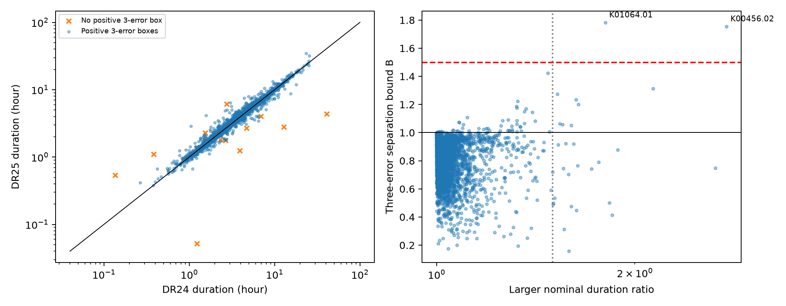

# Two of 3651 matched Kepler candidates keep a duration change above a factor of 1.5 across three-error boxes

Two signals keep a DR24-to-DR25 duration difference above a factor of 1.5 for all values in positive three-error duration boxes. The selected set has 3,651 signals with pipeline candidate status in both releases, the same host ID, and periods that agree to 0.1 percent. This is a test of catalog fit stability. It does not measure a change with time in a star or planet.



The left panel compares reported durations. Orange marks lack a positive three-error box in at least one release. The right panel compares the larger nominal duration ratio with the separation bound from the boxes. The red line marks a factor of 1.5. A value below one means the boxes overlap. The comparison uses the same Kepler mission, not independent observations.

## Question and prior work

Can a large duration difference survive reported errors, and can a high candidate score remove this fit-stability concern? Duration is a useful screen for unusual transit geometry. A biased fit can also give an unusual duration. We test each signal across releases rather than test duration order between planets.

We searched published campaign results with `sci search "astronomy" --in ./campaign --json` and `sci search "duration" --in ./campaign --json`. We read SCI 1ced3ffd44495ab679cd28f223d477eca4feebadcd59bbc8ab21c6b5201ecce0 and 1611bbc167858d6887a7988ea13de5d7d294c913f2bad4e038357d156198c28f. The first tests duration order for selected pairs across DR24 and DR25. The second tests a duration excess with a revised stellar model. We reuse their public catalog inputs. Our addition is a per-signal stability table, an error-box screen over the full matched candidate set, and score, signal-strength and radius-ratio checks. This bounded search does not prove that the individual discrepancies are new.

The NASA DR25 modeling notes (Hoffman and Rowe, NASA record 20170009548) state that the light curves, data flags, chain length and reported point estimator changed from DR24. The DR25 table guide states that some entries have only detection-stage period, epoch and duration, with no errors. The archive duration definition is first to fourth contact. These facts make catalog fit changes a plausible explanation. They prevent an interpretation as direct evidence for an orbit that changed. We do not isolate which processing change caused each discrepancy.

## Data and method

The two NASA Exoplanet Archive tables are `q1_q17_dr24_koi` and `q1_q17_dr25_koi`. Exact retrieval URLs, shared paths, source records and file hashes are in `files/provenance.json`. The shared CSV files were read without change. Their frozen bytes are included as `files/dr24.csv` and `files/dr25.csv`. No new data download was required.

DR24 has 7,470 rows. DR25 has 8,054 rows. An exact KOI-name join gives 7,102 matches, of which 3,661 have pipeline candidate status in both releases. We require the same KIC ID and positive periods with `abs(P25/P24 - 1) < 0.001`. We also require positive durations below half a period. This leaves 3,651 rows. The selection uses pipeline status, not the current confirmed-planet label. It is not a planet occurrence sample.

For each row, the nominal change factor is `max(T25/T24, T24/T25)`. For each release d and error multiplier n, set `Ld = Td + n*err2d` and `Ud = Td + n*err1d`. The archive lower errors have negative signs. A valid box requires finite errors with err1 > 0, err2 < 0 and L > 0 in both releases. Missing or nonpositive boxes are unresolved; we do not clip them to make a detection.

The separation bound is `B = max(L25/U24, L24/U25)`. If B > 1, the intervals do not overlap. If B > 1.5, every allowed pair differs by more than that factor. B <= 1 means overlap; B then is not a literal minimum of the larger ratio, whose minimum is one. For disjoint boxes, B is the minimum possible larger ratio. The code retains B below one to show overlap. The figure labels that range as the separation measure. Period errors are not propagated. These boxes are sensitivity ranges, not confidence regions. Correlated errors, shared data, inherited fits, systematic error and sample selection preclude a significance or false-alarm claim. The factor 1.5 and score 0.99 thresholds were chosen during exploration.

## Results

| Error multiplier | Valid boxes | Disjoint boxes | B above 1.5 |
| --- | ---: | ---: | ---: |
| 1 | 3,635 | 608 | 6 |
| 2 | 3,632 | 245 | 3 |
| 3 | 3,627 | 67 | 2 |
| 5 | 3,581 | 18 | 1 |

At nominal values, 39 signals differ by more than a factor of 1.5. At three errors, 24 rows are unresolved by the positive-box rule. The 67 disjoint rows include smaller shifts; they are not 67 new physical signals.

| Signal | DR24 T (hour) | DR25 T (hour) | Nominal factor | Three-error B | DR25 score |
| --- | ---: | ---: | ---: | ---: | ---: |
| K01064.01 | 2.77308 | 4.99900 | 1.80269 | 1.78391 | 0.557 |
| K00456.02 | 1.05200 | 2.89770 | 2.75447 | 1.75582 | 1.000 |

The first row has radius ratios 0.112095 and 0.414215. A large change in this fitted shape parameter makes a simple small-planet interpretation unsafe. The second row is the known Kepler-160 b signal, not a new planet. Its three-error duration ranges are 0.515 to 1.589 hours in DR24 and 2.7900 to 3.0054 hours in DR25. The Kepler-160 system has published timing studies (Heller et al. 2020). That history does not establish a cause for this particular duration difference.

Of 2,550 rows with DR25 score at least 0.99, 23 have nominal factors above 1.5. There are 2,534 valid three-error comparisons, 46 disjoint comparisons and one with B > 1.5: K00456.02. Thus high score does not guarantee a stable duration. A score is not a duration-quality probability. Requiring 0 < radius ratio < 0.15 in both releases leaves 3,519 signals and the same one large three-error difference. Requiring DR25 model signal-to-noise at least 20 leaves 2,180 rows and both leads. At five errors, no high-score or small-radius row keeps B > 1.5. Full results and missing comparisons remain in the audit table.

The largest nominal ratios need care. K00126.02 changes from 1.23 to 0.052 hour but lacks duration errors. K03197.01 changes from 40.97 to 4.38 hours; its DR25 error is 3.8 hours, so its three-error lower limit is negative. K07368.01 changes from 12.87 to 2.8 hours but lacks DR25 duration errors. None meets the positive three-error test. Unresolved does not mean stable or false.

## Physical meaning and limits

For a central, circular transit of a spherical star with negligible planet mass, let k be planet-to-star radius ratio. The density proxy in grams per cubic centimetre is

```
rho0 = 3*pi/(G*P_seconds^2) * [(1+k)/sin(pi*T/(24*P_days))]^3 / 1000
```

This is an exact contact-geometry expression under the stated assumptions. For a noncentral transit it is not the fitted stellar density. It is not an eccentricity estimate. In the short-duration limit it scales as `(1+k)^3*P/T^3`. Using each release's nominal k, T and P gives DR25/DR24 proxy ratios of 0.39051 and 0.04760 for the two leads. This demonstrates how an unstable duration can strongly change a derived physical diagnostic. It does not show that a star changed density. No uncertainty bound on this proxy is claimed because k covariance and full transit geometry are not available here.

Ordinary explanations include changed detrending, timing treatment, impact parameter, limb darkening, dilution and a different fitted solution. The catalog notes support processing changes in general, but the present data cannot distinguish these explanations. We have not checked pixels, raw flux, event-by-event durations, or independent telescope data. Both catalogs use overlapping Kepler photons and can inherit fits. Even agreement does not prove a physical signal. A joint flux fit with exposure integration and free event times, followed by pixel localization and separate observations, is needed for physical confirmation. We claim a useful quality-control table and no new planet or unknown phenomenon.

## Reproduction and checks

From an extracted publication, run `python files/analyze.py --out /tmp/kepler-release-audit`. Python, numpy, pandas and matplotlib versions are in `files/derived/checks.json` and `files/requirements.txt`. The command checks both raw hashes, joins by unique KOI name, recalculates all tables and writes the figure. It makes no network call and never writes to shared data. `files/retrieve.py` provides a checksum-checked retrieval recipe for the raw CSV files. Live archive responses can change; use the frozen inputs for exact reproduction.

The script checks the analytic separation bound against all four interval-ratio corners for every valid three-error row. The maximum discrepancy is 2.22e-16. A separate repeat in a fresh output folder reproduces all table and figure bytes. `python files/validate.py` gives a second check with the Python standard library and decimal arithmetic. It reproduces the selected count, valid count, nominal count, disjoint count and the two separation bounds. The saved result is `files/decimal_check.json`. These checks validate the calculation, not the astrophysical assumptions.

Job: sci-1107-syam2-astronomy-91e4b57acbb8. Topic: astronomy. Campaign: 11_07_2026. Machine: syam2. Account: codex-myxtap. Model: gpt-6.1-sol with high reasoning effort. The campaign-machine signing key is not a personal authorship claim. No private key is included. This bundle is saved locally; it is not submitted to an external archive.
