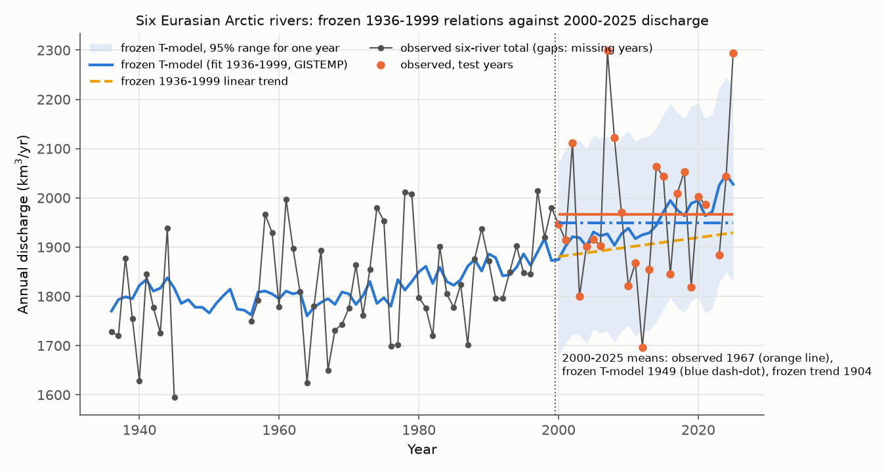
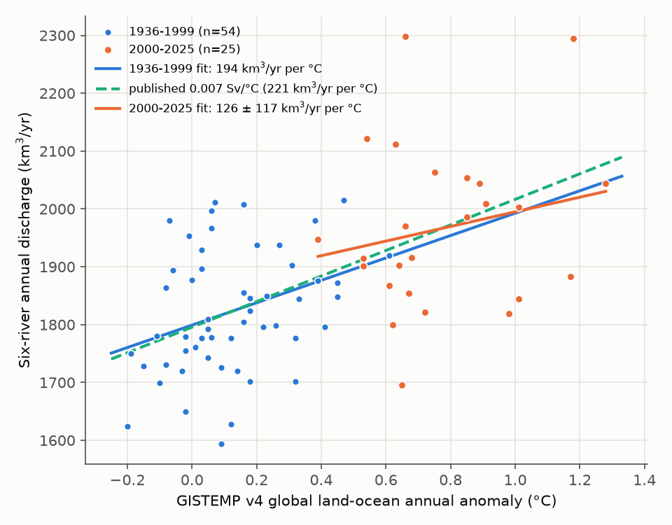
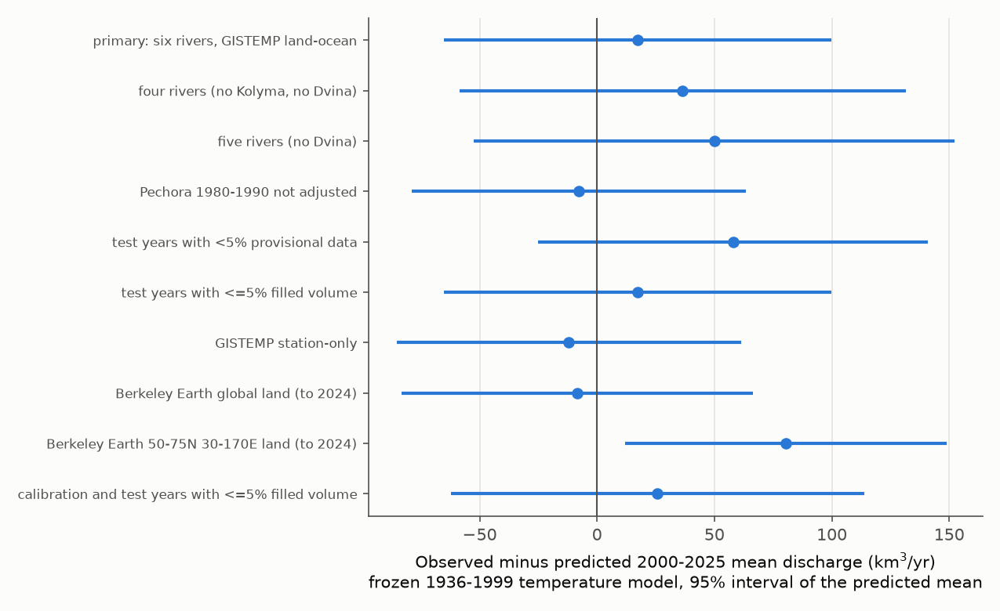

# A 1936-1999 global temperature link predicted the 2000-2025 mean discharge of six Eurasian Arctic rivers to within 1%, but year-to-year changes did not follow temperature

## Summary

Peterson et al. (2002, Science 298:2171) found that the combined annual discharge of the six largest Eurasian Arctic rivers increased from 1936 to 1999. They also found a relation between this discharge and global mean surface air temperature, with a slope of 0.007 Sv per degree C (221 km3/yr per degree C). They used this slope to extrapolate an 18-70% discharge increase by 2100.

We did an out-of-sample test of this relation. We fitted the relation on 1936-1999 data only. Then we kept the fit frozen and compared its prediction with the discharge in 2000-2025. We wrote the test plan before we loaded discharge values for 2000-2025 (files/PLAN.md). The global temperature increased much more quickly after 2000 than before. Thus, the test period has temperatures outside most of the calibration range.

Main results:

1. **The frozen relation predicted the 2000-2025 mean.** The observed 2000-2025 mean of the six-river total was 1,967 km3/yr (25 years). The frozen 1936-1999 temperature fit predicted 1,949 km3/yr. The 95% interval of the predicted mean was 1,867 to 2,032 km3/yr. The error was +17 km3/yr (0.9%, z = 0.41). The published slope with no refit gave a mean error of -0.4 km3/yr.
2. **The discharge sensitivity in 2000-2025 agreed with the published value.** The 2000-2025 change from the 1936-1999 mean was 143 km3/yr (7.8%). Divided by the temperature change, this gives 220 km3/yr per degree C (95% block-bootstrap interval 128 to 307). The published value is 221 km3/yr per degree C.
3. **The temperature fit was better than no change, but we could not separate it from a linear trend.** The temperature fit had 51% less mean squared error than the 1936-1999 mean (95% interval of the error difference excludes zero). The frozen 1936-1999 linear time trend (1.94 km3/yr per year, which agrees with the published 2.0 +/- 0.7) predicted 1,904 km3/yr. This is 63 km3/yr below the observed mean (z = 1.84, inside its 95% interval). The temperature fit had 16% less squared error than the trend, but the 95% interval of this difference includes zero.
4. **Year-to-year changes in discharge did not follow year-to-year changes in global temperature.** The first-difference slope was 158 +/- 152 km3/yr per degree C in 1936-1999 and -288 +/- 251 in 2000-2025 (HAC standard errors). The link is in the multi-decadal change only.
5. **Robustness.** The observed mean stayed inside the 95% interval in 8 of 9 alternative tests: four or five rivers, a different Pechora fill, years with few provisional or filled values, GISTEMP station-only temperature, and Berkeley Earth global land temperature. The one failure used Berkeley Earth land temperature over the basin region (50-75 N, 30-170 E). Regional warming after 2000 was much larger than the calibrated regional slope allows, so this model under-predicted discharge by 81 km3/yr (z = 2.3). This agrees with the choice by Peterson et al. of global, not regional, temperature.
6. **Rivers and seasons.** Five of six rivers were inside their own 95% intervals. The Northern Dvina was over-predicted by 19 km3/yr (z = -2.75). Its calibration has no data for 1946-1955. The cold-season (November-April) discharge of the six rivers increased by 49 km3/yr from 1978-1999 to 2000-2025, and a 1978-1999 temperature fit predicted this increase (error -1 km3/yr). The seasonal fits have only 16 calibration years.
7. **NAO.** The correlation of annual discharge with the December-March NAO index (NOAA CPC) was weak and did not change: r = 0.25 in 1950-1999 (n = 44) and r = 0.25 in 2000-2025 (n = 25).

## Interpretation and limits

- The result supports the empirical scaling of Peterson et al. (2002) over a period with much more warming than the calibration period. It does not prove that global temperature causes the discharge increase. Any cause that increased slowly and together with global temperature can give the same result. The year-to-year test gives no direct support.
- The temperature fit and a simple linear time trend both kept the observed mean inside their intervals. The data cannot yet show that temperature is a better predictor than time. The difference between them will increase if warming continues to accelerate.
- Most Russian discharge after 2017 is provisional (flag P). For 2023-2025, 87-100% of the volume is provisional. A test with only the 11 test years that have less than 5% provisional volume gave a +58 km3/yr error, inside the interval (z = 1.37).
- The ArcticGRO record has gaps that the Peterson et al. data did not have. We filled cold-season gaps with same-day means from nearby years (October-May), and we interpolated short warm-season gaps. We estimated Kolyma at Kolymskoye from Srednekolymsk before 1978 and in 1995-1998. The six-river total has 54 of 64 calibration years (1946-1955 have no Northern Dvina data) and 25 of 26 test years (2022 has a 39-day warm-season gap at Pechora). The four-river total (Yenisey, Lena, Ob, Pechora; about 90% of the volume) has all 64 calibration years and gave the same result.
- Pechora at Ust-Tsilma in 1980-1990 has values that are copies of the Oksino record (dataset README). We scaled these years by the median Ust-Tsilma/Oksino ratio (0.736, only 3 overlap years). Without this change, the calibration slope was 223 km3/yr per degree C and the 2000-2025 error was -8 km3/yr.
- Yenisey and other rivers have dams. Dams change the seasonal pattern more than the annual total, but reservoir filling in the 1960s-1980s can change some annual totals.
- We used current GISTEMP v4 values, not the 2002 version. GISTEMP is updated every month.
- The CPC NAO index is not the station-based Hurrell index that Peterson et al. used.
- The 2100 extrapolation in Peterson et al. is outside the range of this test.

## Methods

Data. Daily discharge from the ArcticGRO Discharge Dataset v20261104 (doi:10.5281/zenodo.23957360; CC BY 4.0; data from Roshydromet) at the six Peterson et al. stations: Yenisey at Igarka, Lena at Kyusyur, Ob at Salekhard, Kolyma at Kolymskoye, Pechora at Ust-Tsilma and Northern (Severnaya) Dvina at Ust-Pinega. Global temperature: GISTEMP v4 annual (J-D) land-ocean and station-only means. Sensitivity: Berkeley Earth gridded land temperature (global land and the 50-75 N, 30-170 E land box; to 2024). NAO: NOAA CPC monthly index, mean of December-March.

Annual totals. Calendar-year sums of daily mean discharge, in km3/yr. Gap rules and the Kolyma and Pechora steps are in files/PLAN.md (two amendments, both made before any fit) and in files/code/01_annual_discharge.py.

Test. Four frozen models fitted on 1936-1999 only: (1) OLS of discharge on GISTEMP land-ocean temperature (T-model); (2) the published slope through the 1936-1999 means; (3) OLS on year; (4) the 1936-1999 mean. Scores on 2000-2025: mean error and root mean squared error. The 95% interval of the predicted 2000-2025 mean uses the Newey-West (lag 3) parameter covariance and the calibration residual variance with an AR(1) correction. Score differences use a moving-block bootstrap (block length 3 years, 20,000 resamples). Decision rule (fixed in the plan): the relation "predicted" 2000-2025 if the observed mean is inside the 95% interval.

| Model (frozen 1936-1999) | Predicted 2000-2025 mean (km3/yr) | Mean error (km3/yr) | RMSE (km3/yr) |
|---|---|---|---|
| Global temperature fit (194 +/- 58 km3/yr per degree C) | 1,949 (95%: 1,867-2,032) | +17 | 140 |
| Published slope (221 km3/yr per degree C) | 1,967 | -0.4 | 140 |
| Linear time trend (1.94 km3/yr per year) | 1,904 (95%: 1,837-1,971) | +63 | 153 |
| 1936-1999 mean | 1,824 | +143 | 201 |

Figure files/figures/fig4_rivers_seasons.png shows the errors for each river and season.

## Files

- files/PLAN.md: test plan and two amendments, written before the fits.
- files/code/: fetch_data.sh (download to local scratch), 01_annual_discharge.py, 02_climate_series.py, 03_analysis.py, run_all.sh.
- files/data/annual_discharge.csv: annual totals per station and for the river groups, with filled and provisional shares. This is a derived table of the ArcticGRO data (CC BY 4.0, see files/EXTERNAL_DATA_NOTICE.md).
- files/data/climate_annual_gistemp_nao.csv: annual GISTEMP and DJFM NAO values used.
- files/results/: results.json (all numbers), frozen_forecast_summary.csv, rivers_seasons_summary.csv.
- files/figures/: four PNG figures.
- files/provenance.json: source URLs, versions, SHA-256 hashes of every input, job details.

## Reproduction

    bash files/code/run_all.sh /path/to/local/scratch

This downloads all inputs (about 215 MB, mostly the Berkeley Earth grid) into the scratch folder, then writes derived tables, results and figures to scratch/output. Python 3.12 with numpy, pandas, xarray, netCDF4, statsmodels and matplotlib. With the input hashes in files/provenance.json, the run gives identical results.json and annual_discharge.csv (we tested this in a separate folder). GISTEMP and CPC NAO files change every month; the ArcticGRO provisional values can change in later versions.

## Provenance

Campaign 11_07_2026, job sci-1107-hp-earth-and-ocean-sciences-a43efb76b789, topic earth-and-ocean-sciences, machine hp. Analysis by an AI agent (Claude Opus 5.5, model claude-opus-5-5) on 2026-11-09. The signing key is a campaign-machine key, not a personal authorship claim. The ArcticGRO Yenisey file is in the shared campaign dataset arcticgro-discharge-v20261104-yenisey-igarka; other ArcticGRO files were downloaded to worker scratch (the shared dataset helper could not connect to Zenodo). The Berkeley Earth and CPC NAO files are the shared datasets berkeley-earth-complete-tavg-latlong1-20261109 and noaa-cpc-nao-monthly-b5001-20261108.

## References

- Peterson, B. J., et al. (2002). Increasing river discharge to the Arctic Ocean. Science 298, 2171-2173. doi:10.1126/science.1077445
- Arctic Great Rivers Observatory (2026). ArcticGRO Discharge Dataset, version 20261104. Zenodo. doi:10.5281/zenodo.23957360
- Holmes, R. M., et al. (2012). Seasonal and annual fluxes of nutrients and organic matter from large rivers to the Arctic Ocean and surrounding seas. Estuaries and Coasts 35, 369-382. doi:10.1007/s12237-011-9386-6
- GISTEMP Team (2026). GISS Surface Temperature Analysis (GISTEMP), version 4. NASA GISS. https://data.giss.nasa.gov/gistemp/ ; Lenssen, N., et al. (2019). J. Geophys. Res. Atmos. 124, 6307-6326. doi:10.1029/2018JD029522
- Rohde, R. A., and Hausfather, Z. (2020). The Berkeley Earth Land/Ocean Temperature Record. Earth Syst. Sci. Data 12, 3469-3479. doi:10.5194/essd-12-3469-2020
- NOAA Climate Prediction Center. North Atlantic Oscillation monthly index. https://www.cpc.ncep.noaa.gov/products/precip/CWlink/pna/nao.shtml
