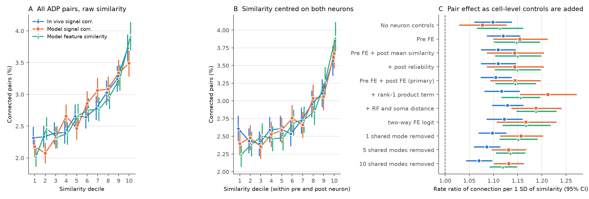
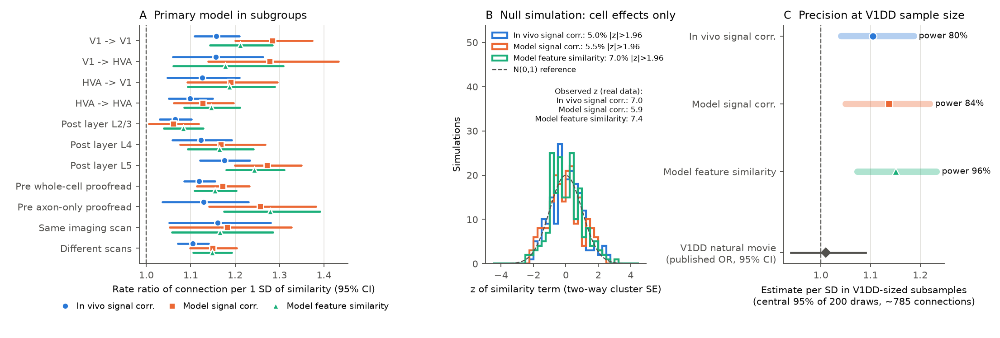

# In the MICrONS mouse, response similarity predicts connection after fixed effects for both neurons; the like-to-like rule is not only a cell-level effect

## Summary

Question. Mouse visual cortex neurons with similar responses connect more often than
axon–dendrite proximity predicts (the "like-to-like" rule; Ding et al. 2025). A cell-level
property can make a pairwise rule look true. For example, a postsynaptic cell that is similar
to many cells and also receives many inputs gives this result. An earlier publication in this
campaign (V1 Deep Dive, one mouse; sci:sha256:a932e167…) found that a covariate for the mean
similarity of the postsynaptic cell removed the pair-level effect. We tested if the
like-to-like rule stays when we remove all additive effects of the presynaptic and the
postsynaptic neuron. We used the MICrONS mouse, which is a different animal.

Data. Public node and edge tables of the MICrONS functional connectomics study (Ding et al.
2025, v1). We used all pairs that have axon–dendrite proximity (ADP > 0): 295,371 ordered
pairs, 148 proofread presynaptic neurons, 11,035 postsynaptic neurons with responses, and
8,128 connected pairs. The areas are V1 and the higher visual areas (HVA) RL, AL and LM.

Similarity measures (3, set before analysis).

1. In vivo signal correlation: correlation of trial-mean calcium responses to the same natural
   movie clips (120 bins).
2. Model (in silico) signal correlation: correlation of digital-twin responses to 4,999 natural
   movie stimuli.
3. Model feature-weight similarity: cosine of the digital-twin readout weights.

We recomputed all three measures from the node table. They agree with the published edge
values to within 6e-7.

Primary model (set before analysis). Poisson regression of connection (0/1) on one
standardized similarity measure. Covariates: log axon length and log dendrite length of the
ADP measure, with squared terms. The model has a fixed effect for each presynaptic neuron and
a fixed effect for each postsynaptic neuron (two-way FE). Standard errors are clustered by both
neurons. Holm correction over the 3 measures.

Main results.

- All three measures predict connection after two-way FE. Rate ratios per SD (95% CI):
  in vivo 1.105 (1.074–1.136), model signal 1.144 (1.094–1.197), model feature 1.145
  (1.104–1.187). Holm p < 1e-8 for each measure (Figure 1C).
- Two-way centred similarity shows a monotone relation. The connection rate is 2.2–2.6% in
  the lowest decile and 3.6–3.9% in the highest decile (Figure 1B).
- The V1DD-type control does not remove the effect. With presynaptic FE, the in vivo rate
  ratio is 1.120 without and 1.109 with the mean similarity of the postsynaptic cell.
- The effect is not caused by one shared population mode. The effect stays when we add a
  rank-1 product term and when we remove the top 1, 2, 5 or 10 shared response modes before we
  compute the similarity (rate ratios 1.07–1.16).
- The effect occurs in all 4 projection classes (V1→V1, V1→HVA, HVA→V1, HVA→HVA), for all
  3 postsynaptic layers, for whole-cell and axon-only proofread presynaptic neurons, and for
  pairs that were imaged in different scans. It is smallest for L2/3 postsynaptic cells
  (1.06–1.08) and largest for L5 cells (1.18–1.27) (Figure 2A).
- Calibration. In 200 simulations with only cell effects and proximity, the test gave
  |z| > 1.96 in 5.0%, 5.5% and 7.0% of draws. The real z values are 7.0, 5.9 and 7.4
  (Figure 2B). A cluster bootstrap over presynaptic neurons gave the same intervals
  (in vivo 1.075–1.133).
- Cell-level effect. Postsynaptic cells with a higher mean signal similarity to all neurons
  receive more connections than proximity predicts (rate ratio 1.07 per SD for both signal
  correlations; 1.00 for feature similarity). This agrees in direction with the V1DD result.
  Model reliability of the postsynaptic cell does not predict connection (rate ratio 1.00–1.01).
  Thus a cell-level effect and a pair-specific effect both occur in this mouse.
- Comparison with V1DD. In random MICrONS subsamples of V1DD size (about 785 connected
  pairs), the V1DD-type model detected the in vivo effect in 80% of draws (84% and 96% for the
  model measures). No subsample gave an upper 95% limit at or below the V1DD upper limit (1.09).
  The V1DD natural-movie estimate (OR 1.01, 0.94–1.09) is lower than the MICrONS estimate
  (difference z = 2.29, p = 0.022). The two studies use different similarity estimates and
  covariates. Thus this comparison does not identify the cause of the difference (Figure 2C).

Interpretation. In the MICrONS mouse, the like-to-like rule is a pair-level property. Fixed
effects for each neuron, a rank-1 population term and residual similarity do not remove it.
The pair effect is moderate: about 10–15% more connections per SD of similarity. The earlier
V1DD null result for pair-specific similarity is most likely a difference in measurement or
power, or a difference between animals. It is not evidence that the rule is generally only a
cell-level effect. The two data sets agree that postsynaptic cells with more population-like
responses receive more local input.

## Figures

Figure 1. A: Connection rate by decile of raw similarity in all ADP pairs. B: Connection rate
by decile of similarity after we centre the similarity on the presynaptic and the postsynaptic
neuron (alternating demeaning). Panels A and B do not adjust for proximity. Error bars: 95%
binomial intervals. C: Rate ratio per SD of similarity (95% CI) as cell-level controls are
added. "Primary" is the pre-specified test. The lower rows use residual similarity after we
remove 1, 5 or 10 shared response modes.

Figure 2. A: Primary model in subgroups. B: z values of the similarity term in 200 simulations
with only neuron fixed effects and proximity (no similarity effect). The dashed line is N(0,1).
C: Distribution of the V1DD-type estimate (presynaptic FE + mean postsynaptic similarity) in
200 random MICrONS subsamples with about 785 connected pairs, and the published V1DD
natural-movie odds ratio.

## Data

| Item | Value |
|---|---|
| Animal | MICrONS mouse (one animal, ID 17797 in the functional data) |
| Source | Ding et al. (2025) node and edge tables, v1, BossDB open data |
| Neurons with responses | 12,894 |
| Presynaptic neurons | 148 (84 whole-cell proofread, 64 axon-only proofread) |
| Analysed pairs | 295,371 ordered pairs with ADP > 0 (edge-table groups "Connected" and "ADP") |
| Connected pairs | 8,128 (2.75%); 741 with more than one synapse |
| Pairs used by two-way FE | 163,870 (postsynaptic neurons with at least one connection; others have no information under a postsynaptic FE) |
| Pairs in the same imaging scan | 8.2% of all pairs |

URLs, sizes and SHA-256 values are in `files/PROVENANCE.md`.

## Methods

Build (`code/build_table.py`).

- We converted each response vector to a unit vector. The two signal correlations use centred
  vectors. The feature similarity uses the flattened 4×128 readout weights without centring.
  The dot products reproduce the published edge values.
- Population similarity of a neuron: its mean similarity to all other 12,893 neurons.
- Shared modes: the top right singular vectors of the 12,894-neuron response matrix. Residual
  similarity after r modes: (s_ab − p_a·p_b) / sqrt((1 − |p_a|²)(1 − |p_b|²)), where p is the
  projection on the top r modes. The first mode holds 6.5% (in vivo), 6.9% (model signal) and
  3.9% (feature) of the variance.
- Rank-1 product term: product of the loadings of the two neurons on the first mode.

Models (`code/analyze.py`). We used pyfixest 0.60 `fepois`. All models include log axon length,
log dendrite length and their squares. Model ladder:

| Model | Neuron controls |
|---|---|
| A0 | none |
| A | presynaptic FE (similar to Ding et al.) |
| B | presynaptic FE + mean similarity of the postsynaptic cell (similar to V1DD) |
| B2 | B + postsynaptic model reliability (cc_abs) |
| C (primary) | presynaptic FE + postsynaptic FE |
| D | C + rank-1 product term |
| E | C + receptive-field distance + log soma distance |
| C logit | C with a logistic link |
| C res r | C with residual similarity after r = 1, 2, 5, 10 modes |
| C joint | C with all 3 measures together |

Cell-level models: connection on the mean similarity of the postsynaptic cell and its
reliability, with presynaptic FE; the same for the presynaptic cell, with postsynaptic FE.

Robustness (`code/robustness.py`).

- Bootstrap: 200 draws of presynaptic neurons with replacement. Each drawn copy has its own FE.
- Null simulation: we fitted model C without similarity, drew connections from the fitted
  probabilities, and fitted model C again (200 draws, 3 measures).
- Power at V1DD size: 200 random samples of 28,527 ADP pairs (713–860 connected pairs). We
  fitted model B and model C. Model C failed in 75 of 200 small samples (too few postsynaptic
  cells with both outcomes), so Figure 2C shows only model B, which is the V1DD-type model.

## Results tables

Primary and ladder results (rate ratio per SD, 95% CI; full table: `files/results/model_results.csv`):

| Model | In vivo signal corr. | Model signal corr. | Model feature sim. |
|---|---|---|---|
| A0 none | 1.099 (1.061–1.137) | 1.077 (1.030–1.126) | 1.113 (1.067–1.161) |
| A pre FE | 1.120 (1.087–1.154) | 1.155 (1.100–1.211) | 1.148 (1.102–1.195) |
| B pre FE + post mean sim. | 1.109 (1.075–1.145) | 1.144 (1.087–1.203) | 1.150 (1.104–1.197) |
| C pre FE + post FE (primary) | 1.105 (1.074–1.136) | 1.144 (1.094–1.197) | 1.145 (1.104–1.187) |
| D C + rank-1 product | 1.117 (1.082–1.153) | 1.212 (1.156–1.271) | 1.156 (1.118–1.196) |
| E C + RF and soma distance | 1.129 (1.098–1.161) | 1.188 (1.138–1.240) | 1.188 (1.148–1.229) |
| C logit | 1.122 (1.086–1.159) | 1.167 (1.108–1.229) | 1.167 (1.120–1.217) |
| C, 10 modes removed | 1.070 (1.044–1.096) | 1.132 (1.102–1.162) | 1.120 (1.093–1.147) |
| C joint (all 3) | 1.051 (1.023–1.080) | 1.043 (0.989–1.099) | 1.095 (1.055–1.136) |
| Bootstrap, model C (2.5–97.5%) | 1.075–1.133 | 1.092–1.193 | 1.100–1.188 |

Primary Holm-adjusted p values: 7.3e-12 (in vivo), 3.4e-9 (model signal), 5.3e-13 (feature).

## Limitations

- One animal. The result is for the MICrONS mouse only. The V1DD result is for a second mouse.
  The two studies differ in similarity estimates, stimuli, proximity measures, covariates and
  layers. Our comparison cannot separate a difference between animals from a difference in
  methods.
- Two of the three measures come from a digital-twin model. Model errors that depend on the
  neuron are removed by the FE, but errors that depend on the pair are not.
- In vivo signal correlations use trial-mean responses to about 10 repeats. Most pairs (92%)
  are in different scans, so shared trial noise cannot cause the effect in those pairs. The
  effect in different-scan pairs is 1.105 (1.071–1.140).
- The fixed effects remove additive effects of each neuron on the log rate. They do not remove
  all interactions between two cell-level properties. The rank-1 product term and the mode
  removal test only the main forms of such interactions.
- ADP is the proximity measure of the published table. Residual confounding by finer geometry
  (for example, the dendritic compartment) is possible. The added receptive-field distance and
  soma distance increase the effect.
- The presynaptic sample (148 neurons) is selected for proofreading. Most presynaptic neurons
  are in L2/3 of V1, RL and AL. The 64 axon-only neurons come from HVAs.
- The cell-level analysis uses mean signal similarity, not the activity-based population
  coupling of V1DD (Okun et al. 2015). The two cell-level results are therefore related but
  not equal tests.
- The size of the effect is moderate (about 10–15% per SD). Similarity does not predict
  individual connections well.

## Reproduce

1. Get the two input files (see `files/PROVENANCE.md`) and check the SHA-256 values.
2. Make an environment: `uv venv .venv --python 3.12 && uv pip install --python .venv/bin/python numpy pandas pyarrow scipy matplotlib pyfixest==0.60.0`.
3. Copy `files/code` to a work folder as `code/`. Run
   `EDGE=/path/edge_data_v1.pkl NODE=/path/node_data_v1.pkl PY=.venv/bin/python bash code/run_all.sh`.
   The build and model steps take about 5 minutes with one thread and less than 3 GB of memory.
   The three robustness runs take about 50 minutes each.
4. Results go to `out/results`, figures to `out/figs`. Bootstrap, null simulation and
   subsample results use the fixed seed 20261108. The numbers in this README come from
   `files/results`.

## Provenance

Campaign 11_07_2026, job sci-1107-dell-neural-structure-and-computation-ca1abaadef86, topic
neural-structure-and-computation, machine dell, model Claude Opus 5.5 (claude-opus-5-5). The
signature is from a campaign-machine key. It is not a personal authorship claim. See
`files/PROVENANCE.md` for data sources and hashes.
